# 【剑桥大学-•-中英】分布式系统讲座-p18-P18-Distributed-Systems-6.2---Raft--BV1NwQhYeEyV_p18-

Now in this section I'm going to walk you through the entire raft consensus algorithm for performing total order broadcast Now I'm going to warn you it's a rather complex algorithm。

 It's by far the most complex algorithm we will see in this course it takes nine slides of pseudocode to explain the whole algorithm and I'm not expecting you to memorize it all what I would like you to do though is to carefully understood and understand exactly how and why the algorithm works because I find that the principles of how the raft algorithm works are really instructive for thinking about state in a distributed system more generally。

Okay so let's start the core of the raft algorithm is a state machine where every node can be more in one of three states。

 either a follower， a candidate or a leader， and it can all the state is always in a certain term so there's always a certain term number and a node can be the leader in a particular term when a node starts off starts up for the first time。

 it always goes into the follower state and also if a node crashes and recovers and then when the node restarts and recovers from the crash。

 it always goes back into the follower state regardless of which state it was in before the crash。

However， all of the node start as followers， eventually we need some node to become the leader and the way how a node becomes the leader is by first becoming a candidate。

 and so when a node detects that there has been no message from a leader for some amount of time a timeout eappses and then a node will decide that okay it is going to stand as candidate in a particular term number and it within that term number it's going to try to get votes from the other nodes and if it manages to get a positive votes from a quorum of nodes in the system from a majority。

 then it is able to transition into the leader state。 however。

 it could also happen that in the process of this election。

 the candidate discovers that there's a different node with a higher term number and if it does so then the candidate immediately steps back becomes follower again and works with with the node that has the higher term number。

 So a higher term number or text precedence。It could also happen while a node is in a candidate state it's doing the election。

 but maybe it's not able to communicate with a quorum of replicas right now or a quorum of nodes and so it timess out so it simply doesn't receive a quorum of positive votes within the required time and if so it will restart its election again with a higher time term number。

 so it remains candidate and starts again with a higher term number。

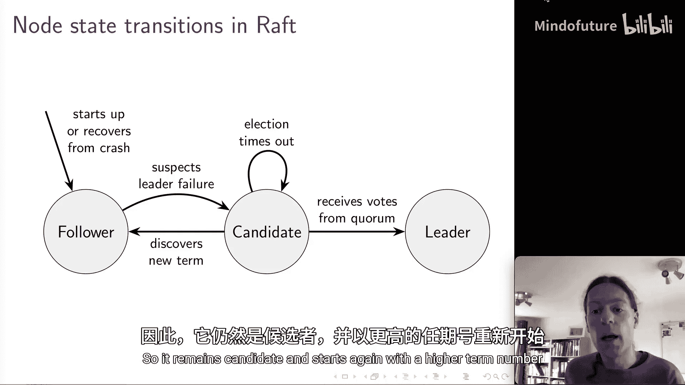

Likewise， it could happen if the leader is is just doing its leadering job。

 it might discover that there's a node with a higher term number perhaps the system has been partitioned so that some subset of nodes have elected a new leader with a higher term number in the meantime。

 And if so， the leader will always step back and become a follower again immediately upon discovering some other node with a higher term number。

 So we always have a very peaceful transition of power in the raft algorithm from the lower term number to the higher term number。

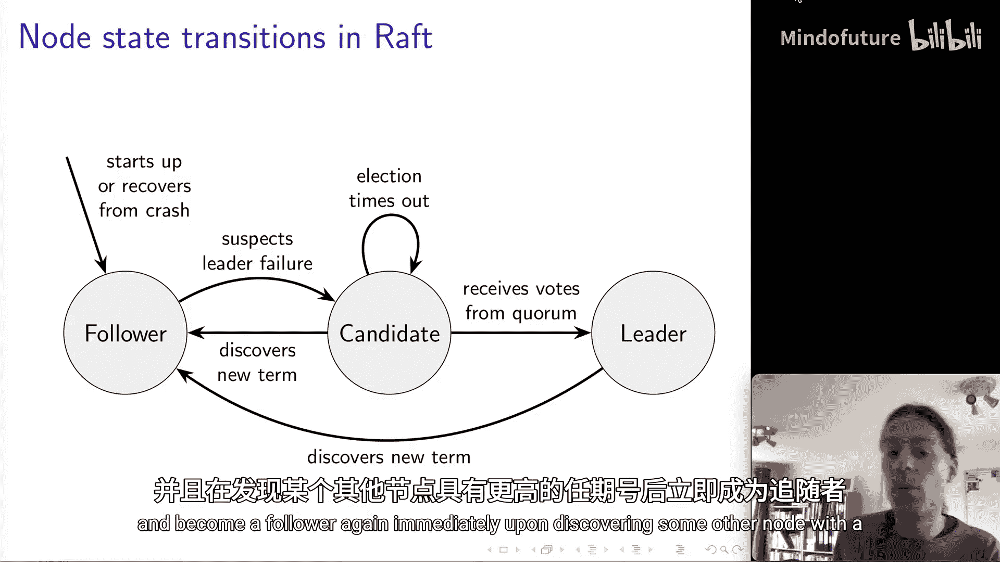

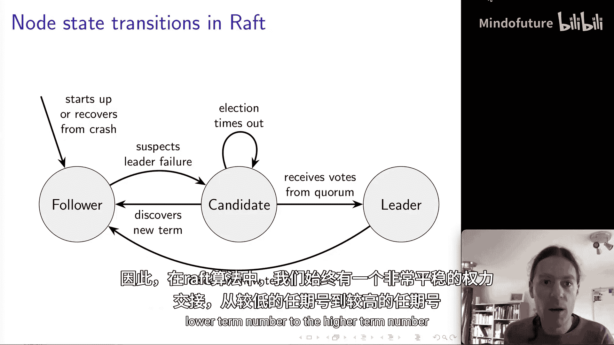

So let's run through the actual code。 And so here we start off with the usual initialization of variables。

 I'm not going to explain every single variable right now。

 but I will explain the variables as we used them as part of the algorithm。

 But I will just point out here the first four variables。

 current term voted for log and commit length。 these four variables have to be stored in stable storage that is on disk whereas the remaining five variables they can be in transient storage they can be lost in the case of a crash。

 but the first four variables have to be preserved in the case of a crash and you can see the crash recovery here。

 So those the five remaining variables simply get reset to new fresh states。

 if we recover from a crash。

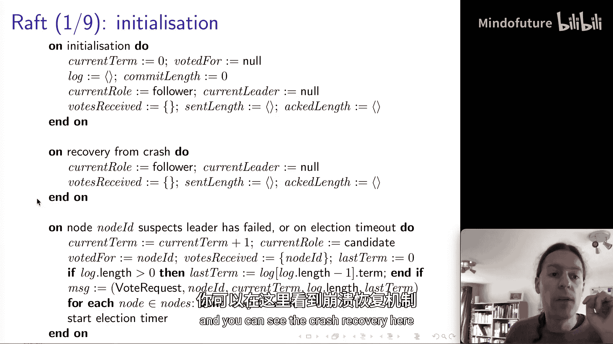

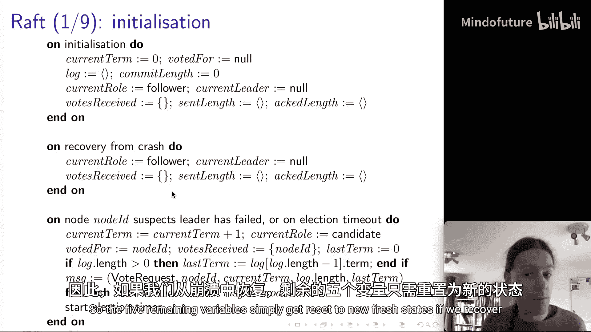

Now， as I said， when a node suspects that the leader has failed。

 it will become a candidate and it will start an election。 That's what happens here。 By the way。

 typically this timeout that that the node uses before it suspects a leader to have failed is randomized and the purpose for that is to avoid having lots of nodes all trying to become candidate at the same time。

 which is what would happen if all the nodes start up at the same time and then have the same time out before before they start an election。

 So randomizing the timeout reduces the probability of having several elections at the same time。

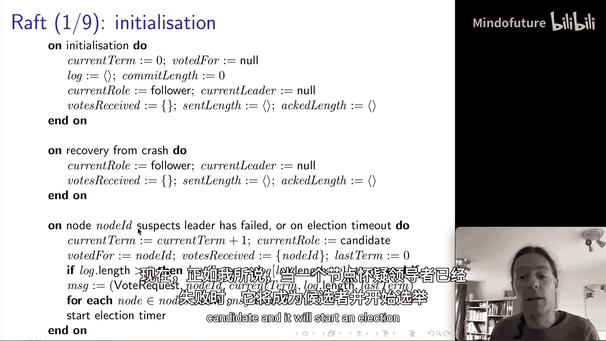

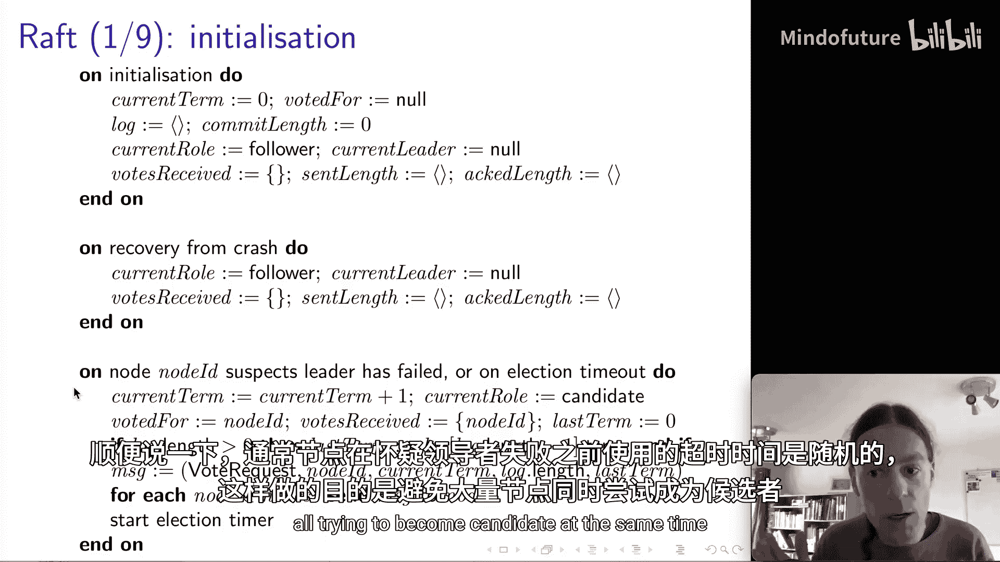

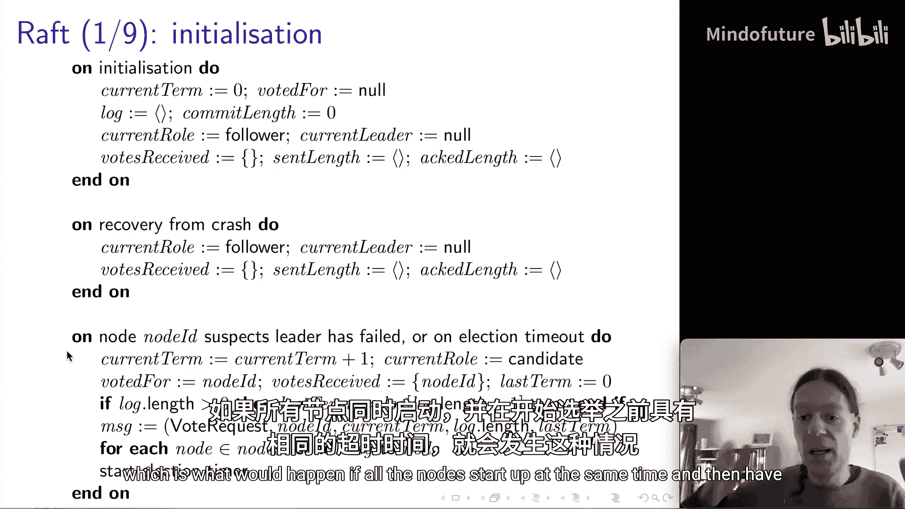

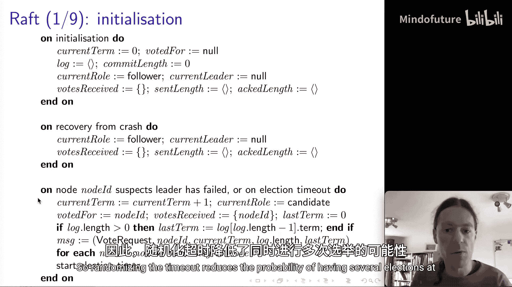

So whenever that happens now， so a node decides it's time to start an election。

 it increments the current term。 It sets its current role to be the candidate state。

 and like in every good election， everyone votes for themselves in an election。 So also en raft。

 So the node that has just become a candidate votes for itself by setting this voted for variable to its own node ID and it has this set of node Is in which it records the set of votes that it has received in favor of itself as a candidate and it puts its own node I as the first member of that set of votes received。

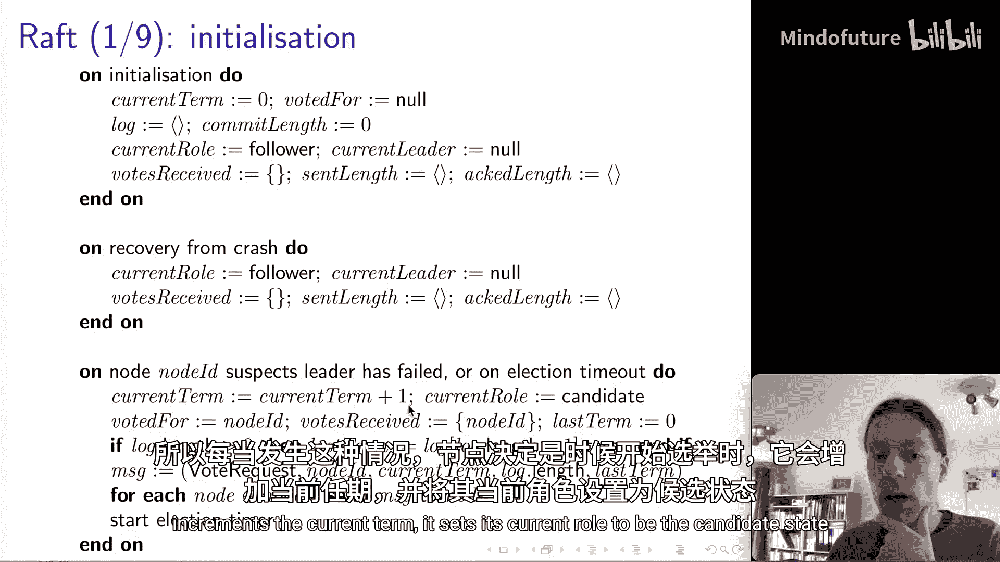

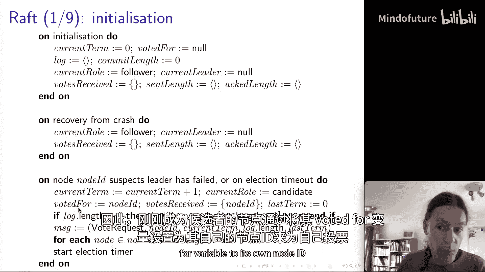

This variable last term is initially zero， but you can see if the length of the log is greater than0。

 then we set this last term variable。 So let me explain first what the log is So the log you can see illustrated up here is an array or a list。

 It's a sequence of log entries。 each log entry consists of two parts。 Firstly a message。

 So this is the message that we want to deliver via total order broadcast。

 That's the whole thing that the purpose of with the algorithm。 and secondly。

 a term number on every log entry。 So this term number is the term number of the leader at the time when that leader added that particular entry to the log and we'll see later why that term number is important。

 but for now just accept that log is this structure here it's zero indexed array where log0 is the first the first log entry。

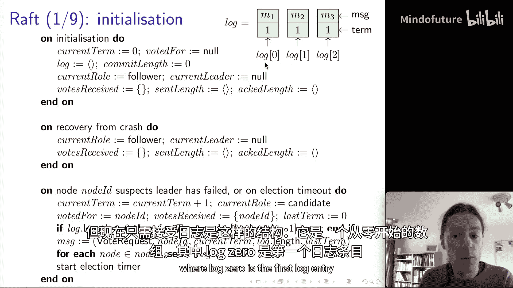

And log dot length is the number of log entries in in the log。 And if the log is non empty here。

 If the log dot length is greater than0， then we're going to say that the last term is the term field of the last log entry。

 So log dot length -1 is the index of the last entry in the log。

 And so we take the term field of that last log entry and set that to be the value of this variable last term。

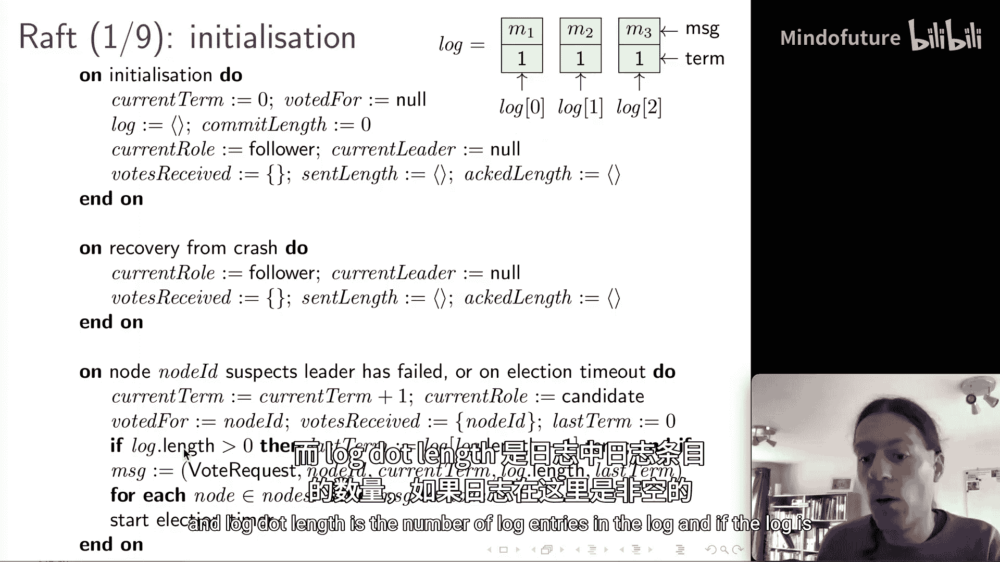

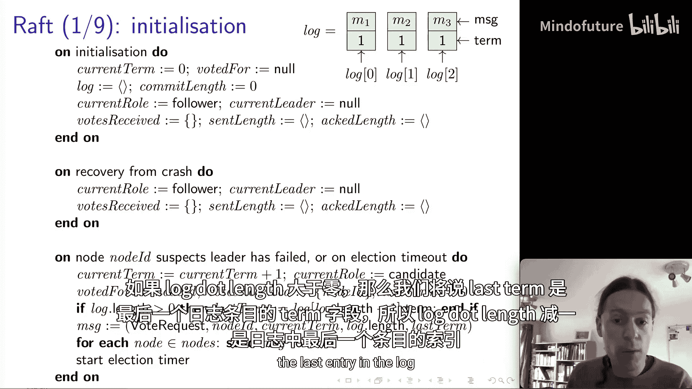

And we then construct a message that will be sent to all of the nodes。

 And so the candidate sends the same message to all of the nodes。

 It's a message tagged with the message type vote request， saying， please vote for me。

 and the message contains the several fields。 It contains the node I D of the candidate。

 It contains the current term after that term number has been incremented。

 It contains the length of the log on the candidate， and it contains this last term variable， which。

 as I just said， is the term field of the last log entry in the candidate log。

 It sends this same message to all of the nodes， and it starts the timer that might eventually time out if it doesn't manage to do the election successfully。

So that's the candidate。 Let's see what happens on the other nodes that receive one of these request messages。

 So now were one of the other nodes that has received a message from the candidate。

 and we have the idea of the candidate。 We have the term number of the candidate the length of the candidates log and the term number in the candidate's last log entry。

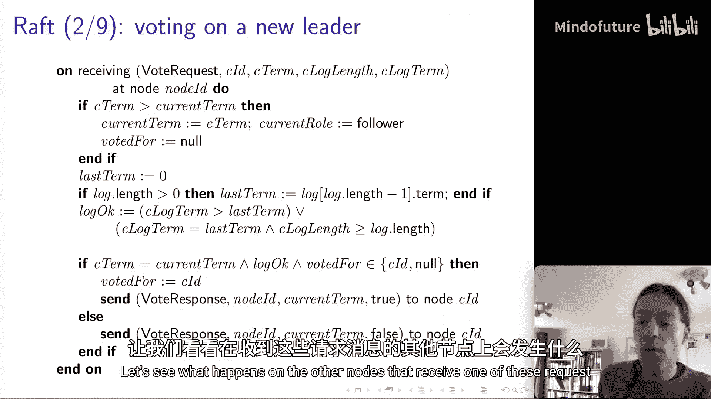

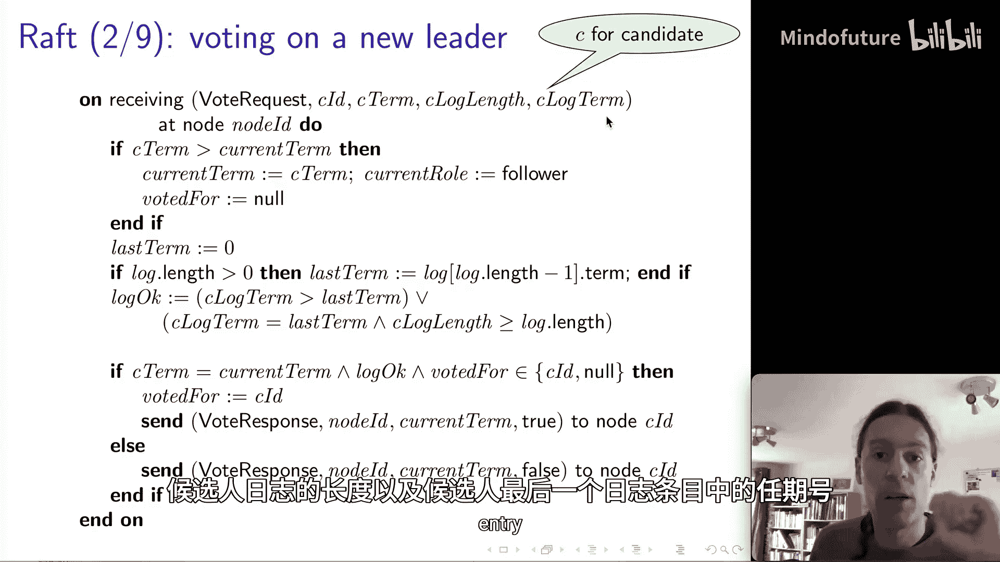

And the first thing we're going to do when receiving a vote request message is to compare the candidate's term to the current term of the recipient of this message and if the candidate's term is greater than the current term of the recipient。

 then we move forward and join the term of the candidate so we do that by setting our setting the recipient's current term to be the candidate's term to transition into the follower state regardless of what the nodes previous state was and this voted for variable gets set to null which means that we have not yet voted for any any candidate in the current term because we just change the current term。

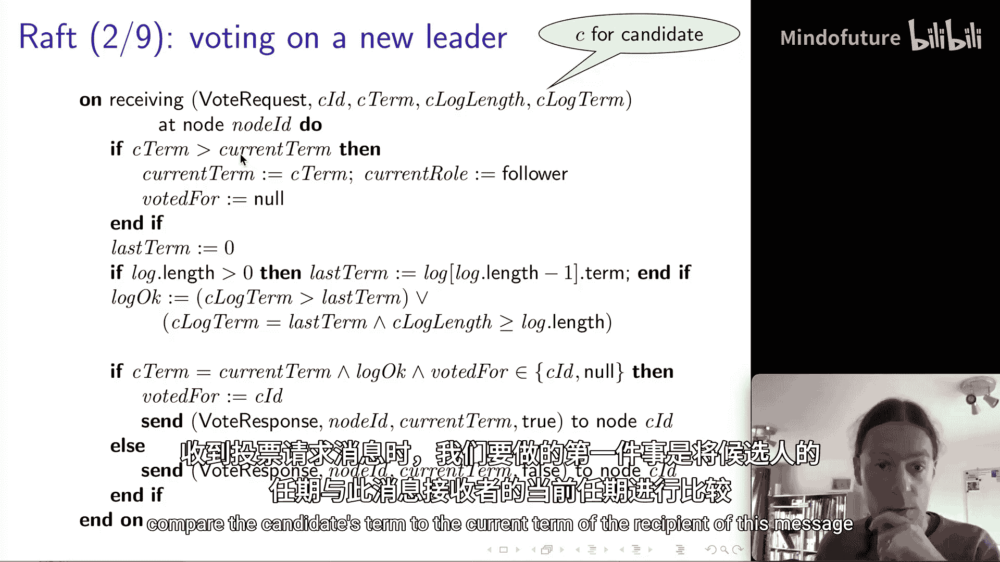

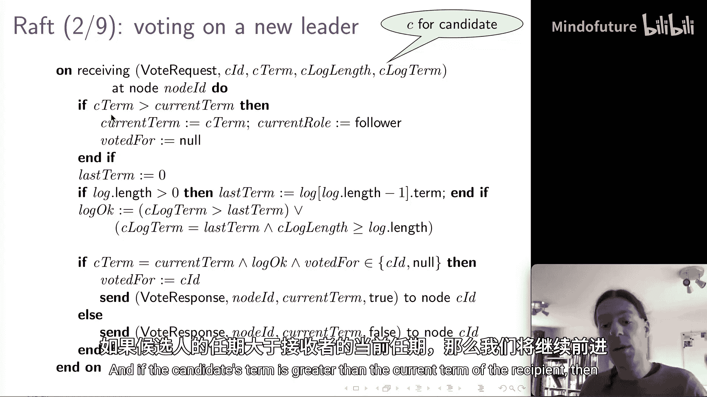

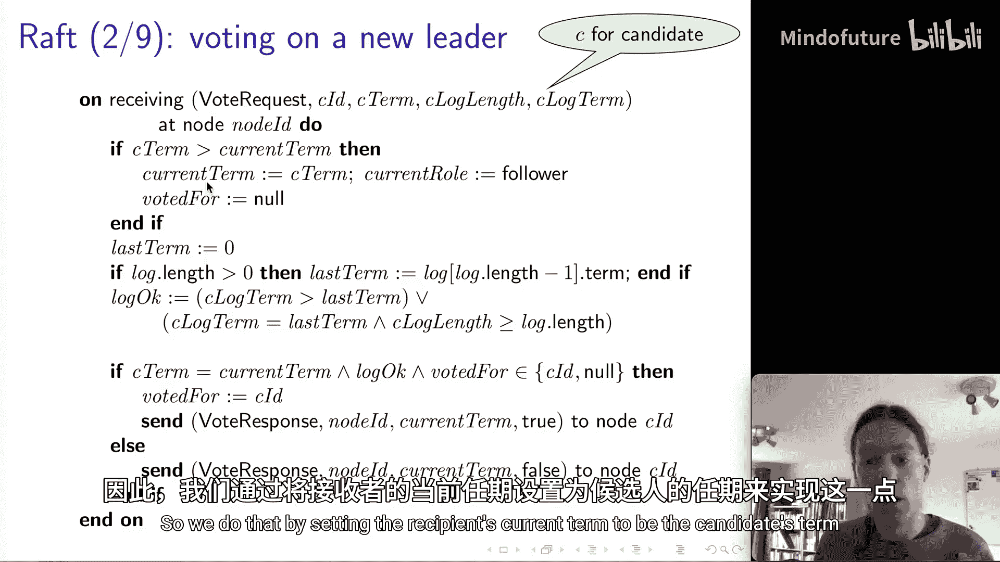

However， we might vote for that candidate in a minute。 So next， we set up this variable last term。

 very similar to the way we did on the candidate。 And that is。

 we look at the last log entry on the recipient of this vote request message。

 we get the term number in that last log entry and we set that to be this last term variable。 Now。

 what we need to do is to check if the candidates log is up to date with our own log。

 The reason for that is that we don't want a candidate with an outdated log to become the leader and。

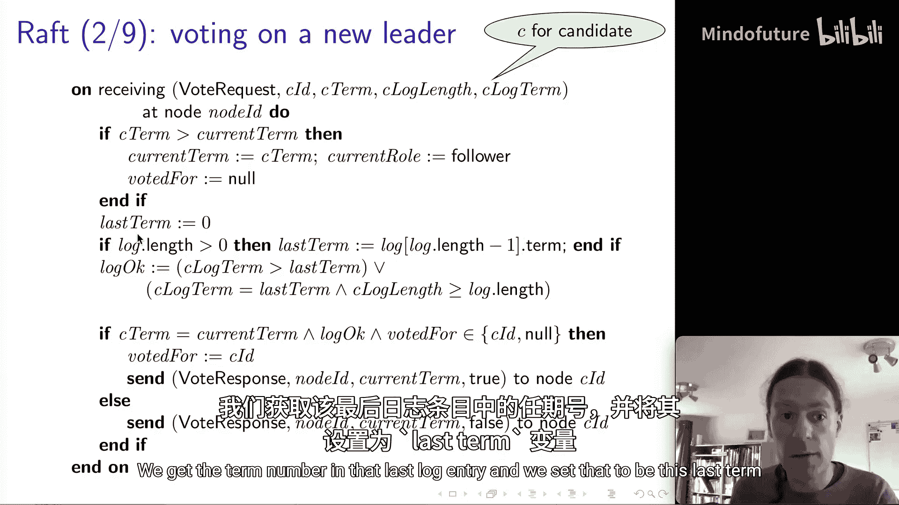

Exactly what outdated means will become apparent later。

 but it's crucial that we want the candidates log to。

 to reflect all the updates that the that the that the other。

 that at least a quorum of other nodes have seen。 So you don't end up with a leader whose log is really outdated。

Because that might lead to the loss of some messages。So we have this log OK variable here。

 which will contain a Boolean which tells us whether we think whether the current node thinks the candidate's log is okay to vote in favor of and so there are two criteria here。

 first of all， if the log term of the candidates that the log entry the term number that appears in the last log entry of the candidate if that term number is greater than the log entry the term number of the log entry on the recipient of this vote request message then we consider the log to be okay。

Secondly， another way for the log to be okay is for the the log terms in the last log entry to be the same。

 but for the candidate to have a log that is at least as long as the log of the recipient of this vote request message。

 So one of those things needs to be true， either or。 and if so， then the log is okay。

So we will now vote for this candidate if three criteria all hold。 firstly。

 if the candidates term equals the current term。 that is， it's not some outdated term。

 we haven't seen any other node with a higher term number。 Secondly。

 if the candidatess log is okay and thirdly， if we have not yet voted for any other node any other candidate in the current term。

 So this voted for variable would be null if we have not yet voted at all for any candidate in the current term。

 or it could be CId if we've already voted for the same candidate。

 It's okay to vote several times for the same candidate in in a single term。

 but we must not vote for two different candidates within the same term。

 So if all those three criteria are true， then we can vote in favor of this candidate。

 we will do that by first setting or voted for variables to C ID to remember the fact that we have voted for the candidate and then we send a vote response message back to the candidate and this is going to contain node ID of the node。

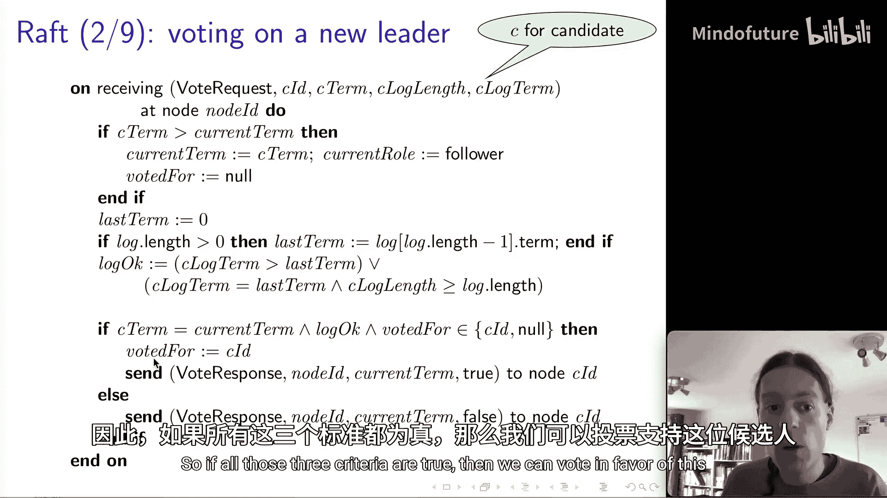

Doing the vote， it's going to contain a current term number。

 So we know which term this election is for and the value true to indicate that it's a a vote approval in favor of this candidate。

On the other hand， if any of those things are not true。

 then we send a vote response with a false field back to the candidate。

 telling it that we are not voting in favor of this candidate。

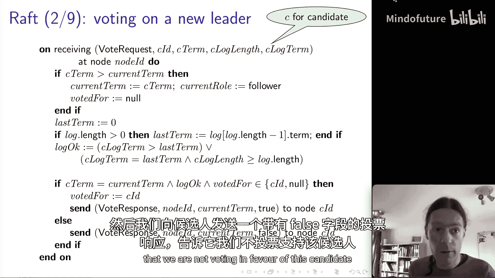

Then now we move back to the candidate and we aggregate， we collect the votes that we receive。

 So any time we receive a voter response message， this is what happens。

 So we have a vote response with the I of the node that is voting with the term number in which the vote is happening and with the Booleyan telling us whether that vote is granted or not。

 And the first thing we do is to check the term number。

 So if the term number in the vote response message is greater than our current term。

 we do the usual thing we we accept that term number as our own we transition into follower state we forget which node we voted for in some previous term and we cancel any election timer。

 So that just moves us back into the follower state in the state machine。However。

 if we are still in the candidate state and if the message that we just received is for the correct term that in which were performing the election and the granted field is true。

 then we have a vote in favor of us as the candidate。

 So we're going to maintain this set of votes received here。

 and we're going to add the idea of the voter to the set of votes we received。

 Notice that this update here is idpot。 So even if this vote response message gets duplicated in the network somewhere。

 that's not a problem， we're not going to count the same vote more than once。

 were still require votes from a quorum of different nodes。

So then to determine whether we have a quorum yet， we can check the cardinality of this set votes received。

 and if the number of votes we received is greater than equal to a majority。

 that is the number of nodes in the system plus one divided by two round upwards。

 then then we have a quorum， a majority quorum of nodes。

 and in that point we can become the leader hra。So we transition to leader state， the current leader。

 well that's ourselves。 Now we can cancel the election timer as well。

 and now we need to send a message to all of the nodes， which are now the followers to tell them。

 hey， with we're your new leader Im your new leader and give it a bit of information。

 So this replicate log function here is going to do the actual sending of that message and we will see that that function in a minute。

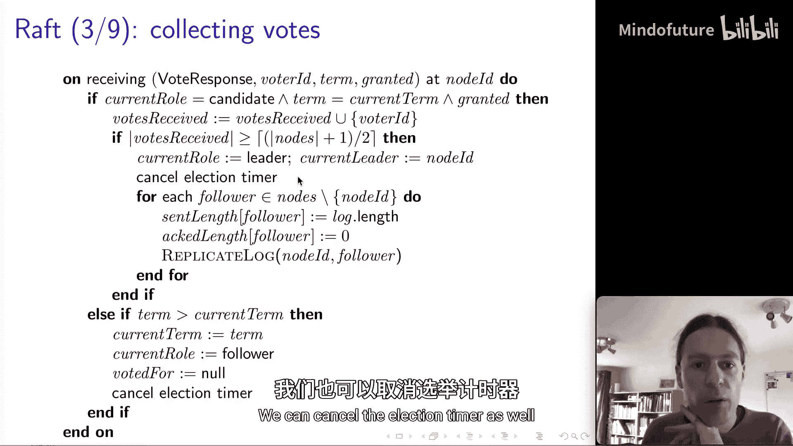

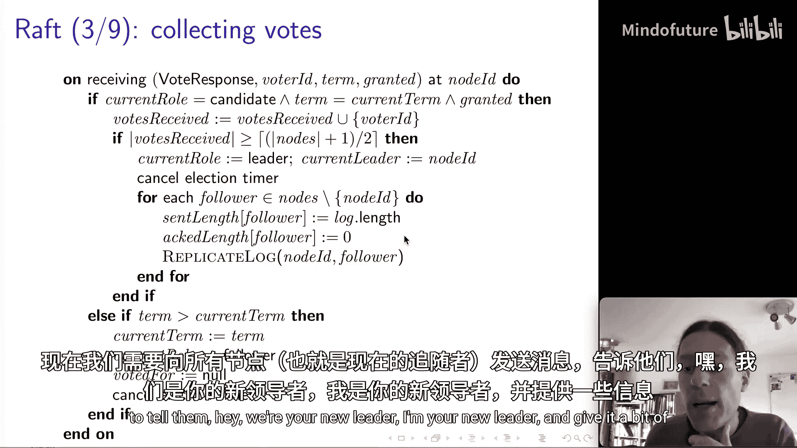

We also need to set up for all of the followers some variables。

These variables here sent length and act length are maps from node ID to an integer and so for each of the follower nodes we're going to initialize these variables here。

 the sent length is going to be initialized with the length of the log on the leader。

And the meaning of sent length is the number of log records that we have already sent to a particular node。

 So here we are assuming that the follower has already received all of the log entries from us。

 if that is not the case， we will correct that later through a process that we will see later。

Secondly， act length is the number of log entries counted from the beginning that the that this particular follow acknowledged as having received。

 and we initialised that to be zero。 and later as we receive acknowledgements。

 we will increase that number。Okay， so that's all we have to do to become a leader。

 Now that we have a leader， we can actually start talking about the total order broadcast， so。

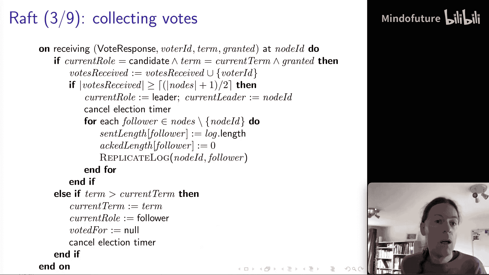

What we have here is now a functioner can be called by a client， for example， to say， okay。

 we want to broadcast a message and we want to do that via total order broadcast。

 ensuring that all nodes delivered that the messages in the same order。 Now。

 the order in which those messages are going to be delivered is， in fact， exactly the log。

 That's the whole purpose of the log。And the only node that can add entries to the log is the leader。

 And so first of all， the first thing we have to do is if the request to broadcast a message happens not on the leader。

 then it has to be forwarded to the current leader via a PIO link using a PIO link here just ensures that in total we actually get PIO total order broadcast。

 not just total order broadcast that's the only thing we need to do in order to ensure the PIO aspect。

嗯。If the current node is the leader and we may have just received one of those forwarded requests to broadcast a message。

 well， the first thing we do is we append a record to the log containing the message that we want to broadcast and containing the current term number of the leader。

We also note that the leader itself has acknowledged the delivery of this message。

 that's just another instance of voting for ourselves。

 so note idea here is the idea of the leader and so we're just updating this act length variable to include the newly appended record。

And now we call again this replicate log function that we already had on the last slide for each of the followers all of the nodes in the system apart from the leader。

Moreover， we also call this replicate log function periodically。 So the leader。

 even if it doesn't have any new messages appended to the log lately。

 it's still called replicate log for each of the followers periodically。

 and that has several purposes。 One is to act as a kind of heartbeat。

 So it's calling replicate log sends a message to the followers。

 to is telling them that the leader is still alive so they don't need to start a new leader election。

 Everything is fine。

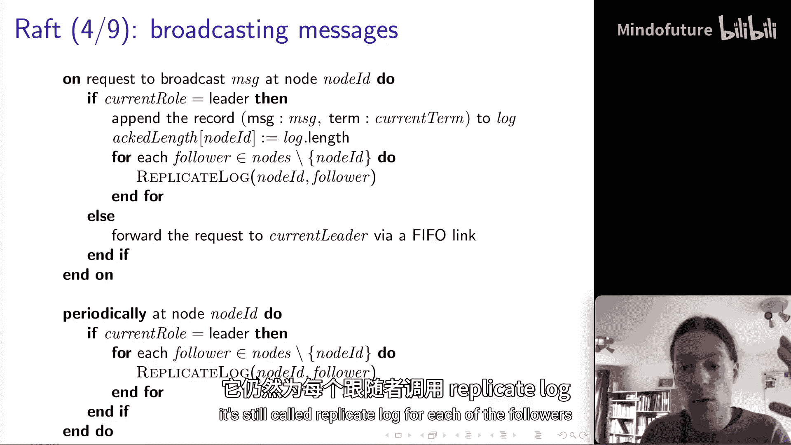

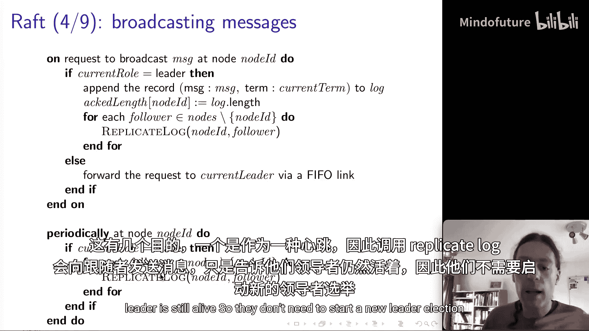

嗯。This calling replicate log also ensures that if any messages got lost， for example。

 then they will get redelivered， and it ensures that if the leader has committed any log entries。

 then then they will also be committed on the followers the process for committing will be we will see later。

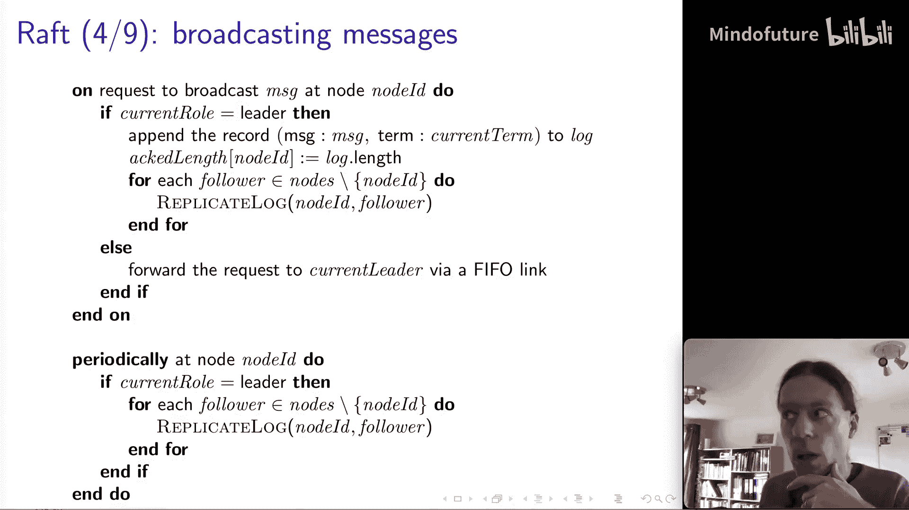

So let's have a look at this replicate log function that we've just seen called three times。

 So this replicate log function gets called， first of all。

 with the node ID of the leader and the node ID of the follower。

And we have access to all of the variables from before。 So first of all。

 we are going to now split the log on the leader into a prefix and a suffix。

 The prefix will contain all of the log entries that we think we have already sent to the follower and the suffix will contain all of the new log entries that we think we have not yet sent to this particular follower。

 And so we have this variable sent length here， which records for every node Id。

The number of log entries that we think we have already sent there。

 And so this prefix length is just an integer now， and now I'm going to take the suffix of the log。

 which is starting at the index prefix length and going all the way up to the end of the log。

 So all of the remaining log entries after prefix length。

 it could happen that that prefix length is indeed the length of the entire log。

 in which case the suffix would just be an empty array。Next， we set up this variable term。

 the prefix term。 and that is now going to be。Looking at the log entries。

 we're going to look at the last log entry within the prefix and look at the term number of that log entry so this is a bit similar to what we have previously in in the vote request message in this case what we're looking at is not the last log entry in the log altogether but the last log entry in the prefix and getting the term number of that。

And we're now going to send a log request with all of these various variables to the follower。

 So we're going to indicate in the variable in this message we're going to include the ID of the leader。

 the term number in which it's a leader， the length of the prefix that we are not sending the term number of the last log entry in the prefix。

 the commit length， which is the variable that we will see later that' just another integer。

 and then suffix， which is this array of new log entries that we want to add to the log。

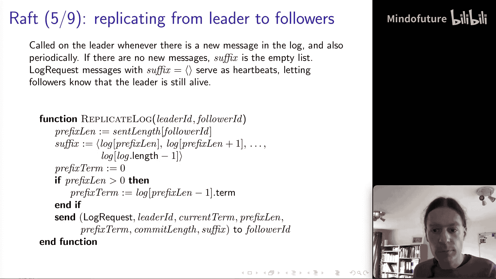

Okay， so that was how we send a log request。 Now， we're on the followers and we will see how to receive one of these log request messages。

 So we've got all of the variables that I just mentioned。And the first thing we need to do。

 as always， is to check the term number。 And so if the term number in the message is greater than the term number on the follower。

Then we are going to do the usual state machine thing。 We're going to accept the current term。

 We're going to forget what what candidate we voted for in the previous term。

 we're going to cancel election timer， and we will also fall through to this second if condition where we set the current role to be follower。

 and we accept the current leader as being the descender of this log request message。

So we fall through to this second case because here we update current term to equals term and so it still equals current term here in the second condition。

 The second condition is also here because it could happen that the node receiving the log request is actually a candidate in the same term number as the leader and in that case we also want to move into follower state。

 even though we're not changing the term number， but we still want to accept the leader as the centerer of of this log request message as the leader。

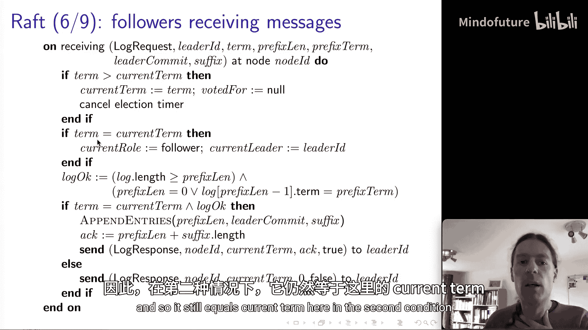

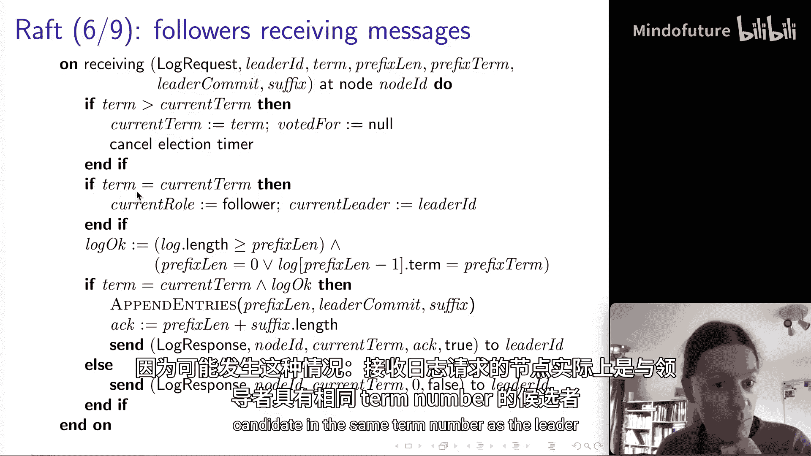

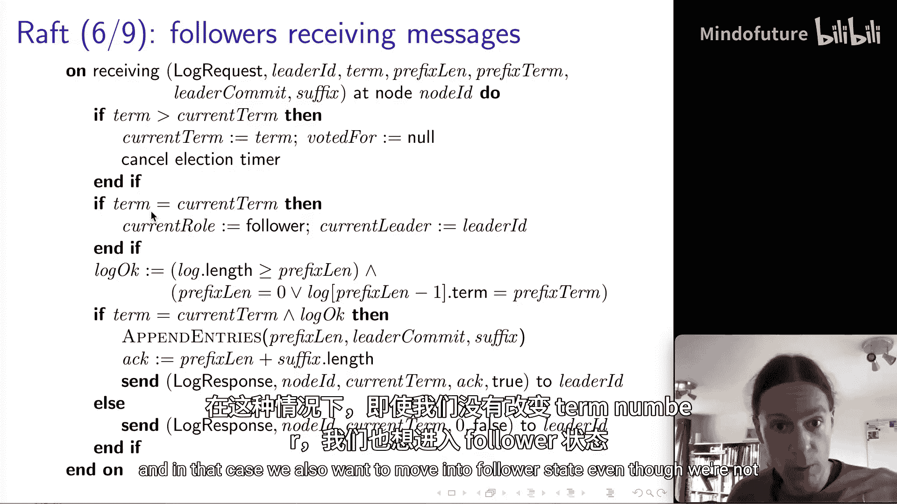

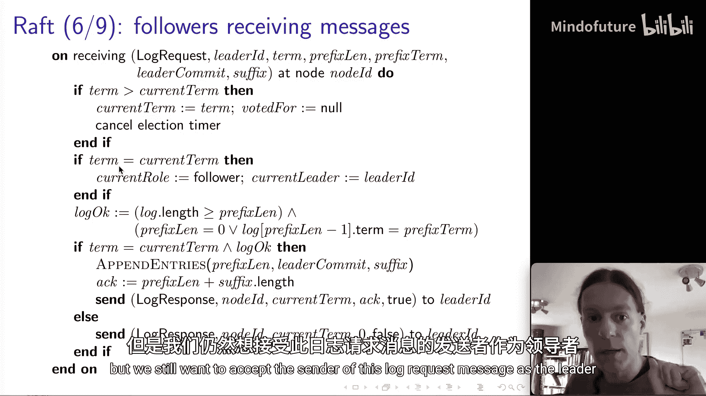

Okay， next thing we need to do is do another check if the log is okay。

 This is a bit similar to what happened earlier during the leader election。

 but the condition is a little different。 So here what we first of all want to ensure is remember we said in on the previous slide we split the log into a prefix that we are not sending。

 which we assume the recipient already has and the suffix which contains the new log entries。 Well。

 first of all， we have to check that that prefix we actually do have as as the sender of the message thought we might do。

 So first of all， we have to check that the followerss length of the log is at least as long as the prefix that we left out on the sender。

 So if this is not the case that means there would be a gap in the log where there's some log entries that the sender didn't send us the leader didn't send us but we also don't have on a follower。

 And so in that case the log would not be okay。 we have to fill in that gap first。

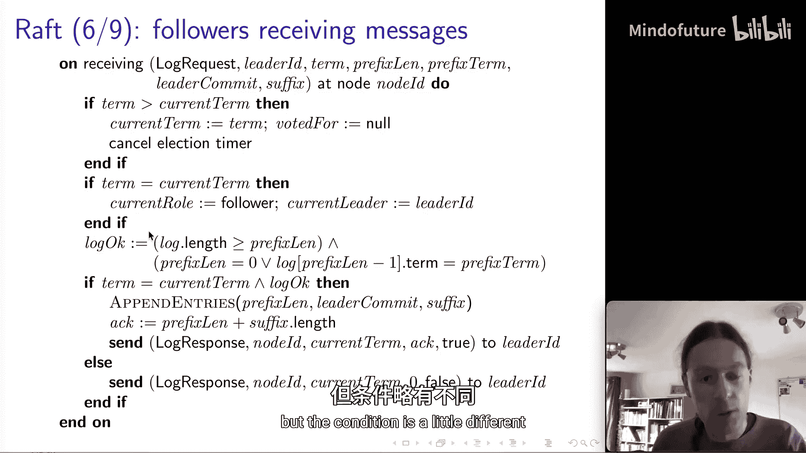

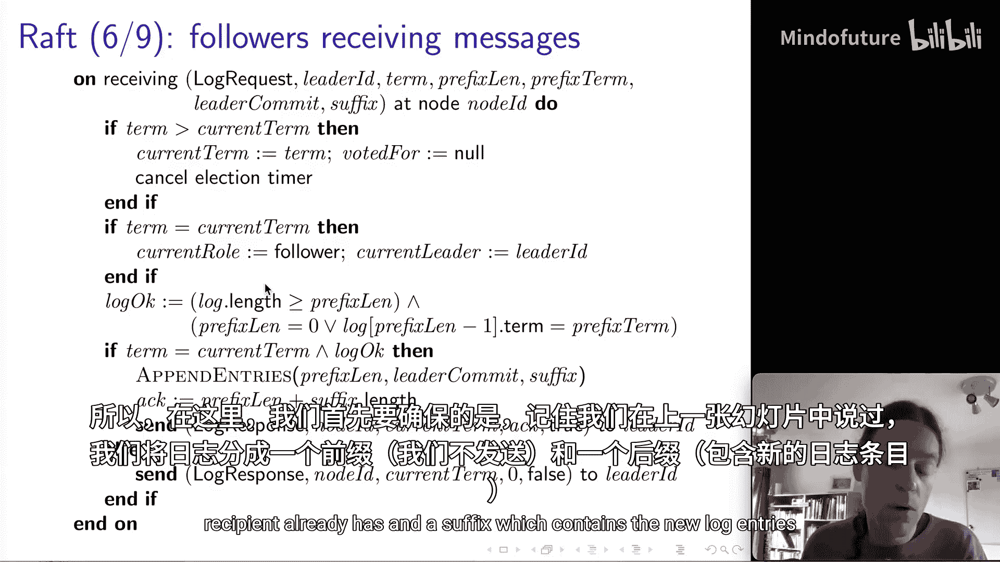

The second requirement is either the length of the prefix is0 or if the prefix length is not0。

 then we have to look at the last log entry in the prefix on the follower。

 Look at its term number and we want that term number to be equal to the the corresponding log entries term number on the leader。

 This prefix term is just a variable that was sent as part of the message。

 So the purpose for this is raft has a certain invariant that it guarantees。

 and that is if there are two nodes in the system。That have a certain log。

 And that at a certain index of the log， they have the same log entry。 in particular。

 they have the same term number in that log entry。Then Raph will guarantee that the entire log up to and including that index will be identical。

 So the term number in the log entries actually allows us to tell efficiently whether two nodes have the same log or not because the only way that two nodes could end up with different logs is by having different term numbers on a certain log entry and so what this here now guarantees is that if this log okay condition is true。

 that means that the prefix of the log as it was on the leader is identical to the prefix of the log of the same length as it is on the follower So this log okay condition checks that actually up to that point。

 the logs are identical this is absolutely crucial for ensuring that actually all of the nodes end up with the same messages delivered。

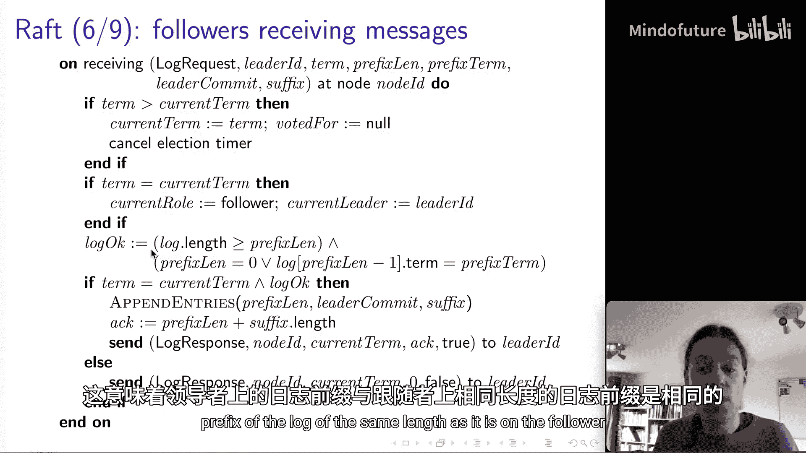

Now， if this log is okay， and if the message was for the correct term。

 then we can go ahead and process the new log entries that were in this log request message and the way we're going to do this is we're going to call the append entries function that I will show you in a minute。

And we're going to pass it the suffix， the new log entries。 And there are a few other variables。

And we're going to also send an acknowledgement back to the leader saying， hey。

 we received your log entries。 It's all fine。 And this acknowledgement is going to be just another integer。

 and it's going to be the integers telling how many log entries from the start of the log that we have successfully received from the leader and that is going to be the length of the prefix that was not sent plus the number of log entries in the suffix that was sent So that's the total number of log entries that we have from the leader after processing this message。

 and this integer we're just going to pack into a message。

 So we're going to make a log response message that we sent back to the leader it's going to contain the I of the send of the log message。

 the current term number as always the actor that I just explained and true to indicate that this is was successfully。

 So the follow was successfully able to process this log request message。

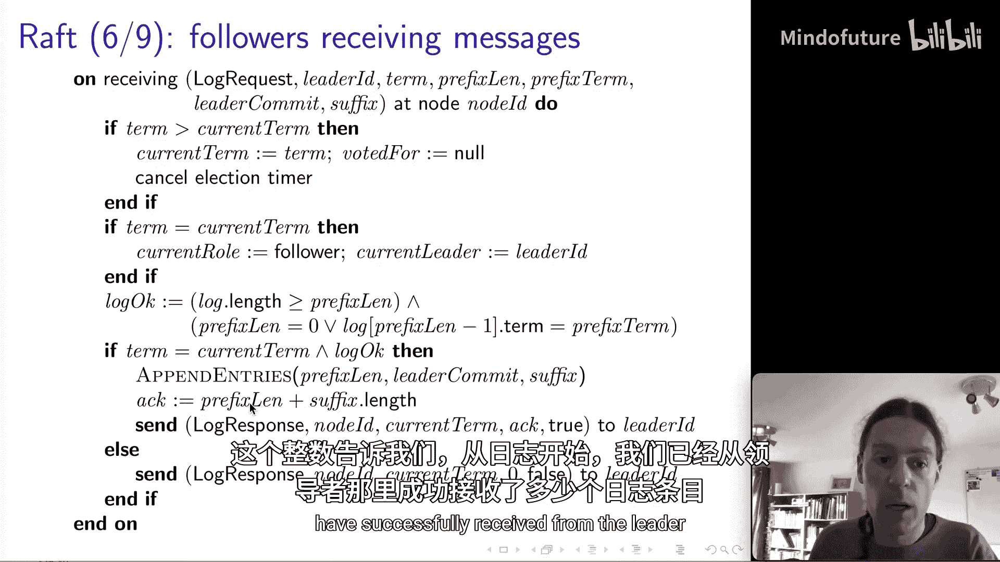

On the other hand， if something is not okay。 So if the term number is wrong or if the log O is false。

 then we send back a log response message in which the last element is false。

 And that tells the leader that we were not able to process that log request message correctly。

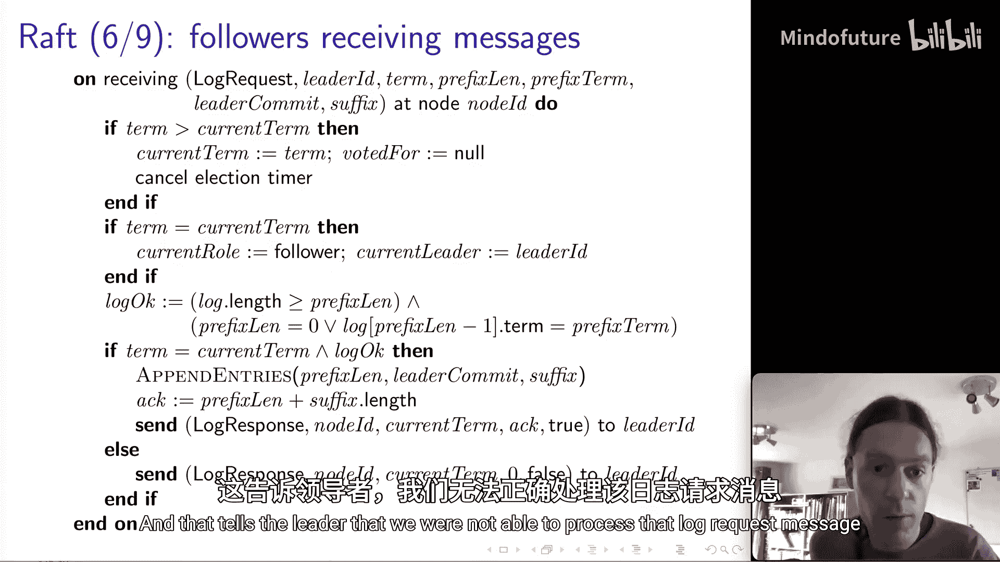

Let's look at this append entries function that I just mentioned。

 so append entries here is called if we have checked that the log is okay and we want to append the new entries from the log request message to the followers log。

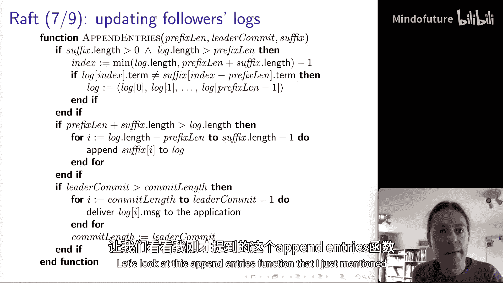

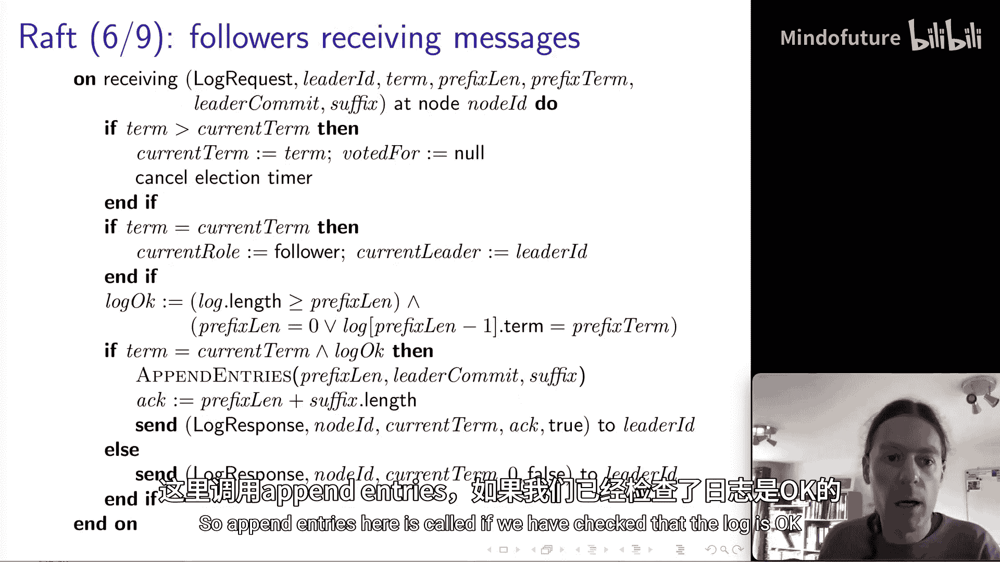

And so the first thing we now need to check is， well。

 it could be that the follower already has some of the log entries that are contained within this message。

 And if so， we need to check whether those are the same。So first of all， if the suffix is non empty。

 so that means the the log request message did contain new log entries。

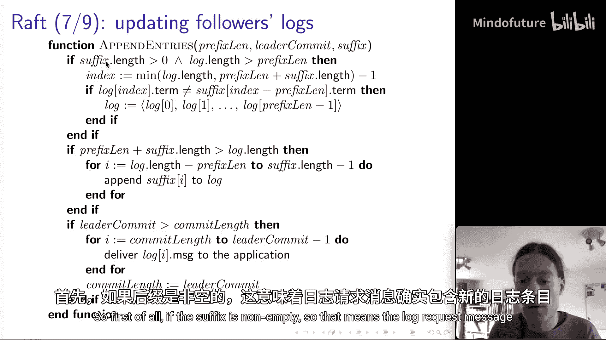

And if the length of the follow's log is longer than the prefix length。

 So that is the follower already has some log entries that go beyond the prefix。 So at this point。

 we have the， the new， the suffix， the new log entries overlapping with the log entries that the follower already has。

In that case， we're going to find the last log entry that we can compare between the follow state and the leader state and the last that's going to be either the length of the followers log -1。

 or it's going to be the length of the prefix plus the length of the suffix -1。

 whichever of those two is smaller。

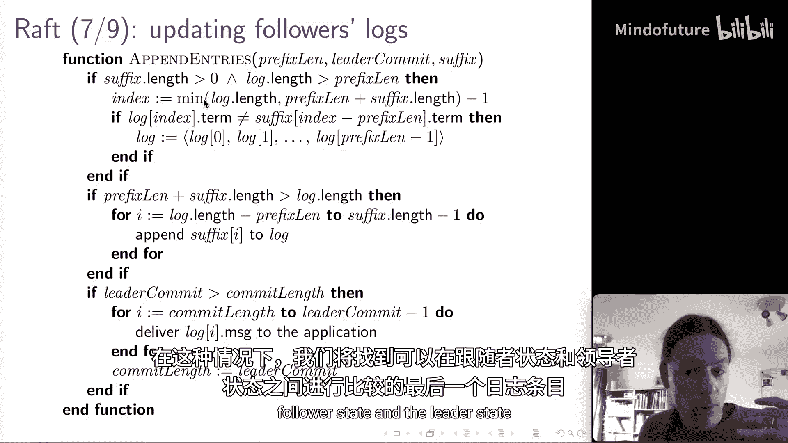

And that is going to be the index of the log entry that we're going to compare。

 And for that particular log entry， were going for that particular index。

 we are going to compare the term number in the followers log to the term number in the corresponding entry in the suffix in the new log entries that we received from the leader。

 And if those are not the same term number that means we have an inconsistency in the log and we have to truncate the log。

 And so what we're going to do then is to actually keep only the length only the followers log up to prefix length。

 and everything beyond prefix length we're going to throw away。

That is the correct thing to do here because those previous log entries might have come from a previous leader and they will not yet be committed。

 so a key property that RAFft ensures is that if a log entry is committed。

 then it will never change and it won't be discarded and it won't be removed by dis truncation process here。

 but a log entry that is not yet committed it could happen that that log entry gets removed as part of dis truncation。

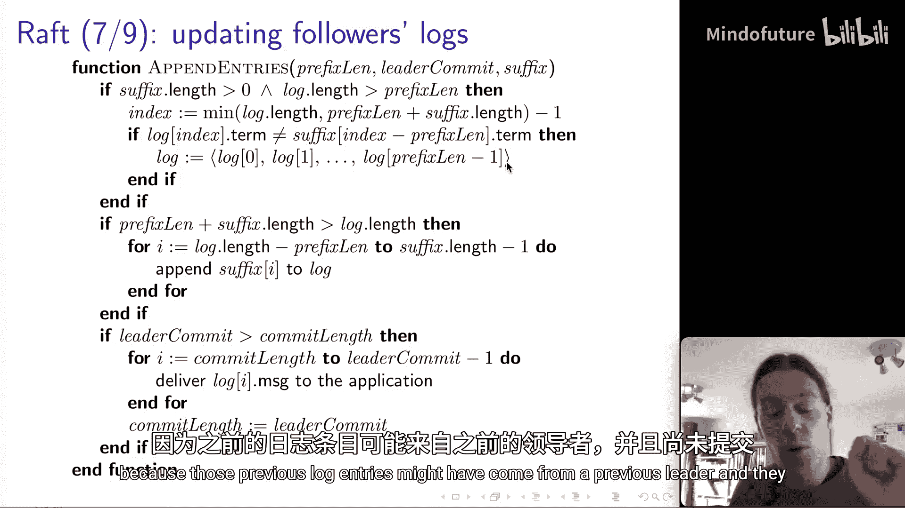

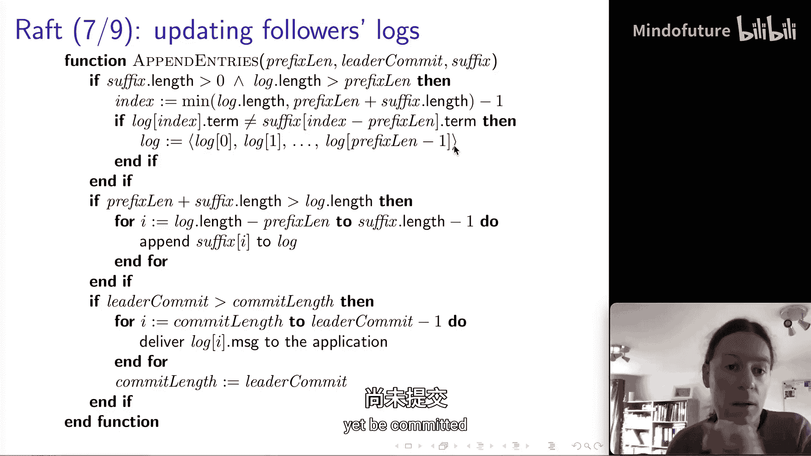

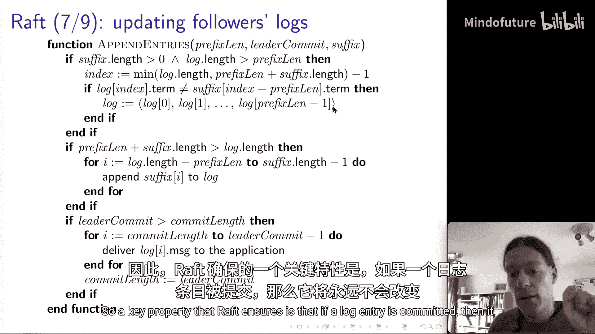

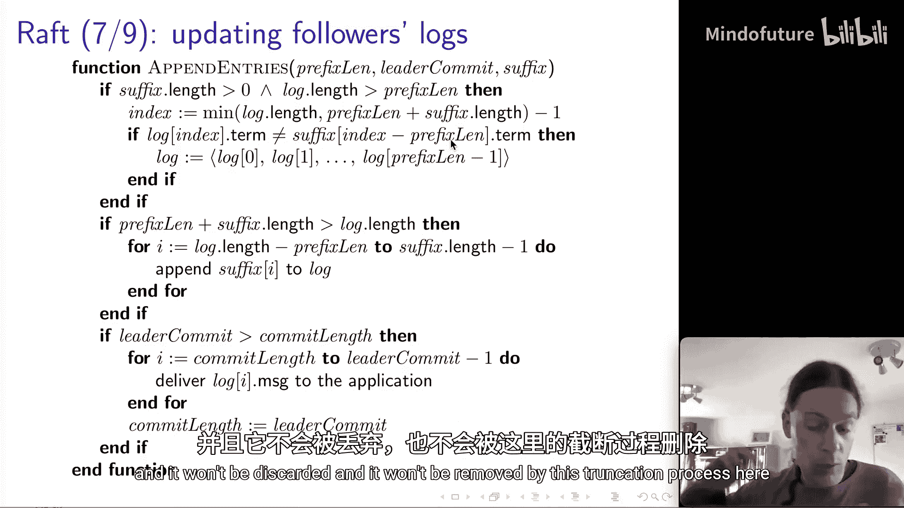

So if these term numbers are the same， then as as I explained earlier。

 RaF guarantees that then the logs are identical up to that point， including that particular index。

 and in in that case， we don't need to truncate the the logs because we know that the leader log and the followers log are consistent with each other。

Either way。Regardless of whether we needed to trunccate or not。

 we can now append any new log entries to the log and so we're going to it could be now here that the suffix contains some log entries that the follower already has in which case we don't need to append them again and we're just going to start off with the first the first entry in the suffix that the follower does not already have and we go up to the last entry in the suffix and we append each of them to the follow's log。

Now comes a variable called leader commits。 I've not talked about this very much yet。

 but this will become important now when we talk about committing log entries。

 so leader commit is just integer and it tells us this this leader commit variable this came as part of the log request message from the leader。

Commit length is a variable that is stored under follower。

 and it keeps track of how many log entries counted from the start of the log have we committed so far。

And if the number of log entries that the leader has committed is greater than the number of log entries that the follow has committed。

 that means more log entries are ready to be committed。

 So it's the leader that decides when a log entry can be committed by increasing this leader commit variable and so if this leader commit is greater that means we can now take the indexes the log indexes starting from commit length and all the way up to leader commit minus-1 and those are ready to be committed and to commit means here。

 first of all， we set the commit length to include those indexes and also we deliver those messages to the application So this is now the total or broadcast delivery as it happens on the followers the total order broadcast delivery on the leader happens separately on the next slide。

So that is the that is actually all that happens on the followers。

 So that's completed the story from the point of view of the followers。

 We just need to finish a story from the point of view of the leader。

 And so if you remember here the followers sent a log response message back to the leader telling it whether it was。

 whether the follower was able to accept the new log entries and append them to the log。

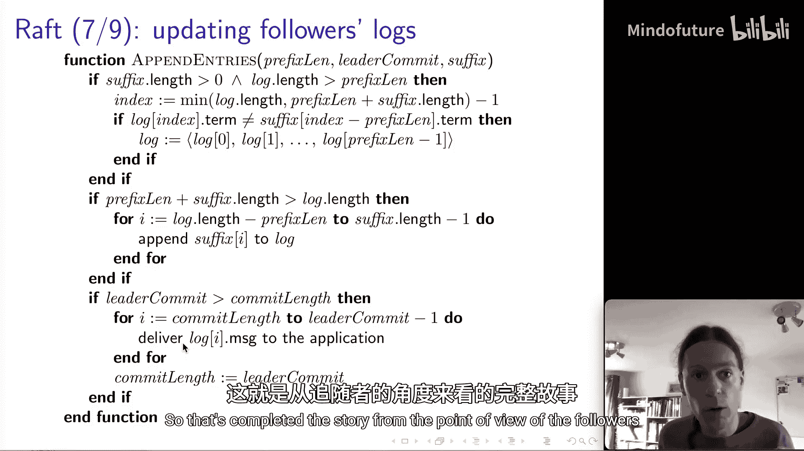

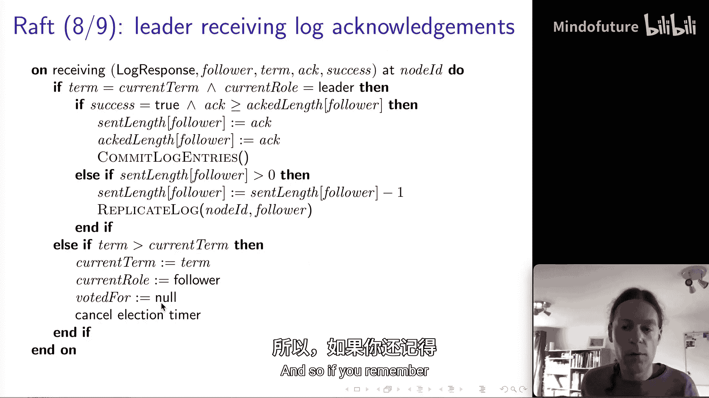

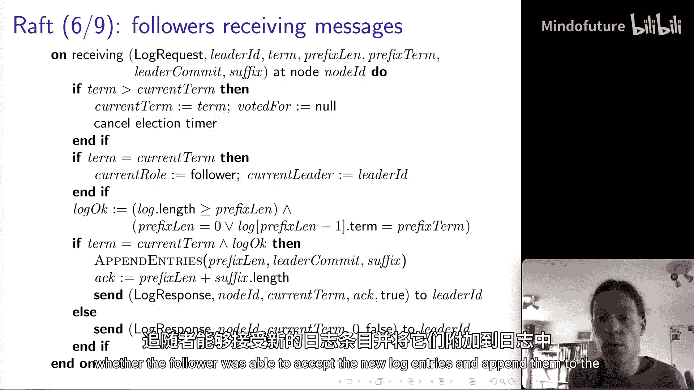

And this is now when the leader receives those log response messages from the follower。

 and now the leader needs to decide which log entries are ready to be committed。

 So a log entry is ready to be committed if it's been acknowledged by a quorum of of nodes in the system。

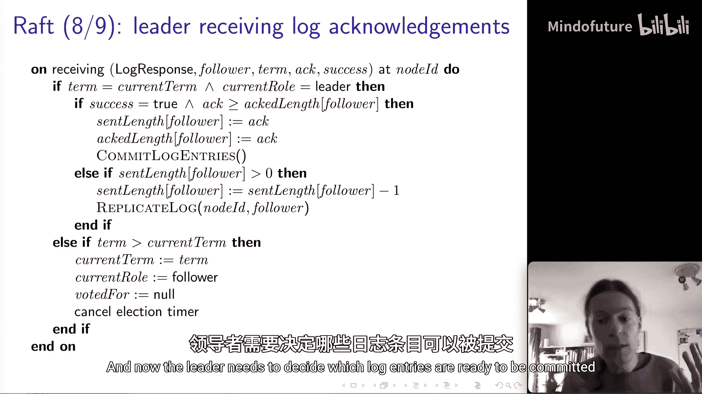

When the leader receives one of these log response messages， as always， when receiving a message。

 the first thing it has to do is check the term number。

 So if the term number and the log response message is greater than the leader's term that means old as a new node with a higher term number。

 as always， we have to accept that term number and transition to follow a state。

 forget whoever we voted for in a previous term and cancel the election timer。However。

 in the case where the term number is correct。So the term number matches the leader's term number and the leader is。

 in fact， still the leader。 then it can go ahead。 Now， first， it has to check。

 Was the success field true， So this is the success field in the log response message that it received from the follower and if this success field is true。

 and if the acknowledgement that was contained that message is at least the number that was previously acknowledged by the same follower。

That means the followers acknowledging new messages。 Now， you know。

 if the if the messages get delivered out of order。

 it could happen that a high and a message with a higher a is delivered first and then a message with a lower act later。

 So this ensures that no matter which order the messages are delivered。

 everything ends up being fine。So in the expected case where the acknowledgeknowment is greater than whatever the previous acknowledgecment was。

 we can now record the the leader can now record the fact that it is received an acknowledgement from this particular follower。

 And it does this by updating both the sent length variable and the act length variable to be that integer that was just that is the number of acknowledged log entries from that particular follower。

 and it then calls the commit log entries function。

 which will be on the next slide to actually decide which log entries are ready to be committed。

On the other hand， if it this log response was not successful。Then we have to check the sent length。

 And so if it was not successful， it could be that there was a gap in the log。

 So remember we split the prefix， we split the log into a prefix and a suffix the prefix we assume the follow already has。

 But what if the follower lost part of its log。 and there's actually a gap and it doesn't have the entire prefix。

 that's the case that we handle here。 So in this case， if the success was not true。

 then the sent length variable for the follower， were just going to decrement that。

 So we're going to reduce it by one。 And that means now we're going to shrink the length of the prefix by one。

 and we're going to send one more log entry to to the follower on our next attempt。Now。

If there's a large gap between the what the log that the follower has and the log that the leader has。

 this could take quite a few iterations where we just reduce the length of the prefix by one every single time。

 So you could imagine more efficient ways of doing this。 But for now。

 we're just going to keep it not， It's complicated enough as it is。

 We're not going to overcomplicate it。And we're just going to reduce this sent length by one and then call the replicate log function again。

 remember we saw replicate log earlier， and this is going to send all of the log entries that go beyond this sent length。

 And so this will ensure that eventually we will fill in any gap in the log and eventually the follower will be able to apply the new log entries because we've sent all of the missing log entries from the leader to the follower。

Okay， and that is the leader side， except for the commit log entries function。

 So that's the last one that we need to look at。

And this one here。Its now looks at this act length variable。

Remember in the Act length variable we recorded for every follower。

 the number of log entries that that follower has confirmed as having received。

 and so here we are now going to start off with the variable commit length。

 so that is commit length is the number of log entries counted from the start of the log that we have already committed。

 and now we want to see if there are any additional log entries that are also ready to be committed。

And so as long as commit length is， is less than the length of the log。We initialize x to0。

 and then this x variable will count how from how many nodes。

 from how many followers including and also the leader， we have an acknowledgement。

And so we are going to go through all of the nodes in the system。

 the leader and all of the followers。 And we're going to check the act length variable for each of those nodes。

 And if its value is greater than the commit length， then that means。😊。

From the point of view of that particular node， it's okay to move the， the commit length forward。

 So it has already acknowledged more log entries beyond the existing commit length。

 And so we're going to count that as an acknowledgecknowledgment。

 And now we're going to see if the number of acknowledgecknowments that we've received for the log entry at index commit length。

 If that is greater than a majority。Then it's ready for for that log entry to be committed。

 And so in this case， we're now going to the do the total order broadcast delivery of the log entry of the message at the log entry with index commit length。

 That's going to be delivered to the application。 This is on the leader。

 and we're going to increment the value of the commit length variable。

 And this new variable will then be sent out to all of the followers the next time we call the replicate log function。

And so we keep going around this loop here and committing log entries as long as we can reach this majority quorum。

 if at some point then we reach the point where we don't have a majority quorum of acknowledgeknowledments yet。

 then we just break out the loop because that means we have to wait for more log response messages before we can do further commits。

And that's it。 That is the entirety of the rough consensus algorithm。

 I hope you were able to follow it。 I know it's a huge amount of detail， but。I thought it's。

 you know， it's really interesting to see that interplay between the leaders and the followers。

 always having to check the term number and so on。 But you can see how by very carefully sequencing all of the things it is possible to actually achieve something like total order broadcast。

That's all for this lecture。 See you next time。

