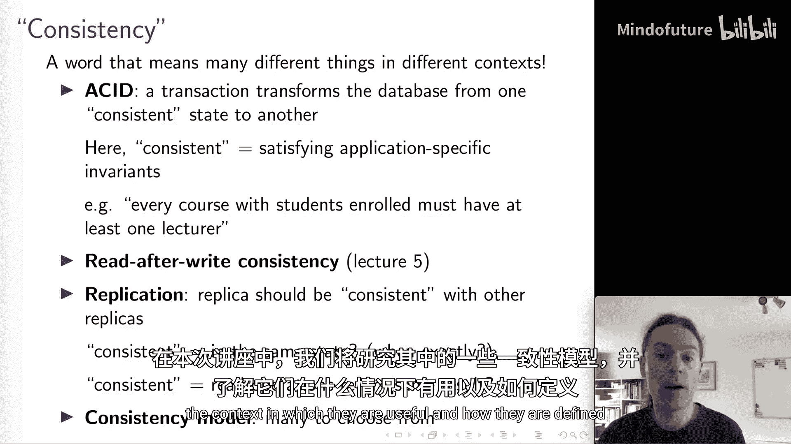
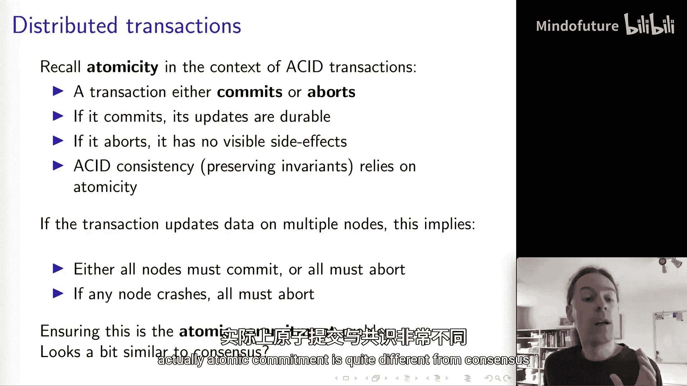
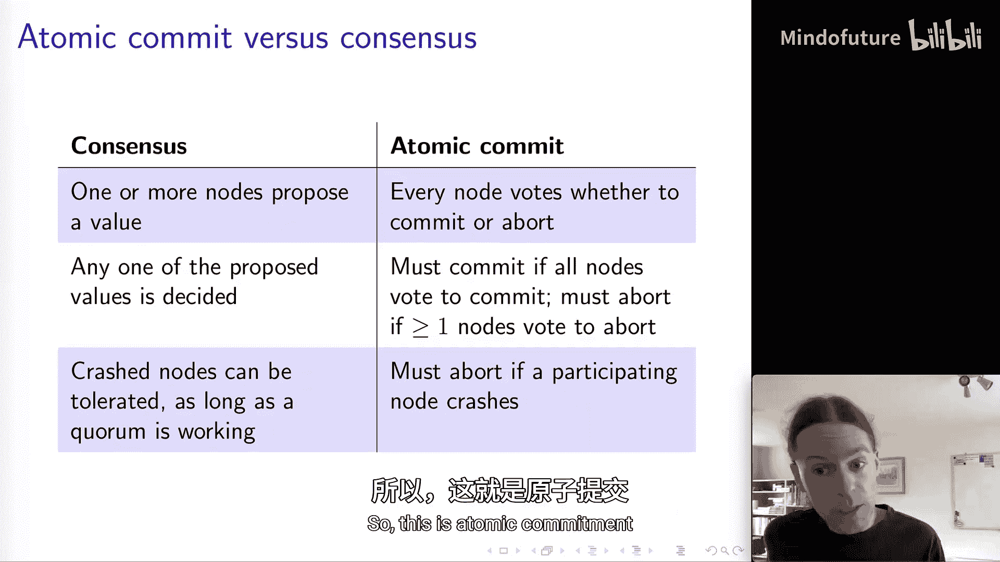
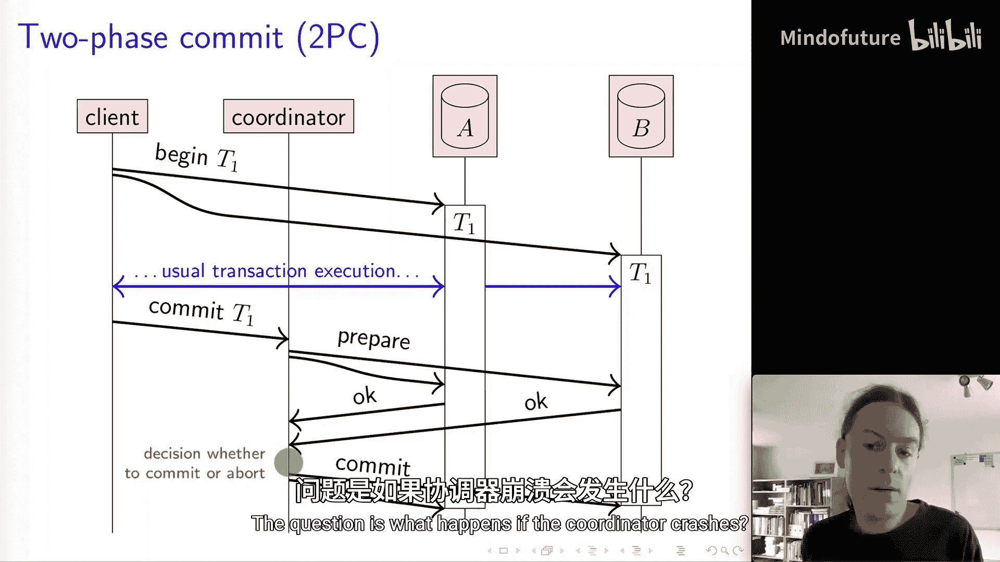
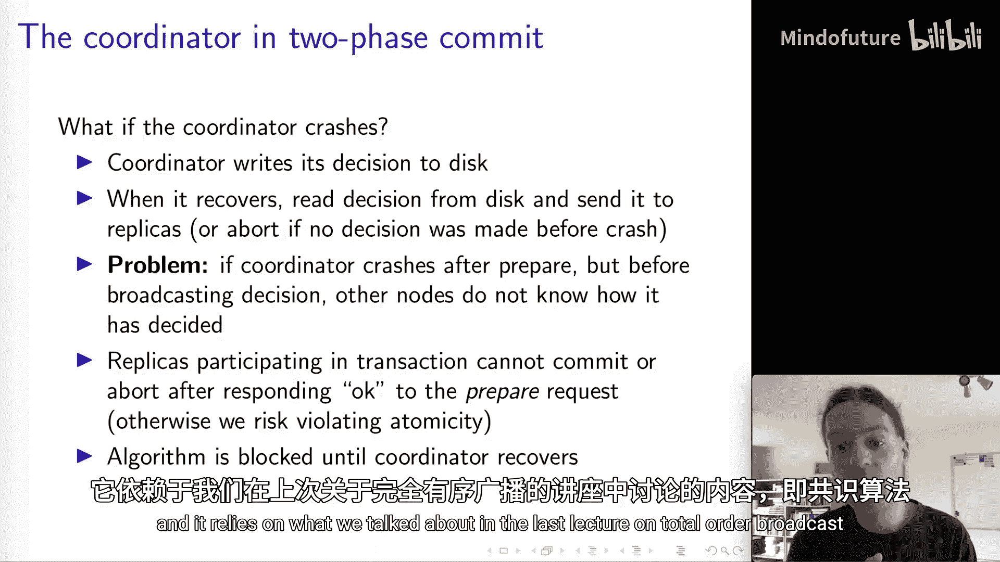
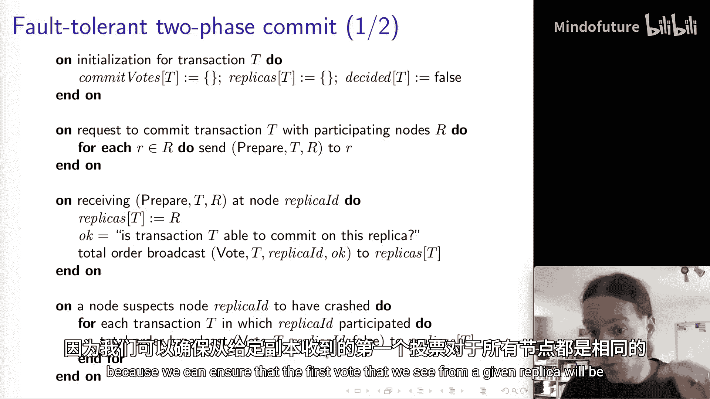
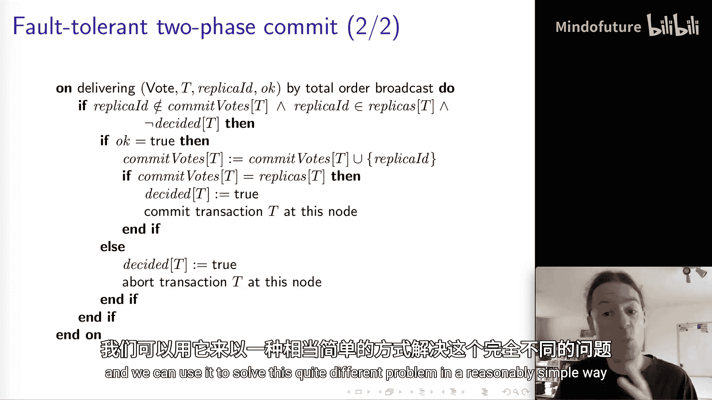

# 【剑桥大学-•-中英】分布式系统讲座-p19-P19-Distributed-Systems-7.1---Two-phase-commit--BV1NwQhYeEyV_p19-

Hello everyone and welcome to lecture 7 of distributed systems today we will be talking about consistency of replicas Now consistency is a bit of a terrible word unfortunately because it means so many different things depending on who you're asking and which context you're talking about so just some of the things where some of the context where you might have seen consistency is in the context or transactions so acid transaction the C stands for consistency and in this context the meaning of consistency is a property of a database state so we're saying that the database is in a consistent state and if you apply a good transaction to it then it moves the database from one consistency state into another so here consistent really means that the state of the database satisfies certain invariance or certain constraints that the application has set as one example if you have a university database you might have a consistency requirement that whenever a course has at least。

One student enrolled in it， then it must also have a lecturer so it must not be without lecturer。

 for example， you could have those kinds of consistency properties。

This acid consistency is not actually what we're usually talking about in distributed systems。

 We saw a different model of consistency a few lectures ago， read after write consistency。

 which was that。If a client makes a write and then reads back what it has just written。

 it should be able to see what it has just written that has got nothing to do with the consistency in the sense of acid it's a very different meaning of the word so in the context of replication what we often say is we want one replica to be consistent with another replica which again raises the question of what exactly we mean so does that mean the replicas are in the state in the same state but when exactly do they have to be in the same state。

 they could be in the same state at different points in time。

 for example or in different states at the same time we could express consistency in terms of what the results of read operations should be what we expect。

I'm just saying here there are lots of different forms of consistency and no one true definition of consistency。

 There are in fact， a whole bunch of different consistency models。

 and in this lecture we're going to look at some of those consistency models and see the context in which they are useful and how they are defined。

So what I want to start with is distributed transactions so you've covered transactions in the first half of discourse on concurrent systems and if you recall the acid properties。

 the A stands for atomomicity， which means that if a transaction makes a bunch of updates to the database then even if the database crashes or something goes wrong either all of those updates are applied to the database and they are made durable in which case the transaction is set to commit or all of the updates。

 none of the updates take effect in which case the transaction is said to be aborted so we have this kind of binary choice of a transaction either it commits or aborts but we don't end up with this kind of half state where some of the transaction updates have happened and others have not have happened and this is very important because if you want to ensure something like consistency in the sense of acid you do have to have atomomicity as the foundation of that。

Because otherwise you could end up with two changes that need to be coordinated in some way。

 and if only one of the two happens， then you'll end up in an inconsistent state。

 so that's why we need atity。Now， in a distributed system。

 we might have a transaction that involves more than one node in a distributed database， for example。

 And in this type of system， we have to ensure atomity across all of the nodes that are participating in the transaction。

 So all of the nodes on which data is being read or written in the course of a transaction。

 so we must ensure that the transaction either commits on all of the nodes or it aborts on all of the nodes。

 So that would then give us atomity for the transaction as a whole across all of the nodes。 Moreover。

 if one of the nodes involved in the transaction crashes。

 then we also have to make sure that we abort the transaction on all other nodes because the crash node cannot complete the transaction。

 It cannot commit the transaction。And this is known as the atomic commitment problem in systems。

 so you might think h this looks kind of a bit similar to consensus because what we want here is all of the nodes to agree on whether to commit or abort the transaction。

 which kind of smelled like consensus。😊，Now， yes， superficially。 But if we look at it in more detail。

 actually， atomic commitment is quite different from consensus。 And so let me just explain why。

With consensus， the way I explained it previously was that you have multiple nodes or one or one。

 one or more nodes may propose some value and one of those values gets decided by the consensus algorithm。

 whereas in atomic commit we're a bit more constrained。

 we have to have all of the nodes voting on whether they are able to commit or transaction or not。

And we have to take all of those votes into account， so while in consensus。

 it's okay to simply pick any one of the values that has been proposed。In atomic commit。

 it's very clearly defined what must happen if all of the vote， if all of the nodes vote to commit。

 then the transaction must commit。 if any one of the nodes votes to abort， then all of them must abt。

 So atomic commit is much more constrained in the decision that the algorithm has to make。

And finally， with consensus， we've seen that we can have algorithms like raftT。

 which can continue working as long as a quorum of nodes is reachable and responding to requests。

Whereas with atomic commit， because we have this requirement that all of the nodes must must vote and we must get consensus across all of them。

 This means now that even just one single node crash will cause the entire transaction to abort。

So atomic commit is not able to tolerate any  faulty nodes， whereas a consensus algorithm。

 a fault tolerant consensus algorithm like raft is able to tolerate a minority of  fault0 nodes in a system。

So this is atomic commitment and the way we typically implement atomic commit is using an algorithm called two phase commit Now two phase commit sounds a bit like two phase locking。

 which you've seen previously don't confuse the two they sound very similar。

 but they're very different things， so two phase locking is around serializable isolation whereas two phase commit is around getting atomomicity very different area。

😊。

So the way we start two phase commit is that the client wants to open a transaction。

 begin a transaction on multiple database nodes。And it just starts a transaction as usual。

 sends some transaction identifier T1 to those nodes and then does its usual thing。

 so the transaction may read and write arbitrary objects in the database do whatever it needs to do any any kind of logic。

Two phase commit only starts when we're ready to commit the transaction。

So rather than the usual form of transaction commits where the client just sends directly to the database。

 hey commit now please with two phasese commit instead the request to commit goes to a new node in a system called the transaction coordinator。

So this commit request goes to the coordinator and the coordinator then sends a prepare message to all of the database nodes that are participating in the transaction。

And the purpose of the prepared message is it's kind of like commit except it doesn't actually finish the transaction yet。

😊，So what preparepa does is when a database node receives the prepare message。

 the database node has to write all of the changes。

 all of the updates from that transaction to disk and it has to check any constraints to make sure that we have consistency of the database because in response to that prepare message the database node now has to reply with either yes or no whether it's willing to commit that transaction or not and so as we said any one node response to disk will cause the transaction to a board。

 but if all of them vote yes， then the transaction will commit。

So this means that once the database node replies saying， okay， I'm happy to commit this transaction。

It is promising that it will definitely be able to commit that transaction in the future because there' at this point。

 the database node has abdicated its responsibility。

 now it's up to the transaction coordinator to make the decision whether or not to commit the transaction So the database node just has to promise that if it is asked later by the coordinator to commit the transaction it will definitely be able to commit it So it's not allowed to back out and flake out afterwards and say。

 oh， sorry I didn't want to commit this after all because by that point it's too late So by the time the prepare message is telling the database nodes that it must get everything ready to be able to commit but without actually ending the transaction yet。

 and then if the coordinator says in phase two if two phase commit if the coordinator says okay now we're going to commit then the individual database nodes go they do the actual commit。

 they end the transaction they release all of the locks and everything is done。

So this is the model of two phase commit and the key moment in this protocol is here。

 So after the database nodes， the participating nodes have replied to the coordinator saying whether or not they're willing to commit this transaction at this point the coordinator makes the decision whether to commit or a boughtt and this is really a key moment in the protocol。

Now。We can think about what happens if some of these nodes crash。 So if the database node crashes。

 then we've discussed that。 That means the transaction coordinator will time out and it will say。

 okay， we're going to abort the transaction for everyone。 So that's fine。

The question is what happens if the coordinator crashes？

So if the coordinator crashes， well， first of all， it has to make this decision on whether to abort or commit the transaction。

 so it can write that decision to disk。 And so then when the coordinator recovers from its crash and starts back up again。

 it can read it this decision from disk and send the decision that it made to to the replicas that we're participating in the transaction。

Or if there was no decision record on disk， then the coordinator can just abort。

 But it has to be even if the coordinator crashes， if it made the decision before the crash to commit。

 then it must honour that decision after it restarts because it might have already sent the commit message to some of the nodes。

 but not all of them and so some of the nodes may have already committed and released all of their locks。

 So now we have to ensure that everybody else commits as well。 and likewise， if one aorts。

 then all of the others have to abort as well。But this leaves us in a problem because the coordinator is now this linchpin in this protocol。

 because if the coordinator crashes just at the moment after the prepare requests have been sent out。

 but before the coordinator sent out its decision on whether to commit to aor the transaction。

Then all of the other nodes don't know what the coordinator has decided， they are simply stuck。

 they cannot end their transaction yet， they can't abort their transaction because as I said earlier they have promised that they will be able to commit it so if they aborted then they wouldn't be able to commit it anymore。

 so they can't commit or aort their transaction they're all stuck in this state of being uncertain with what the state of the transaction is。

😡，And so the individual nodes can't just decide for themselves to abort or commit because that would risk violating atity。

 So the entire algorithm is blocked until the coordinator restart and recovers its state from disk。

 So this is not great because if an coordinator crashes， it might take a while to come back up again。

 if the machine where the coordinator was running on， experienced a hardware failure。

 it's even worse because you know somebody has to go and take the hardware disk out of that machine and put it into a new machine and so on。

 So the whole system could be down and locked up for quite a significant amount of time。Fortunately。

 there is a way around this。😊，And there is an algorithm。

 a variant of two phase commits that is full tolerance。

 and it relies on what we talked about in the last lecture on total or broadcast IEA consensus algorithm。

And it works like this， this algorithm is just two slides long。

 and the idea here is that we use a total order broadcast algorithm to disseminate each node's vote on whether to abort or to commit。

😊，And so for each node we're going to have some state here。

 so for each transaction we're going to have a set containing a set here containing the replica IDs that have voted in favour of committing a certain transaction。

 we have the set of all of the replicas that are participating in a certain transaction and for each transaction we have a flag telling us whether we have decided yet or not。

And so now when we want to commit a transaction， we do the same as we do。

 usually the the coordinator， what the coordinator would usually do。

 which is it just sends a prepare message to all of the nodes participating in the transaction。 Okay。

 that's just the regular prepare message as before。

When a node or a replica receives this prepare message。

Its now okay it now knows the set of replicas that are participating in this transaction called R。

 so it remembers that this is the set of replicas participating in transaction T。And now， as before。

 the replica needs to check whether it is able to commit the transaction and it will reply to the prepare request。

 saying either yes or no， and if it says yes， it promises that will definitely be able to commit this transaction in the future so this okay will simply be a booleion here saying true or false。

 whether it is able to commit the transaction or not and now rather than sending this vote back to the coordinator。

 we use total order broadcast to send this vote to all of the replicas that are participating in this transaction。

So now all of the replicas find out about each other of who is able to commit what。

 And this gets us most of the way there。 The question is just what if one of these replicas has crashed。

 And so if that replica has crashed， then it is not able to broadcast its vote。

 So all of the others would be stuck waiting forever until this vote never turns up。

 So what we have in addition is a failure detector。And this failure detector。

 this can be running on any node， for example， on some of the other database replicas or even under clientient。

And it just checks whether it suspects any of the replicas to have failed。

 So if it has sent the prepare request to some replica and the replica has not broadcast its vote yet after some amount of time。

 some time out。Then this other node is just going to broadcast a vote on behalf of the replica that it has suspected to have failed and it just votes false。

 So it votes to abort on behalf of this replica。Now what could happen， as you can see here。

 is that actually it could be that the replica here that is suspected to have crashed hasn't actually crashed。

 it might be fine， it might just be a bit slow and so it could be that just around about the same time。

 we get two conflicting votes for the same replica that is one genuine vote from the replica that the replica itself is sending and one vote or maybe even several votes from other replicas who think this particular node has failed。

And so now we are relying on the property of total order broadcast， which is all of the participants。

 all of the nodes in the system will deliver the same messages in the same order。

 and because of that， this race between the different votes or the same replica is no longer a problem because we can ensure that the first vote that we see from a given replica will be the same for all of the nodes。

And so this means here， whenever we deliver one of these votes here by total order broadcast。

 we can just consider the first vote from any given replica and ignore any future vote。

 and this will ensure that all of the nodes then come to the same decision as to whether to abort or commit the transaction。

So first of all here， if this replica that is voting is not already one of the votes that has committed and if the replicaas is one of the replicas in the transaction T and we have not already made a decision for transaction T then well it depends whether we voted in favor or not so if we voted true which means in favor of committing then we add the replica ID to the set of replicas that have voted in favor of committing this particular transaction and if this set of replicas that have voted in favor equals the set of all replicas participating in the transaction that means now we have the unanimity that we require。

 we can decide to commit the transaction and do the actual commit at this node on the other hand。

 if the vote was false it was against committing that means we can immediately abort because one single vote against is already enough to discover the whole transaction we can set our flag to be decided to be。

True， and then we're going to abort the transaction of this node。And if you think about this。

 the logic that we have here ensures that we only count the first vote from any given replica and because all of the nodes will agree when they're delivering these votes。

 they will agree on which the first vote was from a given replica。

 this will ensure that all of the participants see the same and come to the same decision as to whether to commit or bought this transaction。

Isn't that nice， we have this total order broadcast algorithm and we can use it to solve this quite different problem in a reasonably simple way。

😊。

