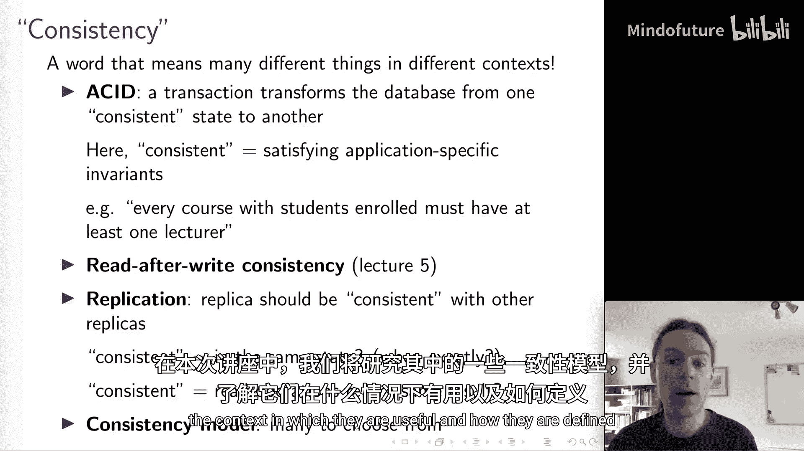
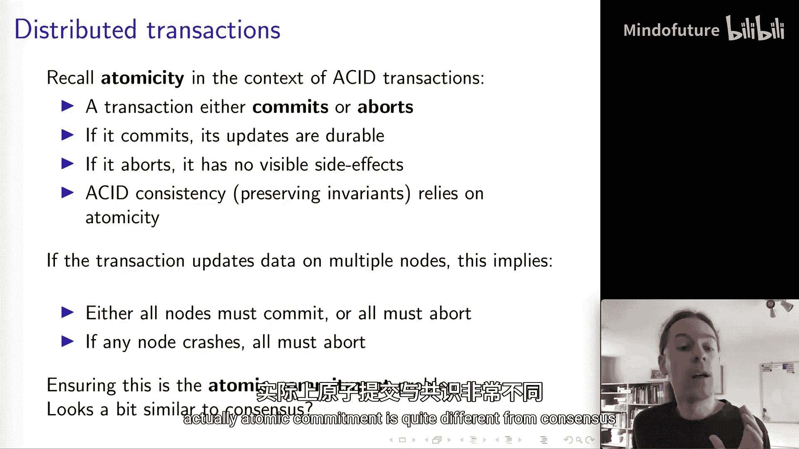
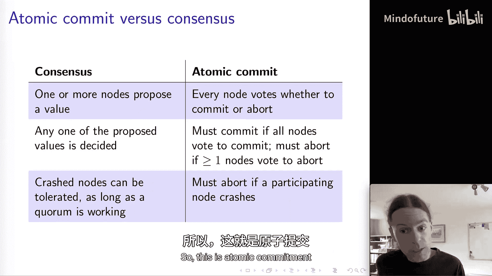
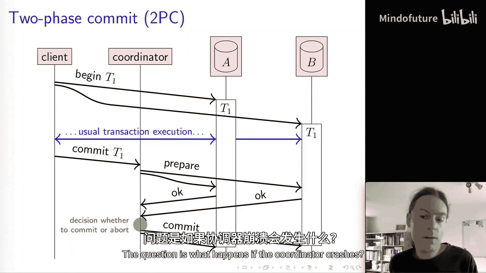
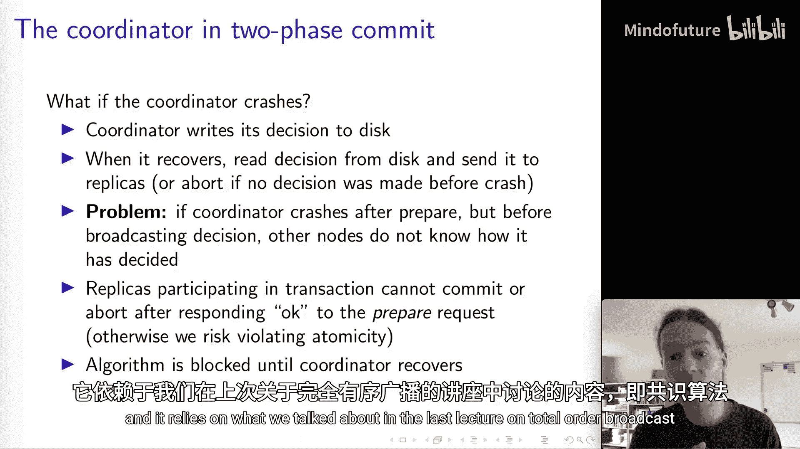
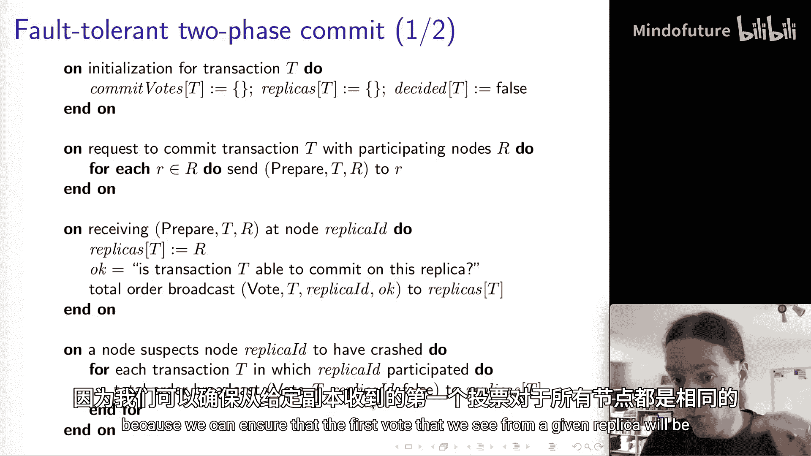
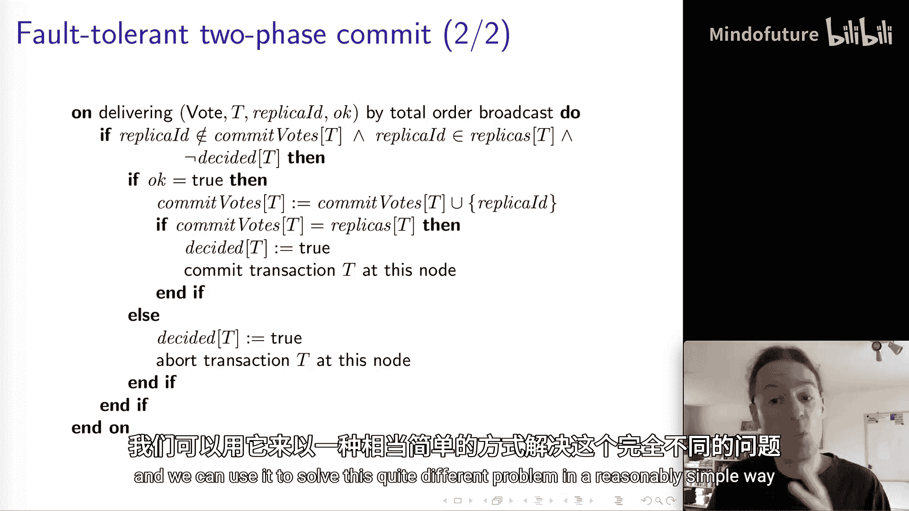

# 分布式系统：7.1：副本一致性模型与两阶段提交

在本节课中，我们将要学习分布式系统中的副本一致性概念，并深入探讨一个实现分布式事务原子性的核心算法——两阶段提交。我们将了解一致性在不同语境下的多种含义，以及如何通过特定协议确保跨多个节点的操作要么全部成功，要么全部失败。

## 一致性概念的多样性

“一致性”这个词在计算机科学中含义多样，具体取决于上下文。

在数据库事务的语境中，ACID中的C代表一致性。它指的是数据库状态必须满足应用程序定义的某些约束或不变性。例如，在一个大学数据库中，可能要求“如果一门课程至少有一名学生注册，那么它必须有一名讲师”。这种一致性是数据库状态的属性。

然而，在分布式系统，特别是数据复制的语境中，我们常说的“一致性”通常指副本之间状态的关系。例如，我们希望一个副本与另一个副本保持一致。但这又引出了新的问题：它们需要在什么时间点保持一致？是同一时刻状态完全相同，还是在不同时间点最终达到相同状态？我们可以通过读取操作应返回何种结果来定义一致性。

实际上，存在多种不同的一致性模型，并没有一个唯一的“正确”定义。本节课我们将探讨其中一些模型，了解它们的定义及其适用的场景。

## 分布式事务与原子提交问题

现在，让我们从分布式事务开始。大家已在并发系统课程的前半部分学习过事务。回忆一下ACID属性，其中的A代表**原子性**。这意味着如果一个事务对数据库进行了一系列更新，那么即使数据库崩溃或出现错误，也**要么所有更新都被应用**（事务提交），**要么所有更新都不生效**（事务中止）。我们不会得到一种“半完成”的状态。

原子性非常重要，因为它是确保ACID意义上一致性的基础。如果两个需要协调的更改只发生了一个，系统就会进入不一致状态。

在分布式系统中，一个事务可能涉及分布式数据库中的多个节点。在这种系统中，我们必须确保参与事务的**所有节点**都具有原子性。事务必须在所有节点上要么全部提交，要么全部中止，这样才能保证整个分布式事务的原子性。

此外，如果参与事务的某个节点崩溃，我们也必须确保在所有其他节点上中止该事务，因为崩溃的节点无法完成提交。这在系统中被称为**原子提交问题**。

你可能会觉得，这看起来有点像**共识问题**，因为我们希望所有节点就“提交还是中止”达成一致。表面上看确实如此，但仔细分析，原子提交与共识有很大不同。

## 原子提交与共识的区别

以下是原子提交与共识的主要区别：

1.  **提议与投票**：在共识中，一个或多个节点可以提议某个值，共识算法会决定采用其中一个提议的值。而在原子提交中，约束更强：所有节点都必须投票表明自己是否能够提交事务，并且必须考虑所有投票。
2.  **决策规则**：在共识中，可以简单地选择任何一个被提议的值。在原子提交中，决策规则非常明确：**如果所有节点都投票赞成提交，则事务必须提交；如果任何一个节点投票赞成中止，则所有节点都必须中止**。原子提交算法必须做出的决策受到更多约束。
3.  **容错性**：共识算法（如Raft）只要可访问的节点达到法定数量（多数）就能继续工作。而原子提交要求**所有**节点都必须投票并达成一致，这意味着即使只有一个节点崩溃，也会导致整个事务中止。因此，原子提交**无法容忍任何故障节点**，而像Raft这样的容错共识算法可以容忍少数故障节点。

## 两阶段提交协议

实现原子提交的典型方法是使用一个称为**两阶段提交**的算法。请注意，它听起来像“两阶段锁”，但两者完全不同：两阶段锁关乎可串行化隔离级别，而两阶段提交关乎实现原子性。

以下是两阶段提交的工作流程：

1.  **事务执行**：客户端希望在多个数据库节点上开始一个事务。它像往常一样启动事务，向这些节点发送事务标识符（如T1），然后执行读写操作。
2.  **提交请求**：当准备提交事务时，客户端不直接通知数据库节点，而是将提交请求发送给一个称为**事务协调者**的新节点。
3.  **第一阶段：准备**：协调者向所有参与事务的数据库节点发送 **`prepare`** 消息。当数据库节点收到 `prepare` 消息时，它必须：
    *   将该事务的所有更改写入磁盘。
    *   检查任何约束以确保数据库一致性。
    *   回复“是”或“否”，表明它是否愿意提交该事务。
    *   如果回复“是”，则该节点**承诺**将来如果被要求提交，它**一定能够提交**。此时，它已将决策权交给了协调者。
4.  **协调者决策**：在收到所有节点的投票后，协调者做出决定：如果所有节点都投票“是”，则决定提交；如果任何节点投票“否”，则决定中止。这是协议的关键时刻。
5.  **第二阶段：提交/中止**：协调者将其决定（`commit` 或 `abort`）发送给所有参与节点。节点收到后执行相应操作（提交或中止），释放锁，完成事务。

## 协调者故障与阻塞问题

现在考虑节点故障的影响。如果数据库节点崩溃，协调者会超时并决定中止事务，这是可以处理的。

关键问题是：**如果协调者崩溃了怎么办？**

协调者可以在崩溃前将它的决定写入磁盘。恢复后，它可以读取决定并通知各节点。如果磁盘上没有决定记录，它可以安全地选择中止。

但是，如果协调者在发出 `prepare` 消息之后、发送最终决定（`commit`/`abort`）之前崩溃，就会导致严重问题。此时，所有数据库节点都处于“不确定”状态：它们已承诺可以提交，但不知道最终决定是什么。它们不能自行提交或中止，因为那可能破坏原子性（例如，如果协调者已决定提交并通知了部分节点）。因此，**整个算法会被阻塞**，直到协调者恢复。如果协调者所在机器发生硬件故障，系统可能长时间不可用。

## 基于全序广播的容错两阶段提交

幸运的是，有一种方法可以解决协调者单点故障问题。我们可以利用上一讲中学到的**全序广播**（即共识算法）来实现一个容错的两阶段提交变体。

这个算法的核心思想是：**使用全序广播算法来传播每个节点关于“中止还是提交”的投票**，让所有参与者共同做出决定，从而消除对单一协调者的依赖。

以下是算法步骤：

1.  **状态初始化**：每个节点为每个事务维护状态，包括：参与该事务的所有副本ID集合 `R`、已投票赞成提交的副本ID集合 `votes`，以及一个表示是否已做出最终决定的标志 `decided`。
2.  **准备阶段**：协调者（或任何发起者）照常向所有参与节点发送 `prepare` 消息。节点收到后，知晓参与集合 `R`，并检查自己能否提交。
3.  **广播投票**：节点不将投票结果直接回复给协调者，而是使用**全序广播**，将自己的投票（`true` 表示赞成提交，`false` 表示反对）广播给所有参与节点。这样，所有节点都能看到彼此的投票。
4.  **处理慢节点或故障节点**：为了避免因某个节点崩溃或过慢而永远等待其投票，我们引入一个**故障检测器**。如果任何节点怀疑某个参与者在超时后仍未广播投票，它可以代表该疑似故障节点，通过全序广播投出一张 `false` 票（即提议中止）。
5.  **处理重复投票**：由于故障检测和网络延迟，可能同时出现来自同一节点的真实投票和代表其投出的 `false` 票。得益于全序广播的**所有节点以相同顺序传递相同消息**的特性，我们可以规定：**只考虑来自任一节点的第一张投票**，忽略后续重复或冲突的投票。这确保了所有节点对“每个节点的第一票是什么”达成一致。
6.  **做出决定**：当节点通过全序广播接收到一张投票时，它执行以下逻辑：
    *   如果该投票来自事务 `T` 的参与者，且事务 `T` 尚未做出决定：
        *   如果投票是 `true`（赞成），将该节点ID加入 `votes` 集合。如果此时 `votes` 集合等于全体参与者集合 `R`，则意味着**全体一致赞成**，节点可以决定**提交**事务，并设置 `decided = true`。
        *   如果投票是 `false`（反对），则**一票否决**，节点可以立即决定**中止**事务，并设置 `decided = true`。

通过这个机制，所有参与者节点基于相同的、按全序广播传递的投票信息，独立地应用相同的决策逻辑，最终必然会对事务的提交或中止达成**完全一致的决定**，且无需依赖一个可能故障的单一协调者。

## 总结

本节课中我们一起学习了分布式系统中的一致性概念和两阶段提交协议。

我们首先认识到“一致性”一词的多义性，在分布式复制语境下，它主要关注副本间的状态关系。接着，我们探讨了分布式事务中的**原子提交问题**，并指出其与共识问题的区别：原子提交要求全体一致且不容忍任何节点故障。

然后，我们详细分析了经典的**两阶段提交**协议，它通过“准备-提交”两个阶段，借助一个**事务协调者**来确保跨节点事务的原子性。然而，我们也指出了其关键缺陷：协调者可能成为单点故障，导致整个系统在协调者崩溃时阻塞。

最后，我们介绍了一种**基于全序广播的容错两阶段提交变体**。该算法利用全序广播传播投票，结合故障检测器和“只认第一票”的规则，使得所有参与节点能独立、一致地做出提交或中止的决定，从而消除了对单一协调者的依赖，实现了更高的可用性。

这个例子展示了如何运用像全序广播这样的基础分布式抽象，以相对简单的方式解决另一个复杂的分布式问题。