# 【剑桥大学-•-中英】分布式系统讲座-p20-P20-Distributed-Systems-7.2---Linearizability--BV1NwQhYeEyV_p20-

I would now like to talk about a consistency model called linearizability so what we've seen so far with twophase commit and atomic commitment is ensuring consistency in the face of crashes so ensuring that even if nodes crash all of the nodes will either commit or bought a transaction but we also have to worry about consistency in the face of concurrency so what if multiple nodes are concurrently reading and writing some data how do we ensure those operations are consistent with each other for some definition of consistency and this is what linearizability is about so it's one particular definition of consistency for concurrent systems。

And it is the strongest such model that is in widespread use and the idea behind linearizability is that the system as a whole behaves as if it was not replicated or distributed at all。

 So it behaves as if there was actually only a single copy of the data and all of the operations happen atomically on that single copy of the data。

 So when you issue a read or write。Operation， that operation will take effect atically at some point in time。

And even though there might be multiple replicas in the system from the point of view of the client。

 it looks as though there was only a single copy of the data。

 and so this is very nice because it's easy to program against because it kind of reduces all of the distributed systems complexity down to something which is very nice and manageable and small。

 like a single copy of the data。😡。

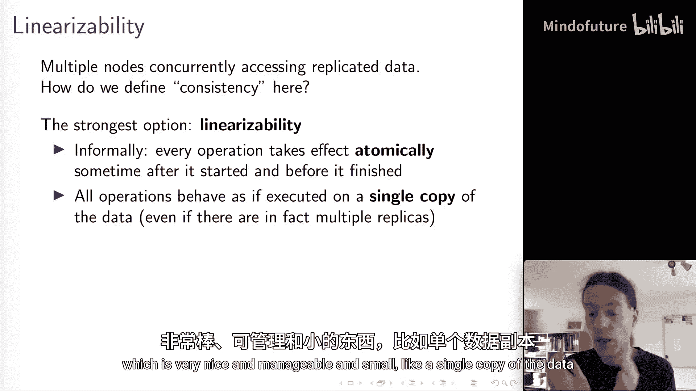

A consequence of this definition of linearizability is that whenever you read some data。

 you're guaranteed to get an up to date value for some definition of up to date that we will see in a moment。

 this is sometimes also called strong consistency but the term strong consistency is a bit poorly defined it's a bit vague and handwaavy so we're going to stick with linearizability which is formally defined we will not go into the exact formal definition in this course I'm just going to give you the intuition behind linearizability through some examples。

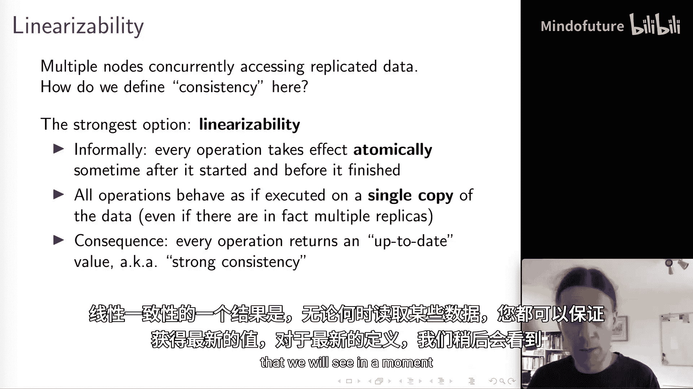

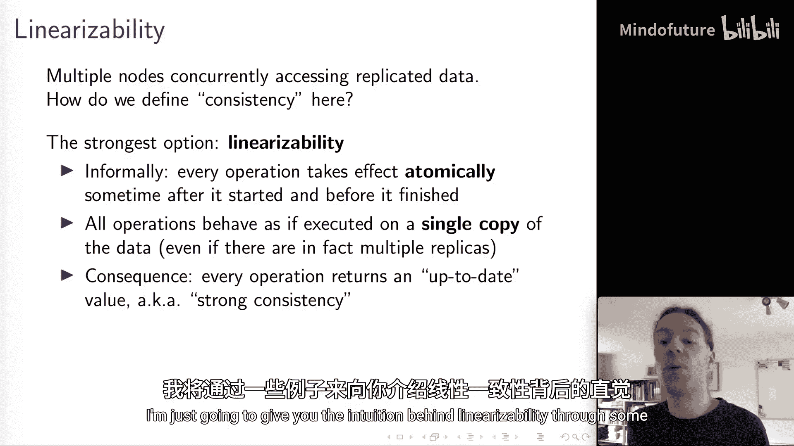

Interestingly， linearizability is not only important in distributed systems。

 but it actually is used also in the context of shared memory concurrency on a single computer。

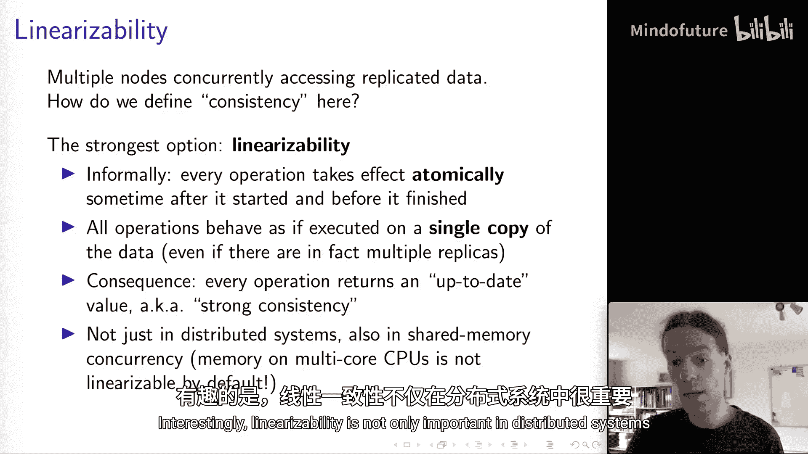

And the reason there is that if you have multiple CPU cores。

 then actually each CPU core has its own memory caches and if you have threads running onto different CPU core。

 you might have one thread writing a value to memory which actually goes to its cache and then on different thread reading that same location in memory and it might not see the value that was written by the first thread because its cache hasn't yet been updated with that value and so you get actually within the scope of a single computer。

 you get this similar kind of behavior as in a replicated system because these different levels of caches gives give you something quite like replication I think this is interesting because you were taking now this idea from distributed systems and a single computer starts actually behaving a little bit like a distributed system too。

😊，Another piece of terminology just to be careful of is linearizability and serializability are not the same thing。

 even though the words look kind of similar， but they mean totally different things。

 so serializability is a form of isolation between transactions It's about transactions having the same effect as if they were executed in some serial order Lineizability is around multiple replicas behaving as if there was a single replica。

 so they're very different things。Okay， so in order to give you a sense of what linearizability means。

 I'm going to go back to something we saw in a previous lecture。

 which is read after write consistency。 So if you remember what we discussed back then this was in the context of read and write quorums So if you have a client that wants to write。

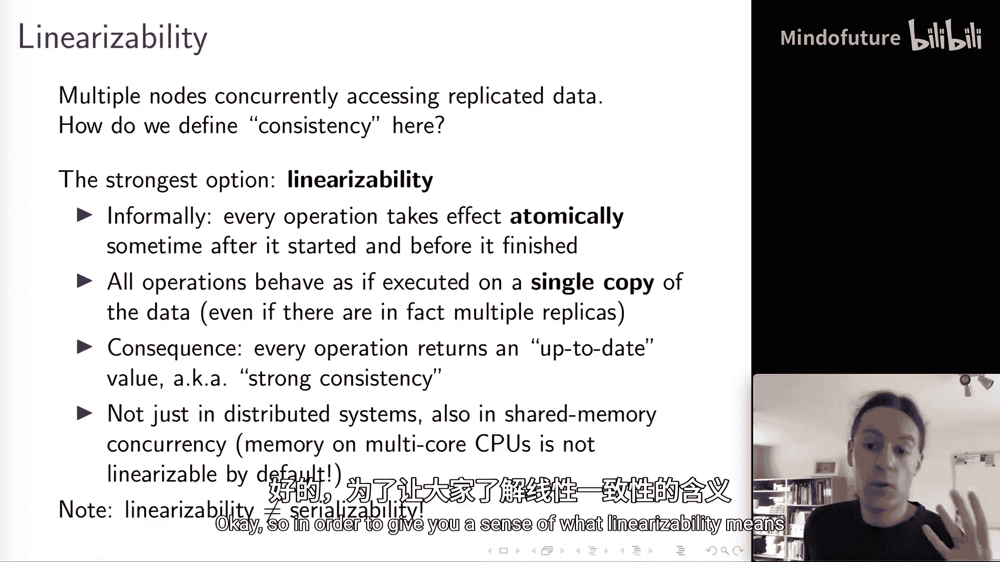

Some value v1 to some object X， it can make this right request to a quorum of replicas if a quorum responds OK。

 then this set request is successful， and then subsequently that same client might make a get requests and send that get get request to a quorum of replicas。

 get some responses back， use the timestamps to figure out which is the more recent value in the responses and return that value from the get request。

So what is new here in this notation is now I've got these boxes。

 which indicate the execution time of this particular operation。 So when the operation begins。

 we start by sending out these requests。 And then after a quorum of responses have been received。

 we declare the operation to be finished。 So the box here。

 this rectangle shows the duration of the operation from the client's point of view。

Now we can actually abstract away all of the internals and this message communication and all of the replicas and we can define a consistency model purely in terms of what the client sees。

 so looking at things only from the client's point of view and this is useful because it means we are consistency model is now not tied to one particular implementation of a system or one particular distributed algorithm。

 we can define the behavior only from the client's point of view regardless of how the internals of this system are implemented。

 and so within the execution of each operation there might be multiple messages sent and received and we don't care particularly what those messages are exactly what we do care about here is that this get operation here started after the set operation finished so there's this time dependency here that the get operation happened later in time than the set operation and therefore we would expect the get operation to see a value of X。

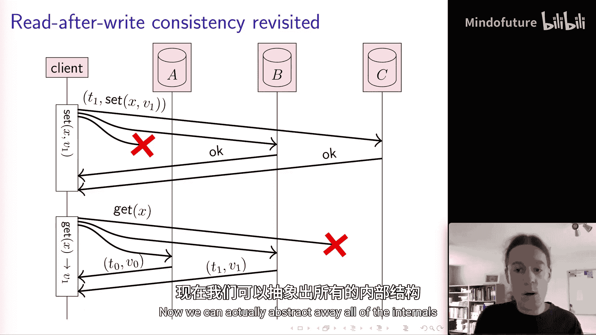

That is at least as recent as the value that was written by the previous set operation。

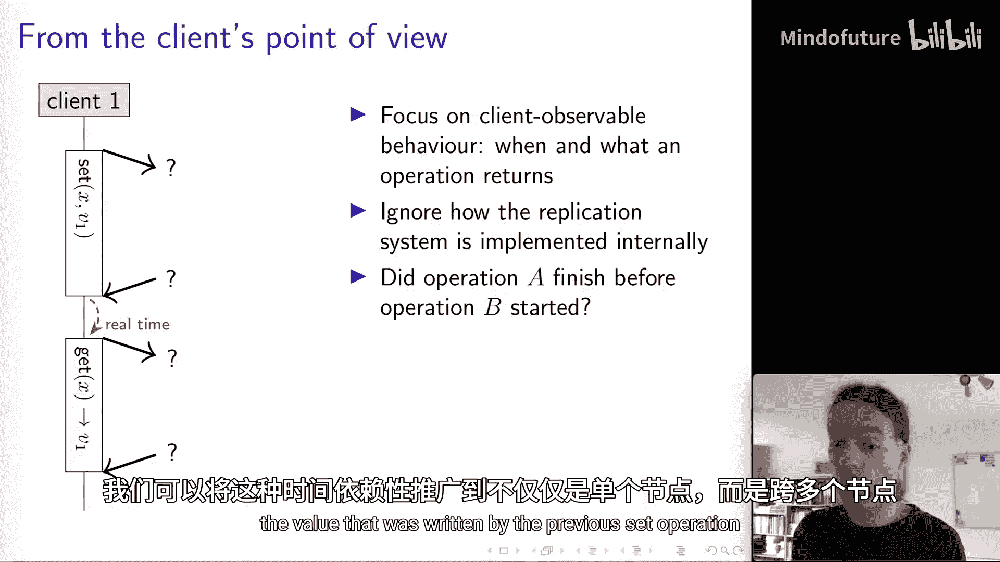

And we can generalize this timing dependency to be not just on a single node。

 but actually across multiple nodes so we could have the client clientient2 here。

 which starts a get operation sometime later in time after the set operation by a different client has completed and again we have this realtime dependency here so linear under linearizability。

 we expect that this client2 will also see the up to dateate value V1 because that's the behavior we would get if we have a single copy of the data on which all of the operations are atomic。

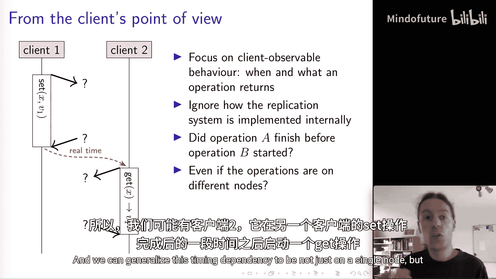

Now this timing dependency here， it looks like the happens before relationship。

 but it is not the same as happens before as we discussed in previous lectures。

So if you remember the way happens before is defined is it's defined in terms of sending and receiving messages。

 So its if there is some path through our message， send and receive graphs so that you can get from one event to the other event。

 then we have that one event happens before the other event。

 So happens before is not defined in terms of real time。

 It's defined in terms of message sending and receiving whereas。

Linearizability is defined in terms of real time， so we are assuming if there is some hypothetical observer who can see exactly when which operation finished and when which operation started。

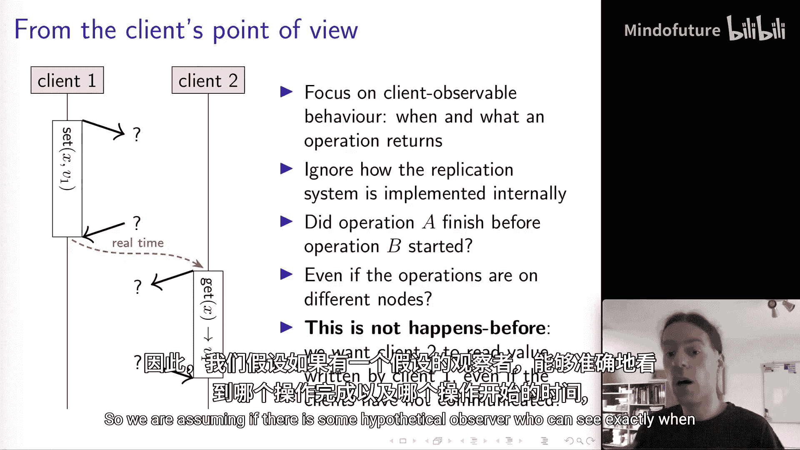

This observer can tell us whether a certain operation started after another operation finished and therefore it should be able to observe its operations its up to date state and we have that dependency even if those nodes did not communicate so even here client1 might not send a message to client2 at all。

 but nevertheless we have this real- time timing dependency between the two operations because this operation by client2 definitely happened later in time。

 Dan client1's operation。

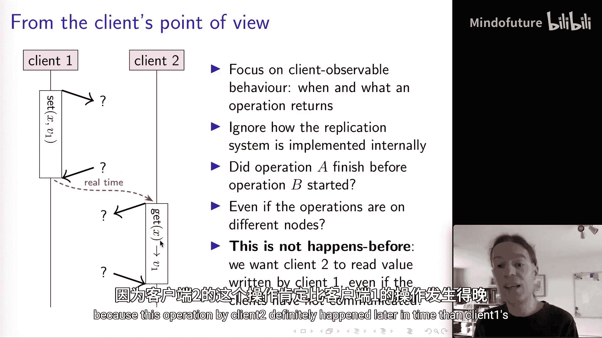

On the other hand， if the two operations overlap in real time。

 then they can take effect in either order。 So in this case here， for example。

 we might have the set operation taking effect first and then the get operation taking effect second。

 in which case the get operation will return the value V1。

 but it could just as well be the other way round。 So it could be that the get operation takes effect first。

 the set operation second， and both of these two behaviors are absolutely fine under linearizability。

😊，So because linearizability just says that the time when an operation takes effect must be sometime after it started and before the operation finished。

 so sometime somewhere within this rectangle has to be the moment in time when the operation takes effect atomically。

 but we don't know where exactly within this rectangle。

Because we don't know what the exact network latency is going to be and so in this particular case where two operations overlap in time。

 they can be ordered either way， but if they do not overlap in time。

 so one operation finished before the other one started。

 then we have this timing dependency and linearizability that tells us what value we must read。

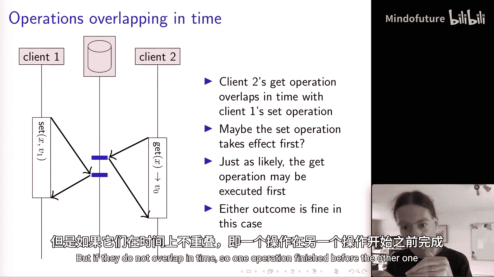

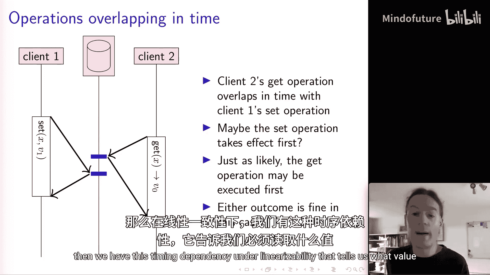

So we talked about read after write consistency and that is ensured using Qrum rights and Qrum reads。

 and you might wonder if those Qrum reads and write are sufficient in order to ensure linearizability。

And the answer is no， interestingly， it is not sufficient to ensure linearizability just to have these quorum read rights。

 and I'm going to show you with an example why that is the case。So in this example here， we have。

 first of all， a set operation by client1。 So as before， client1 wants to set the value of x to B V1。

 and so it sends this set request to all three of the replicas。

 And let's just assume for now that for some reason the request to replica A goes through very quickly。

 but there's a network delay in communicating that request to B and C。

 So eventually B and C will get updated with the value V1， but right now。

Only replica a can seede the value v1 just because of the way the network happened to time things。

Now clientient 2 starts and makes a get request and it requests the value of x from a quorum。

 it gets a response from a quorum consisting of replicas A and B。

 and it's going to compare the timestamps as usual and it's going to see that V1 is the more up to date value and so it's going to return value V1 from this get request。

Next， client 3 comes along and Cl 3 also wants to read the value of X。

 It sends a get request to the nodes。 It receives a quorum of responses。 In this case。

 it happens to get responses from nodes B and C。 Now， this is also a valid quorum。 So this is fine。

 but it happens that B And C， Neither of them has seen that up to date value V1 get。

Because so far a value v1 is only on replica A， but not on B and C。

 so client 3 is going to only see the value v0， it is not aware of V1。Now， after this has happened。

 now the client once set operation reaches replicas B and C。

 So now replicas B and C get updated and they respond， okay so。

All of these requests here satisfy a quo condition。

All of them have acknowledgecment from a quorum of nodes。

 but and you know there are no errors happening here。

 but nevertheless you can see that we have these two get requests from client2 and client 3 and we have a real time dependency between these two requests because client3's requests started later than client2's requests finished。

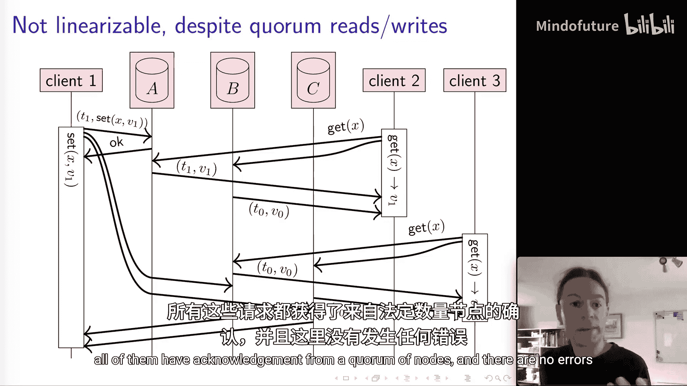

So as before we have this real time dependency between these two operations and linearizability is not only about this dependency between set and get operations。

 but also from one get operation to another get operation。

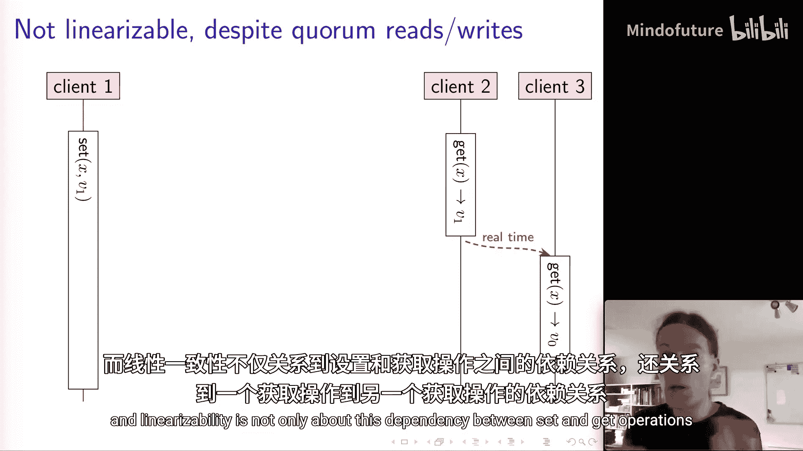

As before we would expect here under linearizability。

 we would expect client 3 to read a value that is no older than the value read by client 2。

 So we expect this to return V1 when， in fact， it returned v0。

 and so this is a violation of linearizability。Now， you might be wondering， can we fix this。

 Can we fix this quorum read and write algorithm in order to make it linearizable under all circumstances。

 and the answer is yes， we can do that， and it works like this。

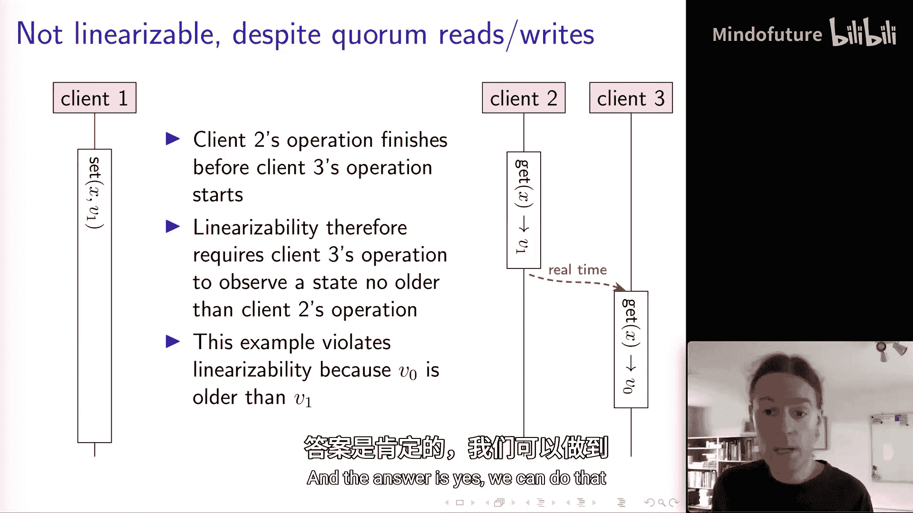

So first of all， the set operation from client1， that's exactly the same as it was before。

 so it gets sent immediately to A and it's delayed on its way to B and C。 that's fine。And next。

 client 2， so client 2， as before， sends a get request。

 gets back responses from a quorum consisting of A And B。

 It decides that V1 is the newer value based on the time stampamp。

 but now we don't just return V1 immediately， but client 2 now knows that replica B has an outdated value。

And client2 doesn't know what the， what the value on replic C is。But it might be outdated as well。

 And so what client 2 is going to do is now it's going to resend the set request to any replicas that did not have the latest value。

 So in this case， it's going to send the value V1， along with the original timestamp T1。

 It's going to send that to replicas B and C。

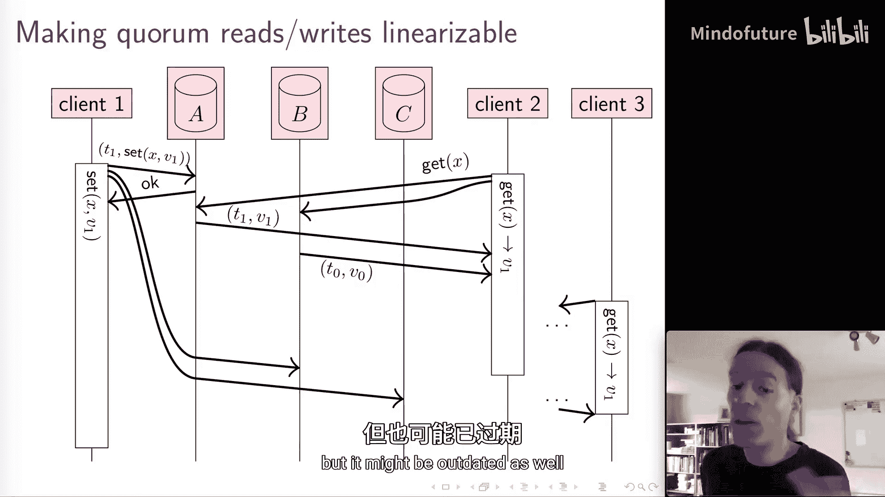

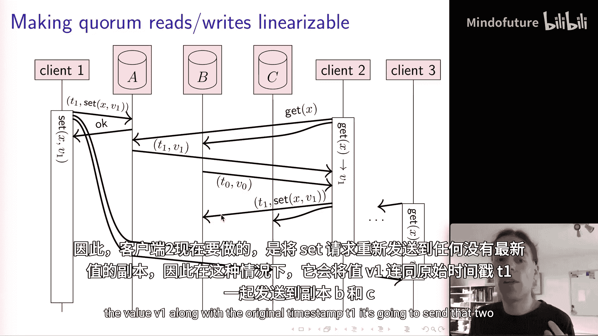

And it's going to wait for at least one of them to respond。

 This case is' waiting for both of them to respond。 but one of them is enough。

 So if one of the two responds now client2 knows that the value V1 is present on a quorum of replicas at the time when this get request finishes。

And because。Client too now knows that。The value V1 is present on a quorum。

 therefore any subsequent get request that gets values from a quorum will also see that up to date value。

So here what we have to do， this is what I called read repair in a previous lecture。

 so that is the client taking a role in distributing the updated value to the other replicas and here as long as the client does not immediately return from the get request。

 but it has to wait。Until it is sure that the new value has reached a quorum of replicas。

 then it's allowed to return。 And if we do that additional round of read repair as part of a get request。

Then the algorithm becomes linearizable。So in this case now finally we have the response going to client1 and in this case everyone is happy in this case client3 is going to see the value V1。

 it's assured to see that。

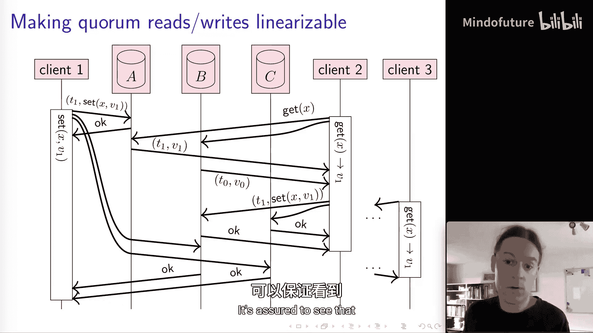

So this gives us linearizability for get and set requests。In this case。

 we do the get by doing a quorum read with read repair and a set request is what we might call a blind write。

 so the set request just overwrites whatever the value of this object is。

 it doesn't like conditionally overwrite it， it's just an unconditional overwrite its value with whatever whatever the current value is just overwrite it with a new value。

嗯。And this is this algorithm here it's called the ABD algorithm is enough to ensure linearizability of these requests。

 however what might happen is if multiple clients are concurrently writing to the same object。

 then those might overwrite each other so there's no coordination between the rights we will be ensured that they all end up with the same value across all of the replicas but you might have a conflict due to two concurrent rights。

So one other thing you might want is a compare and swap operation So remember this again from the first half of this course on concurrent systems。

 a compare and swap operation is often built into CPUs as an atomic instruction which allows you to set the value of some memory location to some new value only if it's old value is some particular value and it does this atomically so even if multiple threads are concurrently executing these compare and swap operations。

 only one of them is going to succeed， so it's not going to allow concurrent context switches between like the checking of the old value and the setting of the new value。

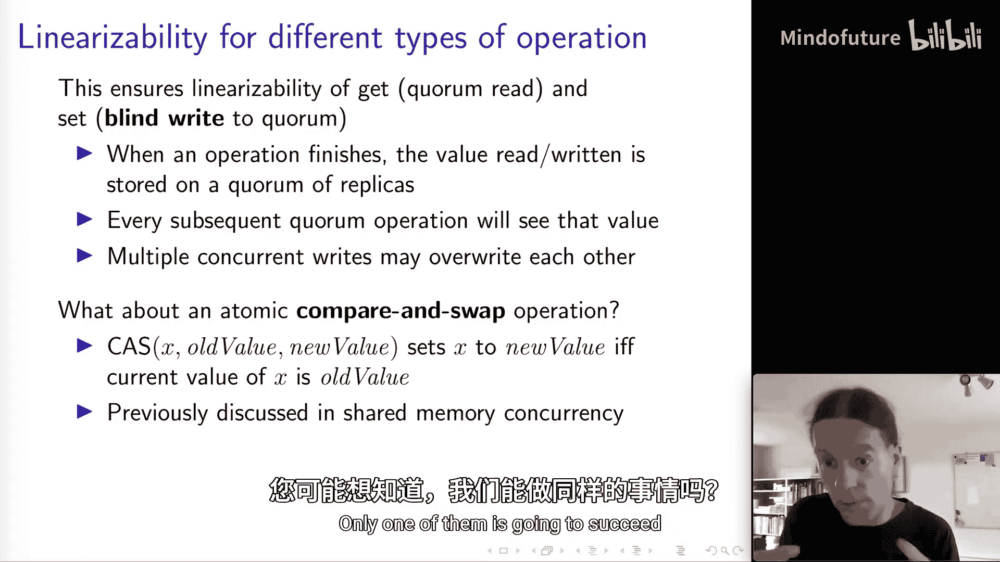

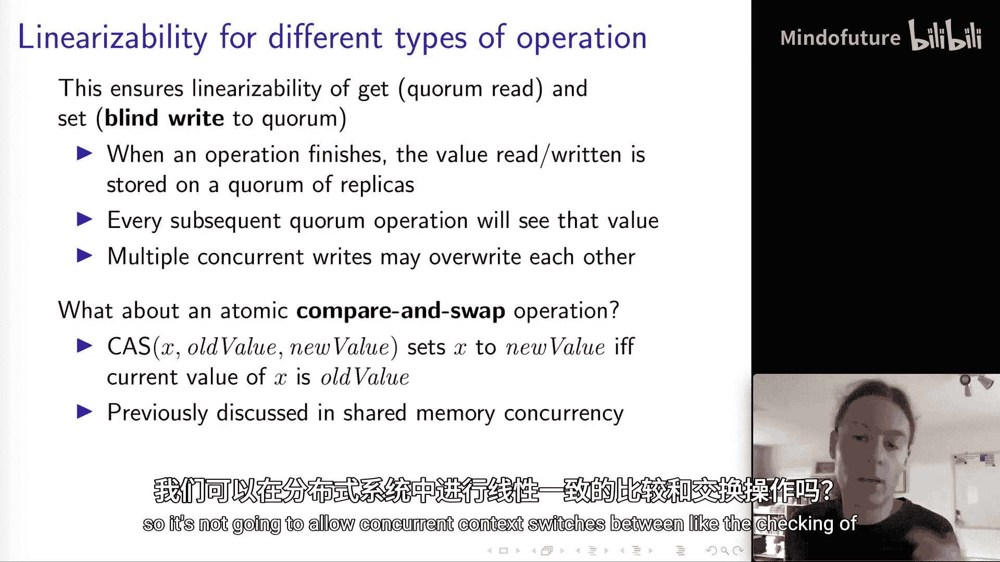

And you might wonder， can we do the same thing。 Can we do a linearizable compare and swap operation in a distributed system。

 And the answer is actually， yes， we can。 But we have to use a different algorithm from the Qrum read and rights that we just did。

 We can instead use total order broadcast again。 So once again。

 total order broadcast comes to the rescue。😊。

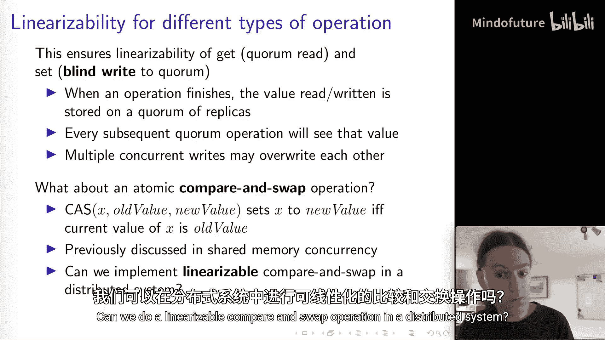

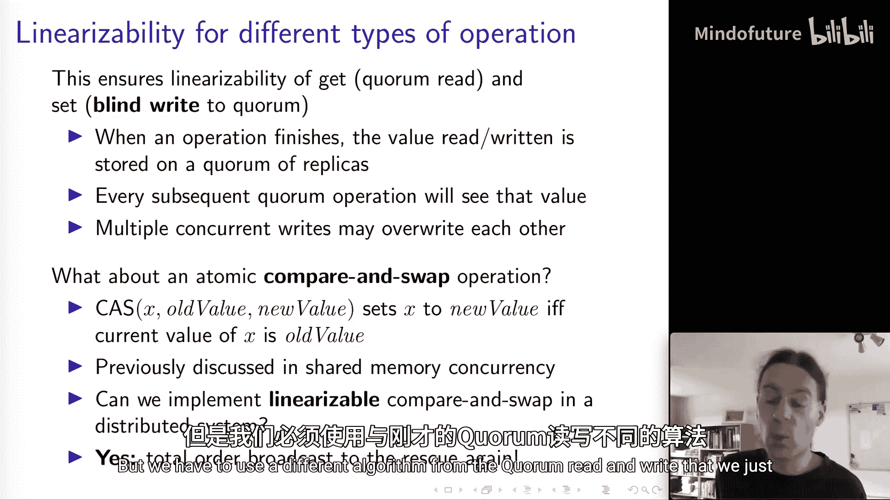

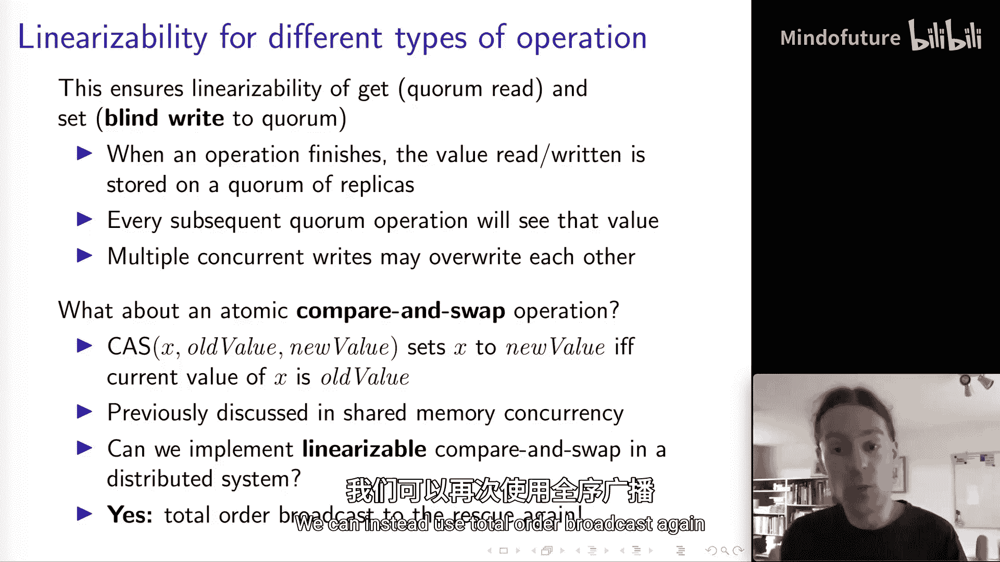

And this algorithm fits on just one slide， It's quite simple。

The way we can implement implement a linearizable compare and swap operation and a linearizable gett operation using total order broadcast。

 if we want to do a get operation， we're going to make a message saying gett X and we're going to total order broadcast up to all of the nodes。

And we're not going to respond immediately， we're going to wait for that message to be delivered by total order broadcast。

Likewise， if we want to do an atomic compare and swap operation。

 we're just going to package that operation up as a message。

Distributed via total order broadcast and wait for that message to be delivered。Now。

 when one of the get messages is delivered by total order broadcast。Well。

 remember what total order broadcast does， it just ensures delivery of the same messages in the same order。

 So therefore all replicas are going to receive the requests and receive these messages in the same order。

 So therefore here now when that message is delivered。

 we can just read the local state read the value of x and return that current value as the result of this get operation。

And likewise， if we receive a CAS message for compare and swap。From total order broadcast。

 then we just do the straightforward compare and swap algorithm。

 So if the the existing state is the old value that we want。

 then we set it to the new value and we return success being true。 Otherwise。

 we don't change anything and we return success being false and we return this as the result of the compare and swap operation。

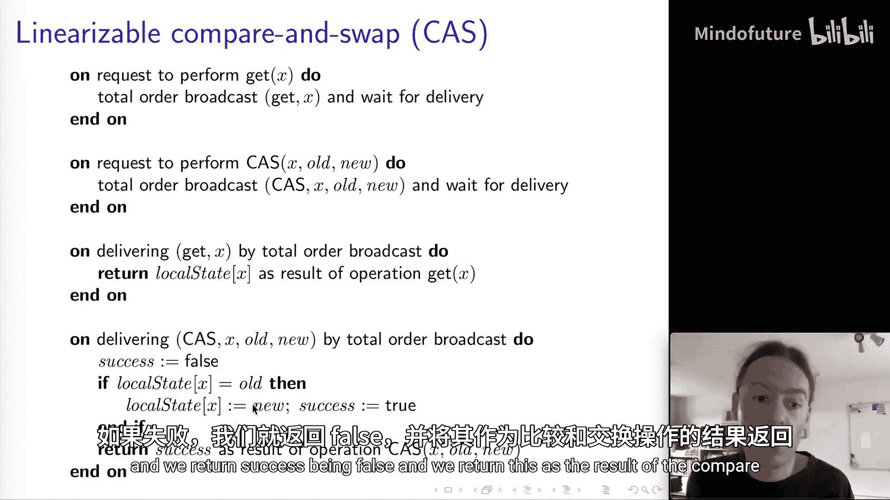

And you know， this is very simple。 but because。Total order broadcast essentially gives us this kind of single threaded view that all of the operations are delivered in the same total order on all of the nodes。

 What we have here is essentially the same as state machine replication。

 We are going to ensure that the get operations get those same result on each replica and the compare and swap operations have the same effect on every replica。

 And so here we get linearizability。 We get these linearizable operations by building on total order broadcast。

 which I think is a very neat construction。😊。

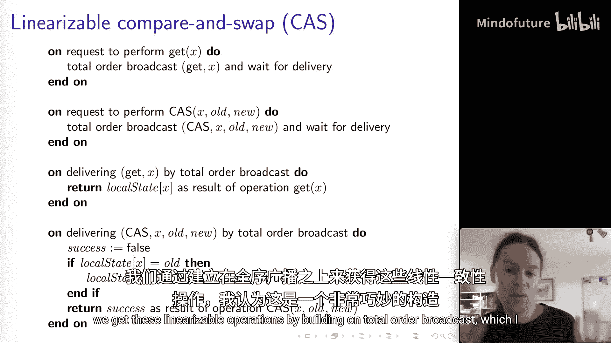