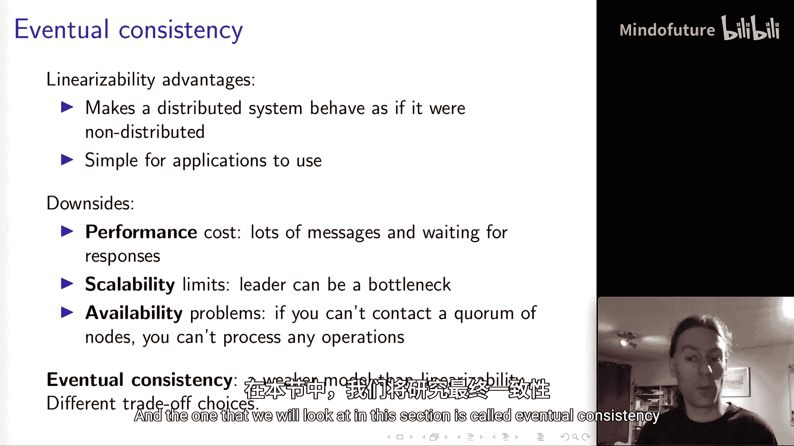
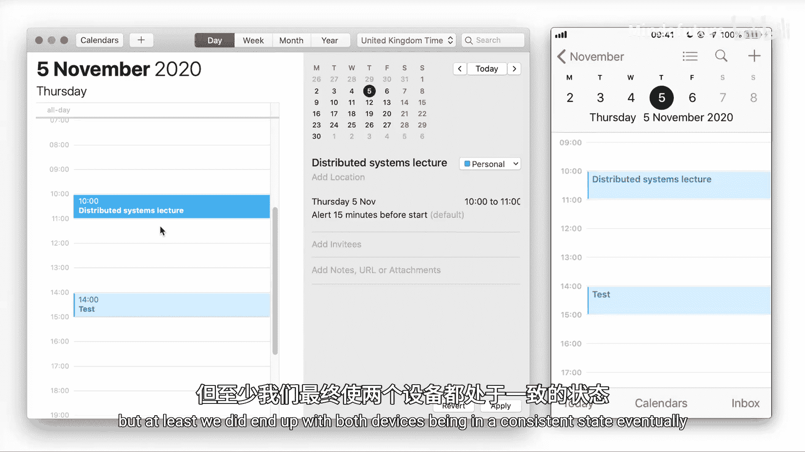
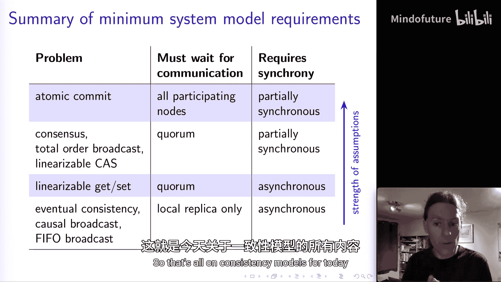

# 【剑桥大学-•-中英】分布式系统讲座-p21-P21-Distributed-Systems-7.3---Eventual-consistency--BV1NwQhYeEyV_p21-

So we've talked about linearizability as one possible consistency model for distributed systems。

 which is a very strong consistency model and we said it has the very appealing property that it actually makes a replicated system look as if it were not replicated。

 it looks as if there was only a single copy of the data and all of the operations on it are atomic。

 which makes linearizability a very easy to use consistency model。

 you basically don't have to think about the fact that your system is distributed and it just kind of works in the way you might expect。

Unfortunately it comes at a price as well so linearizability is not actually suitable in all possible circumstances for several reasons one possible reason is that it's actually quite expensive to implement if you look at the protocols that we discussed there are lots of messages going back and forth。

 lots of waiting for responses probably something like round two round trips for most requests。😊。

So you know it's just going to be a bit slow basically another limitation is the scalability potentially depends a bit on the exact algorithm you're using。

 but if you're using a consensus algorithm like raft， for example。

 all of the updates have to be sequenced through the leader so there's a single node that all of the updates have to flow through and so you are limited by the capacity of that one node in this kind of system that can be that one leader node can become a bottleneck。

And what is perhaps most the deepest problem with linearizability and such strong consistency models？

iss problems with availability and that is every operation that you do needs to contact a quorum of nodes and that means if you can't contact a quorum of nodes for whatever reason。

 maybe you're disconnected on the network or so you can't process any operations neither reading nor writing is possible if you can't contact a quorum of nodes。

And that's why alternative consistency models have been developed， which have different trade offs。

 which are better in some regards and worse in other regards。

 and the one that we will look at in this section is called eventual consistency。

As an example， let's consider a calendar app。 So here I have on the left hand side。

 the calendar app running on my computer and on the right hand side。

 the calendar app running on my phone。 And you all know what this， how this works。

 I can add an event on the left hand side， say this。It systems。

And and this will sink within a couple of seconds over to the phone on the right hand side。

 So then the same event should appear there。 Here we go。And similarly。

 I can add an event on the phone。And。This should sync over to the computer。No。

What we can what we've got here if you think about it is a replicated system。

 we've got a copy of the calendar on my computer and another copy of the calendar on my phone and these two replicas are independent from each other in the sense that I can put my phone into airplaneplan mode and now I have prevented any communication from between these two devices from happening and so I could。

 for example， on my computer now change the time of the distributed systems lecture to 10am and this won't sync over to my phone because my phone is unable to communicate and let's say on my phone I change the title to say distributed systems lecture 1。

And this also won't sink back to the computer until I eventually turn off aeroplane mode and so now after aeroplane mode is off now the two devices should be able to sync up with each other again and the changes from one should propagate over to the other so you can see what has happened now is the time of this event has moved to 10am on both devices but my change changing the title distributed assistant lecture I changed it to lecture 1。

 but that change at the title has somehow disappeared and so what we have here is a conflict because I concurrently edited the same calendar event on two different devices while they were disconnected from each other and we had a conflict resolution that had to happen here and what my calendar app did apparently was a last write wins resolution in which case in this case。

 the update of the time to 10 AM。Somehow took precedence over the update of the title and so the update of the title was discarded while the update of the time took effect on both devices。

 but so even though some data was lost here， but at least we did end up with both devices being in a consistent state eventually。

These systems such like the calendarar app， can be formalized using this result from distributed systems called the CA theorem and this idea behind this is fairly simple。

 it is say you have a system in which theres a network partition that is some of the nodes one subset of the nodes is unable to communicate with some other subset of the nodes。

In this case， we have to make a choice， either we can continue providing linearizability。

 but some of the nodes won't be able to process requests。

Or we allow requests to and operations to continue without contacting a quorum。

 but in that case we risk violating linearizability and so we have to just make this choice in the presence of a network partition illustrated here so we've got on the left hand side of the partition nodes A and B which form a quorum and they can continue providing a linearizable service for these operations but node C here on the right-hand side is stuck in this dilemma because either the node C has to wait for this network partition to be healed before it can reach a quorum which might take indefinite amount of time and so in that during that time node C is effectively unavailable and not able to process any requests。

Or node C just goes ahead and uses its local state， but in that case。

 it won't know about the value v1 that was written by a。 So in this case。

 we will have violated linearizability。 And so this is just the fundamental choice that you have to make in a system in which part network partitions might occur。

 and eventual consistency is sort of the broad category of consistency models that typically people move to if they don't want to make an assumption of being able to communicate with a quorum。

 something like that。 So if we want each replica to be able to process operations just based on its local state and without waiting for a communication with a quorum。

 we cannot achieve linearizability， but we can achieve weaker consistency models。

 and the way eventual consistency is usually defined is like this。 first of all。

Any read requests a replica can just process based on its local state。And then。

Whenever some updates get applied to one replica， they will eventually wander over the network at some point to other replicas and what we want to guarantee is that if we assume that at some point the updates stop。

 then eventually after the updates have stopped， then all of the replicas end up in the same state。

Now this is okay， but it's a fairly weak property because， for example。

 what if the updates never stop， you could have a system in which continually updates are processed nonstop。

 and so in this case eventual consistency does not define what will happen in that case because the premise of this statement of this definition is not true。

 So what people have done is to define an alternative slight strengthening of eventual consistency called strong eventual consistency which is defined with two properties So first of all。

 we say that any update that has been made on one replica will eventually also be made on another replica。

 So updates get disseminated over the network we don't make any guarantees about how long that's going to take。

 we just say eventually this will happen and secondly。

 whenever you have two replicas that have processed the same set of updates。

 then those replicas must be in the same state and thus they will return the same result。

To any read requests。 and this must hold even if the update if those updates were actually applied in a different order on different replicas。

And so。This comes back down to the causal broadcast based replication protocols that we saw earlier。

 for example， where if you have commutative operations for updatingating the state。

 then you can have different replicas updating the state in a different order and still converging to the same final state and so this idea of convergence is really at the core of of eventual consistency and strong eventual consistency。

Now both eventual consistency and strong eventual consistency have some very nice properties if you want to implement this model。

 there is no need ever for an operation to wait for communication with another replica so a replica can always process operations both both read and writes can be processed just locally without waiting for any communication Of course eventually sometimes communication will have to happen in their background。

 but the operations don't have to wait for it， which means that the operations can always be fast they're never waiting for network round trips and the operations can always be reliable because even if the network is interrupted and a replica can continue processing operations。

😊，And we can use these broadcast protocols of causal broadcast or50 broadcast or these other weaker broadcast as a way of distributing the updates from one replica to another。

 Now one problem that can arise with eventually consistent systems is that the same object or the same data item can be concurrently updated by multiple replicas and there's nothing stopping this。

 of course， because they cannot communicate in necessarily and so because we have these concurrent updates of the same object we might have conflicts。

 and so those conflicts will have to be resolved in some way or another with the calendar app what we saw is just the last writer to wins policy where one of the updates precedence over the other。

 the other one was just discarded but we can also devise more sophisticated conflict resolution policies and I've actually done some research in this area on merge merge algorithms which will take concurrently updated data structures and merged。

Together into a clean final state to resolve to conflict。So that's eventual consistency。😊。

I'll now recap the consistency models and algorithms that we talked about in this lecture and do that in the order of how strong the assumptions are that they make about the system model。

 This is an interesting way of comparing these different algorithms and approaches。 So first of all。

 we started with atomic commitment as in two phasese commit and remember that the model with atomic commit is that a transaction can commit only if all of the participating nodes vote to commit。

And so this means that inevitably atomic commit requires communicating with or participating nodes。

 which might be all nodes in a system。 So if any one node is crashed。

 atomic commit will not be able to commit any transactions。

 So this is a very strong assumption that we have to make about the communicationunation that happens in a system。

 We have to communicate with all nodes and wait for their response。Moreover。

 we have to assume a partially synchronous system model because we have timeouts and failure detection that has to happen。

Now。One step down from this is consensus and total order broadcast。

 And so consensus and total order broadcast， the FLP result told us that this also requires a partially synchronous model。

 So the FLP result says that there is no asynchronous algorithm for implementing consensus and so therefore partial synchrony is what we have to assume。

 but in terms of the communication， these consensus actually assumes a bit less because it only requires communication with a quorum。

 And so therefore we can tolerate a minority of nodes being unavailable and the algorithm will still be able to make progress and complete as normal。

 And so this holds for consensus and total order broadcast。

 which are equivalent to each other as we said， Moreover。

 we saw that for linearizable compare and swap， we can implement that using total order broadcast。

 And in fact， it is possible to prove that linearizable compare and swap is also equivalent to consensus。

 So all these three problems are actually reducable to each other。

 they all have the property that they require a quorum。synchrony。Moving down into list。

 interestingly， a linearized board get and set operation。

Has weaker assumptions than a linearizable compared swap operation， Because for get and set。

 we can just use the approach we saw earlier。 the ABD algorithm。

 which means quorum writes and quorum reads with read repair。

And this still requires communicating with a quorum of nodes。 But notice that in this algorithm。

 there are no timerss。 There are no timeouts。 There's no failure detection。

 The algorithm is actually completely asynchronous。 It doesn't require on clocks at all。 And so it。

 so this means that actually linearizable get and set has weaker assumptions about the system model than compare and swap。

And finally， as we move all the way down to the weakest assumptions that we can make。

 now we're with eventual consistency。😊，Where。Every replica can update and read its own local state without waiting for any communication with any other replica。

 so the communication need is totally minimized here and we still make no timing assumptions so this is about the weakest that we can assume for both eventual consistency and strong eventual consistency and also in terms of the broadcast protocols called the broadcast 50 broadcast reliable broadcast and best effort broadcast all of these have the property that they can deliver a message to themselves immediately a node doesn't have to wait for communication with any other node in order to deliver a message to itself。

And this thus also has the property that if these messages are updates。

 that means updates can be applied locally without waiting for any communication。

 so this also has the property that no waiting for communication is required in order to process local updates。

So that's all on consistency models for today。😊。

