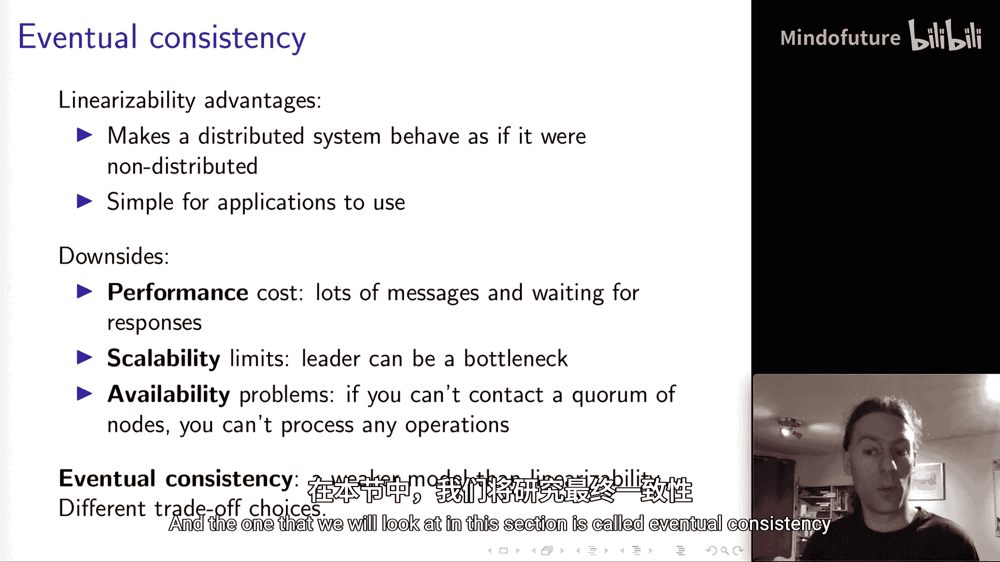
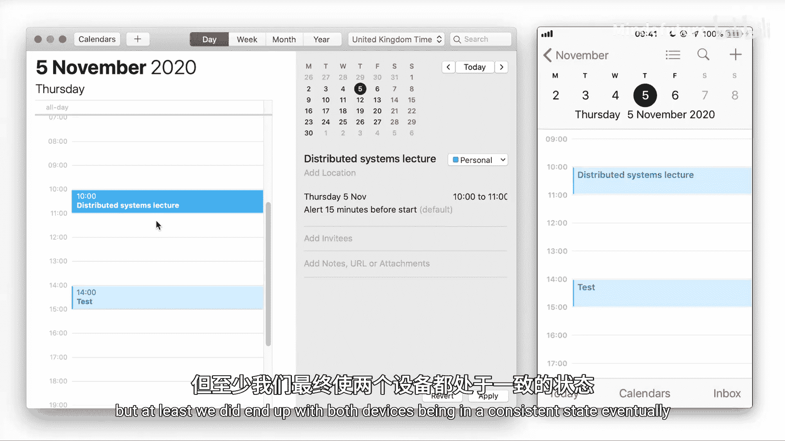
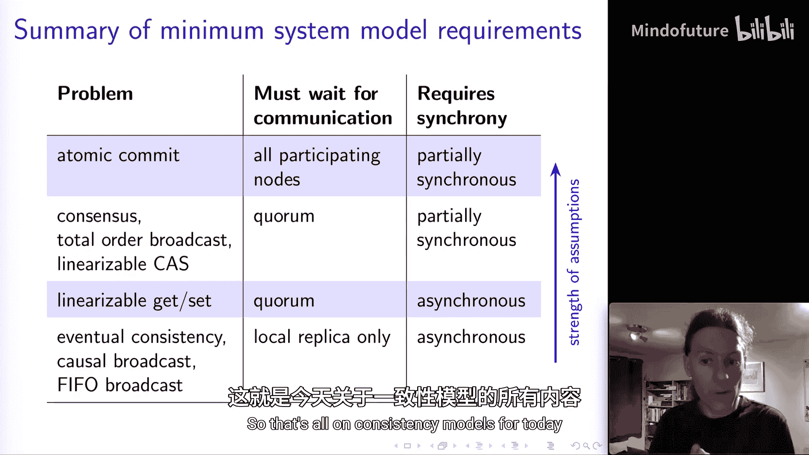

# 分布式系统：7.3：最终一致性 📡

在本节课中，我们将要学习线性一致性之外的另一种分布式系统一致性模型——最终一致性。我们将探讨其定义、工作原理、优缺点，并通过一个日历应用的例子来理解它在实际场景中的应用。

## 概述

上一节我们介绍了线性一致性，它是一种非常强的一致性模型。本节中，我们来看看最终一致性。最终一致性是一种较弱的一致性模型，它牺牲了强一致性，以换取更高的可用性和性能。当网络出现分区或节点无法通信时，系统仍能继续处理操作。

## 线性一致性的局限性

线性一致性虽然易于使用，但它存在一些显著的局限性，使其并非适用于所有场景。

以下是线性一致性的几个主要问题：

1.  **性能开销高**：实现线性一致性需要大量消息往返。大多数请求可能需要大约两轮网络往返，这会导致操作变慢。
2.  **可扩展性受限**：在使用类似Raft的共识算法时，所有更新都必须通过领导者节点排序。这个单一的领导者节点可能成为系统的瓶颈。
3.  **可用性问题**：每个操作都需要联系一个法定数量的节点。如果因网络断开等原因无法联系到法定数量的节点，那么任何读写操作都无法进行。

正因如此，人们开发了具有不同权衡取舍的替代一致性模型。最终一致性就是其中之一，它在某些方面更好，在其他方面则有所不足。

## 最终一致性示例：日历应用

为了理解最终一致性，让我们考虑一个日历应用的例子。

假设左侧是运行在我电脑上的日历应用，右侧是运行在我手机上的日历应用。这是一个典型的复制系统：我的电脑和手机上各有一份日历数据的副本。

*   我可以在电脑上添加一个事件，几秒钟后，这个事件会同步到手机上。
*   同样，我也可以在手机上添加事件，并同步到电脑。

现在，让我们思考一个更复杂的场景。如果我将手机设置为飞行模式，两台设备之间的通信就被切断了。

*   在电脑上，我将“分布式系统讲座”的时间改为上午10点。这个更改无法同步到手机。
*   在手机上，我将同一个事件的标题改为“分布式系统讲座 1”。这个更改也无法同步回电脑。

当我关闭飞行模式后，两台设备重新开始同步。此时，我们看到了一个冲突：两个设备在断开连接时并发编辑了同一个日历事件。我的日历应用采用了“最后写入胜出”的冲突解决策略。在这个案例中，时间改为上午10点的更新覆盖了标题改为“讲座 1”的更新，导致标题的更改丢失了。

尽管有些数据丢失了，但最终两台设备还是达到了一致的状态。这就是“最终一致性”的体现：系统不保证立即一致，但保证在没有新更新的情况下，所有副本最终会收敛到相同的状态。

## CAP定理与一致性选择

像日历应用这样的系统，可以用分布式系统中的CAP定理来形式化理解。

其背后的思想很简单：当系统发生网络分区时（即一部分节点无法与另一部分节点通信），我们必须做出选择。

*   **选择一（CP）**：继续提供线性一致性，但部分节点将无法处理请求（即牺牲可用性）。
*   **选择二（AP）**：允许操作在不联系法定节点数的情况下继续进行，但这可能违反线性一致性（即牺牲强一致性）。

最终一致性属于后一种选择。如果我们希望每个副本都能仅基于其本地状态处理操作，而不必等待与法定数量节点的通信，那么我们就无法实现线性一致性，但可以实现像最终一致性这样的较弱模型。

## 最终一致性与强最终一致性

最终一致性的通常定义如下：

1.  任何读请求，副本都可以仅基于其本地状态处理。
2.  当一个副本应用了某些更新后，这些更新最终会通过网络传播到其他副本。我们保证，如果更新停止，那么最终所有副本都会达到相同的状态。

这个定义比较弱。因此，人们定义了一个稍强的变体，称为**强最终一致性**，它包含两个属性：

1.  **事件传递**：在一个副本上进行的任何更新，最终也会在另一个副本上应用。
2.  **收敛性**：任何两个处理了相同更新集的副本，必须处于相同的状态，因此对任何读请求都会返回相同的结果。即使这些更新在不同副本上以不同的顺序应用，此属性也必须成立。

这回到了我们之前看到的基于因果广播的复制协议。如果你有可交换的状态更新操作，那么不同的副本可以以不同的顺序更新状态，并最终收敛到相同的最终状态。**收敛性**是最终一致性和强最终一致性的核心思想。

## 最终一致性的实现与冲突

实现最终一致性模型有一些非常好的特性：

*   **无需等待**：操作永远不需要等待与其他副本的通信。副本可以始终在本地处理读写操作。当然，后台最终需要进行通信，但操作本身不必等待。
*   **快速可靠**：操作总是快速的（无需等待网络往返），并且总是可靠的（即使网络中断，副本也能继续处理操作）。

我们可以使用因果广播或更弱的广播协议作为在副本间分发更新的方式。

最终一致性系统可能出现的一个问题是，多个副本可能并发更新同一个对象，这可能导致**冲突**。冲突必须以某种方式解决。

*   **最后写入胜出**：就像日历应用的例子，后到达的更新覆盖先前的更新。
*   **更复杂的合并算法**：可以设计更复杂的冲突解决策略，例如合并算法，它能将并发更新的数据结构合并成一个清晰的最终状态以解决冲突。

## 一致性模型与算法总结

现在，让我们按照对系统模型假设的强弱顺序，来回顾本讲座中讨论过的一致性模型和算法。

1.  **原子提交（如两阶段提交）**：
    *   **假设最强**：事务提交必须与所有参与节点通信并获得同意。任何节点崩溃都将导致无法提交事务。需要部分同步系统模型（因为有超时和故障检测）。

2.  **共识与全序广播**：
    *   **假设稍弱**：FLP结果指出，这也需要部分同步模型。但在通信方面，它只要求与法定数量节点通信，因此可以容忍少数节点不可用。

3.  **线性化的比较并交换**：
    *   可通过全序广播实现，并且可证明其与共识等价。因此，它同样需要法定数量通信和部分同步性。

4.  **线性化的读取与设置**：
    *   **假设更弱**：可以使用ABD算法（法定数量写入和读取，配合读修复）。该算法仍然需要与法定数量节点通信，但它是完全异步的，不依赖时钟或超时。

5.  **最终一致性**：
    *   **假设最弱**：每个副本都可以在不等待任何通信的情况下更新和读取其本地状态。通信需求降至最低，且不做任何时序假设。因果广播、可靠广播等协议也具有此属性，节点可以立即将消息传递给自己，从而本地应用更新。

## 总结

本节课中，我们一起学习了最终一致性。我们了解到，最终一致性是一种弱一致性模型，它通过牺牲强一致性来换取高可用性、低延迟和更好的分区容忍性。我们通过日历应用的例子看到了它的实际运作和可能出现的冲突。最后，我们比较了从原子提交到最终一致性等多种模型对系统假设的强弱要求，认识到最终一致性位于假设最弱的一端，适用于对可用性要求极高、能容忍短暂不一致的场景。