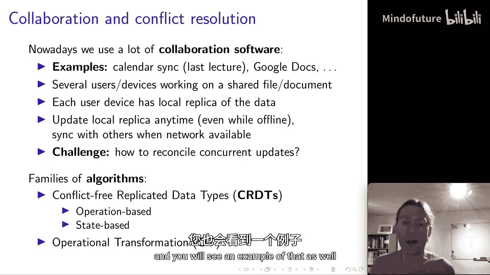
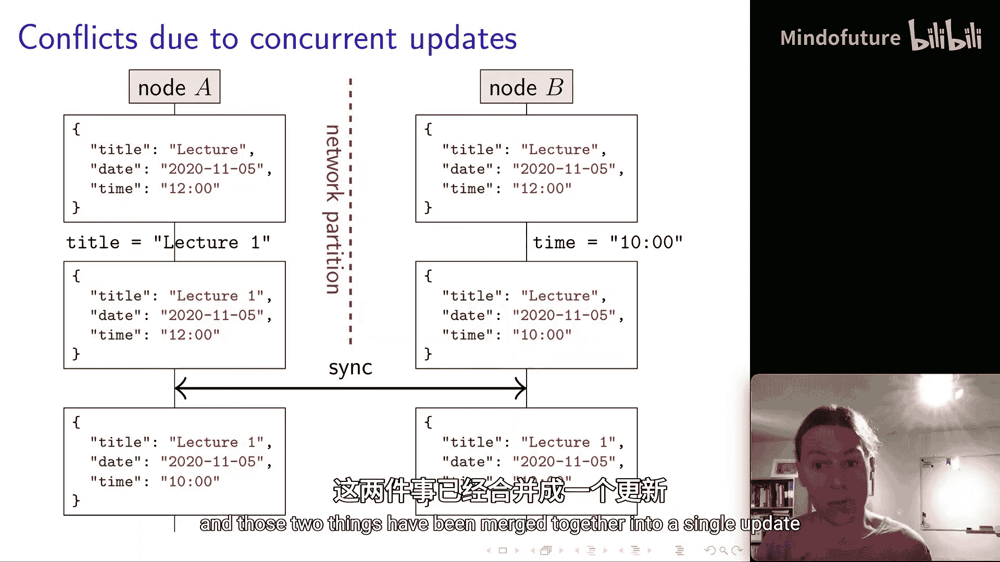
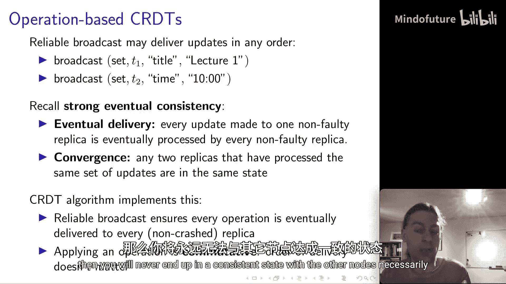
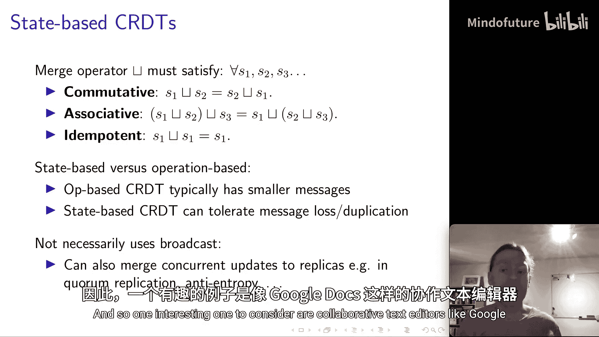
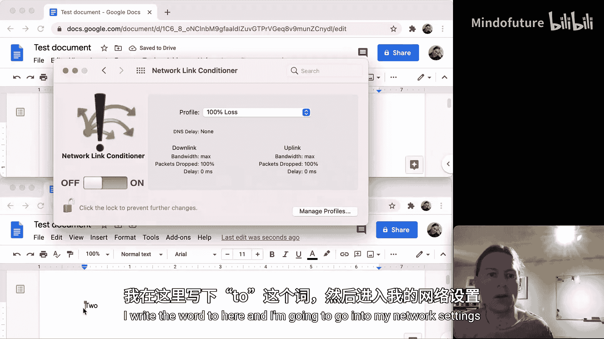
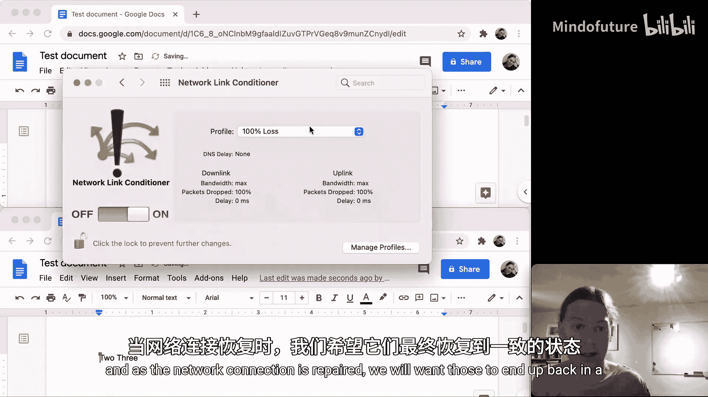
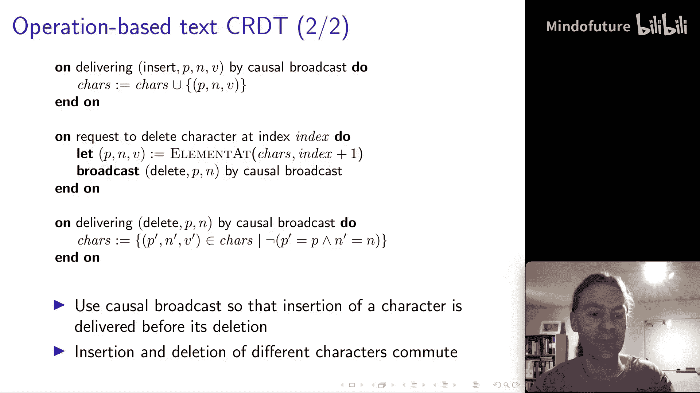

# 【剑桥大学-•-中英】分布式系统讲座-p22-P22-Distributed-Systems-8.1---Collaboration-software--BV1NwQhYeEyV_p22-

Welcome to the eighth and final Dis systems lectureture。

 this lecture we are going to look at some case studies of example applications。

 real world software that uses the distributed systems concepts that we've seen in this course and in particular that has interesting problems to deal with around concurrency。

So I'd like to start with collaboration software so this is a fairly broad category of collaboration of software but you've probably used things like this before what I have in mind are things like Google Docs where you can have several people editing a document at the same time or the calendar sync example that we saw in the last lecture where I can update some events on one device and have those synchronize over to another device。

😊，And many other applications that have this kind of similar collaboration built in nowadays because it's just so useful to be able to work on something with your colleagues without having to email files back and forth。

 for example。So what these applications have in common is that there are several users。

 each user using some device to access some shared file or document or database。

 each of these devices has its own local copy of the data that it's working on this might just be an inmemory but we can still call it a replica of this shared data and each user is able to update the replica of their own their own copy of this document。

 be it in their web browser or in a mobile app or something like that。

 the user can update this data anytime whenever they like。

 even if they're disconnected from the internet ideally。

 and then sometime later when they have an internet connection again。

 then they will sync back with the server and with any other clients that have a copy of this document。

Now， the challenge in this is we can have several people concurrently updating the same document。

 and we have to somehow reconcile those concurrent updates and make sure that everyone ends up in a consistent state。

And so that the software continues working as we might expect and there are two main families that of algorithms that are used in order to implement this type of software one is conflict re replicated data types or CRDTs for short and they come in two flavors further operation based and database as I will explain shortly and a second family of algorithms is called operational transformation and you will see an example of that as well。

So let's start with the example from the last lecture where I showed the calendar sync example。

 so I had my phone and my laptop， I had an event in my calendar saying a lecture on a certain date at a certain time and these two devices were disconnected from each other because I put my phone into aeroplane mode。

Now let's say that on the computer， I update the title from lecture to lecture1。

 and while these two devices are disconnected， concurrently I update the time of the lecture on my phone to be 10 o'clock。

And so now we have these two concurrent updates and sometime later the network is restored and these two devices want to sync and we want to ensure that at the end we have the same information on both devices that these devices converge and ideally we would also like to not lose any data in the process and so in this example we have kept the update of the title saying lecture 1 and we have kept the update of the time to say 10am and those two things have been merged together into a single update So let's look at some algorithms that can achieve this conflict we replicated data types or CRDts are as I said。

 one of the types of algorithms you can use here and this is an example of what is called an Opbased CRDt the data model of this is a map so it's just like a map object that you might have in Java or so so you have this objectoriented interface that you're using in order to represent your data and in this case the data type that we have is a map from keys to values。

So keys and values are not further interpreted， they could be strings。

 but they could be numbers or whatever we like。And the only property that we want to hear ensure is that for a given key。

 there is exactly one value。 And so we can achieve this using the last writer or wins approach that we saw in a previous lecture。

 And so the way you might do this is as follows。 So let's say when a replica initialises。

 it just sets up its own state to be this variable values， which is just an empty set。

And this set here is going to contain mappings from keys to values。

 and each mapping from a key to a value is also got an associated timestamp。

 We can use a logical timestamp here like a lampport timestamp。

 and this will help us figure out if there's several concurrent updates。

 which one is the more recent value and so when we want to read the value for a given key。

 we just look for any entries in this set values the entries are these triples of timestamp key and value。

 So we look for any entry here for the given key with any timestamp at any value and if it exists。

 we return that value V and if it does not exist， we just return null seeing saying there is no entry for that key in the map。

This here works on the assumption that put a given key there is at most one element in this map。

 which the rest of the algorithm does ensure that particular invariant。

So now if we want to update the map， the way we can do that is as follows。

 So let's say we want to set the key K to the value V。 First of all。

 we make a new timestamp and we can use lamp or timestamp for example for that what we do require is that this timestamp is globally unique So any two nodes generating timestamps will not generate an identical timestamp and if you remember the way we can do that with La or timestamps is by including the node ID of the node that generated a particular timestamp and that will make it globally unique So we're assuming this is just T the timestamp and now we're going to take the key and the value that we were that we wanted to set and that timestamp that we just generated practice altogether into a message and send that via a reliable broadcast。

 So remember that reliable broadcast means as long as any two nodes are not crashed then they will deliver eventually the same set of messages but we're not making any guarantees about the order in which those。

Sages get delivered。And and in particular， this broadcast will also be delivered to the note that sent it itself。

 And that's what happens here。 So when we deliver one of these messages here via reliable broadcast。

First of all， we figure out are there any existing values in our set of values for the same key K So we find any entries in this where the key of the entry equals the key of the update that we're making and we set that to previous and so now this could be an empty set if there is no existing value for the key K in which case we go ahead also we look at the timestamp of any previous value。

 So if there is a previous value for this particular K with a timestamp T prime。

And if the timestamp T prime is less than the timestamp T of the incoming update。

 then we overwrite it。So if this is the case that either there is no previous value or the previous value has a lower timestamp。

 then we're going to remove the previous value from the set of values and we're going to add the new mapping from K to V with timestamp T to the set of values。

Now， this ensures that there's up to one。Up to one entry in the set values for a given key。

 and so therefore this， this for all here actually just means it's matching one particular item in in the set if it exists。

And， you know， this is， this is enough to ensure its strong eventual consistency。

 So the way that this algorithm works， as I said， is by broadcasting just these messages And the messages describe what the keys that's being updated and what is the new value being associated with that key。

 And so in our calendar example， the keys might be the field name。 So title or name or date。

 and the value would be the， well， the value as were associated with that particular field。Now。

 remember what we talked about the concept of strong eventual consistency。

 This is exactly the consistency model that we want to ensure in an application like this and strong eventual consistency consists of two properties。

 First of all， we want that every update is eventually delivered by every replica as long as that replicas is not crashed。

 and then secondly any two replicas that have processed the same updates must be in the same state。

 Now the way we achieve the eventual delivery in this CRDT algorithm that I just showed you is by using reliable broadcast and this is exactly what reliable broadcast ensures it ensures that that any two non-cra nodes will eventually deliver the same set of messages。

Furthermore， the process for updating a replica state when it delivers one of these messages by reliable broadcast。

 this process is commutative and which means that we can apply these various operations here in any order and the final outcome will be the same。

 So this might require a little bit of thinking and does an exercise into lecture notess asking you to actually prove for this particular algorithm that the process of applying an operation really is commutative。

Now this is called an operation based CRDT it's an example of an operation based CRDT because the things that we're broadcasting are operations。

 so it's one operation at a time in each broadcast so this does require the broadcast to be reliable because otherwise you know if you're missing a message then you will never end up in a consistent state with the other nodes necessarily。

There's an alternative construction for CRDTs that we can use which is called a state based construction。

 and here's an example of exactly the same map data type but implemented in a state based way rather than in an operation based way。

And so with a state based CRRDT， you always have a merge operator or this merge function。

 which is usually written as like a set union operator， but squared rather than round。

And this merge operator here must satisfy several properties that I will explain on the next slide。

 And in this particular algorithm， we will define the merge operator like this。

 So the merge operator is going to take two sets of values。 In this case， S1 and S 2。

 These are sets of values of exactly the same form as we had in the operation based version。

 That is their triples of times stampamp key and value。

And in order to merge these two sets of values， we're going to take the set union of S1 and S2。

 take all of the triples in there。 And then for every given key。

 we're going to keep only the value with the highest times stamp。

 and we're going to throw away any older timestamps for that particular key。

 And that's implemented by this logic here。 So for every given triple。

 we keep only those where there does not exist another triple in the same set that has the same key but a higher timestamp And the effect of this is that we keep only the highest times stamp for every given key。

Okay， so give them this merge operator here。 Now the rest of the algorithm is looks kind of familiar。

 So the initialization is exactly the same。 We initialize values to be the empty set。

 The process of reading a key is exactly the same as previously。 So that is given a key。

 we try and find any triple with that key in the set values。

 and we return a value from that triple if it exists。Now。

 the process for updating the value for a given key， this is different。 And so here。

 as before we have， we generate a new timestamp can be a lamp or timestamp as before。And now。

 rather than broadcasting this operation， we're just going to update a set of values directly。

And so we're going to update it in such a way that。Given the set of values。

 we remove any existing entries with the same key EK。Which may be none if there is no previous entry。

 but whatever current entry with key K exists， we're going to remove it。

 And then we're going to add this new triple with the new times stampamp。

 the new key and the new value。 we're going to add that to a set of values。

And now we're going to broadcast this entire set of values to any other replicas。

 So rather than broadcasting the operation， we're broadcasting the entire state of the replica。

 which is here， this value values and this is why it's called a statebased CRDt because the thing we're broadcasting are these values and now when this set of values capital B here is delivered。

 we use the merge function in order to merge that with the recipients set of values。

And so this means you know you've got these sets of values flying around which may be delivered in arbitrary orders and the end result is just we keep each each replica when it receives one of these set of values。

 it just merges it into its own local state and as a result it keeps just maintaining the state that is the latest version of whatever has been flying around。

So the interesting thing to note here is that I said that we can broadcast by best effort broadcast。

😊，Rather than by reliable broadcast。 And this is indeed a distinction between the state based approach and the operation based approach。

 as we will see in a moment。So first of all， about this merge operator。

 So this merge operator for it to work correctly， it must satisfy several conditions。

 It must be commutative， which means we can swap around the order， must be associative。

 which means you can swap around the brackets， and it must be idpotent which is the behavior that as we saw before。

 you can merge a state with itself and that does not change anything。😊，And。

If we have a merge operator that satisfies these constructions。

 then we can build a state based CRDT out of it simply by broadcasting the states and merging them whenever we receive a state from another replica。

Now there's a tradeoff here between operation based and statebased CRDTs。

 so as we saw with the operation based CRDTs， the broadcast messages contain just a single operation。

 so those messages containing just one operational are usually quite small。

 so they're quite efficient in terms of network traffic because compared to the statebased approach where a replica needs to broadcast its entire state that might be a much bigger amount of data imagine a key value mapping that have lots of keys in it。

 you're going to be sending all of the keys and all of the values associated with them in every single message。

So here the advantage of the operation based approach is that it has smaller messages typically statebased approach has larger messages。

 but it can tolerate messages being lost and this is quite interesting here it can also tolerate duplication Duplication is easy because we have item pots in the merge function therefore if you receive duplicates you'll just do nothing。

😊，But even with message loss， it can tolerate this because。

The entire state is encoded in every single message。

 So if you miss the message somewhere along the way。

 as long as you receive some later message is that later message will supersede any previous messages anyway。

 and this actually ensures then that you will get convergence of the replicas even if you've missed some of the messages in the middle。

 And so this is quite nice now because with state based CRDts。

 you don't need to involve the costs of a reliable broadcast protocol because the CRDT itself can deal with unreliability。

 Of course， if no messages are ever delivered， then it won't converge。

 But as long as eventually messages some of the messages get through。

 then you can still get convergence properties。Another nice thing about statebased CRDTs is here I wrote it based on a replication protocol based on broadcast。

 but you can actually use it in other forms of replication as well。

 where it's not actually a broadcast protocol but if you remember back lecture 5。

 I think it was on replication， we had these ideas of quorum replication where a client sends an update to a quorum of replicas and then maybe the replicas have an antienttropy protocol amongst themselves in order to try and resolve any differences in the updates that they've seen and statebased CRDTs work very well in this particular setting as well。

 where you've got these replicas that want to exchange their updates through some kind of antienttropy protocol。

Okay， so this has been an example of a map CRDT， so our data type was a map from keys to values。

 we can construct this kind of concurrency control for other types of applications and other data types as well。

 and so one interesting one to consider are collaborative text editors like Google Docs。😊。

So let me give you an actual demo of this。 I think this makes a bit more interesting。

 So I have here two windows of Google Docs。😊，And you can see if I type in one of them。

 this appearss in the other window， and I can go down here。 I can add a smiley。

 and this will appear in the top window as well。 you know， so far， this is probably familiar。

 You've probably used this kind of software before。 Now。

 the interesting thing is what happens if the， these devices get disconnected from each other for a little while。

 So let's。

Set things up like this。 I write the word two here， and I am going to go to my network settings。

 I'm going to fiddle with the network to drop all of the network packets。

And so now these two apps will still work。 And at the top， I can type 1，2， and at the bottom。

 I can type2，3。And Google Docs hasn't realized yet that my network is disconnected。

 So it's just happily letting me type here。 But you can see that the two copies of the document have diverged。

 So they ended up being temporarily inconsistent with each other。

 And as the network connection is repaired。 we will want those to end up back in a consistent state。

 So let's say I repair the network and you can see exactly what has happened。

 So Google Doc has been able to merge these updates。

 So the addition of one has gone down and been added to the lower document and the addition of three has been added to the top document。

 So we ended up with one，2，3 as a merge result automatically。

 you know we didn't have to do any conflict resolution here or do anything particular。

 Google Docs just figured out by itself what we wanted and just gave us the merged document automatically。

 So let's look at some algorithms that can achieve this kind of collaborative editing。

And。And let me show you by an example of a problem that arises when we try to build this kind of collaborative editing software。

So let's say we here have got a document consisting of two characters B and C。

 and we're going to allow users to edit this document by inserting and deleting characters。

 and we're just going to deal with the document one character at a time， just like Google Docs。

 you know every single keystroke adds or deletes one character in the document typically。

And so we've got user A and B， they start off with this in the same state with a document containing B at index 0 and C at index 1。

 Now， let's say on user A wants to insert the letter A at index0 in this document。

 and the result then， of course， is that B ends up at index 1 and C index ends up at index 2。

 So the indexes get moved along by one。Let's say concurrently， while this is happening。

 the user B wants to insert the letter D at the end of the document。

 So this is just like the example I just showed you with Google Docs with the 1，2，3。

Except with individual letters。 And so here， letter D gets inserted at index2， as we expect。

Now let's try and synchronize these two。 So let's say now the network is repaired。

 the two nodes can connect to each other again。 and so user A is going to send its operation insert a at index 0。

 going to send that over to user B and user B is going to apply that。

 So user B is going to insert the letter A at index0， and we will end up with the document ABCD。

 which is exactly what we wanted in this case。 So that has worked fine。

Let's look at what happens if we go in the reverse direction。 So in the reverse direction。

 we take again， the operation that happened。 So in this case， it's insert the letter D at index2。

 We send that over to user A， and user a inserts D at index2 and oh， no。

 things have gone wrong here because if you look what has happened here we on the left user A。

 we have ended up with the document A B A B， D C， whereas on the right。

 we ended up with the document ABC D， and the two users are now inconsistent with each other。

 This is not what we want it。 And the reason why they have become inconsistent with each other is。

 well， the problem with this insertion of D at index 2 here。

The problem with this operation is we can't just directly apply that operation here on the left hand side because index 2 no longer has the same meaning。

 because we concurrently performed this insertion at index 0。

 really the insertion here of D should have happened at index 3， not at index 2。

 So we have to somehow deal with the fact that this concurrent editing has happened and adjust the indexes accordingly。

 And this is exactly what operational transformation does。

 So operational transformation is a family of algorithms that deal with exactly this problem of several people concurrently updating a text document。

 and they deal with it by transforming the operations， as the name says。

 So we have the operations which are recorded as before， just like one character at a time。

 insert or delete。And so we have the insert of a at index 0 and the insert of D at index 2。

 And now when the operation， let's say this index D at index 2， insert D at index 2。

 when this gets sent of the network to user a。User A is first going to check any operations that were concurrent with this particular operation and here it knows that its own insertion of a at index 0 was concurrent and so it now calls this transformation function T It capital T here is the transformation function it takes two operations the first operation is the operation is just received from the network and the other operation is its own operation that is concurrent with the received operation。

And based on these two， it returns a new version of the received operation that is transformed relative to this concurrent operation。

 And so in this case， here the transformation function T， is going to take us first argument。

 the insertion of D at index 2， and it's going to return and transform version of this same operation。

 which is realizing that okay， we've had this concurrent insertion at 0。

 This means we have to increase the index of the insertion of D by one。 And so therefore。

 the result of this transformation function T here is that we now perform the insertion of D at index 3 rather than at index 2。

 And if we perform the insertion at index 3， now we have the document ABC D。

 which is exactly what we wanted。Going in the opposite direction here。

 the insertion of index of a at index 0 also gets transformed with regard to the operation that is concurrent on user B's side。

 So it's the transformation goes just the other way around because they detect the same concurrency relationship between these two operations probably using vector clocks or something like that。

And in this case here， this operation of index 0 does not get transformed because in this case。

 the concurrent operation is further along in the document。 It's further to the right。

 And so therefore it doesn't affect the index of this operation that happens earlier in the document。

 and therefore this transformation function here returns the unmodified insertion of a at index 0。

 And here， insertion a at index 0 is applied and we end up with the document， ABCD， as we expected。

So I'm not going to run you through the full operational transformation algorithm because the details are actually quite fiddly and it gets quite messy and we don't really have time to talk about that。

 but this is the basic idea of how the algorithm works。😊，Now。

 one downside of operational transformation algorithms is that generally they require a total order broadcast as the mechanism for communication between the users。

 so even though a user can immediately apply updates to their own local copy。

It relies on the network broadcast delivering the updates of the operations to all of the users in the same order。

 And so this means we do have all of the costs of total order broadcast associated with making operational transformation work。

There's an alternative， which is to use a CRDT。 And so CRDTs have to property though they don't require total order broadcast。

 In this case， this particular CDT will require causal broadcast。

 I'll show you the algorithm in a moment。First， the concept of how it works。

 so the real problem that operational transformation had to solve is the fact that the indexes don't have the same meaning if there are concurrent insertions or deletions in our case like the Inet the index 2 suddenly has to move along to index 3 and so we have to keep track of everything in order to perform that transformation。

As an alternative， we could simply not use indexes in the first place。

 And instead of using indexes to refer to the places where we're inserting or deleting characters。

 we could use some other construction。 So let's say we're just going to give each character in the document a unique identifier。

And in my case， this unique identifier is going to consist of a rational number。

 so some kind of fractional number， and it's also going to consider the node ID of the node that inserted a particular character。

And we can think of the entire document as consisting of the number line between0 and 1 so0 is the start of the document and here the start of the document is indicated with this little turnstile symbol here and one is the end of the document which is indicated by this little symbol here。

 So these two start and end symbols are not actually part of the document they're just the placeholders to mark the beginning and the end and in between we're just going to take all of the characters and sort them in increasing order by the number that's associated with them。

 we're going to call us a position number and and then when we put the numbers in that order。

 we will just get the document in the order that we expect。Okay， and so here。

 let's say that B has got a value of 0。5。 The way we got that is well。

 we wanted to insert Bs as the first character and a document。

 So we just picked halfway between 0 and1 and said， okay B is going to have 0。5。

 Then we wanted to insert C between 0。5 and 1。0。 So we gave it a position number halfway between 0。

75。 And so let's say now that user A wants to insert the character A before the B。

 So it's now going to pick a number halfway between 0 and 0。5。 So it's going to be 0。25。

 and concurrently the user B on the right hand side， it wants to insert the letter D here between 0。

75 and 1。0。 So it's going to pick halfway between which is 0。875。

Now you can see you can keep subdividing these intervals to be smaller and smaller。

 if you use regular floating point numbers then you will eventually run out of precision and you will just end up with all of the numbers being equal so that won't work so you do have to use arbitrary precision arithmetic in order to make this work but assuming that you have a suitable number library that performs arbitrary precision arithmetic then you can take these operations and you can just send them over the network in a straightforward manner so this insertion here of D at position 0。

875 you can apply here on the righthand side and 0。

875 will slot in just in the right place just where you expect it to happen and likewise in the opposite direction the insertion of a at 0。

25 it will just slot in into the right place。So this is actually a very simple way of achieving the same property。

 but without all of this complexity of operational transformation and here's the algorithm that does this。

 So this comes on two pages， this is the first first page of this algorithm。 first of all。

 I want to define a function that given an index into the list it will find the appropriate element based on the ordering of these position IDs and that's done with this function here。

 So the way this works is that first of all we want to find the minimum element in the set of characters and so we're going to find the minimum element that has some position identifier P node IDN and value V and we're going to find the smallest one which is the element such that there does not exist another element in this set of characters with a position identifier p prime that is less than P。

Alternatively， we also don't want there to be a position identifier with the same position number and a lower node ID。

 So the purpose for this is that you could actually end up with two characters having the same position identifier if two different users can currentlyren insert a character at the same position and so they will calculate the same position number because you're just doing half between the two endpoints。

And so in this case now we have to do a tie breaker and the tiebreaker is going to be based on the node that inserted a particular character。

So here this gives us a total ordering over all of the characters where we first sort by the position number and for any characters that have the same position number。

 we secondarily sort by the node ID and this expression here finds the minimum of all of these characters。

 And if the index that we're looking for is 0， then we're just going to return that minimum Otherwise if we're looking for an index of one or greater we're going to call this function recursively。

 we're going to remove the minimum element from the set。

 So now the next minimum is going to be the next one up and we're going to decrement the index。

 And so then recursively， as you keep calling this eventually index will return0 index will be0 and eventually it will reach this first case here of returning minimum。

Now， this is a very slow algorithm， but I just want to illustrate the functionality。 In reality。

 you could implement this in a more efficient way。 but that's not the point here。

So let's look at the initialization。 So this time we set up our list of characters to start off with the two endpoints。

 So the are are kind of special marker characters for the beginning and the end with a position of 0 and a position of one respectively。

When we want to read the character at a particular index in the document。

 we're going to use this element at function that we just defined and we're going to use index plus one。

 just the plus one just skips the initial character with you know with the placeholder character so that just keep that makes sure that we actually return a particular index as seen by the document not counting that initial placeholder character and then we return that value。

Now， if we want to insert a character at some index index。

 and this is executed by node by some particular node ID， we do exactly what I' explained earlier。

 so we find the element at that particular index and the adjacent element at index plus1。

 So this now gives us the position I position number just before and just after the position where we want to insert。

 So then we can calculate the halfway point as p1 plus P2 over 2。

 And that's going to be the position number of the new character。 We're going to include the node ID。

 as I said in order to tiebreak any insertions that happen to have the same position number and V is the character that's being inserted。

 So now we're going to broadcast this message here by causal broadcast。

 I'll explain in a moment why it's causal broadcast This time and not just reliable broadcast。

So now when one of these insertion messages is delivered by causal broadcast well it's easy。

 we just add that particular element with a particular position number。

 particular node ID and particular character， we add that to the set of characters and that's all we need to do for insertion if we want to delete a character that's also quite easy we find the element at that particular index again again we do plus one in order to account for the placeholder character at the beginning。

We get back the position Id， the node I and the character at that particular index。

 And now we're going to broadcast by causal or broadcast a message containing the position id and the node I。

 because taken together the position number and the node Id are going to uniquely identify a particular character in the document。

 And so that's uniquely going to tell everybody what is the character that we want to delete without referring to it by index。

So we don't need the operational transformation。 And now when we delete。

 when we deliver one of these deletion operations here by causal broadcast， well。

 we are just going to remove from the set of characters any any character that has exactly the position number P and the node IDd N in the deletion message。

 And so this is just going to update the set and remove whatever that deleted character was from the set。

 if it's still there， of course， it could happen that。

Several users concurrently deleted the same character in which case deleting it several times is the same as deleting it once it's just gone that in that case。

And this is enough， this is a CDT that ensures strong eventual consistency for a text document。

 The reason I use causal broadcast here rather than reliable broadcast is because of the deletions。

 and so here we have to be sure that when we' are deleting a character。

 that deletion operation happens after the operation that inserted the character because it only makes sense to delete a character that has been previously inserted。

 And so in this particular algorithm， it's not safe to reorder the insert and delete of the same character because if we did the delete first and then the insert there's not no record of that delete having happened。

 and so we would end up then with the delete not taking effect and so this would not be safe but we can use causal broadcast in this case and because the deletion of a character always happens causally later than the insertion of that character。

The insertion always must happen before the deletion， and so therefore all of the nodes。

 all of the replicas will deliver the insertion before they deliver the deletion。

 and therefore the deletion then will have the desired effect of actually deleting the character。

And otherwise for any insertions of deletions of different characters。

 insertion and deletion just commute， That's easy。 insertion is just set union operator which commutes and so on。

 you can convince yourself that these procedures here commute and as a result it's a CRDT and we get strong eventual consistency again。

 So here making this efficient can be the challenge because in this case now we're carrying along these potentially quite large arbitrary precision numbers with every single character。

So how you take this algorithm and actually make it really efficient so that you can build something like Google Docs in practice。

 that's an interesting area of research， in fact it happens to be one of my areas of research。

 but this really goes beyond the scope of this particular course。

 I just wanted to give you the flavor of how these CRDT algorithms work。😊。

So that's all I wanted to say about collaboration software， CRDTs and operational transformation。

