# 分布式系统：8.1：协作软件

在本节课中，我们将学习协作软件，例如 Google Docs 或日历同步应用。这类软件允许多个用户同时编辑同一份文档或数据，并需要处理并发更新带来的挑战。我们将探讨两种主要的算法家族：**冲突无复制数据类型**和**操作转换**，它们能确保系统最终达到一致状态。

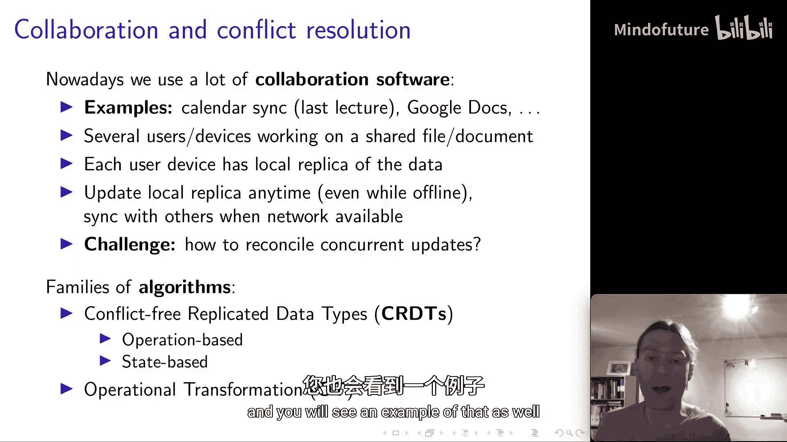

## 协作软件的挑战

上一节我们介绍了分布式系统的基本概念，本节中我们来看看协作软件面临的核心问题。协作软件允许多个用户通过各自的设备访问共享文件或数据库。每个设备都维护着数据的一个本地副本（即副本）。用户可以随时更新自己的副本，即使处于离线状态。当网络恢复后，这些更新需要与服务器及其他客户端同步。

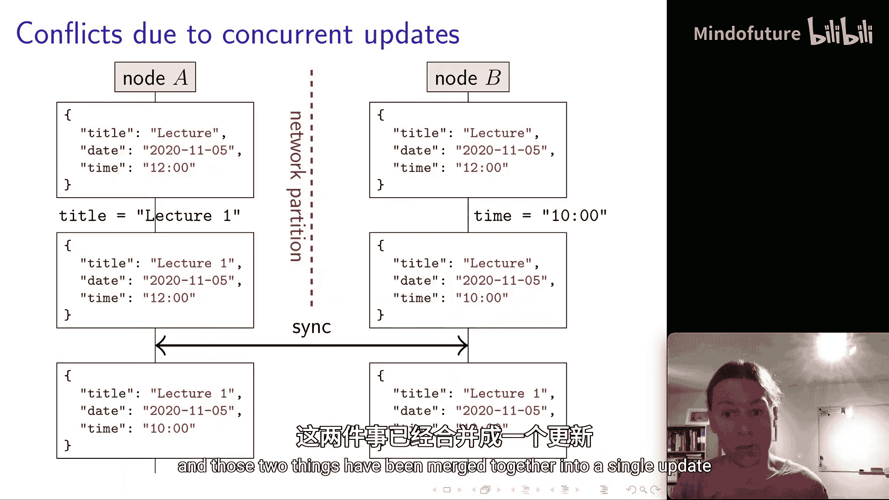

挑战在于，当多人同时更新同一文档时，我们必须协调这些并发更新，确保所有副本最终达到一致状态，并且软件行为符合预期。

以下是协作软件的两个主要特点：
*   多个用户通过设备访问共享数据。
*   每个设备有自己的数据副本，可离线更新，并在联网后同步。

## 冲突无复制数据类型

为了解决上述挑战，我们引入**冲突无复制数据类型**。CRDTs 是一类算法，用于在无需中心协调的情况下，确保分布式副本最终一致。它们主要分为两种：**基于操作的 CRDT** 和**基于状态的 CRDT**。

### 基于操作的 CRDT

让我们从日历同步的例子开始。假设手机和电脑上都有一个日历事件，两者离线时，分别在电脑上修改了事件标题，在手机上修改了事件时间。网络恢复后，我们希望两个设备能合并这两项更新，最终都显示修改后的标题和时间。

一种实现方式是使用基于操作的 CRDT。其数据模型是一个**映射**，即从键到值的集合。我们使用**最后写入者获胜**的策略来确保每个键只有一个值。

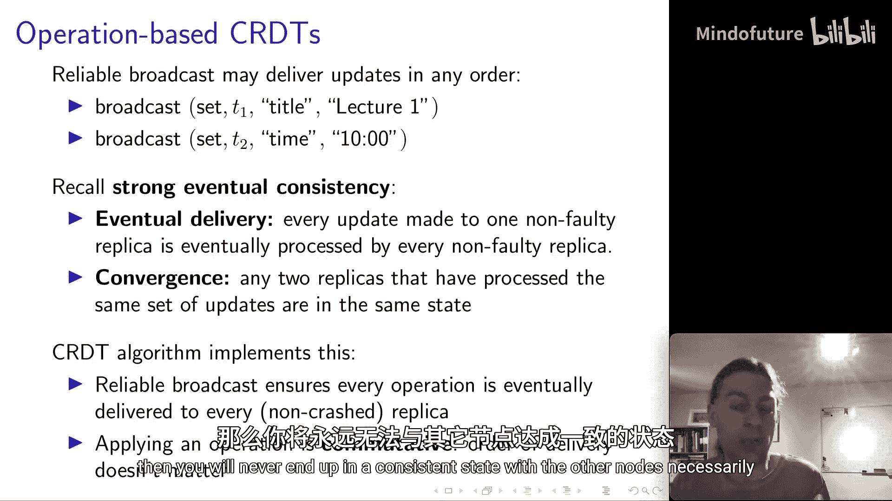

以下是该算法的核心伪代码：

```python
# 初始化：每个副本维护一个集合 `values`，包含三元组 (timestamp, key, value)
values = set()

# 读取键 K 的值
def read(K):
    for (t, k, v) in values:
        if k == K:
            return v
    return null

# 设置键 K 的值为 V
def set(K, V):
    t = generate_unique_timestamp()  # 例如 Lamport 时间戳
    broadcast_message((t, K, V))  # 通过可靠广播发送

# 处理接收到的消息 (t, K, V)
def on_receive(t, K, V):
    # 查找键 K 的现有条目
    previous = {(t_prev, k_prev, v_prev) for (t_prev, k_prev, v_prev) in values if k_prev == K}
    if not previous or t > t_prev for (t_prev, _, _) in previous:
        values.remove(previous)  # 移除旧条目（如果存在）
        values.add((t, K, V))    # 添加新条目
```

该算法通过**可靠广播**发送操作（即键值更新）。它满足**强最终一致性**的两个条件：1) 每个更新最终会被每个存活的副本接收；2) 处理了相同更新的任意两个副本状态相同。操作的**可交换性**确保了无论操作以何种顺序应用，最终状态都一致。

### 基于状态的 CRDT

基于操作的 CRDT 需要可靠广播。另一种方法是基于状态的 CRDT，它广播的是整个副本状态，而非单个操作。

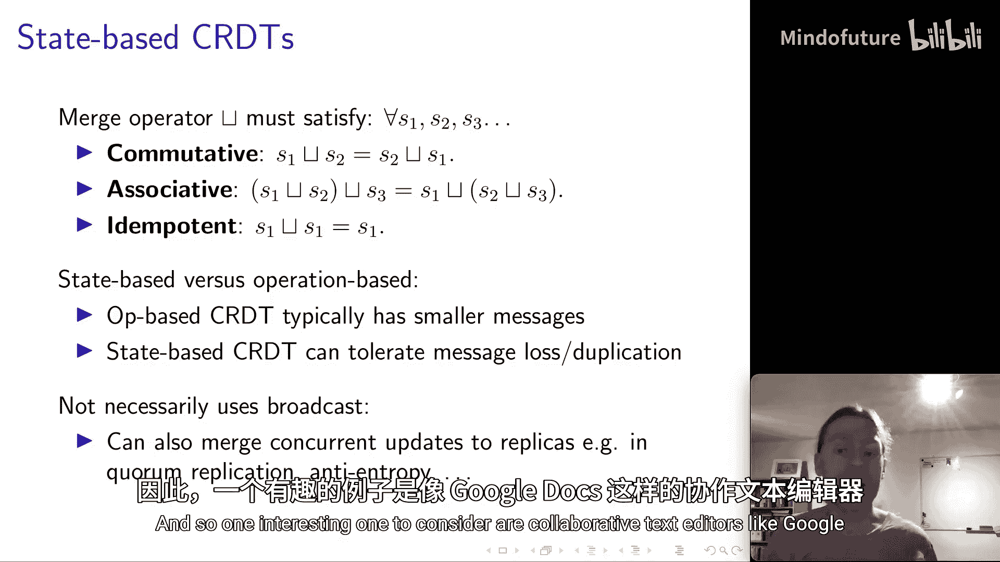

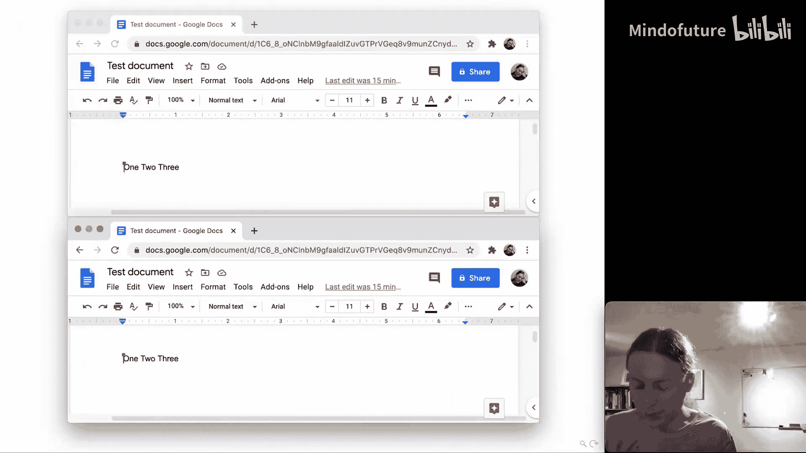

以下是基于状态的映射 CRDT 的核心伪代码：

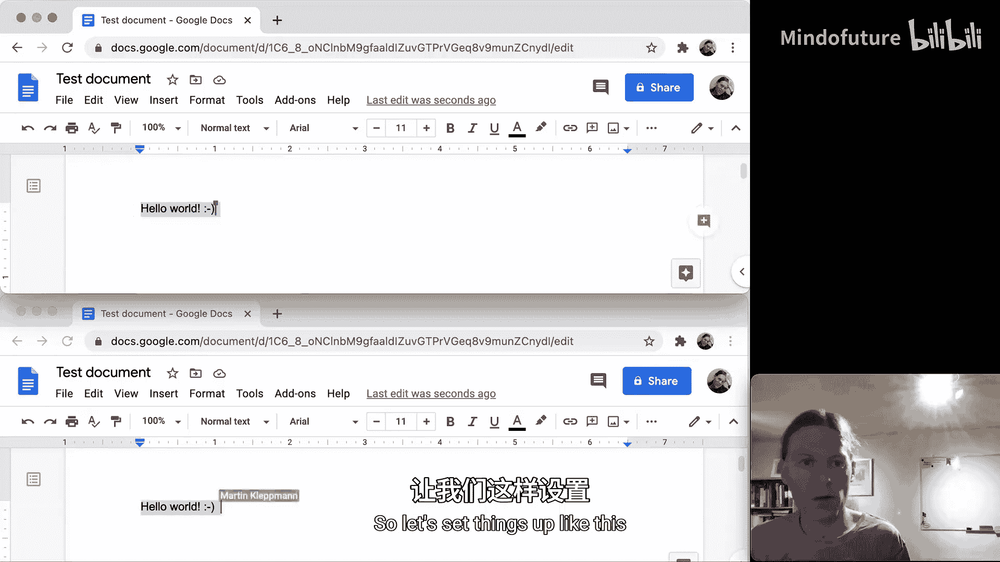

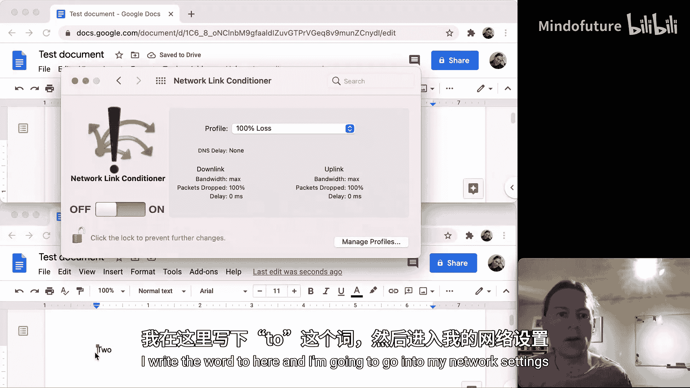


```python
# 初始化
values = set()

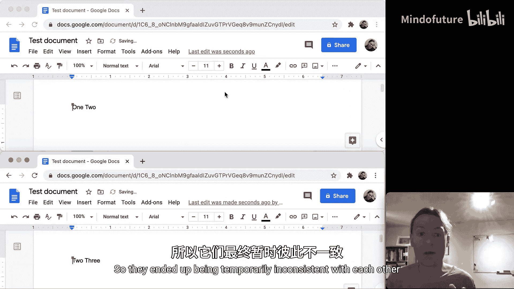

# 定义合并函数 merge (⊔)
def merge(S1, S2):
    union = S1 ∪ S2
    # 对于每个键，只保留时间戳最大的条目
    result = set()
    for (t, k, v) in union:
        if not any((t2, k2, v2) in union for t2 > t and k2 == k):
            result.add((t, k, v))
    return result

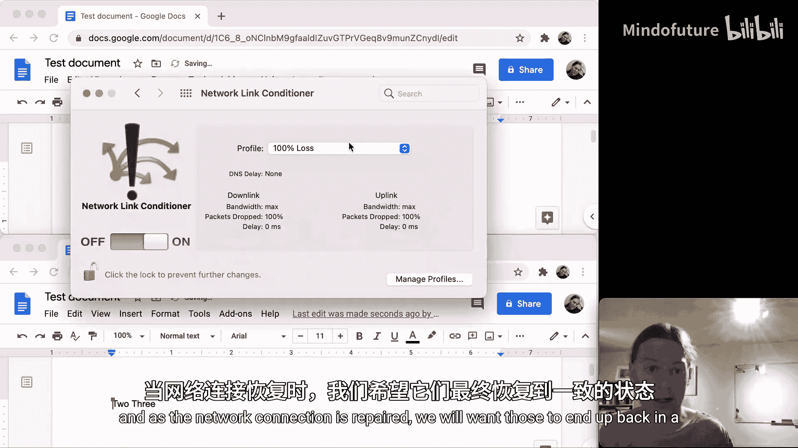

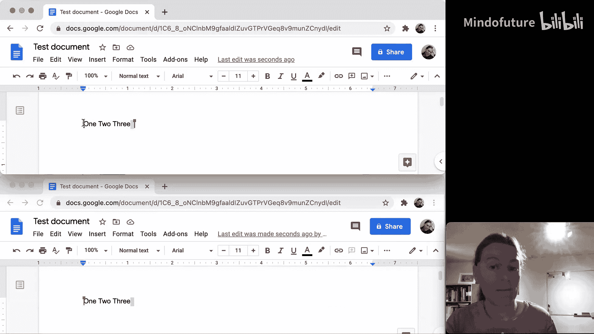


# 设置键 K 的值为 V
def set(K, V):
    t = generate_unique_timestamp()
    # 移除键 K 的旧条目，添加新条目
    values = {(t2, k2, v2) for (t2, k2, v2) in values if k2 != K}
    values.add((t, K, V))
    broadcast_state(values)  # 通过尽力而为广播发送整个状态

# 处理接收到的状态 S
def on_receive_state(S):
    values = merge(values, S)  # 合并本地状态与接收到的状态
```

基于状态的 CRDT 依赖于一个满足**可交换性**、**结合律**和**幂等性**的合并函数。其优势在于可以使用**尽力而为广播**，即使消息丢失或重复，只要最终有消息到达，副本仍能收敛。缺点是每次广播的数据量较大。

## 操作转换算法

上一节我们介绍了用于键值存储的 CRDT，本节中我们来看看用于协同文本编辑（如 Google Docs）的算法。当多个用户同时编辑文本文档时，直接应用操作（如“在位置 2 插入字符”）会导致冲突，因为并发插入会改变字符位置的含义。

**操作转换** 算法通过转换操作来解决这个问题。其核心思想是，当收到一个远程操作时，根据本地已执行的并发操作对其进行调整，然后再应用。

假设文档初始为 “BC”。用户 A 在位置 0 插入 ‘A’，用户 B 在位置 2 插入 ‘D’。如果直接将用户 B 的操作 “在位置 2 插入 D” 应用到用户 A 的本地状态（此时已是 “ABC”），会导致错误。OT 算法会检测到用户 A 的插入操作是并发的，并将用户 B 的操作转换为 “在位置 3 插入 D”，从而得到正确结果 “ABCD”。

OT 算法通常需要**全序广播**来确保所有节点以相同顺序处理操作，这带来了额外的开销。

## 用于文本编辑的 CRDT

作为 OT 的替代方案，我们也可以为文本编辑设计 CRDT。其关键思路是不使用易变的索引来定位字符，而是为每个字符分配一个全局唯一的、不可变的**位置标识符**（例如一个有理数）。

文档被视为一个从 0（文档开始）到 1（文档结束）的数轴。插入字符时，在其前驱和后继字符的位置标识符之间选择一个新值（如中点）。所有字符按其位置标识符排序即构成文档内容。由于位置标识符固定，插入和删除操作天然可交换。

以下是该算法的简化伪代码：

```python
# 字符表示为 (position_id, node_id, character)
# 初始化时包含开始和结束标记
characters = { (0, ‘start’, ‘|’), (1, ‘end’, ‘|’) }

# 在索引 `index` 处插入字符 `V`
def insert(index, V):
    # 找到索引处的前驱和后继字符及其位置ID
    (p1, n1, v1) = element_at(index)
    (p2, n2, v2) = element_at(index + 1)
    # 计算新位置ID（例如中点）
    new_pos = (p1 + p2) / 2
    # 构造新字符并因果广播
    new_char = (new_pos, self.node_id, V)
    broadcast_causal( (‘insert’, new_char) )

# 处理插入消息
def on_receive_insert((pos, node_id, char)):
    characters.add( (pos, node_id, char) )

# 删除索引 `index` 处的字符
def delete(index):
    (pos, node_id, char) = element_at(index + 1) # 跳过开始标记
    broadcast_causal( (‘delete’, pos, node_id) )

# 处理删除消息
def on_receive_delete(pos, node_id):
    characters.remove( (pos, node_id, _) ) # 移除匹配的字符
```

该算法使用**因果广播**（而非可靠广播）来确保删除操作总是在对应的插入操作之后被传递，从而避免误删。它实现了强最终一致性，且无需复杂的操作转换。

## 总结

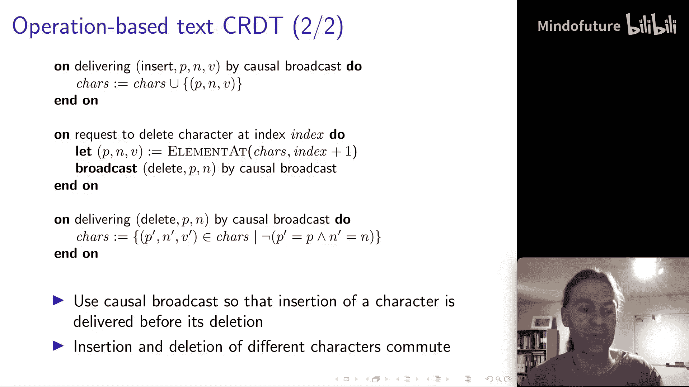

本节课中我们一起学习了协作软件背后的分布式算法。我们首先了解了协作软件面临的并发更新挑战。接着，我们深入探讨了 **CRDT** 的两种实现方式：基于操作和基于状态，它们通过确保操作的可交换性来实现最终一致性。然后，我们介绍了用于协同文本编辑的 **操作转换** 算法，它通过转换操作来解决索引冲突。最后，我们看到了另一种为文本编辑设计的 **CRDT**，它通过为字符分配唯一位置标识符来避免索引问题。这些算法是构建现代实时协作应用（如在线文档和日历）的基石。