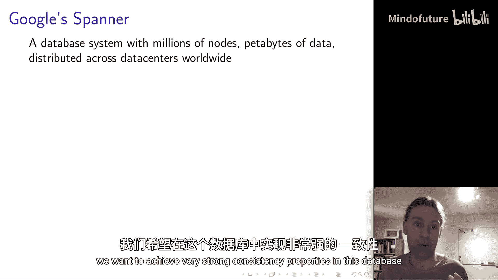
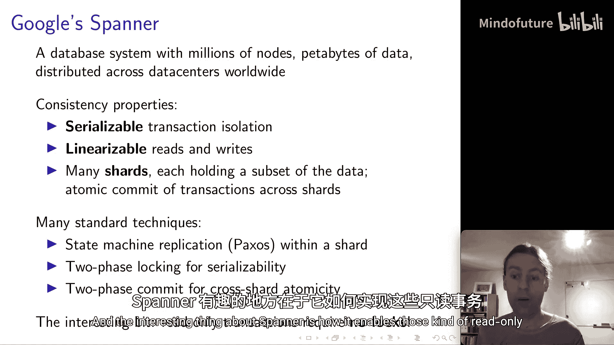
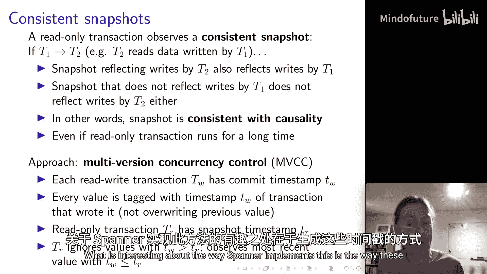
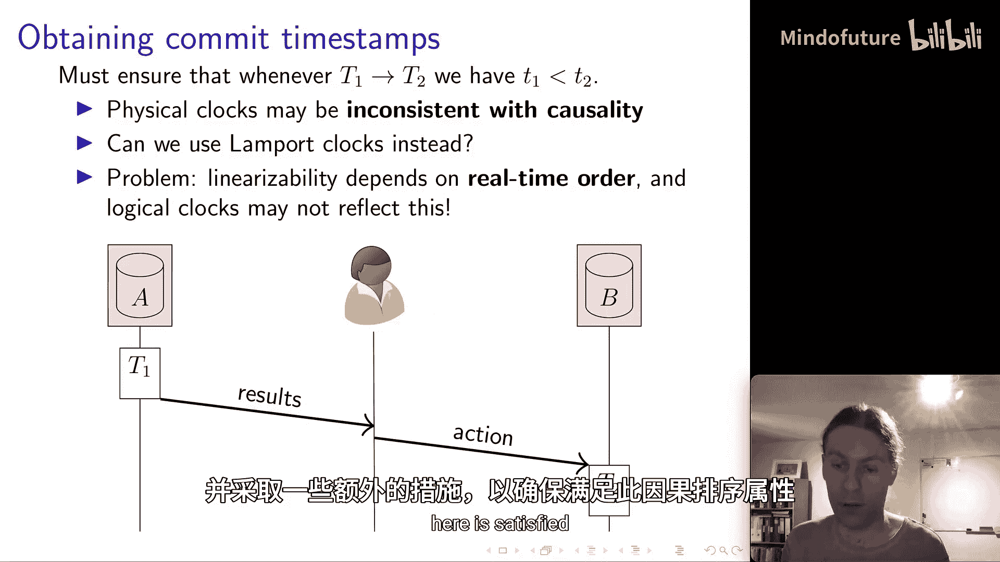
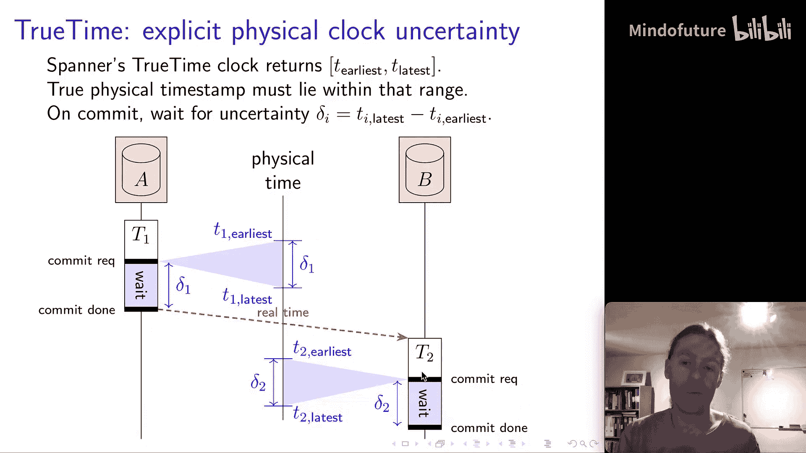
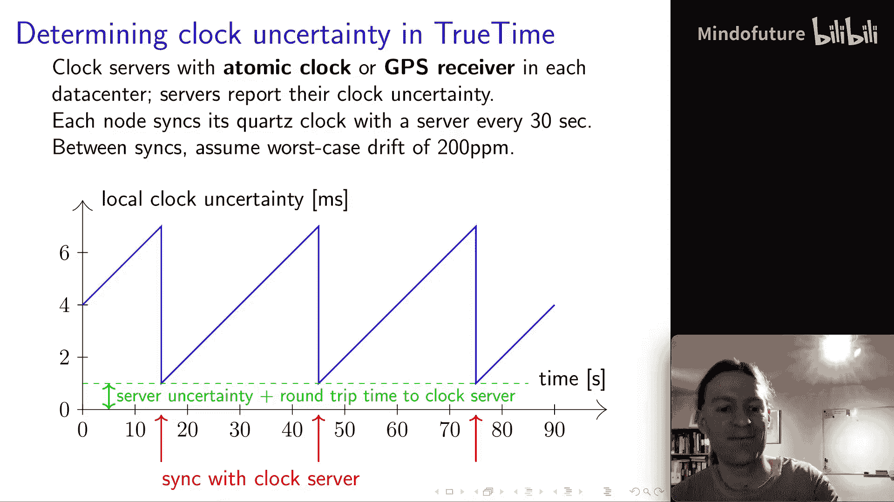

# 【剑桥大学-•-中英】分布式系统讲座-p23-P23-Distributed-Systems-8.2---Googles-Spanner--BV1NwQhYeEyV_p23-

So we've talked about these eventually consistent systems for the last section。

 let's switch back to very strongly consistent systems。

 And what I'd like to tell you about is a very interesting database system developed by Google called Spner。

 This is a very large scale database systems。 It's intended to be used with huge amounts of data with millions of nodes spread all around the globe。

 and nevertheless despite this huge scale， we want to achieve very strong consistency properties in this database in particular。

 the classic that we've seen。 we want serializable transaction isolation。

 the strongest isolation we can get。 We want linearizability for reads and rightss。

 that means we're always going to see an up tod value from from any value written。😊。

Moreover， we need to support sharding， which means that this huge amount of data。

 which is far too much to store on a single node， we have to split into subsets of data。 or each rep。

 each node has a replica of a subset of the data。 so that now。

You can distribute the data across all of these different nodes。

 but this now means that you might have a transaction that needs to read and write data on multiple nodes and if this happens a distributed transaction like this。

 we need atomic commit so that any changes made by a transaction will either be committed on all of the nodes or aborted on all of the nodes。

So all of these classic properties we want and a lot of the techniques that Spanner uses to implement these properties are equally classic standard algorithms。

 So in order to replicate the nodes within a shard， it uses state machine replication。

 It uses the PaxO consensus algorithm rather than raft。

 but they are reasonably similar and the principles are very much the same。

In order to achieve serializable transaction isolation。

 we use the classic two faith locking that means for any reads we take a shared lock any data that we want to read and for any rights we'd need to take an exclusive lock on any data that we write and we need to hold those locks until the transaction commits。

Finally， in order to achieve atomicity across multiple shards。

 we do the classic we do two phasese commit exactly like we saw in the last lecture so so far you know actually implementing all of these things well is still a significant engineering challenge but there's nothing conceptually very new here where Spner gets interesting is that it has support for read only transactions that take no locks now this is special because if you remember what two phasese locking means means if you want to read any data you first have to take a shared lock on that data and the shared lock is going to prevent any other transactions from updating that data。

But now， in real systems， you often get very large read only transactions。 So， for example。

 taking a database backup is a very large read trans read only transaction that needs to read essentially the entire database。

 That's what a backup is。 It's a copy of the entire database。

 And so this backup might take a long time。And if you have to take a shared lock on the entire database for a long time while you're doing a database backup。

 then users are not going to like that very much because it means that no rights can be made to the database for the entire duration of this backup。

 So that would simply not fly in practice。 we have to have some way of doing read only transaction that does not require any locks。

 And the interesting thing about Spner is how it enables those kind of read only transactions。

So the way this works is that a read only transaction can read from what is called a consistent snapshot。

 So a consistent snapshot is a way of essentially looking at the entire database at one point in time。

 and the way it does this is using timestamps now。The important thing for this consistent snapshot。

 the the consistent aspect is that it means we're consistent with causality。

 And so what I mean with this is if we have two transactions T 1 and T 2。

 and if T1 happened before T 2。Then if we have a snapshot that contains the rights that were made by T2。

 then that snapshot must also reflect the rights by T1。

 That means that we don't end up with some of the causal dependencies missing from the snapshot。

 likewise， if the transaction contains the rights by does not contain the rights by T1。

 then it will not contain the rights by T2 either。 So this goes both ways。

 Now this is what we mean with a snapshot being consistent with causality。

 It just means that we don't have bits of the bits of the database snapshot that don't make sense causally。

 So if the snapshot contains the cause， then contains the effect then it will also contain a cause of that effect。

And so we want to ensure this consistent snapshot， even if the read only transaction runs for a long time and without taking any locks and the way this is done is through approach called multi version concurrency control or MVCC。

Now MVCC is actually a very common technique， it's using lots of databases。

 including Postgres and MySQL for example， and the way it works is it attaches a timestamp to every transaction and this let's say that a rerive transaction has a timestamp TW and that timestamp is assigned at the time when that transaction commits。

And when we have a read only。 and sorry， and then any data that is written by this transaction T W。

Is that any data is associated， it's tagged with the transaction timestamp with the commit timestamp of the transaction that wrote it。

And now， if we have。If we have an object that is being updated by a transaction。

 now we won't simply overwrite that transaction in place。

 but will we won't simply overwrite that object in place。

 but we will make a new copy of that object and that new version of the object will be tanked with the times down Tw of the transaction that wrote that version。

 but we will keep the old version of the object in place in case there's a read only transaction that actually needs to read the old version。

And now we associate each read onlyy transaction also with a timestamp and that timestamp identifies the snapshot at which is the point in time at which that snapshot is observing the database。

And now if the reader need transaction wants to read a particular object。

 it looks at the different versions of that object， each version intactgged with a timestamp。

 it ignores any versions that have a timestamp greater than the snapshot timestamp。

And then of those versions that have a timestamp less than were equal to a snap times stampamp。

 it picks the highest， and that is the version of the object that this transaction is going to see。

 And so this now allows the read only transaction to simply ignore any rights made concurrently so the read only transaction is going to see the entire database as of this particular time Tr。

 regardless of whatever rights happen otherwise and without taking any locks。Now this works。

 this is very standard MVCC。 What is interesting about the way Spmner implements this is the way these timestamps are generated。

So in order to ensure that our timest， our snapshot is causally consistent。

What we require is that if transaction T1 happened before T2。

 then the timestamp of T1 has to be less than the timestamp of T2。

 because that's what this ordering property in MVCC is relying on。

And recall from the lecture when we talked about physical clocks。

 that physical clocks do not actually guarantee this。So with physical clocks。

 you could end up in a situation where times where transaction T1 happened before transaction T2 but T2 had a lower timestamp than T1 and we don't want this So we have to take some other measure to ensure that this that our timestamps are consistent with causality The obvious answer is well why don't we use logical clocks because that's exactly。

Exactly what logical clocks were designed to do。Unfortunately。

 logical clocks like La Port clocks are not actually sufficient in this case either。

And the reason for this is by this particular example。

 so let's say that here we have two replicas A and B and the user executes some transaction T1 on replica A and then views the results of that transaction so the user has the results on the screen。

 then the user chooses to perform some action and that action results in some transaction T2 being executed on replica B。

So here， very clearly it's the case that T1 happened before T2 because there's this user communication in the way the communication ensures that the action depends on the results from T1。

So definitely in this case， we want T1 to have a lower timestamp than T2。

 but if we're using Lampot clocks， well， remember the way Lapot clocks work is they work by attaching and timestamp to every message that is sent of the network。

And and then when you receive one of those messages。

 you bump up your own local clock to the maximum of the local timestamp and the one you received。

 But in this case here in this example， there might not be any communication between replicas A and B So replica A may never send any message to replica B while this is happening because the communication is going by a user and so there's nothing that can propagate our timestamps from a to B because there's no message or can propagate the timestamps and we can't rely on the user to like type in timestamps or something like that here So replica B may not actually realize that it needs to have a timestamp for T2 that is higher than the timestamp of T1 because there's nothing passing along these timestamps that we would need for La port clocks。

So lampau clocks don't work either， so what can we do in this case。

 Well we can go back to physical clocks， but we have to adjust the physical clocks and do some extra measures in order to make sure that this causal ordering property here is satisfied。

😊。

And the way Spanner does this is using a system called true time。

 So true time is a system of physical clocks that explicitly captures uncertainty in the timestamps。

 So this is the really interesting bit about Spner。And the way this works is， say。

 replica A wants to commit transaction T1 at the time when it wants to commit that transaction。

 the replica requests a timestamp from true time， and true time does not reply with simply a single timestamp。

 but it returns a range， it returns to timestamps， the earliest possible and the latest possible。

And so because of the uncertainties we have， you know。

 there's no perfect synchronization of clocks in the systems that we have。

 we can never be totally certain about what the current real physical timestamp is。

 but we can track all of the errors in the system and all of the uncertainty in the system。

And if we correctly account for the uncertainty， then we can be sure that the real physical timestamp will be somewhere between this earliest possible and latest possible with very high probability。

So this means we have to track like the round trip time to the clock server。

 we need to account for clock drift， we have to account for any sort of things that might cause error。

 add up all of those potential causes of error and factor this all into a single uncertainty interval so that we know that the real time stamp lies somewhere in between this earliest possible and the latest possible。

And now what spanner is going to do is it gets this pair of earliest and latest from two time。

 and now it's going to wait and the time it's going to wait is exactly the difference between the two time stamps。

 and so this length of the uncertainty time intervalable called a delta 1。

The transaction is simply going to wait for that time。

 It's not going to do anything during that time。It's going to continue holding all of the locks。

 So the transaction is ready to commit。 It just hasn't actually committed yet。

 And it's going to wait for this period。 Delta 1。 And once that time is elapsed， now it commits。

 it releases all of the locks， and it moves on。So this extra weight is the key thing here。 Now。

 let's say that replica B wants to execute transaction T 2。

 It does the same thing when it's ready to commit， it requests timets from two time。

 So it gets back and earliest possible and latest possible。 and again。

 it waits out the uncertainty in this case， deelta 2。

 the times the difference between the two times stamps。 Now， in this case here。

 we have this real time dependency。 So that T2 started after T1 ended。

And the effect that this waiting has had。Is to ensure that if we have these two timetamps where there's a real time dependency。

 then their uncertainty intervals from two time will not overlap。

And because the uncertainty to time the intervals do not overlap。

 this means now that the commit times stamp for T1 will definitely be a lower times stampamp than the commit times stamp of T2。

By having these these uncertainty periods non overlapping。

 we have got rid of the possibility of the timestamps getting reordered and thus being inconsistent with causality。

So the key here is this waiting and of course， in a real system。

 we want to wait for a short time as possible。 So we now need to do two things。 Firstly。

 we need to precisely quantify the uncertainty so that we know how long we have to wait。

 and then secondly， we have to keep the uncertainty as small as possible so that our waiting time is as short as possible。

And the way that True Time does this is by actually putting atomic clocks and GPS receivers in every data centre and these costs and money。

 of course， but Google has figured out that， you know they're actually affordable enough。

 it is al right。 you can actually put GPS receivers and atomic clocks in every data centre。

And this gives each data centre a reliable clock source。

And now every other node in the data centre that is not directly connected to these reliable clocks。

 every normal node just has the usual quardtz clock。

 and it is going to periodically synchronize its local quadtz clock with the time server that has the atomic clock or the GPS receiver attached。

And true time actually performs this clock synchronization every 30 seconds And so every 30 seconds。

 there's going to be like a ping from each node in the data center to its local time server。

 and the result is that every time that clock synchronization is performed the uncertainty drops down because the uncertainty now is just essentially the round trip time to the server plus any uncertainty that the server had about its own time。

 And so because we're assuming that here the time server is in the local data center locally。

 the round trip time to the clock server will usually be less than1 millisecond because there no big geographic distances to be covered here。

 and so therefore whenever we sync with the clock server。

 the uncertainty about our clock about local clock drops down to about1 millisecond。

And then in between in these 30 second intervals between the synchronizations， well。

 it depends on the rate at which the local clock drifts with respect to the real actual real time。😊。

And so for this Google did some measurements and they figured out what is the worst case clock uncertainty that we have to assume to make sure that all of the clocks have a drift that is lower than this bound and they figured out that a worst case drift of 200 ppm was a safe assumption to make。

And so this means here that in between these 30 secondcon clock sinks。

 the uncertainty of each local clock keeps drifting up at a rate of 200 ppm。

 So this means over the course of 30 secondsconds， we rack up about 6 milliseconds of clock uncertainty。

 and through time keeps track of exactly how long it's been since the last clock synchronisation。

 And therefore it has these uncertainty intervals that keep widening and widening and widening until the next clock sync and then uncertainty drops back down to 1 milliseconds。

 and then they start widening again and so on， we get this kind of saw tooooth pattern here。

And the result is now that we have a very accurate notion of what our clock uncertainty is。

 which allows us to determine the wait time for each transaction and moreover。

 because we're using these local accurate clocks， atomic clocks and GPS receivers。

 the average time uncertainty is actually quite small。

 so the uncertainty average uncertainty interval average length is about 4 milliseconds and so on average about 4 milliseconds is the time that the transaction needs to wait before it's allowed to commit。

And 4 milliseconds is a pretty short time actually。

 it's certainly a lot shorter than the time it would take to do like a roundtri time to data center on a different continent。

 which would take like 100 milliseconds or more。 So this is really the key insight of spanner that we can use these reliable clocks and the careful measurement and careful accounting of uncertainty to ensure that the timestamps are consistent with causality now that if we have timestamps that are consistent with causality we get these causally consistent snapshots using multiversion concurrency control without taking any locks so therefore we can do these large scale read transactions without any locks so we can do database backups without disrupting any right transactions that are happening in the database。

So you see here， this is sort of the stack of assumptions and combinations of algorithms that you get in real systems。

 but this is a very concrete， really very widely used system that is widely deployed in practice and you can see how all of these distributed systems concepts come together in a single system which I find very exciting。

😊，So that is the end of the distributed systems course I hope you enjoyed it。

 I hope you got something out of the ideas if you have any questions feel free to just ping me an email dont for the Cambridge students among you don't forget to fill out the lecture evaluations and yes I hope you enjoyed it and see you another time。

😊，Thank you。 Bye bye。

