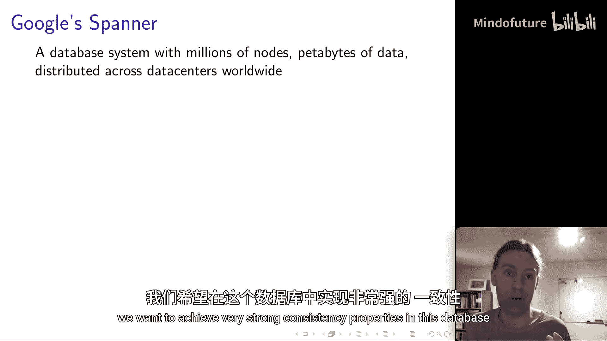
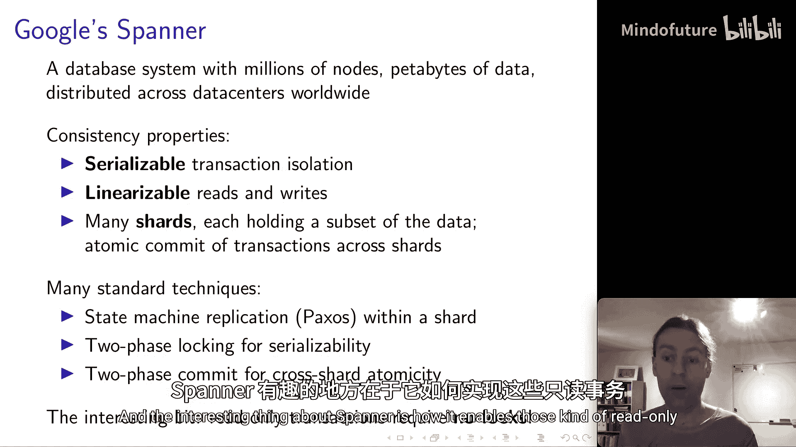
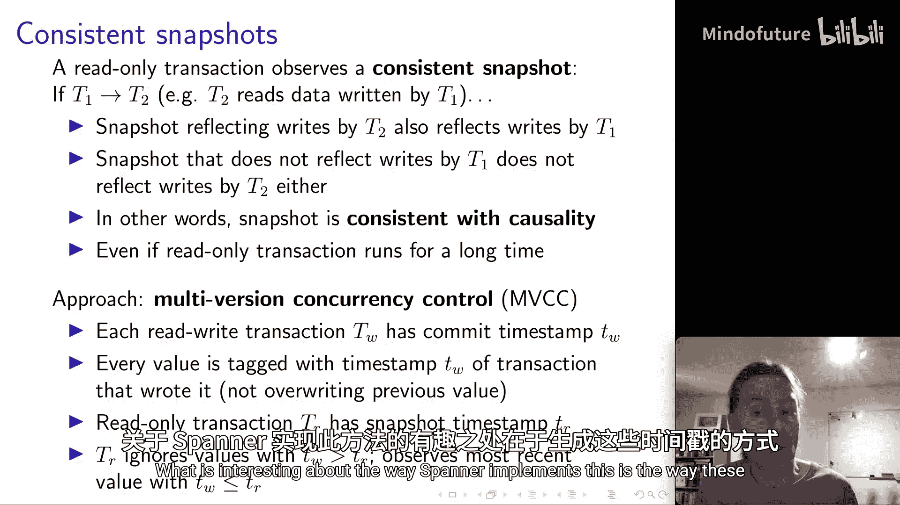
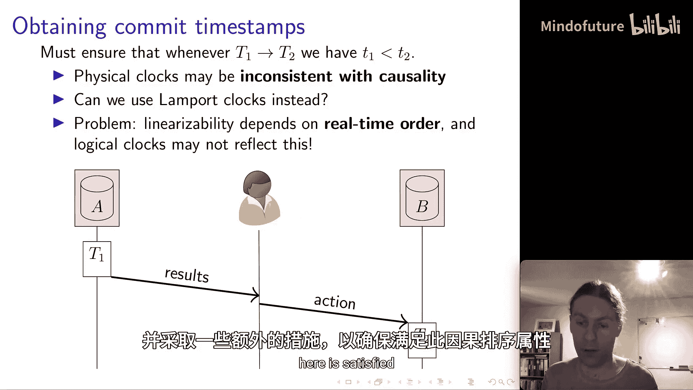
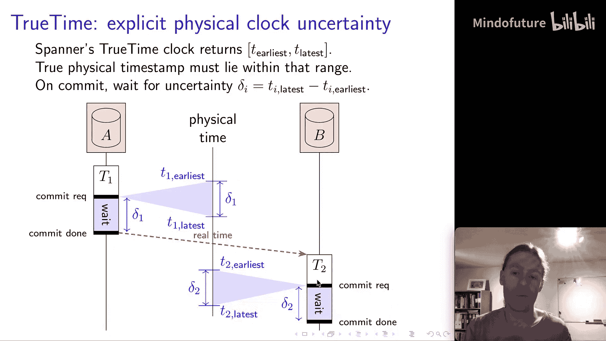
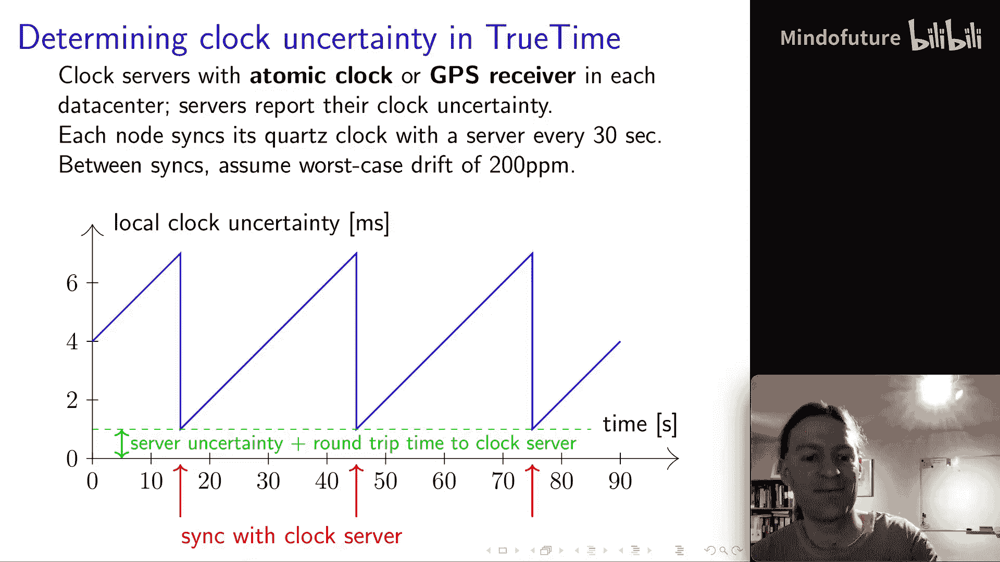

# 分布式系统课程：第8.2章：Google Spanner 🗄️

在本节课中，我们将学习Google开发的一个非常有趣的大型分布式数据库系统——Spanner。我们将探讨它如何在全球范围内管理海量数据，同时实现强一致性、可序列化的事务隔离和线性化读写。

## 从最终一致性到强一致性 🔄

上一节我们讨论了最终一致性系统。现在，让我们切换回强一致性系统。本节将介绍Google开发的Spanner数据库系统。

## Spanner的设计目标 🎯

这是一个超大规模的数据库系统，旨在处理分布在全球数百万节点上的海量数据。尽管如此，Spanner仍致力于实现非常强的一致性属性。

具体来说，它追求我们见过的经典属性：
*   **可序列化的事务隔离**：这是我们能获得的最强隔离级别。
*   **读写的线性化**：这意味着我们总是能看到任何写入值的最新值。

此外，它需要支持**分片**。由于数据量太大，无法存储在单个节点上，必须将数据分割成子集。每个节点都拥有一个数据子集的副本，从而将数据分布到所有不同的节点上。

但这意味着一个事务可能需要读取和写入多个节点上的数据。对于这样的分布式事务，我们需要**原子提交**，以确保事务所做的更改要么在所有节点上提交，要么在所有节点上中止。

## 实现经典属性的经典技术 ⚙️

Spanner使用了许多经典的标准算法来实现这些属性。

为了实现分片内的节点复制，它使用了**状态机复制**。它使用**Paxos共识算法**（而非Raft），但两者原理非常相似。

为了实现可序列化的事务隔离，它使用了经典的**两阶段锁**。这意味着对于任何读取操作，我们都需要在要读取的数据上获取共享锁；对于任何写入操作，我们都需要在要写入的数据上获取排他锁。并且，我们需要持有这些锁直到事务提交。

最后，为了实现跨多个分片的原子性，它采用了经典的**两阶段提交**协议，正如我们在上一讲中看到的那样。

到目前为止，虽然很好地实现所有这些功能仍然是一项重大的工程挑战，但在概念上并没有太多新内容。

## Spanner的亮点：无锁只读事务 🔓

Spanner变得有趣的地方在于，它支持**无需加锁的只读事务**。这很特别，因为如果你还记得两阶段锁的含义：如果你想读取任何数据，首先必须在该数据上获取共享锁，而共享锁会阻止其他事务更新该数据。

然而，在实际系统中，经常会出现非常大的只读事务。例如，进行数据库备份就是一个非常大的只读事务，它需要读取几乎整个数据库。备份可能需要很长时间。如果在进行数据库备份的长时间内，你必须在整个数据库上持有共享锁，那么用户会非常不满，因为这意味着在整个备份期间无法对数据库进行任何写入。这在实践中是行不通的，我们必须有某种方式来进行不需要任何锁的只读事务。Spanner的有趣之处就在于它如何实现这类只读事务。

## 一致快照与多版本并发控制 📸

其工作原理是，只读事务可以从所谓的**一致快照**中读取数据。一致快照本质上是在某个时间点查看整个数据库的一种方式，它通过时间戳来实现。

这个一致快照的“一致”性关键在于它意味着与**因果关系**保持一致。具体来说，如果我们有两个事务T1和T2，并且T1发生在T2之前，那么如果一个快照包含了T2所做的写入，则该快照也必须反映T1所做的写入。这意味着我们不会在快照中遗漏某些因果依赖。同样，如果快照不包含T1的写入，那么它也不会包含T2的写入。这就是快照与因果关系保持一致的含义：我们不会得到在因果意义上不合理的数据库快照片段。

我们希望确保这个一致快照，即使只读事务运行很长时间且不加任何锁。实现这一点的方法是通过一种称为**多版本并发控制** 或 **MVCC** 的方法。

MVCC实际上是一种非常常见的技术，被许多数据库使用，例如Postgres和MySQL。它的工作方式是为每个事务附加一个时间戳。假设一个写入事务有一个时间戳 `T_w`，该时间戳在该事务提交时分配。任何由此事务 `T_w` 写入的数据都会被标记上该写入事务的提交时间戳。

现在，如果一个对象被一个事务更新，我们不会简单地就地覆盖该对象，而是会创建该对象的一个新副本。这个新版本的对象将被标记上写入该版本的事务的时间戳 `T_w`。但我们会保留对象的旧版本，以防有只读事务需要读取旧版本。

现在，我们为每个只读事务也关联一个时间戳 `T_r`，该时间戳标识了该快照观察数据库的时间点。如果只读事务想要读取一个特定对象，它会查看该对象的不同版本（每个版本都标记有一个时间戳），忽略任何时间戳大于快照时间戳 `T_r` 的版本。然后，在那些时间戳小于或等于 `T_r` 的版本中，它选择时间戳最高的那个，这就是该事务将看到的对象版本。

这允许只读事务简单地忽略任何并发进行的写入。只读事务将看到特定时间 `T_r` 的整个数据库状态，无论其他写入如何发生，且无需获取任何锁。

## Spanner的独特之处：时间戳生成 ⏱️

这是非常标准的MVCC。Spanner实现方式的有趣之处在于这些时间戳的生成方式。

为了确保我们的快照是因果一致的，我们需要：如果事务T1发生在T2之前，那么T1的时间戳必须小于T2的时间戳，因为MVCC中的排序属性依赖于此。

回顾我们讨论物理时钟的讲座，物理时钟实际上并不能保证这一点。使用物理时钟，你可能会遇到这样的情况：事务T1发生在事务T2之前，但T2的时间戳却低于T1，我们不希望这样。因此，我们必须采取其他措施来确保我们的时间戳与因果关系一致。

显而易见的答案是：为什么我们不使用逻辑时钟呢？因为这正是逻辑时钟的设计目的。不幸的是，像Lamport时钟这样的逻辑时钟在这种情况下实际上也不够用。

原因可以通过这个特定例子来说明：假设我们有两个副本A和B。用户在副本A上执行某个事务T1，然后查看该事务的结果（例如，结果显示在屏幕上）。接着，用户选择执行某个操作，该操作导致在副本B上执行某个事务T2。

这里非常明显，T1发生在T2之前，因为存在这种用户交互，确保了T2的操作依赖于T1的结果。因此，在这种情况下，我们肯定希望T1的时间戳低于T2。

但是，如果我们使用Lamport时钟，请记住它的工作原理：它通过为网络上发送的每条消息附加一个时间戳来工作。当你收到其中一条消息时，你会将自己的本地时钟增加到本地时间戳和收到的时间戳中的最大值。

然而，在这个例子中，副本A和B之间可能没有任何通信。因为通信是通过用户进行的，所以没有消息可以将时间戳从A传播到B。我们不能依赖用户手动输入时间戳之类的东西。因此，副本B可能实际上并未意识到它需要为T2分配一个高于T1时间戳的时间戳，因为没有传递Lamport时钟所需的时间戳信息。

所以Lamport时钟也不起作用。那么在这种情况下我们能做什么呢？我们可以回到物理时钟，但必须调整物理时钟并采取一些额外措施，以确保满足这里的因果排序属性。

## TrueTime：管理不确定性的时钟系统 🕰️

Spanner实现这一点的方式是使用一个名为 **TrueTime** 的系统。TrueTime是一个物理时钟系统，它明确地捕获时间戳中的**不确定性**。这是Spanner真正有趣的部分。

其工作方式是：假设副本A想要在某个时间提交事务T1。当它准备提交该事务时，副本会向TrueTime请求一个时间戳。TrueTime不会简单地回复一个单一的时间戳，而是返回一个范围，即两个时间戳：**最早可能**的时间和**最晚可能**的时间。

由于我们存在不确定性（例如，系统中的时钟无法完美同步），我们永远无法完全确定当前真实的物理时间戳是什么。但我们可以跟踪系统中的所有误差和不确定性。如果我们正确地考虑了不确定性，那么我们就可以非常有把握地确定，真实的物理时间戳将位于这个最早可能和最晚可能的时间之间。

这意味着我们必须跟踪诸如到时钟服务器的往返时间、时钟漂移以及任何可能导致误差的因素。汇总所有这些潜在的误差来源，并将其纳入一个单一的不确定性区间中，这样我们就知道真实的时间戳位于这个最早和最晚时间之间的某个地方。

现在，Spanner要做的是：它从TrueTime获取这对最早和最晚时间戳，然后它将**等待**。等待的时间正好是两个时间戳之间的差值，这个不确定性时间区间的长度称为 `δ1`。事务将简单地等待那段时间，在此期间它不会做任何事情，但会继续持有所有的锁。事务已准备好提交，只是还没有实际提交。它将等待这个 `δ1` 时间段。一旦时间过去，它就会提交，释放所有锁，然后继续。

## 等待如何确保因果一致性 ⏳

这个额外的等待是关键所在。现在，假设副本B想要执行事务T2。当它准备提交时，它做同样的事情：向TrueTime请求时间戳。它同样会得到一个最早可能和最晚可能的时间戳，并再次等待这个不确定性区间 `δ2`（两个时间戳之间的差值）。

在这种情况下，我们存在这种实时依赖关系：T2在T1结束后才开始。这种等待的效果是：如果我们有两个存在实时依赖关系的时间戳，那么它们从TrueTime得到的不确定性区间将**不会重叠**。

因为不确定性区间不重叠，这意味着现在T1的提交时间戳**肯定**会低于T2的提交时间戳。通过使这些不确定性区间不重叠，我们消除了时间戳被重新排序从而导致与因果关系不一致的可能性。

这里的核心就是这种等待。当然，在实际系统中，我们希望等待时间尽可能短。因此，我们需要做两件事：首先，我们需要精确量化不确定性，以便知道需要等待多长时间；其次，我们必须尽可能减少不确定性，以使等待时间尽可能短。

## 如何最小化不确定性：原子钟与GPS 📡

TrueTime实现这一点的方式是，实际上在每个数据中心部署**原子钟**和**GPS接收器**。这当然需要成本，但Google发现它们实际上是负担得起的，可以在每个数据中心部署。

这为每个数据中心提供了一个可靠的时钟源。现在，数据中心中未直接连接到这些可靠时钟的每个其他节点（普通节点）只有通常的石英钟，它将定期将其本地石英钟与连接了原子钟或GPS接收器的时间服务器同步。

TrueTime实际上每30秒执行一次这种时钟同步。因此，每30秒，数据中心中的每个节点都会向其本地时间服务器发送一次ping。结果是，每次执行时钟同步时，不确定性都会下降，因为此时的不确定性基本上只是到服务器的往返时间加上服务器自身时间的不确定性。由于我们假设时间服务器位于本地数据中心，到时钟服务器的往返时间通常小于1毫秒，因为这里没有大的地理距离需要覆盖。因此，每当我们与时钟服务器同步时，本地时钟的不确定性就会下降到大约1毫秒。

然后，在这30秒的同步间隔之间，不确定性取决于本地时钟相对于真实时间的漂移速率。为此，Google进行了一些测量，确定了我们必须假设的最坏情况时钟不确定性，以确保所有时钟的漂移都低于这个界限。他们发现，假设最坏情况漂移为200 ppm（百万分之二百）是一个安全的假设。

这意味着，在这30秒的时钟同步间隔之间，每个本地时钟的不确定性会以200 ppm的速率不断漂移增加。这意味着在30秒的过程中，我们会累积大约6毫秒的时钟不确定性。TrueTime会精确跟踪自上次时钟同步以来经过了多长时间。因此，它拥有这些不断变宽的不确定性区间，直到下一次时钟同步，然后不确定性又回落到1毫秒，接着再次开始变宽，如此循环，形成一种锯齿状模式。

## 总结与课程结束语 🎓

本节课中，我们一起学习了Google Spanner分布式数据库系统。我们了解到，Spanner通过结合状态机复制、两阶段锁和两阶段提交等经典算法，实现了强一致性、可序列化隔离和原子提交。其核心创新在于利用TrueTime系统管理物理时钟的不确定性，通过等待不确定性区间来确保时间戳的因果顺序，从而支持无需加锁的、基于MVCC的一致快照只读事务。这使得进行大规模数据库备份等操作成为可能，而不会干扰正在进行的写入事务。

Spanner展示了在真实系统中，各种分布式系统概念（如共识、锁、提交协议、时钟同步）如何结合成一个具体、广泛部署的系统，这是一个非常令人兴奋的例子。

至此，分布式系统课程结束。希望你喜欢这门课程，并从这些思想中有所收获。如果你有任何问题，请随时给我发邮件。对于剑桥的学生们，别忘了填写讲座评估。希望你们喜欢这门课，下次再见。谢谢，再见。