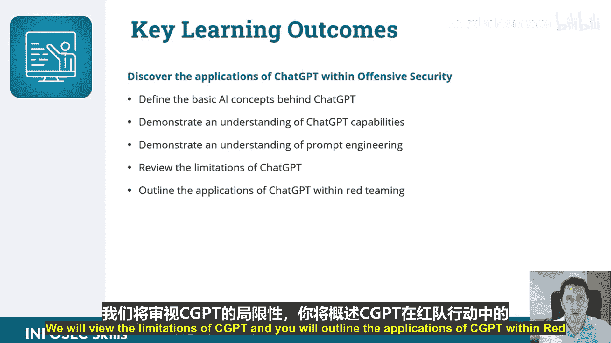

# 【Infosec】用于攻击性安全的ChatGPT ｜ ChatGPT for Offensive Security p01 01_01_01_chatgpt-and-prompt-engineering-overview -BV1jPrHBsEv1_p1-

出来。Welcome to this course， Understand Cha GPT basics and capabilities。This is section 1。

 course overview。As a course introduction， this course will introduce Cha EPT。

 which are referred to as CGPT within the context of offensive cyberse。

It focuses on the practical applications of CGPT within offensive cybersecurity。

 red teaming and ethical hacking。coverss key AI concepts。

 and it provides an introduction to prompt engineering。

This course is designed for cyber security professionals who are looking to integrate chat EBT within their offensive cyber security workflows。

To other key learning outcomes for this course， you will discover the applications of CGPT within offensive cybersecurity。

We will define the basic AI concepts behind CGPT， you will demonstrate an understanding of the model's capabilities。

 you will demonstrate an understanding of prompt engineering。

 you will view the limitations of church EptT and you will outline the applications of CGPT within Red teaming so let's get started。

