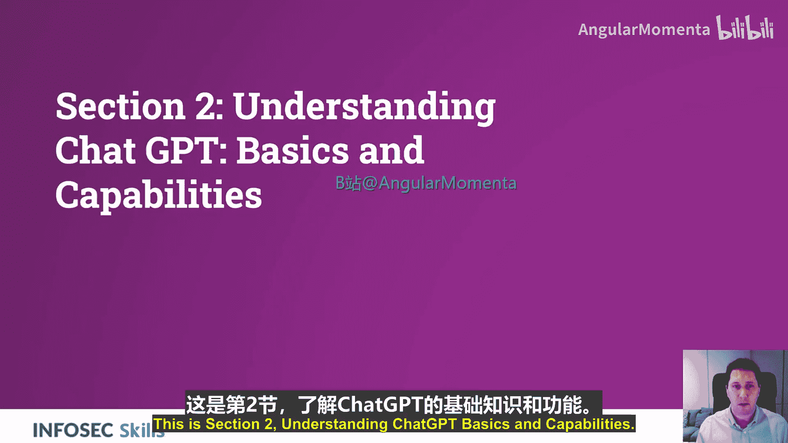
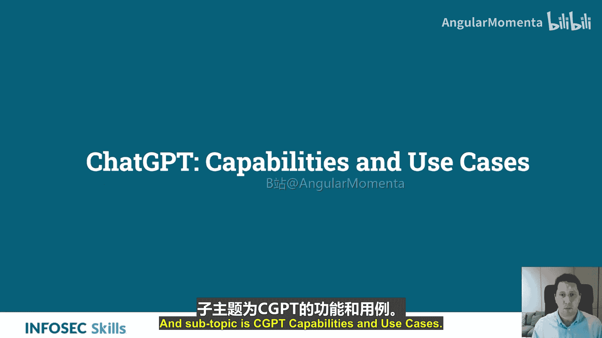
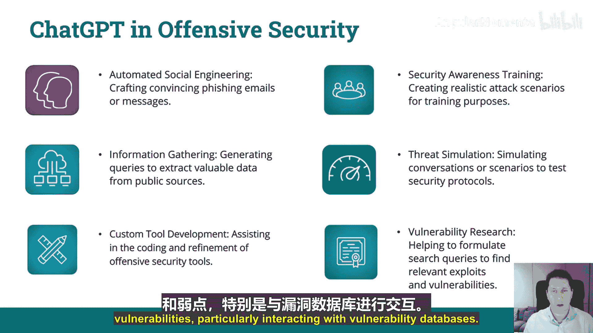
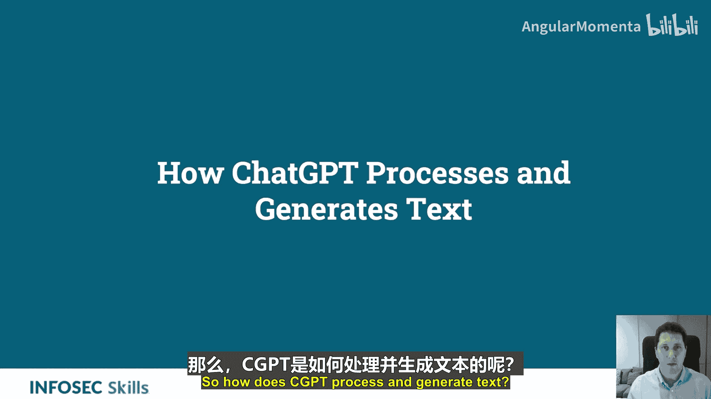
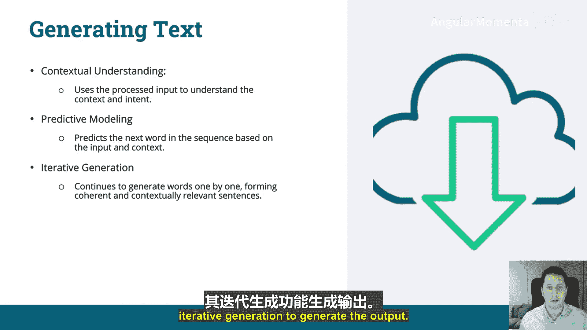
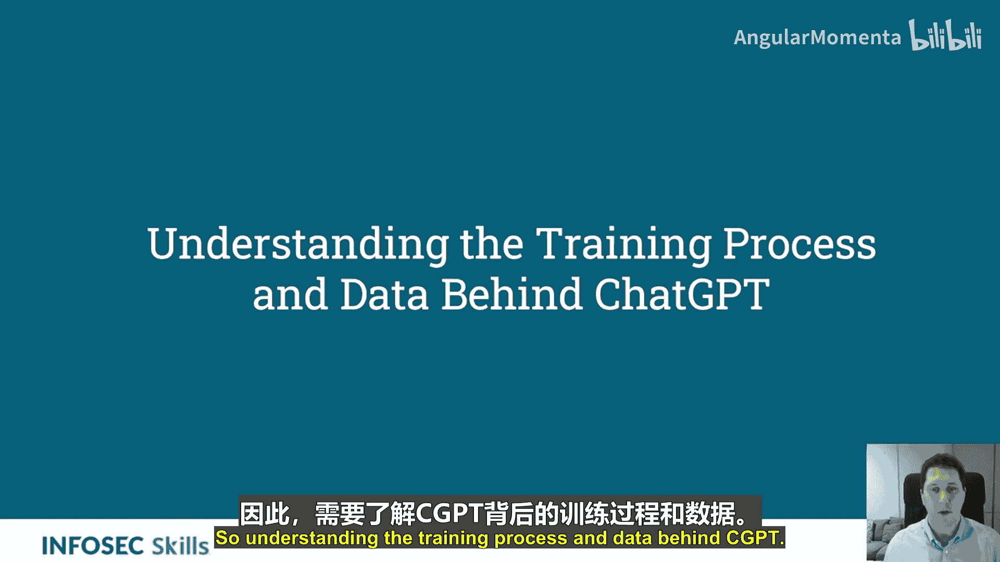
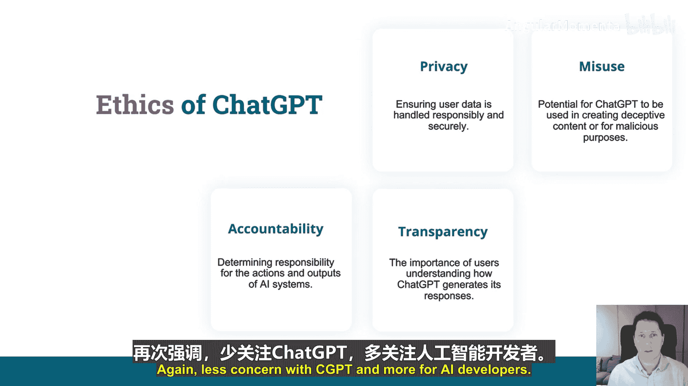

# 【Infosec】用于攻击性安全的ChatGPT ｜ ChatGPT for Offensive Security p02 01_01_02_understanding-chatgpt-basics-and-capabilities -BV1jPrHBsEv1_p2-

Introduction to Chay B， T and prompt engineering。

This is Section 2， understanding chat EptT basics and capabilities。

And subtopic is CGPT capabilities and news cases。

So what is CGP。It's a variant of G， which means generative pretrain transformer。

 And this is a model tailored for conversational responses。

It is developed by open AI and is designed to understand and generate human light text based on the input they receives。

What are the core capabilities of CGPT？Natural language understanding NOU。

 this is the ability to take input and understand understand natural language input。

 whether that be text or voice。Natural language generation。

 the ability to generate natural language output。And responses。Contextual memory。

 the ability to maintain context within a conversation。And adaptability。

Being able to learn from user interactions and improve responses over time。

How is CGPT used in off of cyber security？Automated social engineering， crafting。

 convincing phishing emails or messages， that the natural language ability of CGPT lends itself very well to phish campaigns and simulations。

Information gathering， generating inquiries to extract valuable data from public sources CGPD can be used as an assistant within your offensive cybersecurity workflow。

 for example， pen testing network， network enumeration。

I have accusmed tool development assisting in the coding and refinement of offensive security tools。

 whether that's creating scripts， assisting with writing scripts or converting between languages。

Security awareness training， creating realistic attack scenarios for training purposes。

They'll really speed up your efficiency in producing training material。Threat simulation。

 simulating conversations or scenarios to test security protocols and vulnerability research helping to formulate search queries to find relevant exploits and vulnerabilities。

HerParticular interacting with vulability databases。

So how does CGPT process and generate text？

CGPT processes input and generates text using a model trained on a diverse data set。

 utilizes the GPT generative pretrain transformer architecture， which we will now go over。Okay。

 so the GPT architecture got transformers， which is the corein behind GPT focusing on self tension mechanisms。

This was a development in 2017 by Google engineerers in a white paperper called Attention is all you need。

Before that， there was methods of deep learning within AI。

 but this ability to use transformers really really revolutionized the area and allow for the recent developments。

So the purpose of the GPT architecture model enables the model to weigh the importance of different words in the input。

So processing em tokenization。Converting the input text into tokens that the model can understand。

 is taking words that are inputed to earth for its natural language understanding。

 and it's converting them to tokens， which the model can understand。Embbedding。

 transforming tokens into numerical representations， capturing semantic meanings。

Once it has those tokens， it's able to embed them into its neural network and understand them as vectors。

And attention mechanism determining which part of the empire most relevant to the responses。

Once you've got all of these vectors embedded within a neural network。

 the attention mechanism is understanding how they relate to each other。A generating text。

 contextual understanding used uses the processed input to understand the context and intent。

Predictive modelling， predicting the next word in a sequence based on the input context iterative generation continues to generate words one by one forming Karen and contextually relevant sentences。

 So here you're seeing the process the CDP goes through in taking your text and then generating it。

 First of all， it needs to use the input to understand it then it uses its model to predict the next word in the text and then it uses its iterative generation to generate the output。

So understanding the training process and data behind CGP。

Training AI involves feeding very large data sets， large language models， LLM to the model。

 allowing it to learn and make predictions specifically。

S CGPT is specifically trained to understand and generate human light text。the data behind C g p。

He acquired diverse sources so she executive is trained on a wide array of text sources。

 including books， websites and articles， every model that they bring out they train on a much larger data set。

 a volume trained on data sets consisting of hundreds of gigabytes of text of data likely to be ter GPT5。

And the objective is to grasp the nuances of human language and generate care and context aware responses。

The training process explained， first all you've got pre training where the model is exposed to the dataset set learning the basic structure of the language。

 then you've got supervised fine tuning where it's trained on a narrower data set and finally reinforce learning with human feedback if you're into development you'll recognize this as pre training is where where you create the application supervised fine tuning is where you take care of the edge cases and reinforce learning is where you've put into production and you're getting a bunch of support tickets saying is here's all the bugs。

pre training in detail， the objective is to understand and predict the next word in in a sentence。

 the mechanism behind this utilizet a transformer based architecture for processing large amounts of text。

 and the outcome develops foundational understanding of language patterns and context。

For are CGP's limitations and ethical concerns。Now the study of moral issues and societal impacts arise arising from artificial intelligence。

 the definition of AI ethics， as a powerful AI tool。

 the use of CGPT raises important ethical core considerations。Its important to be aware of this。

First one is N。 The first limitation is understanding context。 So while it's advanced。

 CGPT can struggle with complex air context。And。Data bias reflecting biases present in its trained data potentially leading to biased outputs。

 I'm sure you've seen in the media about some of the biased outputs of AI through the fine tuning process by humans and attempting to install ethics into the model。

 can it can definitely create bias there。 misinformation capable generating plausible but inaccurate or misleading information。

 you often find that you will generate at first glance， very convincing an accurate。

 factual information， but then once you actually look deeper into it。

 you will realize that it's complete nonsense。 so this goes back to the first one understanding context。

 So it can understand simple context very well， but more complex context， not so good。

And that is always improving in later GPT models and the final limitation is data sets so is limited by the information available and up to its last training date。

 GP 3。5 which is the current free model， I think it goes goes up to 2021 so quite out of date go GPT4 is 2023。

Okay so well the ethics of CGPT some ethical considerations。

 first one is privacy ensuring user data is handled responsibly and securely if you're inputting data into the AR model it may be used for training data it may become exposed in other ways through malicious prompt engineering so you always need to be careful with。

What data you put in， the potential for chat GT to be used in creating deceptive content for religious purposes。

 that actually one that we want to exploit within offensive cybersecurity。

 accountability determining responsibility for the actions and outputs of AI systems more for modelre if you're creating models and putting in training data。

And but it can be if you're creating an ethical hacking script。

 making sure that that the user is aware that this can be used for this should be used ethically and transparency。

 the importance of users understanding how CGPT generates its responses， again。

 more and less concern with CGPT and more for AI developers。

