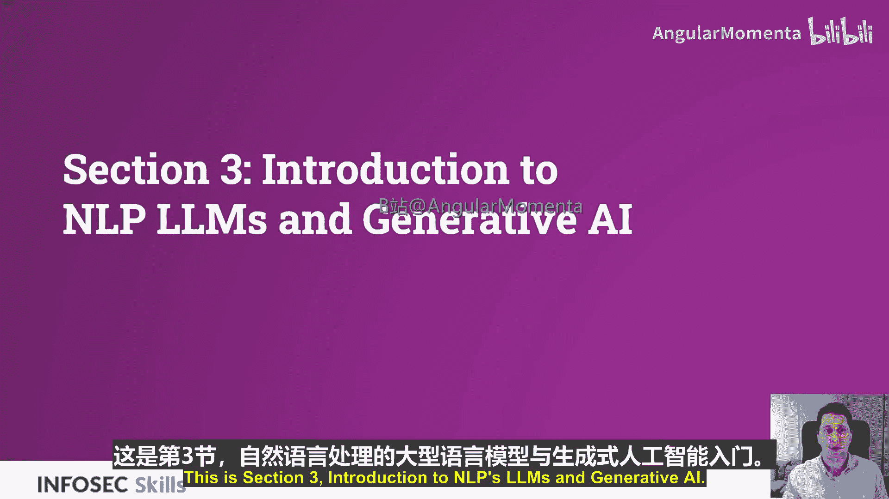
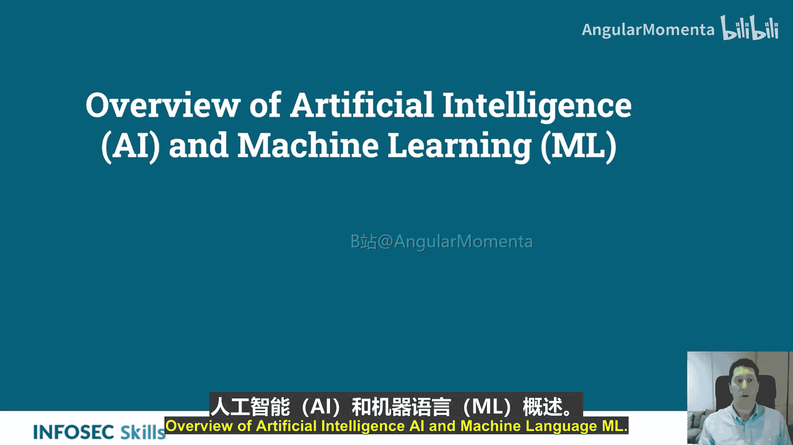
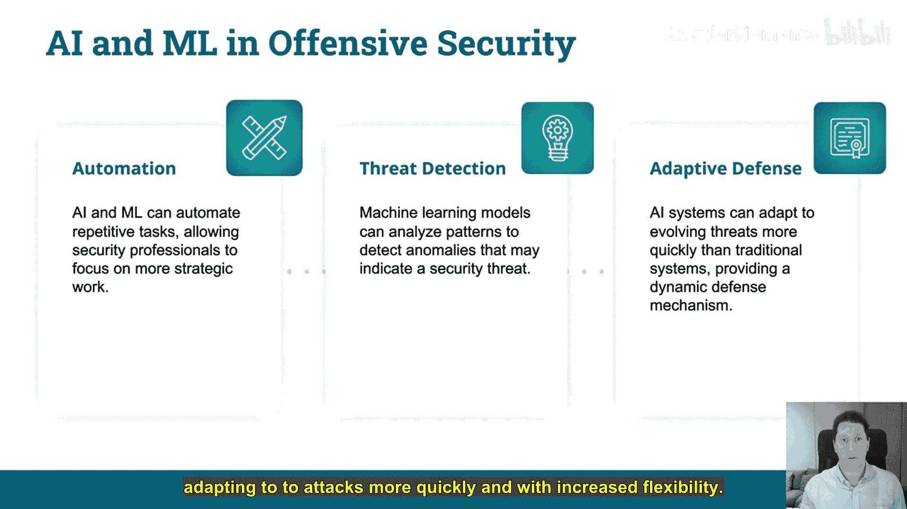
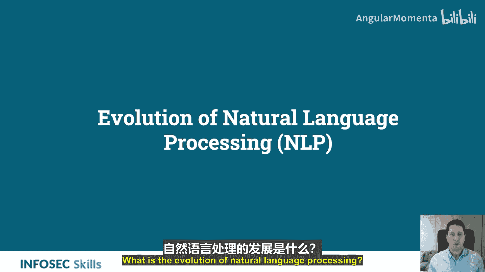
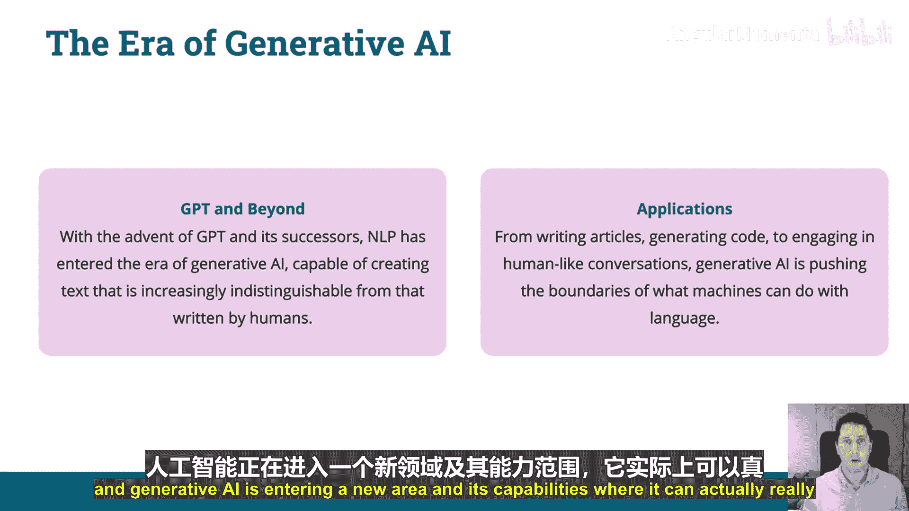
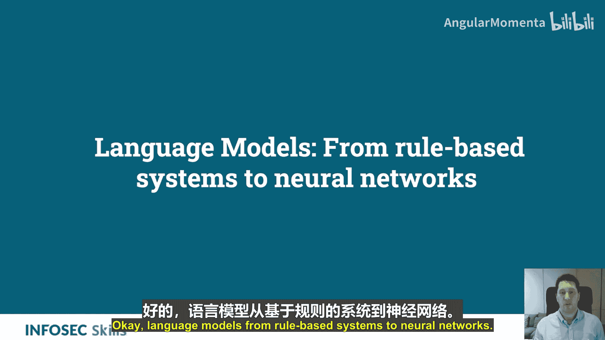
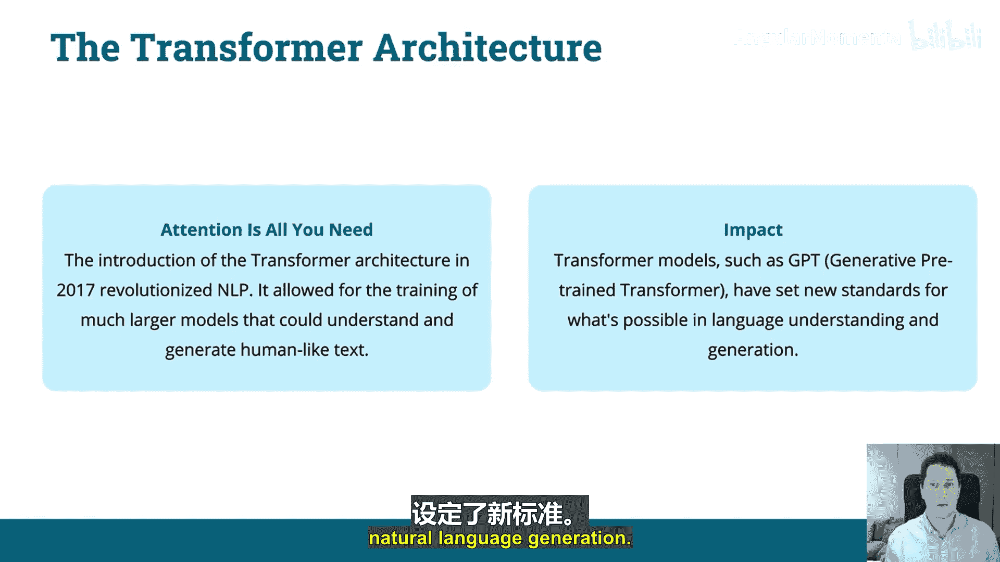
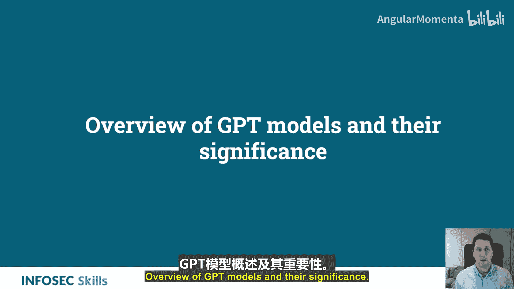
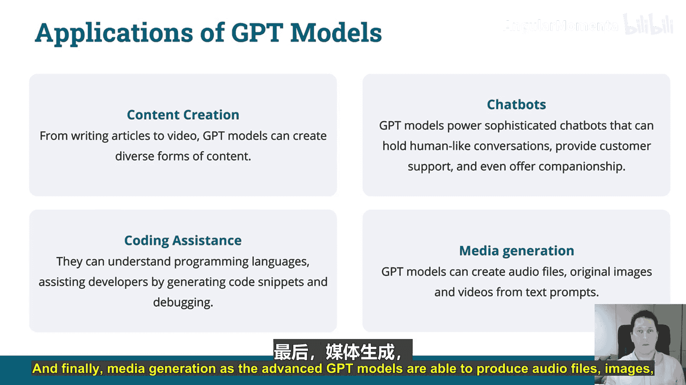

# 【Infosec】用于攻击性安全的ChatGPT ｜ ChatGPT for Offensive Security p03 01_01_03_introduction-to-nlp-llms-and-generative-ai -BV1jPrHBsEv1_p3-

Instructuction to chat G and front engineering。

This is Section 3 In to NLPs LLMs and generative AI。

Overview of artificial intelligence， AI and machine language， M L。

Let's take a look at AI at a high level， first of all。

 so artificial intelligence focuses on creating systems capable performing tasks that typically require human intelligence。

Take a look at the diagram， you can see that AI is at the top and then under that is machine language。

 so machine language is a subset， it's a field of study within AI。

And machine language gives computers the ability to learn without being explicitly programmed。

A subset of machine language then is deep learning and neural networks。

 neural networks are large mathematical equations that provide an effective technique for learning A to B mappings or input to output mappings。

 taking the input， processing and providing an output。

And deep learning is a type of artificial network that allows multiple inputs leading to an output。

You can see coming out of deep learning and is supervisorvised learning。

Semi supervised learning and unsupervised learning。

 So these are these are methods of training training the models and we'll it more we'll look a bit more into these later。

 but say supervised learning is。Providing labeled data to the model such as his bunch of pictures that have got a specific tag on and then here's bunch which haven't so training the model that way and then semi supervised and unsupervised is kind of going through that process of lettinging it land by itself。

ChatGT is a product of these technologies， the models are trained。

 the GPT models are trained and chat GT is a product of GPT3。Yeah。

So let's look a bit deeper into the relationship between AI and ML。

 so AI artificial intelligence AI is the simulation of human intelligence in machines。

 and machine learning is a subset of AI and it's the method that teaches computers to learn from that data by identifying patterns and making sense of the data without human intervention。

How do AI and ML L work together？And there's the concept of neural networks。

 So AI techniques such as neural networks are leveraged and。

Within Chat EPT to process the information， receive journal conversations。

 machine language algorithms play a central role in training Cha EPT by exposing it to vast amounts of text data。

 allowing the model to learn patterns， language structures and semantic relationships。

What's the relationship here， and machine learning is helping is a type of neural network that enables GPT models to be able to process this data。

I will take a look at how how this is achieved through this course。

One the different types of machine learning had a brief look at this supervised learning。

 the computer is taught by example， so data is labeled。

 unsupervised learning where the computer learns patterns and relationships from the unlabelled data。

 and then reinforce learning where the model receives rewards or penalties。For for， four actions。

AI and M O in offensive cyberseity。 How what was some use cases for these automation。

Models like Chagi Boutique can automate your cyber securitycurity profile and provide you with increased efficiency。

 allowing you to focus on more strategic work。Threat detection， analyzing。

 analyzing patterns and trends detecting anomalies and adapted defenses and adapting to。

Add to to attacks more quickly and with increased flexibility。

Where is the evolution of natural language processing。

The history of NLP began in 1950 with simple algorithms and the first used case of trying to translate language using a machine language。

 as there's this famous experiment called the Georgetown experiment in 1954 where they translated 60 Russian Sens using Natural language processing。

This this was important because it was the first time that they provided proof of concept that this could be a viable product and it attracted government funding。

At the rise of statistical methods， data science 1980s to 1990s。

 and the focus shifted from rule based methods to statistical methods。

 and this allowed more flexible and accurate language processing by enlaring larger data sets and using more powerful computers。

Then there was a deep learning revolution from 2010 onwards at the introduction of deep learning models air transformed NOP。

 and these models can now understand and generate human light text。There was a breakthrough in 2017。

 there was a white paper by Google Engineers called Attention is All You need。

 which introduced the concept of transformers and this led to the creation of more advanced models like the GPT。

Genative pretrain transformer。The era of generative AI， so GPT is and beyond。

 so with the advent of GPT and its successors， NLP has entered a new era where it can generate text which mimics human behavior very closely。

And there's multiple applications for this， which you can see with chat EptT from writing articles。

 generating code， engaging in human conversations， and generative AI is entering a new array of its capabilities。

 work can actually really imitate human language human speech。

OkayK air language models from rule based systems to neural networks。

Large language models a language model predicts the likelihood of a sequence of words it's the backbone of natural language processing。

 early models relied on handcrafted rules whereas neural networks rely on deep layers of deep neural layers which enable connections between the vectors。

Okay so the rise of neural networks， neural networks。

 a breakthrough came with the adoption of neural networks which could learn deeper patterns in data。

 this led to more accurate and context aware language models。

 so the key concept here is that neural networks allow machines to learn from examples rather than follow explicitly programmed rules。

The transformer architecture， as you mentioned before this is white paper attention is all you need。

 and the introduction of the transformformer architecture in 2017 revolutionized natural language processing allow for the training of much larger models that could understand and generate human light text。

How the impact is that transform a model such a GPT has set new standards for what's possible in natural language generation。

Overview of G models and their significance。

The evolution of GT models。A generative pre train transformer is a series of AI models designed by open AI。

 These models can understand and generate human light text based on the input that they receive。

GPT versions 1 to 4 of popularized LLM based applications setting the standards for what possible。

Let's take a look at the timeline of GT releases from Open AI， and just give you some context GPT3。

 This is where we see the appearance of chat GT。So GPT1。

 there was a breakthrough in 2017 of unsupervised learnings that GPT1 was released in 2018 by Open AI and this demonstrated the potential of transformers in language understanding an actual practical application to the White Paper。

GPT2 was released in 2019 with a significantly larger data set providing more contextually relevant text。

GP3 released in 2020， this is the current free model 3。5。

 and this has 175 billion parameters and showcasesumbread ability to generate human light text。

And this is there this is what has has popular us in recent times G4 is includes a lot more。

 a lot more ethical consideration and focus on。Again， the data write more human intervention。

And getting it into into a production ready， ready state so that can be used within business。

GPT4 also includes an advancement on GT3 where GPT3 was mostly about text generation。

 GPT4 has also got text voice voice to text， text to voice， image to text， text to image。

 sound and video generation。And then moving on to GP 5， which is due to be released in 2025。

 there is a significant increase in parameter size as well as additional features。

 and I'm sure much more work on the ethical side of things。As how do do PT models work？

Learning from data GT models are trained on very large data sets and then generating content once they're trained they're able to generate content input。

Processing output。And being able to do this in a very believable way。

W let's what are some applications of GPT models， content creation and writing articles， videos。

 a diverse range of content。Coding assistance， assisting with assisting with writing scripts。

 and assisting with fixing code and writing stuff， writing code from scratch。

Converting code into different languages from one house to another。A chattbots， a chat T team。

These text generation models are very good at interacting with humans in a natural way。

 so they naturally lend themselves to holding human conversations within customer service。

And finally， media generation， as they advanced duty models are able to produce audio files and images。

 videos。

