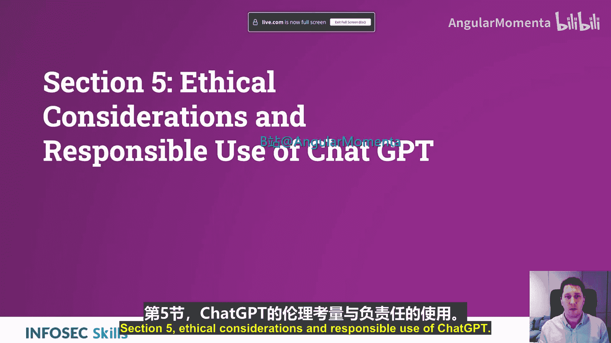
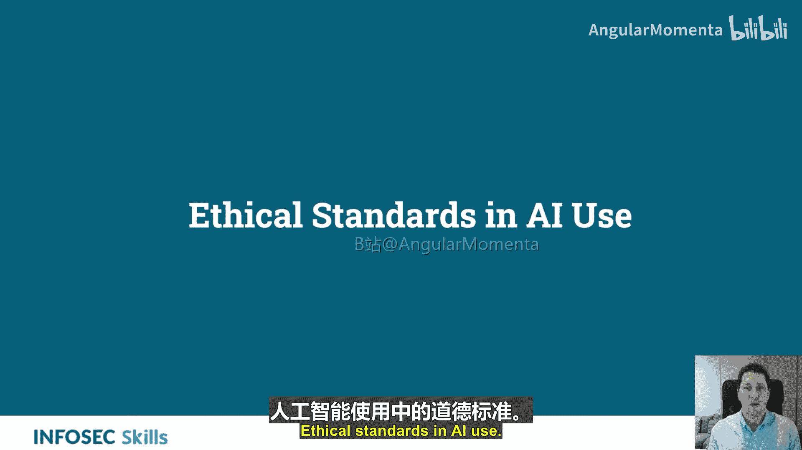
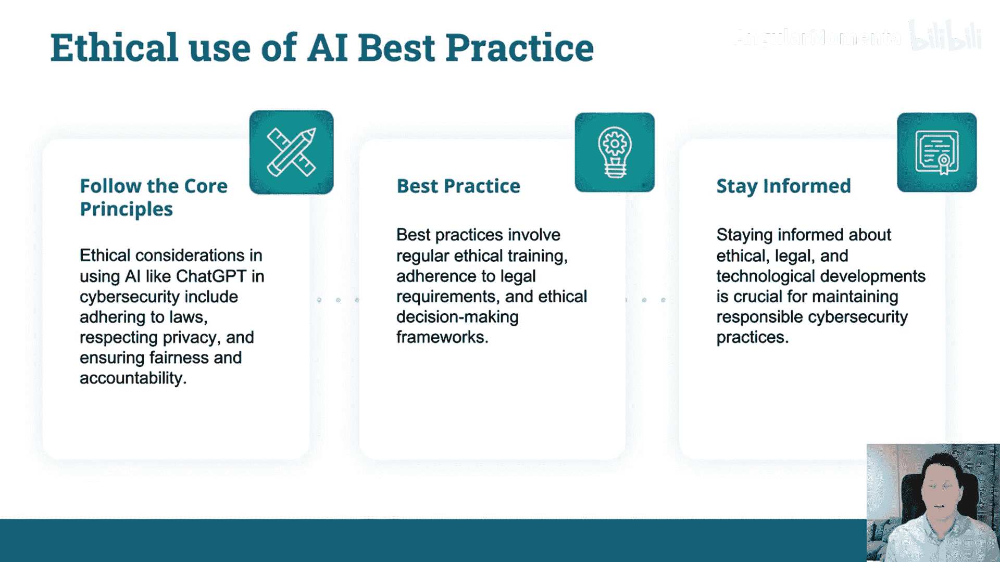

# 【Infosec】用于攻击性安全的ChatGPT ｜ ChatGPT for Offensive Security p05 01_01_05_chatgpt-s-limitations-and-ethical-concerns -BV1jPrHBsEv1_p5-

Introduction to Chaty BT and Front engineering。

Section 5， ethical considerations and responsible use of charge ET。

Ethical standards in AI use。

This instruction to the use of AI within the instruction to the use of ethical use of Cha GPT within AI。

An area in cybersecurity enhances threat identification analysis and countmeas。

 but requires ethical oversay。ethicalical guidelines ensure AI's power is used to protect， not harm。

 maintain user trust and compliance with laws。The balance of innovation and ethics in cybersecurity involves respecting user of privacy。

 data， integrity and consent。The ethical framework， core principles within ethical hacking。

 core ethical principles and cyberse do no harm， fairness， privacy and concern。Be ethical。

 ethical hacking aims to improve security not exploit vulnerabilities for malicious purposes。

And be responsible responsible AI use involves applying these principles to protect against unethical data manipulation and privacy violations。

 that be applying the principles of ethical hacking and ethical cybersecurity practice to the use of chat GPT within offensive cybersecurity。

Privacy concerns and overview our tools like CGBT can pose a risk to data privacy if not used for strict data protection measures。

 be careful of the data that you put into the model that you query with that you are asking for help with code and make sure you've got effective guidelines in place for policies and procedures。

Priv privacy protections， essential privacy protections include data anomaization and stringent access controls。

 not specific to AI， but in general， privacy laws， as you know， GDPPR， CCP mandate。

 rigorous data security and user of consent practices。

Bs and discriminations again more specific into CGPT now， inherited bias AI systems including CGPT。

 can inherit biases from their training data affecting cybersecurity decisions。

Beyond be on the lookout for this， if if you program bias into the model or if bias has been programmed into the model and you use that data wholesale。

 you may you may be getting a biased data and if you use that yourself you then become part of that because that part of that chain and mitigateigating bias。

 efforts to mitigate AI bias include the use of diverse data sets and regular bias audits always be always be on the lookout for that bias and evaluating bias。

 ensuring fairness in AI driven cyberse practices require a continuous elevation and adjustment。

Countability and transparency。Accountability， AI driven decisions in cybersecurity must be traceable and explainable to ensure accountability。

Transparency about AI。Transparency about AI use and security practice builds stress and ethical and legal compliance。

 documentation and review processes are crucial for accountability in AI assisted cybersecurity actions。

So transparency in the way that you produce your models， but also in the way that you use them。

Legal considerations are the key laws that working out general data protection。

 GDPR for Data Protection， Comp fraud and Abuse Act， Cybersecurity Information Shaing Act。

Ere these laws regulate the ethical hacking activities and the use of cyber securitycurity。

Responsible use of CGPT and offensive cyber securityity。

 A responsible use guidelines include only targeting authorized assistance。

 maintaining a confidential reality of findings and reporting vulnerabilities for re mediation。

Kine consent C GPT can be used ethically， but always gain consent。

 the ethical considerations avoid the use of。A malicious malware and respecttator and privacy norms。

The best practice for the ethical use of AI follow the core principles。

 ethical considerations in using AI by CGPT and cybersecurity include adhering to laws respecting privacy and ensuring fairness and accountability。

A best practice is regular ethical training， adhering to legal requirements and ethical decision making frameworks。

 stay informed， stay informed about the most of today date's developments。

