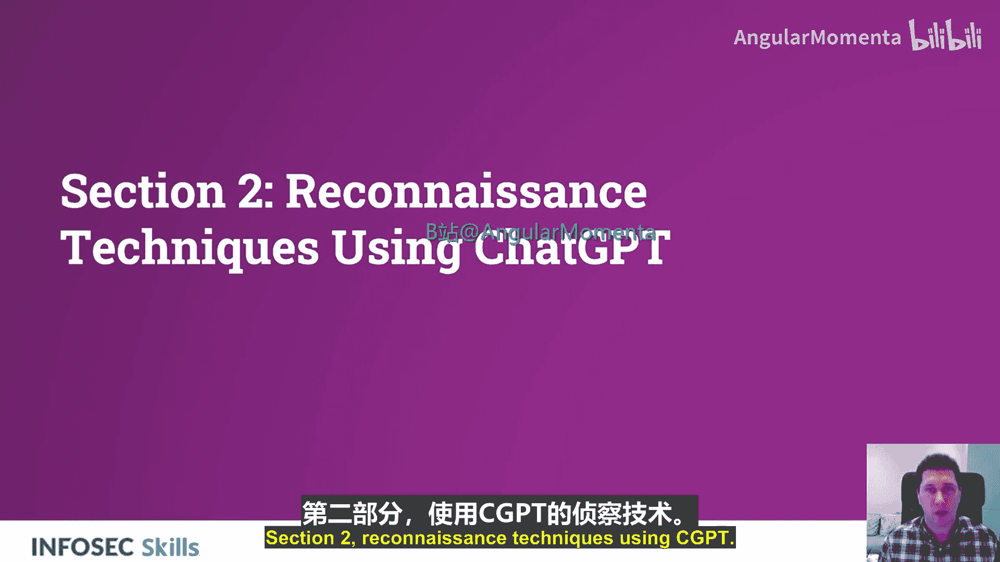
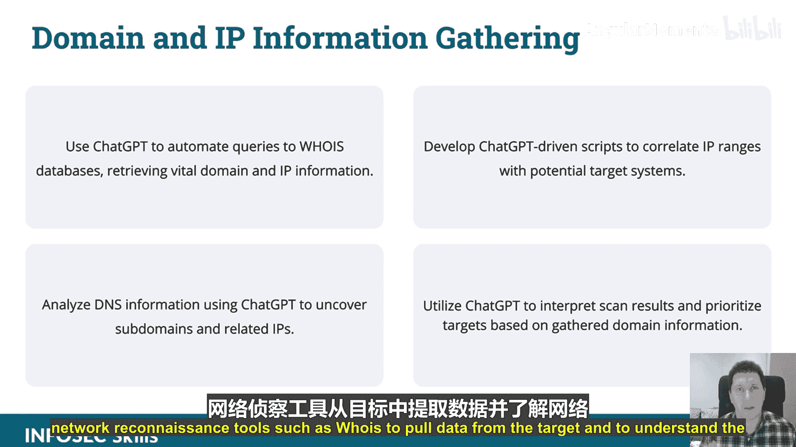

# 【Infosec】用于攻击性安全的ChatGPT ｜ ChatGPT for Offensive Security p07 02_01_02_reconnaissance-techniques-using-chatgpt -BV1jPrHBsEv1_p7-

Offensive application security using CGP。Section 2， Reconnaissance techniques using CGPT。

Here's an overview reconnaissance with CGPT， so its ability to process and analyze vast amounts of textual data and produce natural language output where it excels and where it's very useful in the reconnaissance phase。

 you can utilize the tool to really add efficiency and save itself a lot of time。

 as well as implementing custom scripts and dynamically interacting with data。

Domain and IP information gathering， we're going to go over this in a demo by just going through a little bit theory first。

In your normal reconnaissance phase， you will use network reconnaissance network reconissance tools such as who is to pull data from the target and to understand the network network interest。

