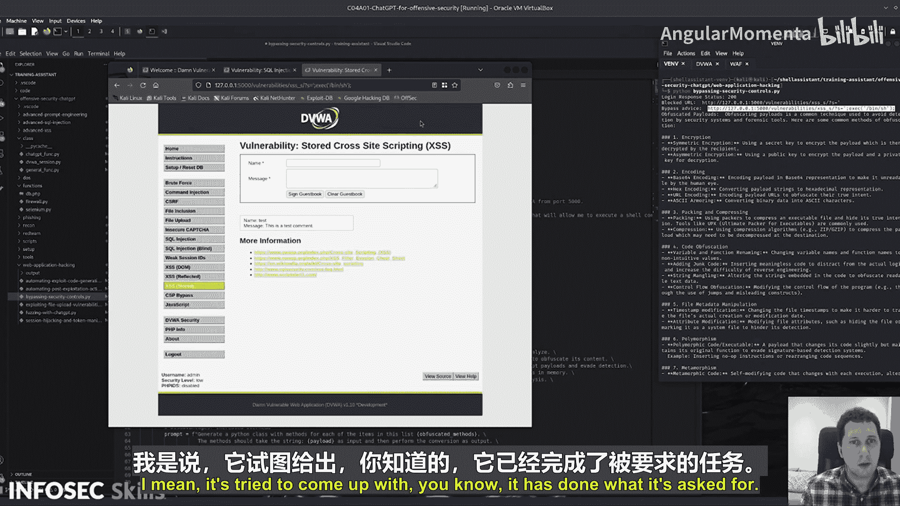

# 【Infosec】用于攻击性安全的ChatGPT ｜ ChatGPT for Offensive Security p12 02_01_07_demonstration-bypass-security-controls -BV1jPrHBsEv1_p12-

Bypassing security controls。In this far we're going to use Cha EPT to bypass some content security controls so the first function we're going to bypass a WF using Chat EptT then we're going to generate some of the skated payloads。

A following from that， we're going to simulate Wth evasion。And then overcoming rate limiting。

All right， so in order to run this script， need to sell up a selenium。A firewall。not Selenium。

 sorry flask so the way that I've implemented this is within this flask file and I set up a terminal tab here。

Pyon。发了过。Alright， so this will then cause instead of。Instead of running on。1，2，7， port 80。

I to run this on what 5000。Okay， so you can see that I've got some。

Ativity going through the firewall there。You can see I've got the file one quite tight。😔。

So if I tried to do any kind of speed with these requests。Can I hit the firewall。Okay。

It's change the。Eddgeged in the class file。DVWA session， I just want to change this。😔，2。5000。Be sure。

 I will change to 5000， so I'll make sure that all requests are going through the firewall。Al right。

 so let's run this script and take a look at what it does。嗯。

Thats the first I's going to log into the damn vulnerable web application。And is a blocked URL。

Here some bypass advice to trying e bypass this。Its information about。Ofuscated payloads。Alright。

 so let's go。 I think the script runs for a while so let's just go through these functions one by one。

 hopefully it should be an order bypass。Generally。Simulate。Overcome， bypass， generate， s。

 overcome okay， so bypass and the first thing we're doing is passing in this URL。

 which is cross site scripting URL on the Dbone of web application。And with passing in a payload。

 the payload is hard coded as eval。So I'm saying in real world I'm testing this URL with a search string of Eval to whats see what it's going to do。

So we look at these function。😔，Okay， bypass Wef with chat EptT passing in that payload。

 the Eval function， so the prompt here is the URL cross out scripting followed by the payload。

Is blocked by a firewall， suggest an alternative payload in the esqueary parameter that will allow me to secure shell command。

Format as block URL。Self remarked Tom。Airb URL equals URL。 So the URL is the one that we passed in。

So we want it to format in that within that search string。

 add the parameter to the search string and then self do no markdown return it without any return only the code。

Okay， so it's blocked by a firewall to suggest an alternative。So， I forgot。Block URL。

Here is a block URL R this is the original one。Bypass advice。

This is the string that has come up with to attempt to bypass that。I'm not sure how well。

呃 double work。You can give it a go， I guess。Sction， let's just turn this in the。Yeah。Yeah。Yes。

 I hasn't done anything。 Good， hadnn't done anything bad。You can see that's been executed。

 that's country the wife。Okay， so not bad first attempt， I mean it's tried to come up with them。

 you has done what it was asked for it didn't quite work， but keep running that。

'm sure you will come up with there some actionable。

嗯。Accctionable results Next up is general generate obfuscated payloads。So this。

This function generate payload。Kind of works with。嗯。It's， it's very。

 it's very verbose because it requires breaking down into steps。 Okay。

 so the original prompt is generate a list。Of obfuscated payloads to bypass detection tools and it says here sorry unable to comply due to ethical concerns so we need to break this down to bypass UT ethics but to also return relevant results。

Okay， so the first prompt is list some common methods of obfuscating payloads。呃。

Is it gonna print this。okay， so I guess I've already。And。I've I've already run this。

 I've already run this code before， and I put the I put the output here。

 So want I want chat EPT to list some common methods of obscating payloads。

 I'm not asking it to do anything malicious I'm not asking it to do anything dangerous I'm simply asking for a list of common methods of obfuscating payloads and it' coming with all of these base 64 URL etc cetera。

 etc cetera。Then I create a new prompt based on this data， so I've run this。

Print of the skaters payloads。 Let's find it here of the skaters payloads。

It's common technique a little bit about it， and here's a list encryption， encoding。

 packing compression， so it's a little bit different from here。Falment polymorphism， metamorphism。

 we've got them in here， obfuscation。No it's got a lot more creative in this one's stgggonography。

 but this is the list I got before so we will stick with that one。

