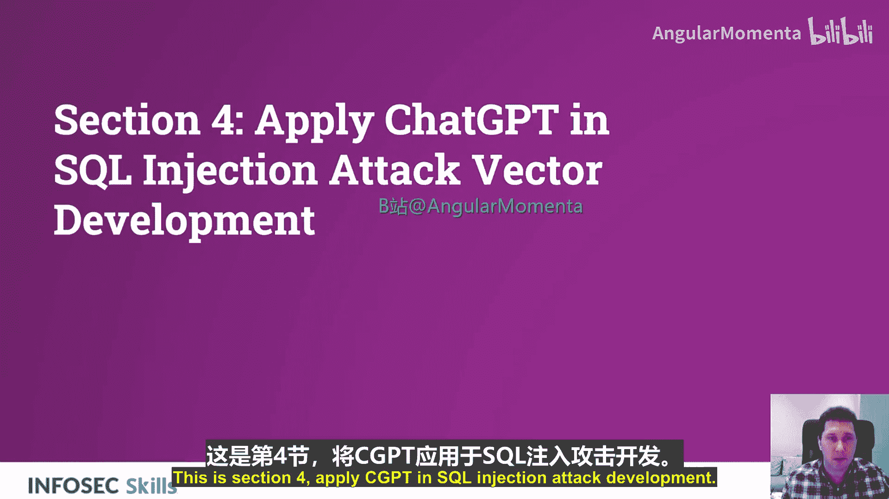
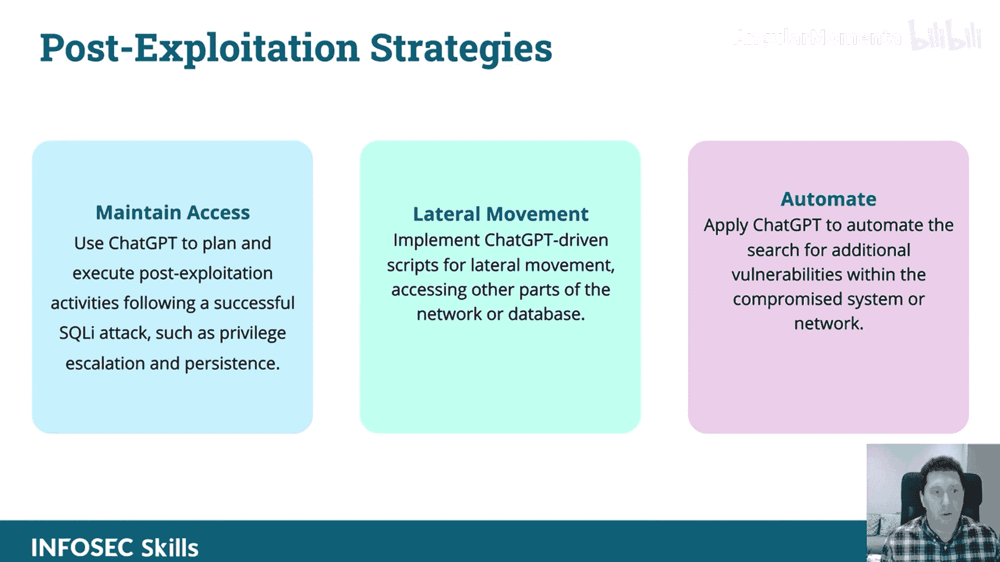
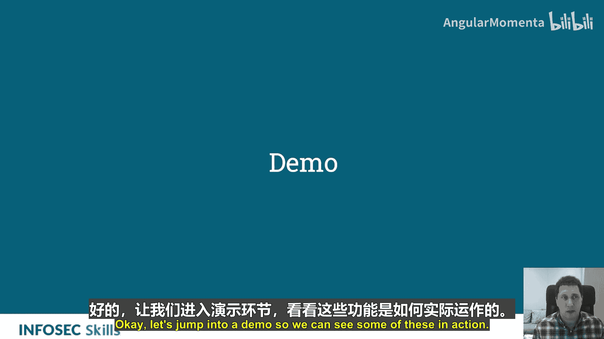
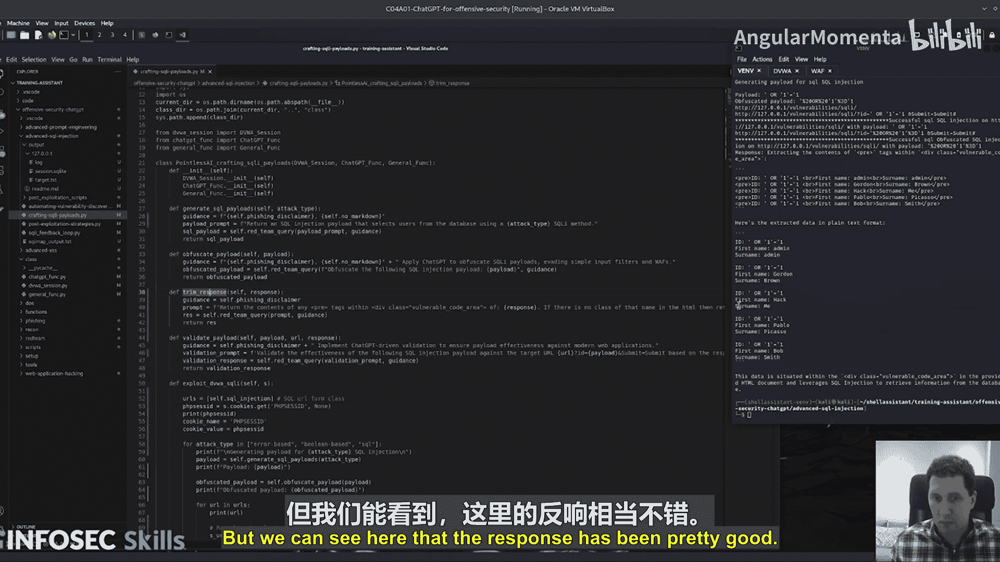

# 【Infosec】用于攻击性安全的ChatGPT ｜ ChatGPT for Offensive Security p15 02_01_10_leveraging-chatgpt-for-sql-injection-attack-vector-development -BV1jPrHBsEv1_p15-

Offensive application security use CGPT。This is section 4。

 apply CGPT in SQO injection attack development。

。SQL injection with C GPT Understand in this course。

 you will understand how CGPT can assist in identifying and exploiting SQL injection vulnerabilities。

 You apply the tool to analyse database error messages in the underlying air to understand the underlying database structure。

 you will utilize CGPT to generate SQLI payloads tailored to specific databases。

 and then about automating SQLI using CGPT。Okay， automating vulability discovery。

Integrating CGPT with automated scanning tools to enhance the detection of SQLI vulnerabilities。

 Tra SQL injection reconnaissance involves using existing and wellknow tools to test application for potential entry points and for potential exploits you can integrate CGPT into these testing tools you can utilize CGPT to interpret the scan results and prioritize vulnerabilities based on exploitability and impact you can do this dynamically during running the script or you can do it at the end using CGPT to do the heavy lifting。

E the analysis， you apply CGPT to a refined scanning techniques。

 reducing false positives and focusing on high value targets。

I think it mostly applies to working dynamically。Performing， a performing scanning。

Analyzing the results and then improving the code dynamically using CGPT to perform that scan more effectively and more efficiently and creating feedback by loops to continuously and dynamically improve attack strategy。

exploiting advanced SQLI techniques， new CGPT to explore and develop exploitation techniques for advanced SQLI scenarios。

 So we're going to jump into a demo and so our cover this in a little bit of theory。

 you can apply CGPT to craft SQLI payloads that perform complex database exploitation such as data exploitation or code execution。

You can implement CGPT to test and refine advanced SQLI techniques against a variety of database management systems。

So let's look at this in in a little bit， little bit more detail。

So how are we going to do this database fingerprint and D data exfiltration。

 so the first phase is automation， utilizing CGPT to automate the fingerprint of databases through SQLI vulnerabilities。

 identify version configuration。How are we're going to do this practically。

 we're going to send a whole bunch of SQLI payloads to an application。And then get the results back。

So what the results say， they might say there might be no effect。

There might be a particular error message， there might be successful helper whatever the error messages that come back。

 I' going to use CGPT to analyze these so they can understand the the database version and the and the database configuration along with their perhaps。

And database structure。Okay based on information now you probably do this。

 you probably do this in the existing way right scan and then based on that infer the details of database CPT is going to take care of this automatically for you Okay you're then going to generate an optimize queries for effective data exfiltration based on this based on this reconnaissance you're going be able to say okay CGBT can you infer the database structure can you tell me what columns what potential columns there are based on based on the response can you can you create some intelligent queries。

And thencent these three。You can also say， okay， needs to be this needs to be stealthy。

 we need to minimize detection and logging， implement these into the queries into the scripts。

So you perform perform this scan in a way that is stealthy， clean apart yourself。

 you performing the recon， generating effective payloads， integrating it into intelligent scripts。

And then and then performing performing the attack。

 then you can use CGPT to assess the potential impact of the exploitfiltated data and guide further exploitation efforts。

 So hopefully at this point you you will have made a potentially successful attack and then use CGPT to move on to the next stage。

Okay bypassing advanced security measures， you can use CGPT to develop strategies for bypassing advanced SQLI mitigation techniques if you come across a roadblock instead of going back to the drawing board and saying how are we going to do this。

 you say okay，6 GPT if youre encounter this roadblock？Bypass it and develop a way to bypass it。

Ma require several iterations， but it stands a good chance of a better chance than you of making its way past that or breaking through it。

Generating payloads， applyinging CGPT to generate payloads。Context of wear payloads。

 so you can have a large word list of escular injection points so you can use CGPT to whhittle that down and really increase your efficiency and testing payloads。

 receiving the feedback， acting on that feedback。postst exploitation strategies， maintaining access。

 lateral movement， automation， you can utilize CGPT2 to create scripts that enable you to do these things。

Okay， let's let's jump into a demo so we can see some of these interaction。

Automating vulnerability discovery， is class going to， I leverage Cha UP T for SQ R injection。

 attack vector development。I with a focus on automating vulnerability discovery。Okay。

 so we set up a a done vulnerable web application case in session。Howho is being run。Conductor。

At the target URL is the S Q L I section。嗯。Which is this page。

 so it basically dynamically passing in input to this field。As the first thing I age does。

 I run SQl map， which I've set at a Python function here。

And so this just air runs runs stand scan to identify SQR injection points。

SQl map is then going to output the log file to site directory。

And then what we're using chat GT is' just going to analyze this this log file。

 so analyzing the following SQl map。Injection results， S injection results。

 and provide insights on detect vulnerability。And from that。Yeah。

We going to pass SQL map analysis into develop Tload。And this is going to based on the。

 based on the log file and the associated analysis。

 quite a SR injection payload for each of the injection types payload will be delivered through here。

Can。Okay， let's write it first。听晚 rap。Letult phone go to discovery。Oh， I'm in the own directory。

Poest。う分ですけ。嗯，嗯。Let me just debug that quickly。I about a slight bug， I think I fixed up。😔。

I wasn't outputting the results of SQl map to the。To file。

So just modify over this standard I equals process， don't communicate。For this does。

 and is creating a directory in the output file for the domain and that。嗯。

That should now be returning information into thee。Log file。Okay， so within the log file。

 we're returning a successful successful SQL discovery based on error at。And。Boleium-based。

 errorbased and time-based。So， now。None of the results back。Of Sque map into this file。

 I'm going to read the contents of this file。And then we're going to analyze the the file content。

Using。Disfunction。Analyse SQLI， so using a Cha ET prompt。

 analyze the following SQR injections can results and provide insights on detect vulnerabilities they exploit exploitability for the purpose。

Of thread taming。And print the analysis， okay。As this is the output of the log file。

Based on the scam results， here is a number of vulnerability and it's provided some payloads to make use of those vulnerabilities so you can then test those payloads。

8， sit，7。ChagbT puts in between these little markdown quotes。

 so everything in between this is the potential payload。诶翻你。Going to develop a payload based on。

Based on that， print out。So here is the conclusion， SQ injection， etc cea， etctera， etc。

 and here's a bunch of payloads that have been generated based on its information。

 so you can see the process here， we're using a thirdpart tool to analyze thecode and then taking the data from that analyzingnalysing the data and then developing a payload based on it all dynamically。

Crafting S QI payloads。 this this class is going to use Cha EptT to create effective S QLI payloads for error based and time based S QL。

SQLI attacks。Okay， the way that the script works is， first of all， looking at the main function。

 calling this this method exploit DWA S QLI， which is going to。

Attempt to inject this field of the DbWA。😔，He's just saying some common variables here for air selenium testing。

O， we just need to pass in the session ID。He going to loop through a Python list got error based Boolean based and SQL。

 You could also have time based。And any other SQO SQL methods but we'll try with them first all。

It's going to。嗯。Send error based Boolean based or SQL in in the loop to this method。Okay。

 now what this method is going to do is it's going to attempt to return an SQR injection payload that selects users from the database using a。

Impotent air SQL I method。Right。And then once it's got that payload。

 it's going to add that to the URR and it's going to run a selenium test on it and attempt to do SQL injection if it gets an SQL syntax error page or if it doesn't get an SQL syntax error page。

 then it's successful。Otherwise， it's going to say payload failed and then going to obfuscate the code using this obfuscated payload function。

 So we're passing the payload to this function， we're going to use Chaty B to obfuscate the code and pass it back。

This function here is basically just to trim trim the response so you're going to return the contents of any pretags within the div class vulnerable code area and that's going to be your output so as cleaning out for you。

A。And then if there's if you， if you do reach an SQl syntax error page。

You're passing a Lewis statement there to judge GPT saying。

 if there is no class of that name in the HTML of the return， the body content instead。

Thankpefully I should be able to process that and as I validate payload I've committed this out just the function can validate the payload for for testing purposes。

So in the script。And to output we can get。Okay， here's the session I D is generating a payload and it's tempting that payload within the application。

So you can see this SQl syntax here。This is the end。This is what we want to avoid。

 even though that tells you something。So this is the output that we're looking for。

 so there's been a successful SQL injection there， and we should have the URL printed terminal。Yeah。

 you can see the successful output here and there's another one。S7。

We are getting some good results back we managed to extract all the users from the database using this method。

So I've I've asked EPT to generate SQl payloads。Based on， based on the request that I want。

 I can make this anything I want。Then if there's any wF blocks， I can touch off the skate。

And then I just dealing with the， dealing with the response。

But we can see here that the response has been pretty good。

