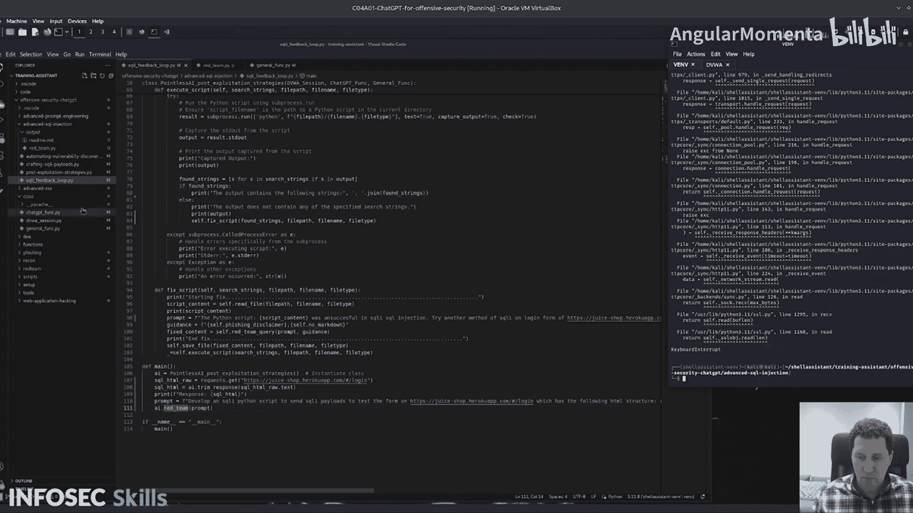

# 【Infosec】用于攻击性安全的ChatGPT ｜ ChatGPT for Offensive Security p16 02_01_11_demonstration-post-exploitation-strategies -BV1jPrHBsEv1_p16-

Leevering Cha EP 4 SQO injection attack vector development De script post exploitation strategies。

So in this script， we're going to use chat GPT to plan and execute post exploitation activities。

AndI originally made the script for SQLI attack， but I think it shows it better with SSching to a server。

And。So the way the script works， we start a DBWA session。And then execute this function here。

 plan post exploitation activities passing in a prompt。

 plan and execute post exploitation activities following successful SSH to a server such as privilege escalation and persistence。

How we' going to use SS Sage parks or our neighbour to do it dynamically。

 and here are the credentials being passed in。Alright。

 so the first function plan post exploitation activities。 is going to。

Just going to plan how we're going to exploit this in particular with privilege escalation and persistence on a target server。

AndThen this is going to pass the results of that the report to generate exploits and generate exploits is going to define a single Python function to implement the strategy。

Then we'll pass that to the next function refine exploits。

 which is going to work with the following with with with a generated function and then convert this function into useful working code。

So let's find this thread。That's the first thing it's doing is it's planning it's planning post exploitation with the prompt that we've passed it。

 so I've passed it as successful as it search to a server。

 you can pass any prompts like a successful。Successful SQL injections。

 successful obtaining of credentials， anything you want in there。

here's a little bit of ethics and then it's coming up with steps so in access。

 iss the terminal command， basic enumeration， checking and studio privileges。

 privilege escalation has come up with a nice little plan here。

Now it's gone to the next function where developed the payload。

This is a payload that demonstrates lateral movement and persistent access。So following on by that。

 it it's then attempted to refine the script。And it saved saved the output to plan dot Pi。

 So now we've got a script which we can use for。He used for post exploitation activities。

 so it's some it's got some URLls in here which obviously need modifying the script needs some work。

But if I run this again， they'll come up with a different method so I could I could just run this five times。

 take the best things from all five scripts and put them all together and just let Cha UT come up with an excellent script for you。

Let me just let me just run that through again just to show you an example of another。

Another script that it might create so in this current one exploit SSH hased the imported the modules。

 is accepting a target and then on the target server is running all of these commands which is going to pull all the information and useful information from the target server and then take action on it。

Not sure what Parameko does。 I haven't used that， but chat AT seems to know what its。

W what it's doing。you could execute the script dynamically as it's created。

 but you can see they would need some additional configuration in the prompt so you need to specify maybe the target IP and。

Some， some information。I've had an ethics problem there。😔，All right。

 and that's sir that's just depended， so let' just get rid of that。Okay。

 so now now the method is called a attack strategy。

And we're running a subprocess from the Python script again。

 getting all the information from the server。You can see it's coming up with some really useful stuff。

 probably stuff that you wouldn't even， even think to， to operate。SQLI feedback loop。

this script leverages chat ET for SQL injection， attack vector development。

 and in particular asQLI feedback loop， so it develops。

 it generates a script to attempt SQLI injection。And then。

 runs that script and then if if it's unsuccessful， it sends into a feedback loop。Okay。

 so we can see the outputs just been run here。So the first thing， the first thing that I do is to。

Pll the raw HTML from the target login page that way I'm able to obtain obtain the form。

I use this method here， trim response。To obtain the form in HTML。

For this particular site since it's built in nothing angular。

 it doesn't actually enable me to get the HTML form so I to take a best guess is saying the login form might look like the Owa juice shop so it's taking a best guess here and if you're working with target and you want to speed things up。

 maybe grab that first if you're if unable to get a dynamically。Okay， so next up。

 can to send this prompt to develop an SQLI Python script to send SQLI payload to test the login form？

Which has the following structure。I'm going to pass this prompt to a function called red team。

So what red team is going to do is it's going to execute that prompt。

 so it's going to develop an SQLI Python script to attempt this SQLI injection on the login form。

AndFollowing on from that， it's going to pass it to pass the。

Pass the strategy that is developed to the function generate exploit Gene exploit is then going to take the strategy and define a single Python function to implement the strategy。

This is going to pass the function to refine exploits。

 which is going to convert the function into useful working code ready for exploit。

I going to set some search strings here， which is， which is a measure of success。

 If the response contains any of these search tokens。

 then the script has been successful and it connects it。

Right following from that we' execute the dynamically created script。嗯。

And if the output contains any of the followings， any of the provided strings。

 we will then exit the script。 If not， we' can to send into a feedback loop send it to the next function。

 Next function is going to attempt to fix the script。 So it saying， okay， this was unsuccessful。

 We need to， we need to attempt to to fix it。No haven a got。If I go to。The Iwa juice shop。

 And then I look at the。The post post URL， the API。

So we're actually posting to our rescues and login， there should be able to extrapolate that。

All right， now once Cha Juputee has attempted to fix the script is then going to pass it back to execute script。

 that's going to attempt to execute it again if it's still been unsuccessful。

 send it in a loop so keep bouncing between these two until we get a successful outcome。

So we can see here in the output it's tempted to figure out what the form is and then developed a script to attempt to log in dynamically。

This script has been output to redt dopi。😔，Then the scripts been run。

And we have received a successful successful login using the provided payload。

And the output contains following string token and the script is executed。

 so this this executed quite quickly， but in reality it can just loop round for for as long as is required。

 let's see if we can just get it looping round a little bit before a successful outcome just to show you this in action。

It's the first thing that is doing is。Maan， as first nurse doing is getting that HTML， processing it。

 getting the form information。And then。Running， running that prompt on red team。

Red team has created the prompt， It generated to make exploits to refine the exploits and is now executing the script。

 So you're saying now is script being executed。It's not working。 So now starting fix， try again。

 and fix， starting fix and fix。 So just going round in a loop to try and。

Add to try and get a correct script that will， that will effectively log in。

And obviously this can be adapted to not just SQL injection， but any form of attack。

All you've got to do is modify this prompt and here maybe a few areas in the code where it talks about SQl injection。

