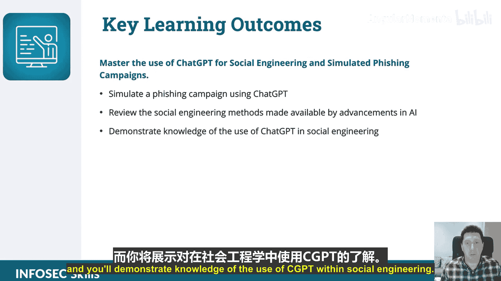

# 【Infosec】用于攻击性安全的ChatGPT ｜ ChatGPT for Offensive Security p17 03_01_01_introduction-to-chatgpt-in-social-engineering-and-phishing-campaigns -BV1jPrHBsEv1_p17-

T U P T in social engineering and fishing campaigns。This is Section 1， course overview。

This course introduction， are going to understand the potential of CGPT in offensive operations and simulated phish campaigns。

 going to discover CGTP applications within social engineering， aircraft craft fishing。

 effective phish attacks using CGPT and automate and adapt these simulations using AI。

Other the key learning outcomes the main objective should had be to master the use of CGPT for social engineering and simulated phish campaigns。

You will simulate a phing campaign using CGBT， who will review the social engineering methods made available by the advancements in AI and you demonstrate knowledge of the use of CGPT within social engineering。

Okay， so let's get started。