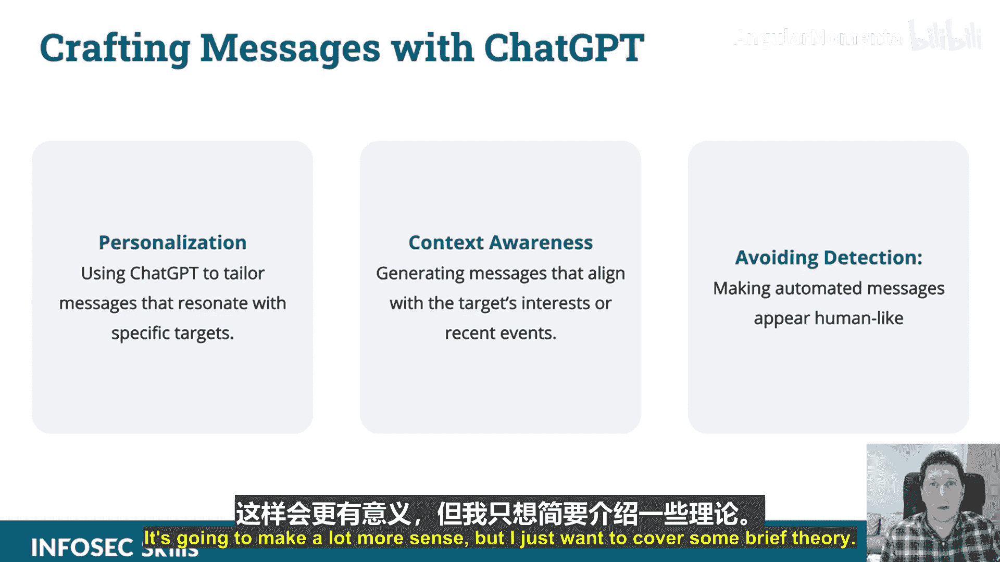

# 【Infosec】用于攻击性安全的ChatGPT ｜ ChatGPT for Offensive Security p18 03_01_02_social-engineering-with-chatgpt -BV1jPrHBsEv1_p18-

Church A and Social engineering and fishing campaigns。This is Section 2。

 Social engineering with Cha GPT， O C GPT。Okay， here's an overview of social engineering ICGPT。

You can make use of CGPT's conversational abilities for social engineering attack。

 and you can automate the creation of convincing and context aware messages and you can identify potential targets for data extraction and access。

Croing messages with CGPT。 Now we're going to go over this in a demo。

 It's going to make a lot more sense。 but I just want to cover some brief theory。

