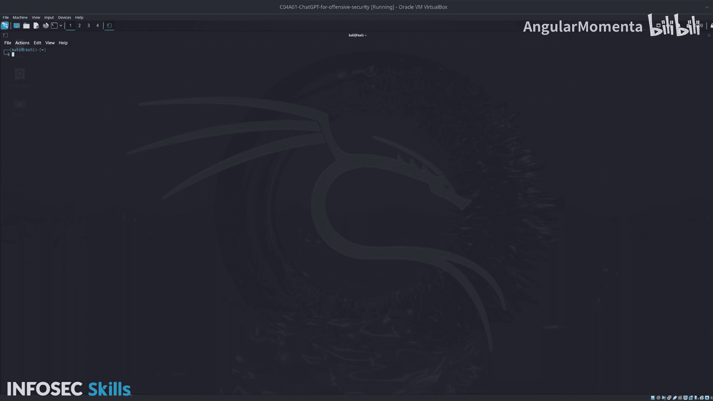

# 【Infosec】用于攻击性安全的ChatGPT ｜ ChatGPT for Offensive Security p20 04_01_03_compare-a-range-of-chatgpt-tools-used-to-craft-attacks-lab-overview -BV1jPrHBsEv1_p20-

Hello， welcome to this lab on using chat GptT terminal tools for the purpose of offensive cyber security。

In this lab， you will work within Carly Linuxox and compare multiple GPT tools that can be used within offensive cyberseity workflows。

You will staff testing a basic terminal system called EI。

 EI is a basic terminal system and is a good instruction to the power of AI within the terminal。

Next to our demo AI shell， which is a user friendly terminal system。

It has a good U I and can be integrated into existing commands， for example， through piping。

You will then move on to SGPT or Shell GPT， a multifunctional tool that can be used to create code。

 generate executable shell commands， and provide general terminal assistance。

Its the most advanced of the tools and includes functions to customize and expand its uses。

You will then test out TGPT or terminal GPPT， which provisions the use of multiple providers and models This means access to a sizable library of AI models and perhaps more significantly the ability to work locally without any internet connection and without an API key。

 for example， in an airCpped environment。Finally， you will create your own shell GPT script to act as a basic shell system。

Let's get started。