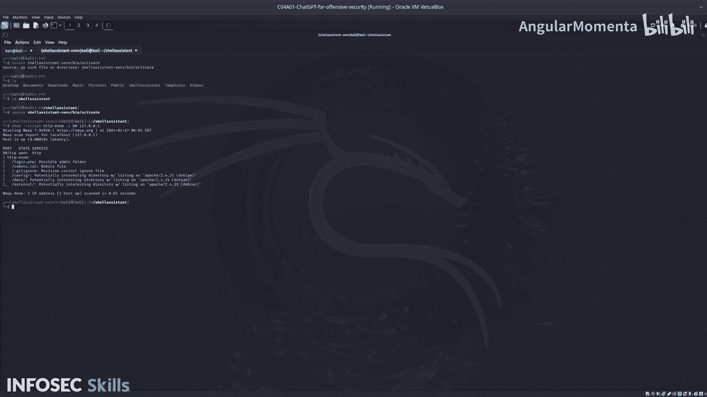

# 【Infosec】用于攻击性安全的ChatGPT ｜ ChatGPT for Offensive Security p21 04_01_04_output-and-setup -BV1jPrHBsEv1_p21-

Your task is to brute force the Dam V Web application login page using ChajiepT as an assistant。

The output will vary depending on the tool， but the successful command return for the model should be a variant of the Hy Pro force command。

 as you can see on the screen here。We will then execute this command to compare output per of different tools and options。

Okay， so the first step is going to be to start the。Docker application。

If you're not aware of what the T vulnerable web application is it's a web application that's got a number of known vulnerabilities and we're just finding that in a Docker image so I'm going to open up a new tab now。

Because that should be running on port 80。Ct opening up pay bothth and virtual environment by entering this command。

But maybe I'm in the wrong direction， you know。The first need two。Go to the S assistant directory。

 okay。Let see thee andchill assistant。N my that closed。Okay。

 so I've now opened up the Python virtualr environment within the Shell Asistant directory。

Now I want a test to see if the dam vulnerable web application is actually running。

 so you're going to run an Mmap command。So this is enumerated port80 on local host her to find potential vulnerabilities。

within a configuration so we can see here login。phP and there's a possible admin folder now if I go to the browser login。

phP I will see a login form which were going to attempt to brute force。Okay。

 yeah so the first tool that we're going to look at is your。

 so let's get started with that in the next video。

