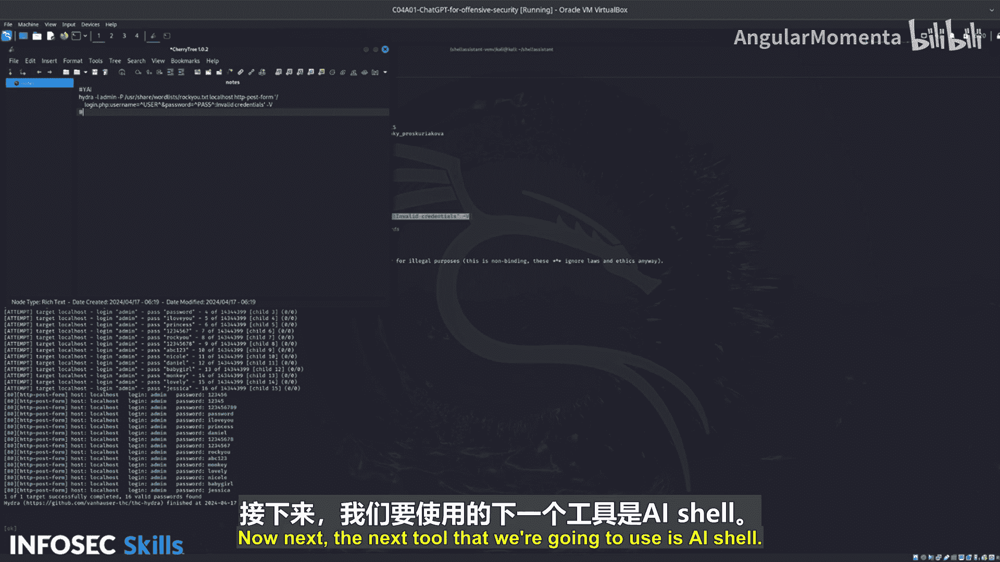

# 【Infosec】用于攻击性安全的ChatGPT ｜ ChatGPT for Offensive Security p22 04_01_05_step-1-run-yai-tool -BV1jPrHBsEv1_p22-

We now going to run the Y terminal system Air to try and Profor the damn vulnerableable web application login page。

So the I terminal system is a good introduction to the power of AI within the terminal。

 it's already been installed， so you'll now enter a series of commands to compare the tool output in assisting in brute forcing the DVWA。

So the first thing to do is to get your API key from platformform。 openai。

com so they'll give you a free trial API key and then after your free trial you can then top up with5 and that will give you a lot of requests unless you're doing something stupid but for this purpose you should be fine with the free trial。

Al right， so ya is already installed。 so if I try to run say I help。

It says I cannot find the configuration file。 You need to enter the API key。

 So this is where youll enter your your API key。 let me to send to mine。Obviously。

 I'll change this once the。😔，Once the course goes live。Yeah。Hi， so now it looks like it's working。

 So I can say something like capital of。Bronance。ECo Paris。 and it's to cut。

 it's trying to execute it like it's a shell command。 So maybe I could say something like list files。

我不是。😔，Yeah。Yeah。I list files and I'll come back with L S。

 and then I can type Y to execute the command。 and that tells me the contents of the directoryy。

 So I've now got this。 I can also say something like yeah。诶。List。Running doctorcker。Images。

And it turns me the command， I run that and then it tells the the tambone web application is running。

Okay， so let's try。 let's try brute forcing this web application then。呃，I普措施。😔，Yes。Okay。

So the command I'm trying is Yi， which is the terminal system。 and then I'm saying brute force。

 the application on logo is so very basic。No， it's given me a command。Air hydro。The admin user name。

It's pulled out the word list from Carly。And then it's figured out the。

Where I've said the application on local host， the AI has actually figured out local host that this is login dot PhP。

 so it's going to attempt to execute this。Why。All right。

 so you can see by just by saying brute force the application on local hosts it's actually gone through a lot of the times that won't work initially。

 so if you need to clarify that，Then you can try and give it a bit more context。

 so EI terminal system AI terminal system broke forth the application on local host specifying Port8 using the Rocky word list。

Okay， so this has now actually been less successful because it's going to try and run the Rocky Word list。

 but that's not the directory of the Rocky Word list so let's let's just take a few that now for an error。

So now need to try and clean this up by saying and still saying the rocky wordless may up than try saying the Carly rocky word list。

So now it how I understood that。 and it's going to try and run with the collie。

And we've got successful output again， so you can see here just sometimes you'll get hit just using a very basic brute force the applicational lowcoist and we need to think about that that you worked first time but sometimes you'll need to specify the file name or the OS that you're using give it some context so that's right。

Let's save。That好 her。It's gonna to save this output to a notepad。Fction as sell。😔，ch一吹。嗯。N。Okay。

 so this one is。Yeah。Colly has there。有要。So it sh find the correct air， quick to keep the hash。Okay。

 for you。 Now， next， the next tool that we're going to use is AI shell。

