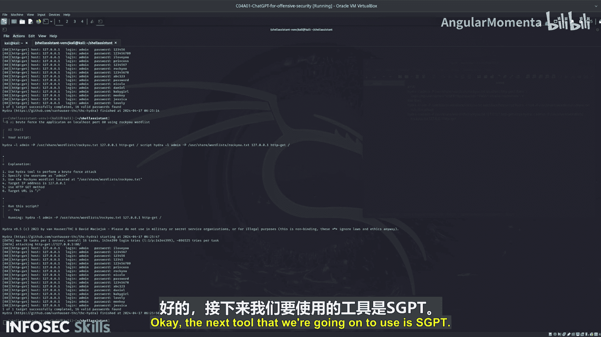

# 【Infosec】用于攻击性安全的ChatGPT ｜ ChatGPT for Offensive Security p23 04_01_06_step-2-run-ai-shell -BV1jPrHBsEv1_p23-

The next tool that we're going to test is one called AI shellll。

 So AI shell is a user friendly terminal system。 It's got a good Ui and can be integrated into existing commands。

 for example， through piping。AI show has already been installed she'll now enter a series of commands to compare the tool out in assisting brute forcing the Aam vulnerable Web application。

So the first thing kind of need to do is enter the API key， let let just start running a command。

So AI list files。No。Alright， so incorrect the API per key provided。 So we need to end the API key。

 the way to do that is。Planing。Into the config。Let me describe grab my API K。Stra again。

 Haless files。All right， since AI list files。 you can see this is a lot more graphical than。

Then yeah I， say。Y when we said this files， it returned the L command and then a description and then said do you want to execute？

Right， with them。With AI shell， it provides a more detailed explanation。 Why is this？

Where this territory is a pain， right。Okay。Yes， it provides a much nicer graphical interface。

 and you can actually scroll down these with the arrow key。 So I've said， okay， AI。

 how do I list files in the terminal It's told me the command It's given me a detailed explanation。

 I can then edit this command。 or I can rip copy cancel or just run the command。

 Its probably pressing enter。 I you can see here it's given the output。Okay。

 so the step now should be to try and brute force this web application。

 So were going run the same command that we did with the eye and compare the outputs。The case said。

AI Air brute forced the application on Lo very basic again。It's come up with disk command。This is a。

A abaron。Of what we saw。How with eye。So let's try and execute this。Alright。

 so it's trying to attack SSH a local host I mean， it's a bit weird why it's trying to do that let's try and run that command again and see if it gives us a different output。

No miss tried to do again， so I'm going to cancel this。And I then't want to。I then want to try and。

Clear up this clear up this command。 So AI brute force the application on local host port 80。

By this looking a bit more promising England let's take this。啊。Good O。

 so we've had a successful result back there just by giving it a little bit more detail just by specifying portaneity。

 actually being able to successfully execute that command。

Another variant that you could use if you need more specific detail。

 Its AI brute for the application of low port using the Rock Q word list。We run this script。 Yes。

 enter。Again， that's a successful output。Okay， the next tool that we're going on to use is S G P。

