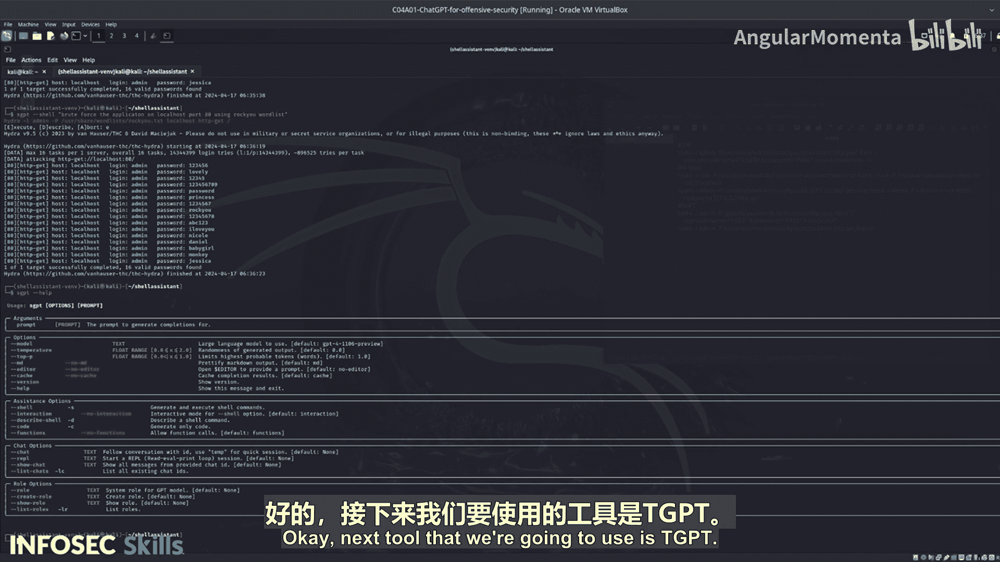

# 【Infosec】用于攻击性安全的ChatGPT ｜ ChatGPT for Offensive Security p24 04_01_07_step-3-run-sgpt-tool -BV1jPrHBsEv1_p24-

I we're now going to test out the SGPT tool or shell GPT。

 so this is a multifunctional tool that can be used to create code。

 generate executable shell commands and provide general terminal assistance。

It's the most advanced of the tools and includes functions to customise and expand its uses。

SGPT has already been installed on this system， so youll now enter a series of commands to compare the tall outputper in assisting brute forcing the D WA。

As the fascinating dos export the API key。So me just scrap mine。Actuallyly。

 I think it should already be in the say yeah just don't to API key exploit the API key and say in there。

And。Then just test this by saying list files。So you'll notice with SGPT that you need to put these in in double quotes。

 whereas in in Y AI and AI shell you could just。You don't need to double quotes。Okay。

 here's another area where it differs SGPT when you ask it to list files it's not going to immediately say。

 okay tell me to execute this command and it's telling you some very detailed information here more so than the other tools。

 but in order to actually execute this as a command， you need to specify to her。

Do you want to work with the shell。So the add the shell flag and then Ls execute the command。

 and then you get the output。This gives it a lot more functionality to add add that flag because then you can have other flags such as our code and chat。

Celes。Try our standard command， and see the output。

SGPT broke forth the application on local Coast this time in double quotes。Very interesting。 Okay。

 smell the。AG didn't work。 right， let's try into the API G again。Yeah。Yeah。

 I can't think I'm saying wrong。Sent me O key， sorry。Exs grabbing my API key。Obviously。

 I'll change things once stay。Our course goes live。All right， let's talk with that command again。

Alright， so I've typed this command in without the shell parameter。

 so this is now telling me a lot of information to the force and application on local host Steage use tool design for the task So now it's telling me a whole bunch of tools I potentially use Hyda B suite Owasapp on the Ripper Airb suggesting Hyda So you can see this very intelligent tool。

And that's given me this command。 so let's grab this and。Stick that in our boats。All right， so yeah。

 you can see it differs differs a little bit and we could try running this command base also saying okay。

 we need to havent specified the a particular file that you want to use。

So let's be a bit more specific with this。The first thing we're going to do is run it as a shell command。

So， I've added the shell flag。I didn't know that string was the。

it's given us this terminal and a weird error。That support them。Let's try again。

 That was a bit weird。Okay this works better so it's now given us this this string it's also picked up the word list once we've entered the shell command。

 picked this local host， it's port A and using the app and username so this looks like it should work。

Okay， so let's Chris scrap I come up。To thin in here。Right now。

 if you needed to get a bit more specific again， you can。To specify the port and the word list。

 so here I'm specifying that is a shell command I want to put forth the application on local host but I want to use Port8t and I want to use the Rocky Word list so let's just see what this says。

And again， successful。Okay， now SGPT you can actually go a lot deeper into it。

 there's a lot of a lot of good options I encourage you to。Explore the。

You explore the different options that you can use so you can see here that we use the shellll command to generate and execute shell commands。

 but you can also run code to generate only code interaction。

 a tap like a rep wall and then chat which will provide context。

And you can also create specific roles which is very useful because you can then then use that to provide some additional training to the model。

 which you can use for your specific use cases， so you could have， say a pen tester role。

 an ethical hacker role， red team role， a blue team role。

And that'll then provide you with a lot more functionality。Okay。

 next tool that we're going to choose is T G P。

