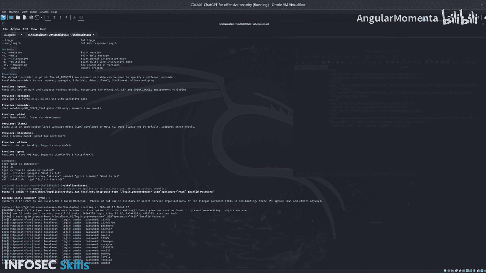

# 【Infosec】用于攻击性安全的ChatGPT ｜ ChatGPT for Offensive Security p25 04_01_08_step-4-run-tgpt-tool -BV1jPrHBsEv1_p25-

Let's now have a look at the tool TGPT， so TGPT provisions the use of multiple providers and models。

 so this means access to a sizeable library of AI models and perhaps more significantly the ability to work locally with no internet connection。

Without an API key。As TGPT is already been installed。

 so you will now enter a series of commands to compare the two output in assisting and brute forcing the DvWA。

So firstly I'm going to do is just test this test we don't need to enter an API key so。😔。

Let's say TGPT list files and see what it comes back with。😔，And I think it may need double quotes。

And look into list files， write this then cur say description of and some assistance but fine to the shell command exists quite similar to SGP with the shell flag。

This then provides the Royal shall command， no description。 no extras to command。topPS S， Y。

 and it brings up the files。 Okay， so next step， let's do something useful with it。TGPT show。

And then brute can our standard brute force the application on local hosts see what it returns。

This is kind of looking good， but。There was no option to execute it's looking for a word list called parcel list stock text which doesn't exist and the admin the username is called user so there's no way that's going to return anything but let's just save that to territory。

平。Okay， so how to improve on this。We can look at the areas that it's missing。

And follow a similar process to the other tools。 So now we' going to give a bit more detail I passing the AI more detail prompt with more context a group who will a brute force the application on low cost poor AD using a Rocky word list。

K now， it still hasn't offered the option to execute， but this does look a bit more promising。

 We've got the ad menus and name the correct word list。 So let's try executing this。Yeah。Yeah。Okay。

 interesting。As say what it looks like this is this command is doing through TGPT。

 this cancel that is its out it's the command worked correctly but instead outputting the correct correct response。

 it's actually outputting all of them and。It's also using post instead of G。 so by using post。

 I think it's a lot slower it's through it's goings for all of theses。

All of these different different usernames get works in two seconds post seems to be taking forever unless let's say it's outping all the wrong answers as well which is not what you want so you needs to do some tweaking there。

Now， let's let's do something different with T GP T。 So then let get the help options。Okay。Right now。

 this is where this is where TGPT shines because you can see that as E。

As a terminal assistant compared to S GPPT is it's not as good， but it does have。

this availability to use all these different providers。

 a lot of them can be used offline so Fi enterular command， TGP and use the provider flag。

Their provider。And I'm going to look for a provider of open AI， which needs an API key to work。

 and I'm going to ask it the same command。So you can see now by using open AI。

 which is the one which all the other ones choose， I've now got the option to execute this shell command。

It's just， I think it's picked up an old file。 So now this now this is working。

 so what what change between this， this output which produced all this nonsense。

 not very helpful at all。 not nonsense just not helpful。 And this。

 which was phase us into and gave us the brief force straight away。 It was the model that were using。

So I， I have said， okay， I wan to use open AI， I think by default。

The default provider is P P Hnd P H I P H I N D， I don't how' pronounced， but great for developers。

 not so good for for our purpose。 So by specifying the provider as open AI M I then get the relevant results。

All right， in the next video we're going to say with TGP。

 but we're going to look at how to use this model locally without our internet for air gap environments。

