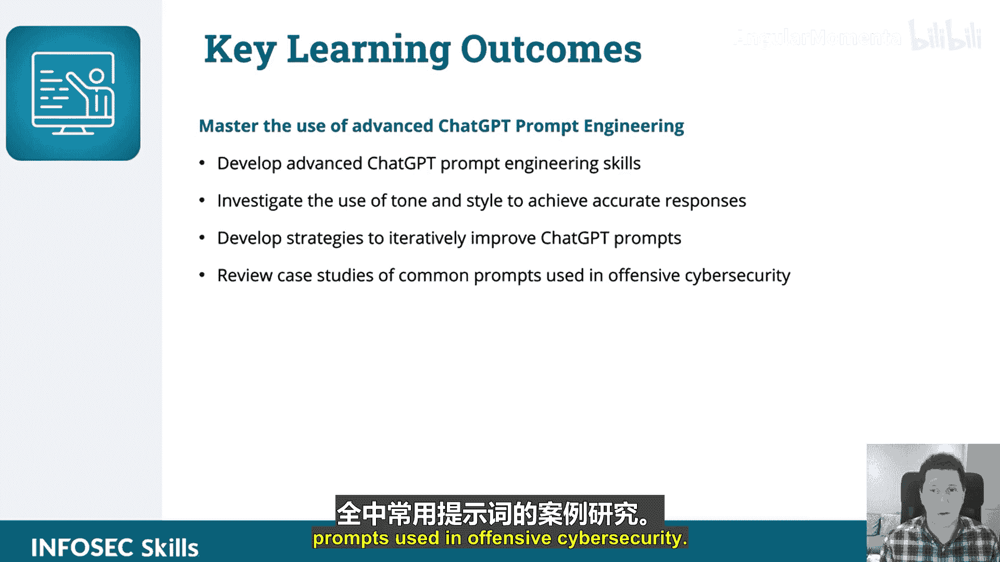

# 【Infosec】用于攻击性安全的ChatGPT ｜ ChatGPT for Offensive Security p28 05_01_01_advanced-chatgpt-prompt-engineering-techniques -BV1jPrHBsEv1_p28-

Advanced chat GT prompt engineering techniques。This is section 1 course over view。

K's course introduction， this course will teach advanced prompt engineering for offensive cyber securitycurity。

You'll learn refining chat GPT prompts and master techniques to enhance response quality for cyber operations you will learn about control of tone style and content and learn to manipulate GPT outputs to fit specific cyber cyber scenarios。

 You also learn about iterative refinement strategies。The key learning outcomes。

 you will master the use of advanced chatGPT prompt engineering。

 you develop advanced CGPT prompt engineering skills。

 youll investigate the use of tone and style to achieve accurate responses。

 youll develop strategies to iteratively improve CGPT prompts。

 and review case studies of common prompts used inoff cybersecurity。

Slesska started。