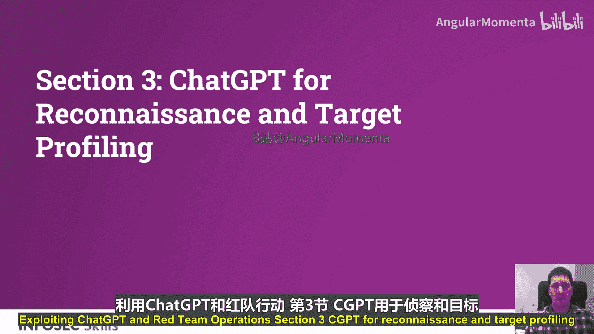
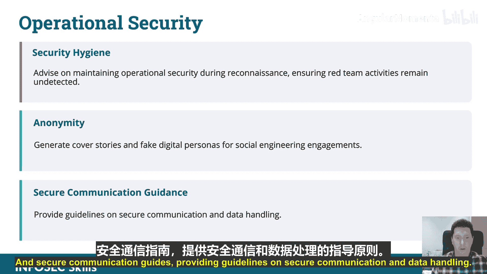
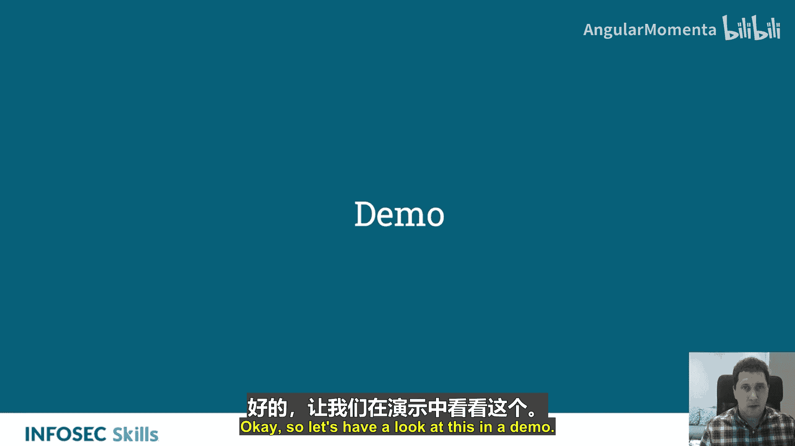
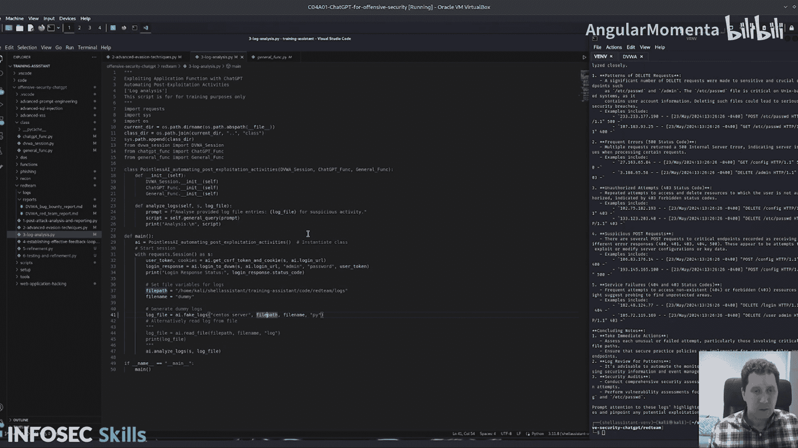

# 【Infosec】用于攻击性安全的ChatGPT ｜ ChatGPT for Offensive Security p31 06_01_03_leveraging-chatgpt-for-reconnaissance-and-target-profiling -BV1jPrHBsEv1_p31-

Exploiting chat GT and red team operations。Yeah。Section 3， CGP for commisance and target Profiling。

In Red Team reconnaissance， CGPT accelerates the initial phase of cyber operations by automating data collection on targets。

 it can analyse public records， websites， social media to build comprehensive profile of the target。

Real analysis using CGPT can help to identify key personnel and technological infrastructure。

usingsing traditional methods to。Build up a profile of a target。Is often time consuming。

 CGPT can really act as an intelligent assistant in this respect by taking all the information that you procure from reconnaissance and building up a profile of the target。

Based on， based on the prompter you provide。Advanced target profiling。

 you can generate detailed profiles of key individuals within the organization including social habits and network associations just by dumping all the data and running a CGPT script on。

You can analyse insider threats by processing data from internal monitoring tools。

 pushing that to a CGPT function that will analyse that data and look before and for patterns and malicious activity。

And you can identify key targets by helping to by mapping out the target organization's infrastructure。

Based on public information。SHGPT offers custom search capabilities and you can utilize advanced search techniques to filter through vast amounts of data。

A traditional method might be if you receive a large payload of Jason say through。

Say through an API call to a feed， you received that information too。

 and then you would use something like JQ。To filter the information you would create very rigid functions to filter that and create reports for you CGPT can do this very dynamically as you say okay I'm looking for suspicious activity within within this log or activity that meets this meets this pattern it's a lot more flexible。

 you can employ natural language queries to uncover hard to find information about a target in their systems。

 it's no longer a case that you have to memorize every single MMap command you can now ask CGPT to generate in natural language what you want to do and it will generate a command for you streamline the process of gathering intelligence Nice form forums and encrypted chat services again taking in very large data sets and making sense of them without any human intervention。

SCCGPT as practical applications in operational security。

 and you can advise on maintaining ObsEC during reconnaissance and ensuring you remain undetected just by treating it as a red team consultant。

 consulting with it on best practice on methods。to maintain anonymity and best practice security hygiene。

can generating cover stories and fake digital personas for social engineering engagements。

 very good at generating fake personas which are realistic。

And secure communication guides providing guidelines on secure communication and data handling。

Okay， so let's have a look at this in a demo。

Log analysis。This class will demonstrate how to use chat E B T in log analysis。

That's what this class does is， first of all。Creates a fake log file。

 this is just using a function in the class to generate fake logs。Let's take a look at it class。😔。

in general。Right， here we are。 So， and here's a。Air set a prompt create Python script。

 which generates log type say pass in a type of log。

 including a function to save it to air file path file name。

So low script sends a request to general query。And then that then prints log script。

The script is then executed， so the log script is a script which creates fake logs。

 which Cha UT has generated， this then is executed using her asol system and then we read in the file。

Okay， once the fake log has been generated， they' going to a it using a chat ED。

 so the prompt is analyse provided log file entries for suspicious activity。Right。

 now I've got this says Sos server。 I could generate any any fake log using that suppose。

 I we can do a centos。And thiss from the script。First of all。

 the function is going to generate a script to generate fake synto logs。

This this can also be useful for confusing after an attack for post exploitation。

 you can probably upload a bunch of generated logs to court General mayhem。

And now chat ET is I analyzing these logs and it'll provide a report。So analysis。

 the log entries reveal a number of potential security concerns。Patterns of delete requests。

 a significant number of delete requests were made to sensitive and crucial endpoints。

 So this is a clear sign of of intrusion。And someone attempteded to cover their tracks for not very well。

Then it said just provides lots of information there's some suspicious post requests here。

 some service failures， some concluding notes on how to deal with this。

