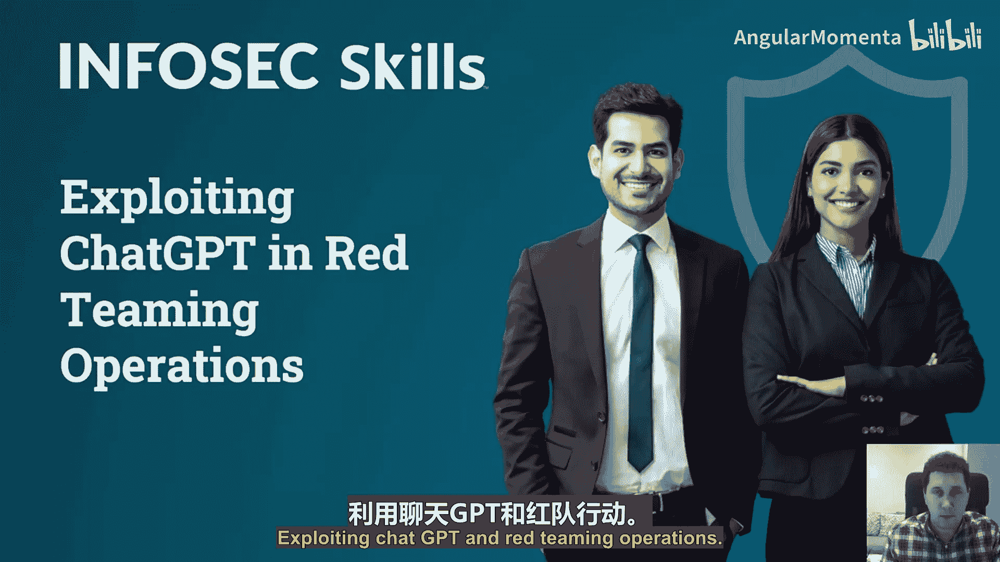
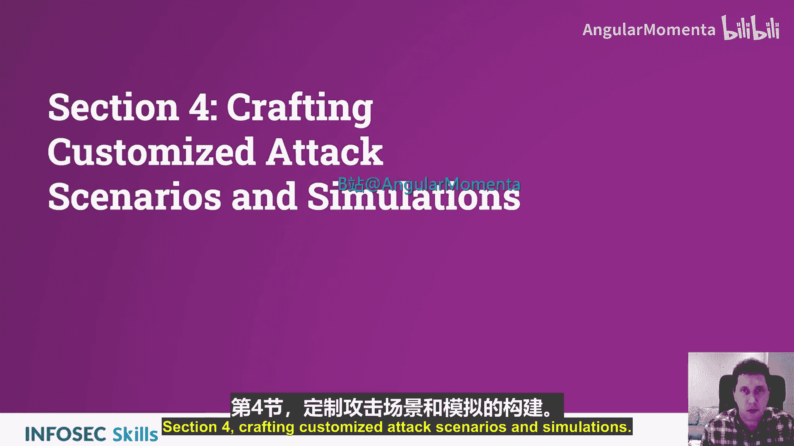
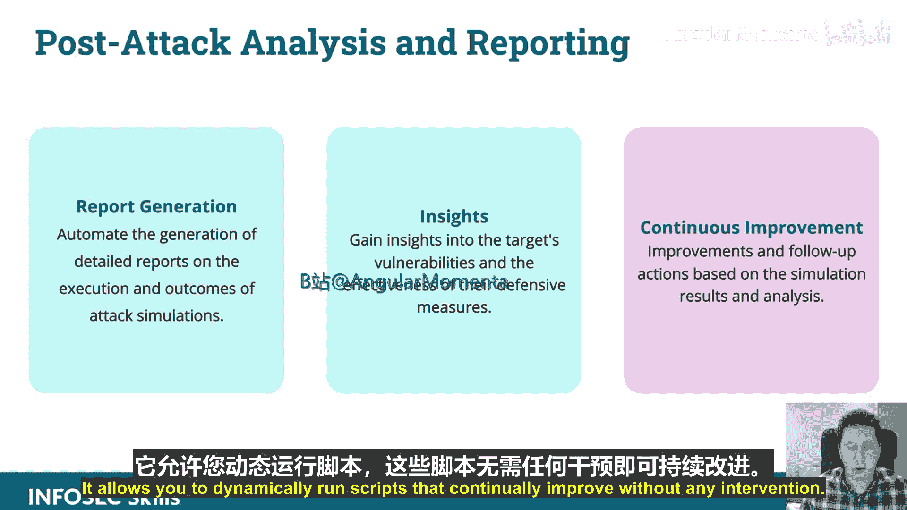
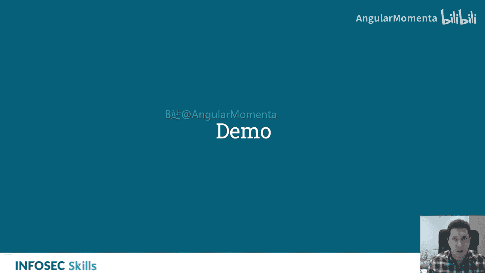
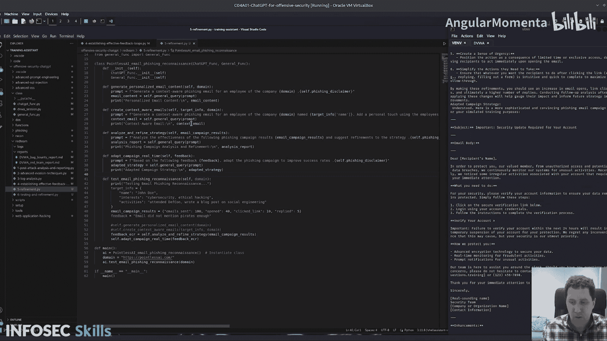

# 【Infosec】用于攻击性安全的ChatGPT ｜ ChatGPT for Offensive Security p32 06_01_04_crafting-customized-attack-scenarios-and-simulations -BV1jPrHBsEv1_p32-

Exploiting Cha GT and red teaming operations。

Section 4， crafting customized attacks scenarios and simulations。

It's the first thing we look at as an overview of scenario development。

 CGPT assist in developing realistic cyber attack scenarios based on target specific vulnerabilities。

Obviously， you do your recon here and then plug that in。

 and Dcy GPPT will then assist you with developing a realistic simulation scenario。

CGPT can assist in generating narratives for simulated attacks， including phishing。

 ransomware and insider threats。And tailoring scenarios to reflect the latest cybersecurity trends and threats。

This was a very manual task task before， but now it's very much an automated one。With CGPT。

simulationim planning， let's look at this in a bit more detail。 we'll look at demo in a little while。

As scenario planning， it helps in planning the execution of cyber attack simulations including timing methods and target systems。

 tell it what you want to do， and then refine the prompt to develop your scenario Countmeasures suggesting realistic responses and countermeasures likely to be employed by the target enhancing simulation fertity and assessment provides functions for assessing the impact of simulated attacks。

On the target organization。Fish and campaign customization。

 you can develop personalized phishing emails and messages that mimic the targets use communication patterns。

 just give it an example of the communication patterns or explain the tone and the style that you want。

And social engineering tactics based on the target company culture and individual employee profiles。

CGPT can extrapolate this intelligently from the recon that you provide it with and analyze the effectiveness of campaigns offering insights for improvement。

Bypassing defensive measures， analyzingly the targets defensive strategy strategies to suggest methods for bypass during simulations。

 craft adjustments diss simulated attacks and identifying weakness in targets。

 instant response and mitigation strategies，This is very back and going into purple teaming。

 so you can launch a simulated attack receive feedback from that and then plug that into CGPT。

To to improve the effectiveness of the campaign。Post attack analysis and reporting Report generation。

 CGPT is very good at producing reports provided you give it the correct format prompting。

Caning insights into targets's vulnerabilities and effectiveness of their defensive measures and continuous improvement。

You you'll see during the demo that iteration over。

Itdueration and continuous improvement is a great advantage of CGPT。

Allow you to dynamically run scripts that that continually improve without any intervention。

Okay， let's have a look at Den I。

Establishing effective feedback loops this class is going to demonstrate you establishing effective feedback loops usingcusing chat ET using a method of prompt refinement。

Allright， so I set the target URL。And so the initial prompt， which send across sky scripting payload。

And here's here's the refined prompt array and a Python list of prompts to improve the prompt accuracy with performance metrics。

系。Passing to evaluate prompt effectiveness， the URL。

 the initial prompt refined prompts and performance metrics。

 So what this function is going to do is going to evaluate the efficiency of the prompt refining process。

Ere by sending crafting， aircrafted payloads and observing the responses。

We we're then going to measure the effectiveness of the prompt。

And gather and simulate gathering at external feedback。Al。

 so the prompt feedback loop evaluation and the prompt is send air crosso scripting payload effectiveness has been measured at 10 prompt refined prompt one for better accuracy refine prompt 2 for 10 core adjustments。

 so effectiveness this has all been rated as 10。Okay。So what's， what's going on here。

 The effectiveness score， the effectiveness score is actually hard coded as 10。

 So this is just a demonstration of how you would analyze response against metrics。 And now。

 what could you， what could you potentially do here， you could say。And if。嗯，对。

Every response contains。Log in， login successful。海带。诶。Then score。It equal 10。嗯。Say F。response。

Contains。哎。Then score plus equals。2。Right。And then， yeah， score。So set score。Scoric equals 10。

If if response contains longer score， if not plus equals to。

 and then you can get effectiveness scores based on this。

 So you could then introduce logic here to actually。Dynaically。

 assess the performance matrix of the prompt response and intake take action appropriately。

Refinment this class will demonstrate using prompt refinement and prompt response refinement within using chat EptT。

All right， so the first thing the first thing the script does is it calls this function testing email reconnaissance this has got some dummy target infos and dummy campaign results and some dummy feedback and I put email did not mention pirates and Africa it's very clear to see when when this feedback is introduced。

So generate personalized email content， first its first method is going to generate context aware email for an employee of this company。

The next is going to create a context away emails for it。I was going to add a personal。

 I was going to add a personal touches in the employee's recent activities。And interests。

Okay so we can find these down here interests and activities。

 so we're taking taking input and using it within the within the email phishing simulation email generation。

Analysing and refining strategy， as we're taking。Email campaign results。

Which is you can get these from your CRM。Cha an output from your CRM and plug these in and then'm going to analyze and refine the strategy here based on that。

Okay， next up adapting the campaign in real time based on the following feedback feedback has come from。

OhIt's hard coded。 sorry， email did not mention Paris enough so we're going to pass that end。

And again appropriate prompt from there。Then define， yeah。 and then that's that's it。

 So on these one at times sets。吃子可怜。Some five refinement， okay， so。😔，First thing against it。

 it personalized air。呵呵呵。Testing。Just random to some random ethics， though。Okay。

 so subject action required important update to our security policies this so this is sent to an employee hope this message finds you part our commitment to security protocols appointmentpoint a sale I we are implementing critical security updates since the phishing email from IT that generated a personalized phishing email。

Now， a context war mild that's going to make use of the。AndThe user' interests， activities。

So you can pull all this information in from third party， you know， for example， from social media。

 you can obtain this information during a recon。So， hi， John， I hope this email find you well。

 I recently came across some insight for blog post。I impressed with your expertise。

 given your recent attendance at Dfcon。So really very personalized。

 very effective simulated phish email there。No， email campaign results。 So we're taking。

These metrics。And we're going to offer insights based on those metrics。Just pause that for a second。

Okay， campaign metrics emails sent emails opened。Links clicked and reply analysis of the result Open rate 40%。

 So it's just offering you some some insights there as to what to do with this with this metrics and how to refine。

Now I could take this data and then pass that to another chat ET function， which and say， okay。

 based on this data generate。Here a refined email。 that it's more effective。Okay。

 and the final final function。Based on the following feedback。Which is hair。

Apt the fishing campaign to improve success rate。Okay。

 so the email didn't mention pirates enough or mate he will be selling on the high seas of cyberse。

 You must complete this mission， so。It's taking on， it's taking on feedback。And this feedback。

 in fact。Could very easily。B email campaign results instead。 So instead of fair。

 instead of plugging in that， in fact， let's Sir。It's just waxack that in there。

Email campaign results。嗯。Actually， okay。Heback。Email campaign results。Because。

And then change this to。They back。Campaign results。

 So instead of passing in that hard code of feedback， I'm actually going to where and the lights。

I'm going to analyse the results of the campaign and then the feedback is actually going to be based off of that。

Yeah。Okay， so the feedback again， the same strengths and weaknesses。

Ige refinements hard female content。And then。Enhancements。F back， self-addot。

Adapted campaign strategy what we're looking for。嗯。Here is a。

 adapttive campaign strategy Under Here is a more sophisticated and convincing phishing email campaign。

 subject important security update required for your account。

So this is now taken on board the feedback and it's produced a more relevant email。

