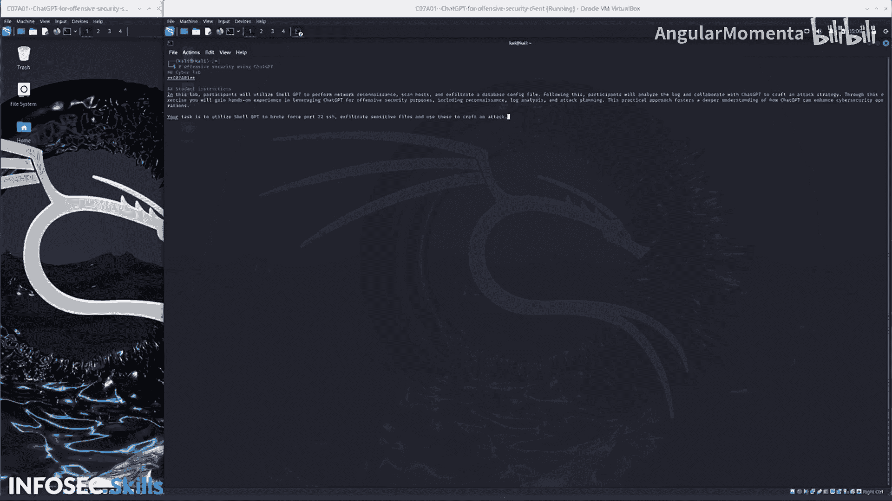

# 【Infosec】用于攻击性安全的ChatGPT ｜ ChatGPT for Offensive Security p34 07_01_04_simulate-a-real-world-attack-using-chatgpt-lab-overview -BV1jPrHBsEv1_p34-

Welcome to the offensive cyberber security using ChatyPT Cyber Lab。In this lab。

 participants will utilize Shell GT to perform network reconnaissance， scan host。

 and exulttrate a database config file。Following this。

 participants will analyze the log and collaborate with C EPT to craft an attack strategy。

Through this exercise， you will gain hands on experience in leveraging ChaPT for offensive security purposes。

 including reconnaissance， log analysis and attack planning。

This practical approach fosters a deeper understanding of how chat GPT can enhance cybersecurity operations。

Your task is to utilize shellll GPT to brute force port 22 SSH Exfil tray sensitive files and use these to craft an attack。

