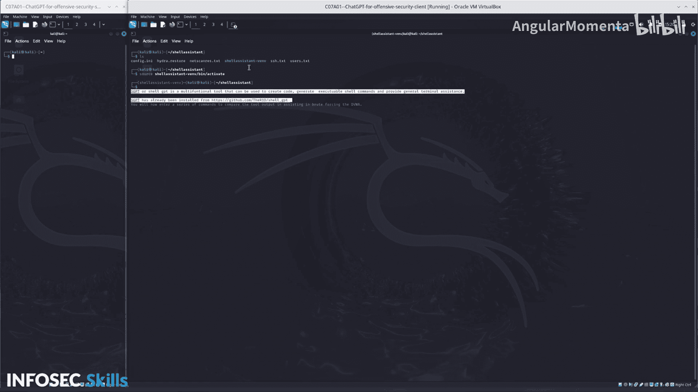

# 【Infosec】用于攻击性安全的ChatGPT ｜ ChatGPT for Offensive Security p35 07_01_05_initial-lab-setup -BV1jPrHBsEv1_p35-

Initial setup。After logging into the virtual machine， you'll see that we have a client。And a server。

Within the client， C D to the Youll assistant directory。Within the S Assistant directory。

 you will see a Python virtualrual Environment She As。嗯。Activate this， using the source command。

Once that's activated， you can then export your open AI APII key using following command。

For this exercise where will use a tool called SGPT。Or shell GPT。

 This is a multifunctional tool that can be used to create code。

 generate executable shell commands and provide general terminal assistance。

S TPT has already been installed from its publicly available Github repo。

