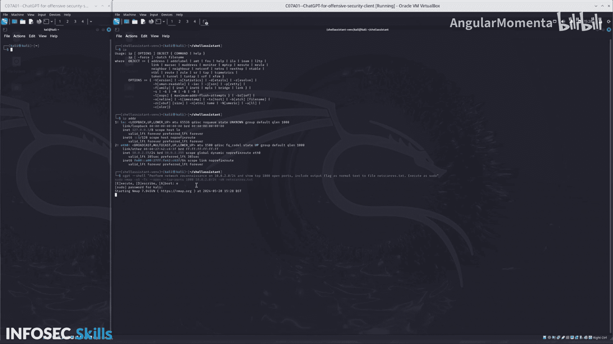

# 【Infosec】用于攻击性安全的ChatGPT ｜ ChatGPT for Offensive Security p36 07_01_06_step-1-scan-for-hosts-on-network -BV1jPrHBsEv1_p36-

Task1， performing their work reconnaissance。So my first task going to be to find out my I P address。

Okay， so my I P for this virtual machine is 10。0。2。15 dash 24。Slash 24。So this means I'm on a 10。0。2。

0 network。So what I'm going to do now is to run a SGPT command。

 which is going to you identify other ports on the network。

This from this command and see what it brings back。Okay so the natural language command is saying。

 okay， I want you to return a shell command by using the D dash shell flag。

 I I'm asking the GPT to perform network reconnaissance on this network which are just identified and to show the top 1000 open ports。

 including output flags， including output flag as normal text file。ir to a normal text file netcaras。

text X pseudo， so you can see here that I've gone through a fair amount of prompt refinement there my initial prompt would have been perform network reconnaissance on this IP。

And this brought back two， this took too long， so I' then said and share the top 1000 open ports。

Then I wanted to output it to file， so I said output to a file。This gave an incorrect command。

 So I changed it to include an output flag as a normal text file to this file。

 The final error was that the command required C day running。

So the three prompt refinemen I've come up with this prompt I've executed it and it's returned this Nm command So if you're if you're an old hand this Nm command you might just write it out but I think the power of this shows that。

That anybody， anybody could do this using natural language。Not attend this command， less executed。

So we're now scanning the local network。

Okay， that's good so sad。And just type in。I your addressed to find out at7 IP 10。0。2。6。I say。10。0。2。

6 here we are。 so this is scanned the network and it has found this host on the network Now it's returned that there is a port 22 open which has been there open for this for this demonstration purpose。

Now what what be a good idea。Is to copy this command and put in your notes for next time。

