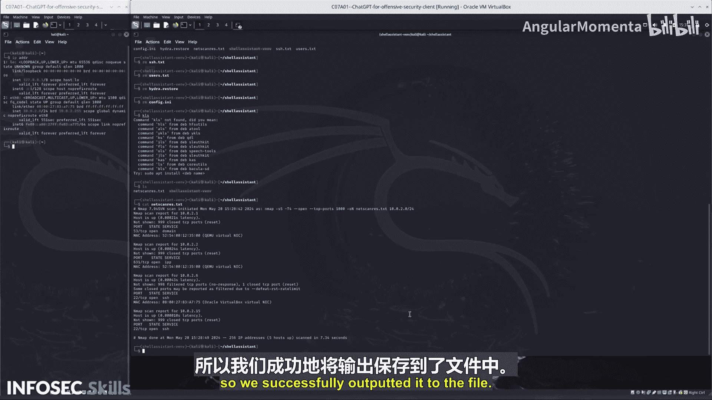

# 【Infosec】用于攻击性安全的ChatGPT ｜ ChatGPT for Offensive Security p37 07_01_07_step-2-access-vulnerable-machine -BV1jPrHBsEv1_p37-

Kitless your st reduced this terminal size a little bit to make sure you're not missing anything on the bottom of the screen。

😔，All right， so after running this command， it's output it to nextcas dot text。

Okay check that file as there。In fact， let's just clean up。So of this。Yeah。对。Okay， I feel better。

Okay， so I'm going to inspect this N cameras。So can see that the file basically contains the same out as the terminal。

 so we successfully out purd the file。

Now what I want to do next is。Use SGPT again just to save some save me some work if I'm writing this in a script it's going to mean that it's automated doing it from the terminal means I can do it without thinking or as a layman。

So I cap the Neca。res file and then pipe the file， the contents of the file to STGPT。

 I'm not using a shell command this time because I actually want just the information。

So I'm then saying， okay， here here's the scan results， piping into SGPT and SGPT。

 can you tell me from the provided text list the Is of host with open've been import 22？Okay。

 it's given me a nice little list here in ports with port 22 they open。

So what's next Now I'm going to attend to brute force port 22。This host。

So let's take a look at this prompt before running it so once again who want to return a shell command from SGPT。

 now saying brute force port 22， which I've just discovered is open on this host which I've just discovered is vulnerable。

 using username Carly， which I already know the user name in advance in real world of course you got harder job。

 include the output flag again and save。Ive got any valid username passwords to S H dot text。

 So I only what I'm only interested in valid username and password。

 Let run it since the order brings us。Okay， so I've got a command。

Return by S GP is suggested that use Hya to brute force。 youve got to consider as as a layman。

 I've got no idea what hydra is。 I don't know what this tool is used for。

 I've literally just said brute force put 22。哎。And it's going to use the。Carly word list。

 you see us extrapolated that hemology asked her to use that word list it's extrapolated that from the fact I'm using Carly。

 it's got the IP， the port and the output， so I'm going to execute。Right， so let's look， okay。

 so I've got this S。t textt file now so it's going to count that。And it's telling me logging Carly。

 password Carly， it's not the cleanest of output files。

 but I'm going to pass that through of CGPT again and thus going to extrapolate that information。

