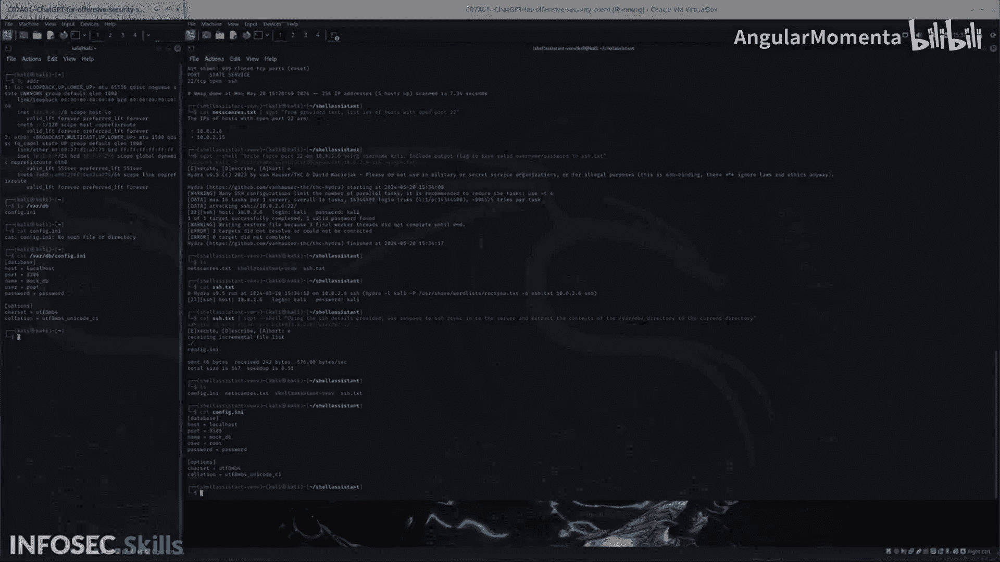

# 【Infosec】用于攻击性安全的ChatGPT ｜ ChatGPT for Offensive Security p38 07_01_08_step-3-exfiltrate-logs -BV1jPrHBsEv1_p38-

All right， so we've successfully discovered a host on the network with an Openport 22 and successfully bru forth the E user named password。

 only as this easy in real life。So the next task is going to be to exfilrate a database configuration file because my ultimate aim is to be able to access their database。

Case of G command already prepared here。Let's take a look at his command before running it。

I'm going to cut the S。tex file， which is this file here， this content here。

So it's not in any any nice format， it's not easy to pass。

 but for CGPT it's very easy to pass so pass that text file to SGPT。I want to return a shell command。

And then using the SSS details provided， use SSH Pass to SSH R S or server and extract the contents。

Add the VRdb directory to the current directory， so I've skipped a few steps obviously to discover that VarDb directory you would have to do a little bit of work and using SSH Pass here because is going to enable to pass the username and password directly in the terminal as an attacker。

I'm sorry bothered by that as a defender。 It's a big no， no。 don't want to do that。

So let's execute this come on and see where we go。Okay， S S H pass password carly。I think。

SS H4 TV to current director， Let's Caergo。I so I's pulled the content of Vdi Vus just check this on here。

Some' on the server here and the content of Vardibi on the server is Config D。

 so I've got Config D file here。But just re thee。Just to make sure。嗯。对。大腿背。All right。

 so we've successfully extracted this file from from the server。

 which contains the database login details， which is what I was。Looking for。

