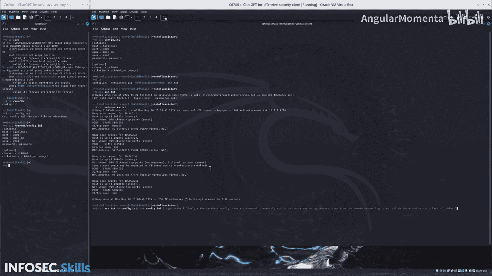

# 【Infosec】用于攻击性安全的ChatGPT ｜ ChatGPT for Offensive Security p39 07_01_09_step-4-analyze-logs -BV1jPrHBsEv1_p39-

Alright， so I've now got。Two files that I've extracted air。CatConfitE。

 so Cont IE has got the database login information in。And then I've also got SS。

ttext where I've bruteford the。SS H。SSH Loin information， which is Carly Carly。Right。And then。

 I've got the。嗯。N， Conrez。The text。Air file， which shows me the the IP address， so I'm attacking 10。

0。2。6。4t 22。I've got the login Detail report 22， I've got this database file。Okay。

 so the next thing I want to do is analyze the database tables。So I'm going to run this command。

I I'm here is I'm going to append the contents of SSH。t text。Into confit any。

Just to save just to save time。

Now， even though these are going to be in a weird format with， I mean。

 this is for a regular command to extract this quite you know quite complex。

 so there's a whole whole load of information here。

But SGPT will have no problem understanding this file。

 so Cont to any will now contain all the information and going to cut the output of that file and then pipe it to SGPT。

How do return a shell command from this。Here say analyze database config。

Create a command promotely SSH into the server using SSH Pass。Then from the remote server。

 log into the SQR database and return a list of tables。So why am I doing this from the remote server？

Because I don't want to install my SQl on My server and it's because there might be blocks。

 firewall blocks from accessing the SQL server remotely。

 so I much prefer to do it on me on the target computer。

Target server so let's run that command this is provided a nice little command to access the server I can then save that for later for automation because for all all all of GT models benefits they tend to be slow so a command like this is going to be much quicker in a script once you actually figured thatll。

So let's execute that。tables in mock DB， so it extracted the name of the database from this cont or any file。

And then it's told me that I've got two tables， accounts and users。

