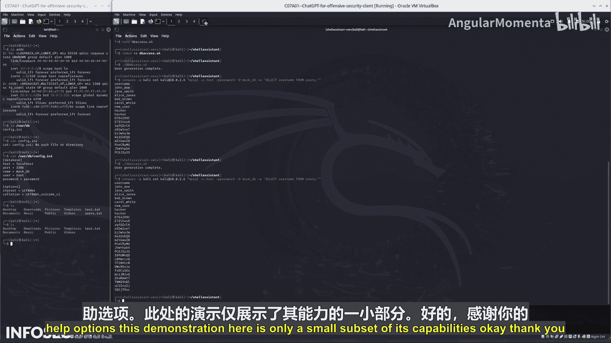

# 【Infosec】用于攻击性安全的ChatGPT ｜ ChatGPT for Offensive Security p41 07_01_11_step-6-create-bash-script -BV1jPrHBsEv1_p41-

So as a final step， I might want to craft some kind of tack。

On on the server， so I'm going to run this command。

 which is going to is the take all the login details and the information about the user。

 about the the database and then generate a batchsh script that accesses the server and generates random users。

Okay， so you can see here it' come with a nice little script。However。Dby pass。No。I wonder。

Its actually。S S H pass， S H user。Okay， it might work。 might work。 Let's give it a go。

I was just thinking I might need to be a bit more specific。😔，是得。这个。😔，这。都不出。

I didn't know if I need to pseudodo。 Let's try and do it without pseudoo。Pch。Okay。

S writing the script。Okay， so what we hopefully want to do is yeah。

 generate a whole bunch of random users I'm not sure if that worked on all this。

Have a look at the database table。😔，嗯，没。Oh， yeah。 look at this， okay。That's very good。

 Let's run this script， again。Actuallyatally surprised that worked first time。

I didn't think they prompt was。Sucinct enough。Yeah。

 so I've got a very very powerful script here because I can now create random users within this database and if I can create and I can create a million。

Okay you have now completed this lab in this lab you have used Cha GBT to recon a network。

 identify vulnerable hosts and generate payloads to exploit server misconfigurations。

The next step in your learning should be for you to install Shell GPT in your local environment and explore the help options。

This demonstration here is only a small subset of its capabilities。Okay， thank you for your time。

