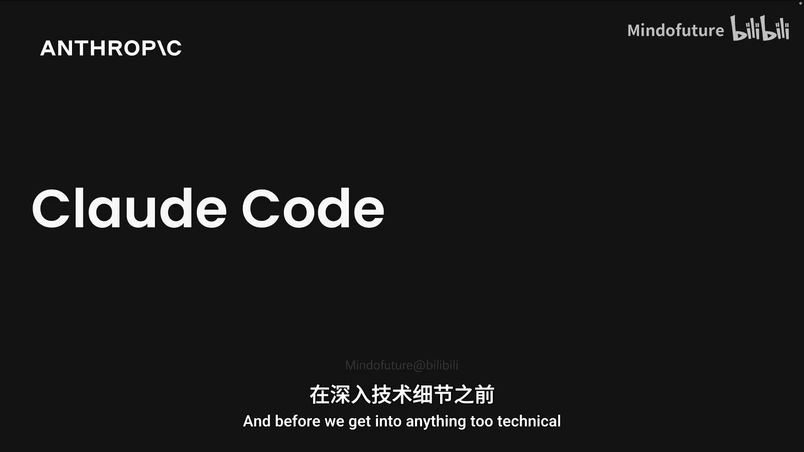
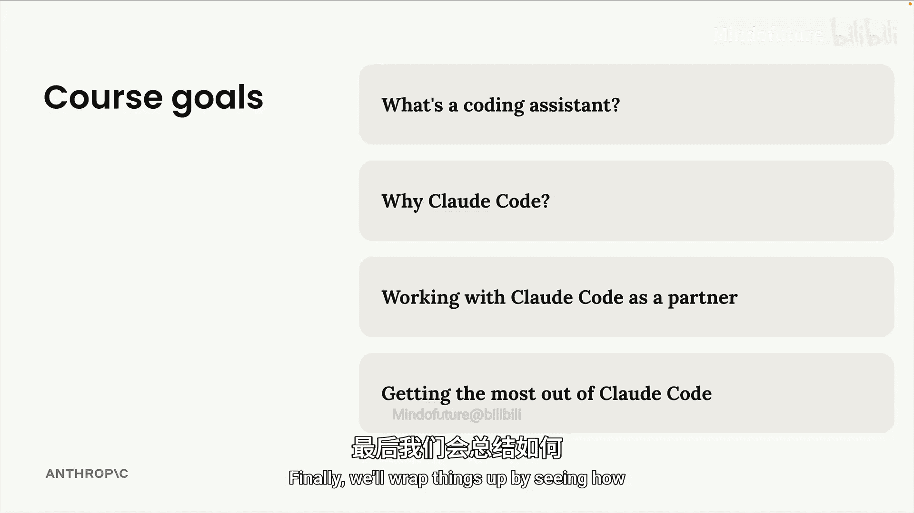

# 【Anthropic】Claude-Code-官方完全教程-｜-Claude-Code-in-Action-｜-vibe-coding-p01-P01_Introduction--BV12TzGBCERK_p1-

Hello and welcome。 My name is Stephen Grder， and I'm a member of technicaln staff at Anthropic。

 In this course， we're going to get to you up to speed with Clade code。

 And before we get into anything too technical， I want to give you a quick overview on what we'll be learning。

 This course is organized into four sections。 We're going to first spend some time to understand exactly what a coding assistant is。

 We'll then take a look at cloudde code itself and understand what makes it stand out among all the different coding assistance on the market。

😊。

Once we've established that， we'll walk through the use of cloud code on a typical project and get some hands on experience finally。

 we'll wrap things up by seeing how you can get the most out of cloud code on your own projects。😊。

