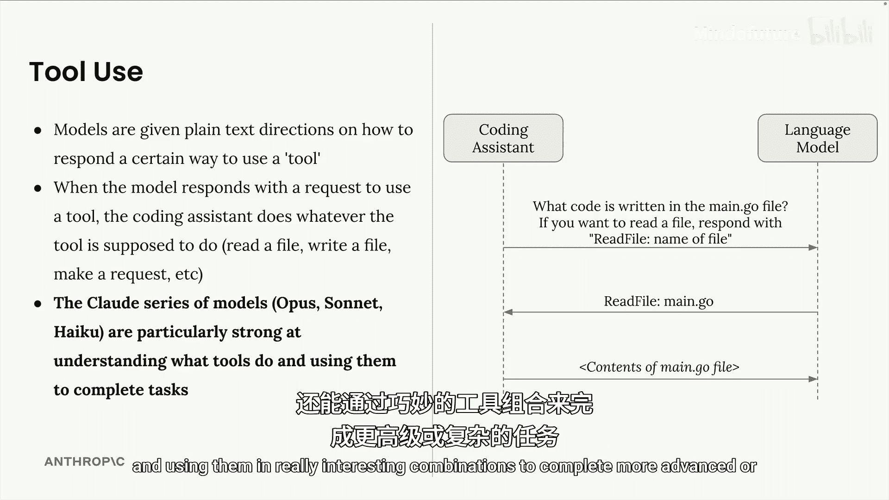
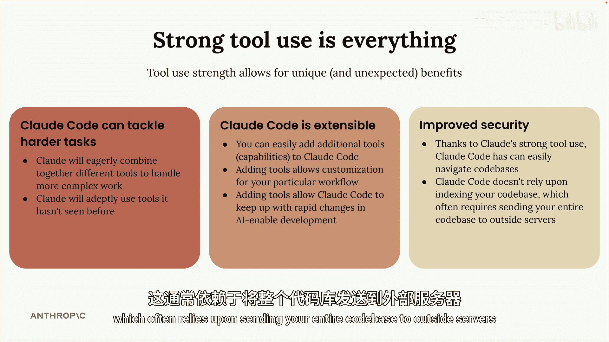
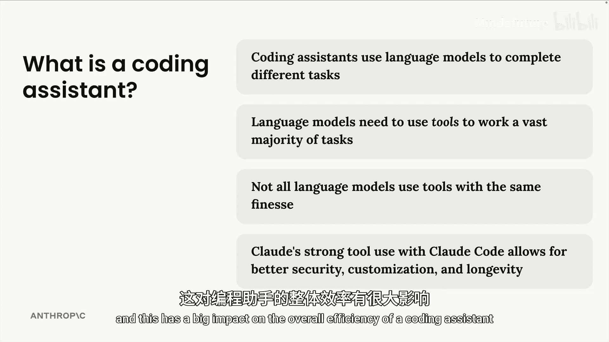

# 【Anthropic】Claude-Code-官方完全教程-｜-Claude-Code-in-Action-｜-vibe-coding-p02-P02_What_is_a_coding_assistant--BV12TzGBCERK_p2-

In this video， we're going to get a better understanding of what a coding assistant is。 Yes。

 a coding assistant is a tool that writes code， but I want to give you a deeper understanding of what's going on behind the scenes。

 You see， by understanding what a coding assistant really does and how it works。

 you'll have a greater appreciation of what makes a truly amazing assistant to complement your team。

 Here's one way that you can picture what a coding assistant is doing。

 An assistant is first given a task。 In this case， maybe the assistant needs to fix a bug based upon some kind of error message。

 This task is passed off internally to a language model。

 which needs to figure out how to solve the issue。 Now。

 different language models solve problems in very different styles。

 depending upon the complexity of the task。 But in many cases。

 they work very much like how a human would work。 It first might need to gather context by understanding what the error is referring to what area in the code base is during the error and what files seem to be relevant。

 Once it has gathered that information and then needs to formulate a plan on how it will actually accomplish the task。

 In this case。😊。

It might decide to change some code and then run or write a test to verify that the issue is actually fixed。

Finally， it will take an action， in this case that might be updating a file and running the test。Now。

 I want to give you some more information on this entire process。 In particular。

 I'd like you to notice that the first and last steps here require theco assistant to actually do something。

 In other words， to actually gather information from the outside world or affect the outside world in some way。

 For example， to gather context。 The assistant needs to maybe read a file or fetch some documentation online。

And for taking action， the assistant might need to actually run a command or edit a file。Now。

 having a language model actually do these things is a little bit trickier than it actually sounds。

 let me help you understand why that is。Let's imagine that we are interacting with a language model directly。

 So it's not running inside of any coding assistant or anything like that。

 Let's than imagine that we ask this language model directly what code is written inside the main dot go file。

 Language models running outside the context of any coding assistant or similar tool do not inherently have the ability to say read a file or write a command or anything like that。

 Language models take in content like text and they return text。 That's it。

 That's the entire extent of their capabilities。 And this is true of all language models。

So if you were to send some text into a plain language model asking it to read a file。

 it would most likely respond by saying that it doesn't have the ability to read any files。

 So let me show you what coding assistant and many。

 many other tools out there do to actually allow a language model to。Qu unquote， read a file。

 So here's what happens。 Whenever you send a request off to your coding assistant。

 the coding assistant behind the scenes is going to automatically append a lot of text into your request。

 In this particular case， we can imagine that the coding assistant is going to add on some text that says something like if you language model want to read a file。

 respond with this very carefully formatted message。 For example， maybe be something like read file。

 colon， and then the name of a file to read。 So in this case。

 the language model would hopefully realize that in order to answer our question it needs to respond by reading that file。

 So it might respond with read file， colon main do go。 Now。

 the coding assistant would be in charge of receiving this very carefully formatted message and realizing that the language model wants to take some kind of action by reading a file。

 So the coding assistant would then be responsible for actually read the file and sending the contents of that file back into the language model。

Now the language model has received the actual contents of that file。

 it can write a fun response that gets sent back to us。In which it might say， well。

 I read this file and it contains some amount of code or whatever else， whatever is inside that file。

 This entire system of giving a language model， these extra little instructions。

 asking it to respond in a very well formatted or carefully formatted way is referred to as tool use。

 So tools are used to give models extra capabilities。

 The model is responsible for responding in a very particular way。

 And then something like our coding assistant would be responsible for actually doing whatever was promised。

 So actually reading a file or writing a file or whatever else。Again。

 this is how every single language model out there works， they all work with this idea of tool use。

Now， here's the critical part to understand the Cd series of models。 So Ous。

 Sonet and Haiku are particularly strong at understanding what tools do when theyre called and actually using them to effectively complete tasks and using them in really interesting combinations to complete more advanced or complex tasks。

 Cld strongong tool use is the absolute core strength of cloud code as a coding assistant。

 Here's why。 First， as I just mentioned with better tool use， cloud can handle more complex tasks。

 Second， cloud code itself is extensible， So it's really easy to add in new tools to cloud code。

 and Cla will happily make use of those tools。 This is especially important for continued relevance。

 Given the fast changes that we're seeing in the world of development。 In other words。

 cloud code is in assistant that will change with you in the years to come。😊。

And finally， with improved tool use， you often get better security because Cloudud can effectively search your codebase to find relevant code without relying upon indexing。

 which often relies upon sending your entire codebase to outside servers。

Let's do a quick review on what we learned inside this video around what a coding assistant really is。

 So remember， coding assistants use language models internally to complete different tasks。

 These language models， they need to know how to use tools to work on the vast majority of tasks that they are given。

 Tos are used to read files， write files run commands。

 and essentially everything else that doesn't just involve generating some text。

 Not all language models make use of tools at the same level。

 And this has a big impact on the overall efficiency of a coding assistant。

