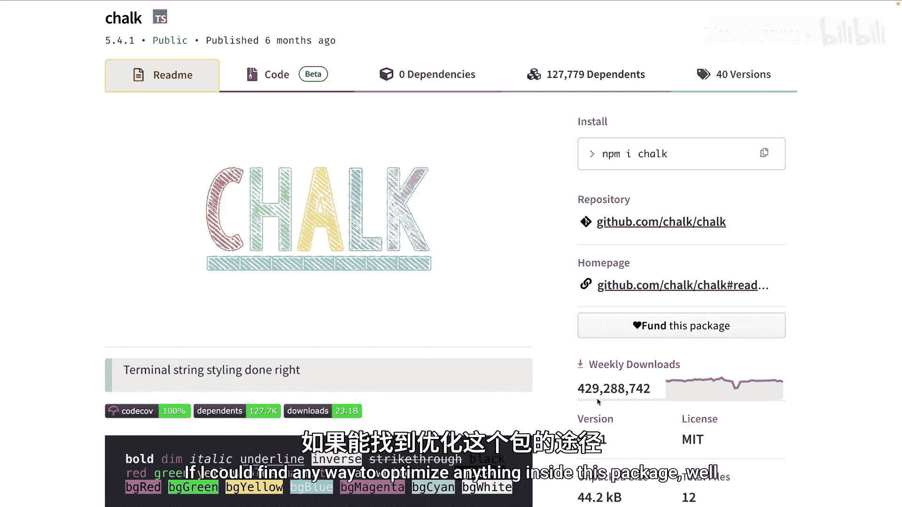
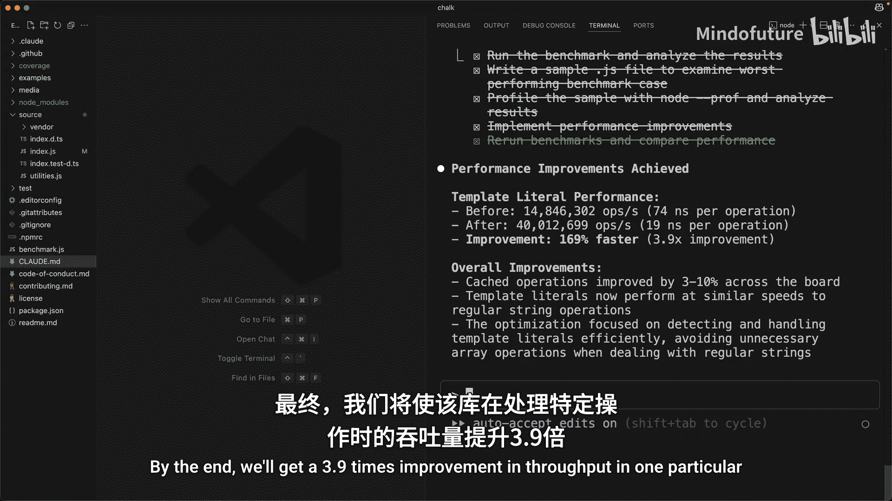
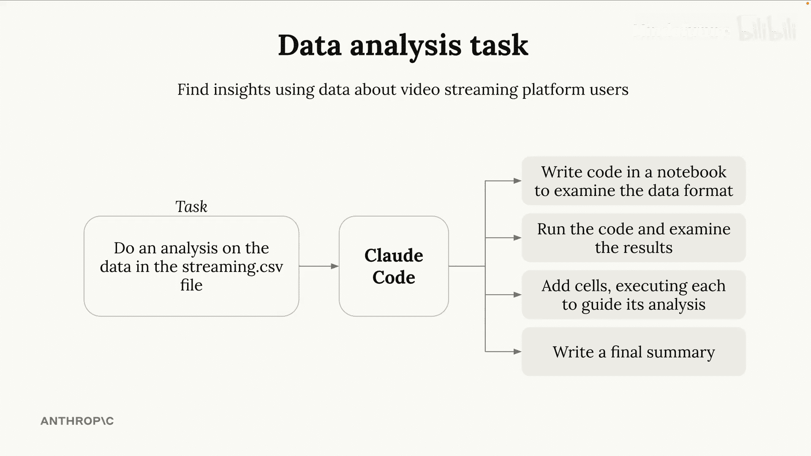
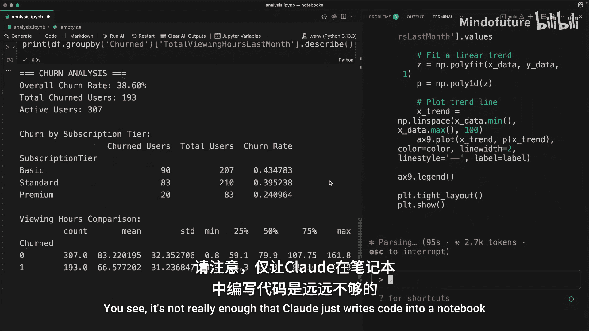
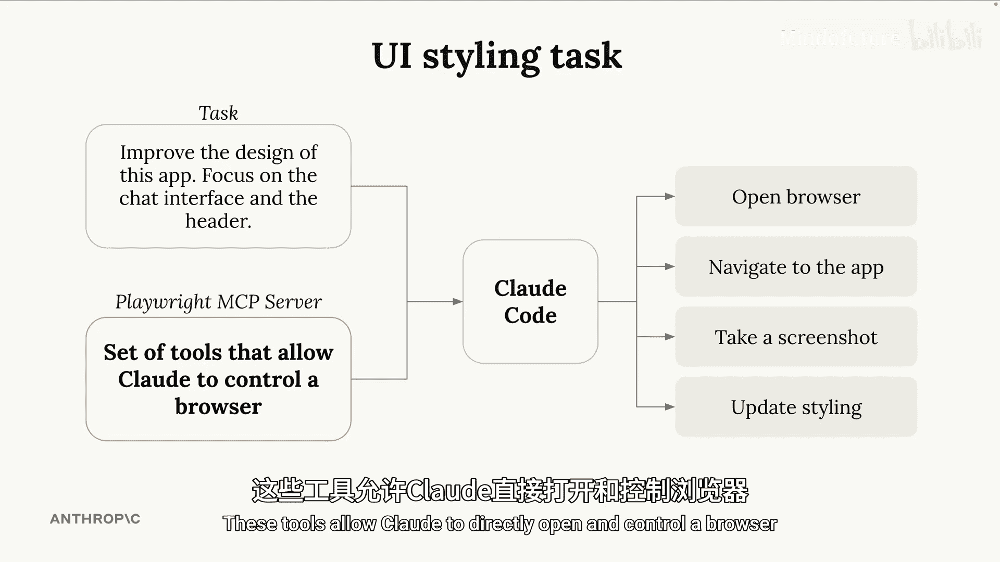
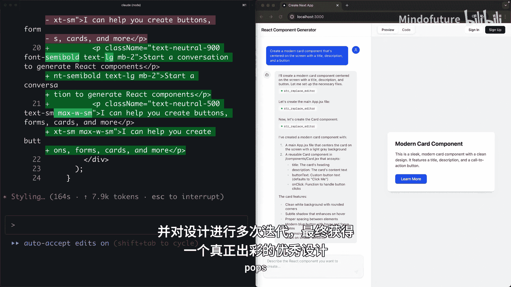
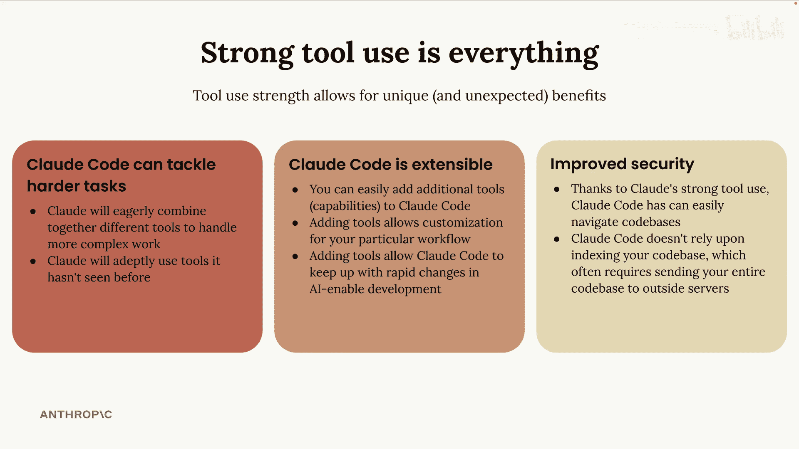

# 【Anthropic】Claude-Code-官方完全教程-｜-Claude-Code-in-Action-｜-vibe-coding-p03-P03_Claude_Code_in_action--BV12TzGBCERK_p3-

Just a moment ago， I made some pretty big claims by saying that Claude was an expert at making use of tools。

 and the Clade code was easily extensible。 Natural， you might be a little skeptical。

 So I'd like to give you a few quick demonstrations on this table are the default tools that are available in Clade code。

 It has all the abilities you would expect。 like reading files， writing files。

 writing commands and so on。 I'm going to show you a couple of tasks completed using Clade code。

 And in each case， it will use this set of tools in rather intelligent ways。

 And in at least one task， I'll even give Clade an additional new set of tools to make use of。😊。

Not only will this process give you a good idea of what ClaD code can do right out of the box。

 but hopefully you will also see how easily you can extend cloud code with more functionality。

Here's my first task for cloud code。 I'm going to ask it to find and optimize performance issues in the chalk library in case you're not familiar with it。

 chalk is a jascript package。 Here's a documentation for it。

 Now this is a very small library that has one very simple purpose。

 All it does is print out text in nicely formatted colors。 So like exactly。

 as you see in this example screenshot right here。 So you can give the text colors or backgrounds and formatting all that kind of stuff。

😊，Now， this might sound like a really simple and silly package。 but here's the thing。

 It turns out this is actually the fifth most downloaded package in the entire javascript ecosystem。

 Last week in particular， it had 429 million downloads。

 So this package is used far and wide to put it simply。

 If I could find any way to optimize anything inside this package。 Well。

 it would probably be worth the effort。 So I'm going to ask Claude to run the benchmarks。

 identify the worst performing cases。 Use some profiling tools to figure out why those cases are running so slowly and then fix them。

 We'll then see that Claude is going to use a wide variety of different tools to intelligently tackle this problem。

 It'll form up a todo list to track its progress。 Exute commands to run the benchmarks。

 write a file to better zoom in on one particular case。

 use a CPU profiler to understand why that case is running so slowly and then implement some improvements。

😊。

By the end， we'll get a 3。9 times improvement in throughput in one particular operation around this library。

Here's another example of how well Claude can string together different tool calls to complete a rather complex task。

 I'm going to give it a data set inside of the CSV file。

 All the data inside of here contains information about different users of a video streaming platform。

 and I'm going to ask it to just do a general analysis。

 maybe identify some causes of churn on the platform And I want all this analysis to be done inside of a Jupyter notebook。

Here's my data set， I'm then going to ask Claude to run the analysis and let's see how it does。

This is a great example of where effective tool use is really important。 You see。

 it's not really enough that Claude just writes code into a notebook。

 Claude can also execute code in different cells and view the results of those executions。

 That means that Cla can take some initial look at the data in the notebook and then customize each successive cell to hone in on some particular details。

Next up， I'd like to show you an example of a task where I extend Cla code's capabilities by giving access to a new set of tools。

 I built a small app that will generate UI components based upon some description entered on the left side of the screen。

 The generated component is then displayed on the right side。 Now。

 the app can generate good looking components quite easily。

 but the chat interface on the left and the header at the top are not looking so nice。

So I'm going to use cloud code to improve the styling。

 If I just asked it to fix the styling in the chat interface in the header。

 it would likely do a fine job。 But remember my goal here is to show you how easy it is to add additional functionality to cloudcode。

 So along with this styling task， I'm going to also give cloud code access to a new set of tools provided by something called the playwright MCP server。

 which I'll tell you more about later on。 these tools allow Claude to directly open and control a browser。

😊。

So here's what that process looks like in action。 I'm going to ask Claude to improve the styling of my app and make use of a browser to do so。

 It'll then open a browser on the right hand side of the screen。 navigategate to my app。

 It'll take a screenshot to view the current styling and then update the styling。

 We could even ask Claude to take another screenshot of the page when it was complete and iterate on the design a couple of times to really get a organized nice design that really pops。

😊。

And before long， we've got something that actually looks pretty reasonable。

There's one last set of demonstrations that I like to give you。

 Remember what I mentioned a moment to go。 Cloudud's ability to utilize tools so well is what will allow cloud code to grow with you and your team in the future。

 Let me show you an example that right away。 Cloud code has a very close integration with Github。

 You can set up cloud code to run inside of a Github action。

 where it will be executed automatically based upon certain events like creating a pull request or when directly mentioned inside an issue。

 When cloud code runs on Github， it not only gets to view and run your code。

 but it also gets to access a new set of tools for interacting with Github。

 like the ability to create comments or create commits or pull request and so on。

 You can use this integration to automatically review pull request。 Let me show you an example。😊。

Let me first set up a little scenario for you。 Let's imagine that we are building out some infrastructure on AWS and all of our infrastructure is defined inside of a set of terraform files。

 which are committed and stored on Github， because all of our infrastructure is defined inside of terraform files。

 Cloud code has a really good idea of how information is flowing through our infrastructure。

Now let's imagine that in this app I have a dynamo DB table。 And if you're not familiar with those。

 it's kind of like a normal database table inside there。

 I'm storing some different information about users。

 including maybe plans viewed and a registration date。

 and for maybe some reason we want to share just that plans viewed and registration date information with some internal marketing team。

 but also some external marketing team as well。 So some other company has access to the data that we are writing in this bucket。

 So it's really important for us to always be aware of what information is being written into that bucket over time。

Nightly， we might have a Lambda function， pullll out all the different users that have been added into that table and then extract just plans viewed and the registration date and store that in the S3 bucket。

 So these two marketing teams can access that information。 Now。

 let's imagine that months later on the internal marketing team asks us to also store the email inside of this S3 bucket as well。

 So we might go into the Lambda function and add in just one single line of code that takes the user's email and stores it inside the bucket。

 And because this is months later on， we might have completely forgotten that this S3 bucket is shared with a external marketing partner。

 So now at this point in time， we are putting personally identifiable information into this bucket。

 which is accessible by a separate company。 This is a big no no。

 definitely something we would not want to do。 But at the same time， this is a error that does occur。

 and it's kind of hard to catch。 if we don't have a good idea of exactly what's going on with this S3 bucket。

 Well， it turns out that cloud code can catch this kind of scenario。😊。

Inside of a pull request quite easily， specifically because all of our infrastructure is defined inside of this terraform files。

So here's a quick example。 I built that project that I just showed you in that diagram。

 I created a pull request to add in the user's email inside of the Lambda function。

 So the only line of code that I changed was that right there I'm saying that for every user。

 I want to get their email and add that into the bucket as well。😊，Now。

 cloududcode has an excellent idea of my infrastructure。

 so it was able inside of an automated review that we're seeing right here to take a look at all the changes I made inside this pull request。

 It was able to figure out exactly how my infrastructure works。

 and it was able to identify that I am exposing some PI to a partner。

 So it has listed out the data flow right here。 The exact steps that occur。

 and goes into great detail on how this bucket is shared with a external partner。

 catching issues like this during development instead of after we deploy this change is an amazing benefit to using cloudde code's integration on Github。

 I'm going to go into a lot of detail later on and show you exactly how to set up a flow exactly like this。

😊，I think that we've now got a good idea of what cloudcode can do thanks to its excellent ability to make use of tools。

 Remember， you really want to think of cloud code as a flexible assistant that can be customized。

 grow and change over time to meet the needs of your team。😊。

