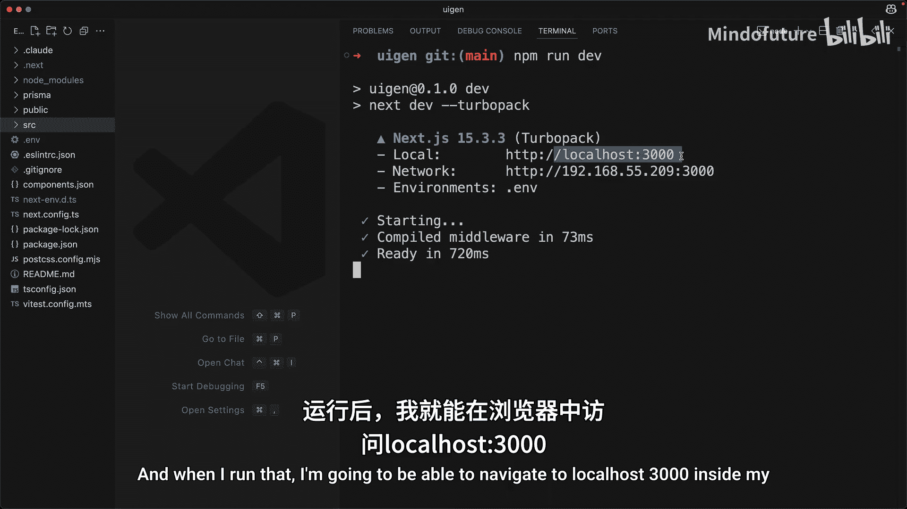
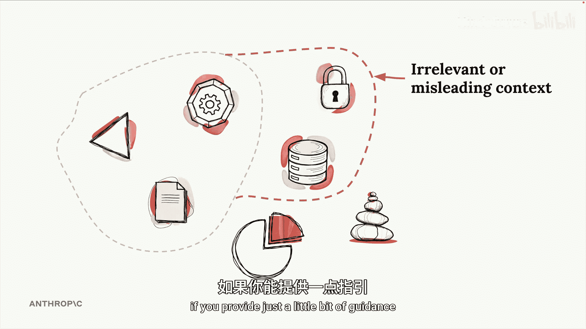
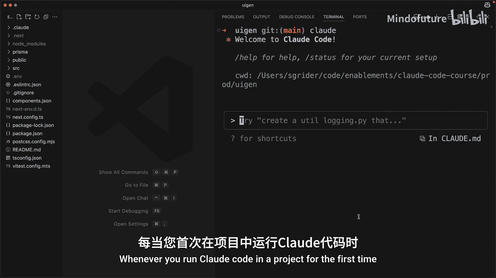
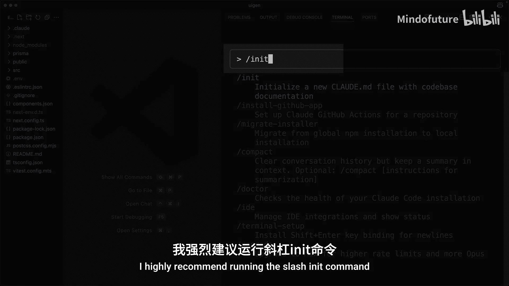
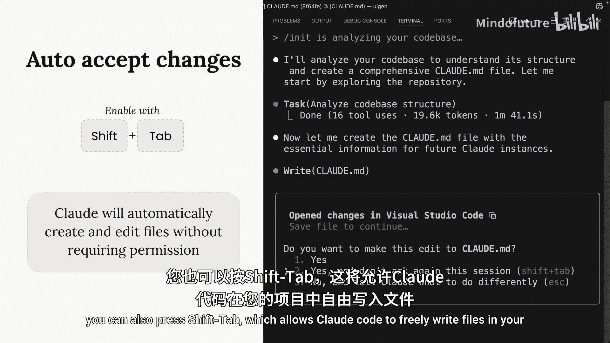
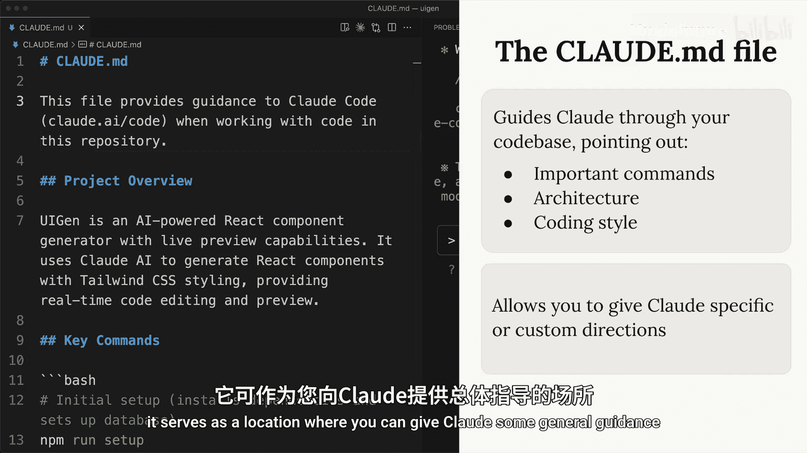
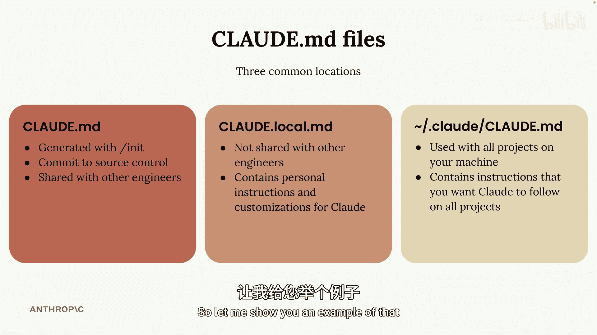
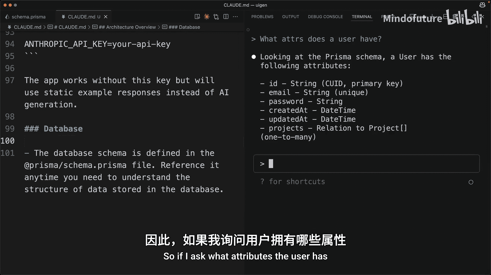

# 【Anthropic】Claude-Code-官方完全教程-｜-Claude-Code-in-Action-｜-vibe-coding-p04-P04_Adding_context--BV12TzGBCERK_p4-

I've got my code editor open inside that small project。

 I'm going start up the development server with a NPpm run dev。 And when I run that。

 I'm going to be able to navigate to a local host 3000 inside my browser and see the application running。

 So here it is right here。 We are going to use cloud code to do a little bit of work on this project。

 But first， there's something really critical I want you to understand around using cloud code。

Specifically， I want you to walk away from this course with a strong understanding of context management。

 You see inside of your typical project， there might be dozens or hundreds of files each with a tremendous amount of information。

 whenever we ask Clade code a question or give it a task。

 there is some ideal amount of information that Claude needs just enough to help understand how to answer your question or complete your task。

 As soon as we start adding in additional information that's not relevant。

 Cla code's effectiveness will start to decrease。 So it is really important for us to help guide Cla towards relevant files or documentation inside of our project。

 Clade code can certainly work without any handholding。

 but you'll get the best results if you provide just a。😊。

A little bit of guidance。So for the remainder of this video。

 I'm going to give you a bunch of different tips on how to give Claude the best context possible to get started inside my editor I've opened up my terminal and I'm going to start Clade code up by running the Cla command。

Whenever you run Clade code in a project for the first time。

 I highly recommend running the slash init command。

 This gets Cla to take a deep look at your entire code basease。

 It'll figure out the purpose of the project， the general architecture， relevant commands。

 critical files and so on After this search， it'll summarize its findings and place them into a file called Clade dot M。

When ClaD tries to create this file， it will ask for permission。

 you can either hit enterter to accept， or if you don't want to have to grant permission to every file right request。

 you can also press ShiT， which will allows Claud code to freely write files in your project。

I would encourage you to open up the Cla M file that was generated and take a look at its contents。

 As I mentioned， the contents of this file are included in every request we make after to Cla。

 This file really has two different purposes。 First。

 it helps Claude better understand your code base so it can find relevant code more quickly。

 and second， it serves as a location where you can give Claude some general guidance。

Just you know， there are multiple clo M D files that Cla code will make use of。

 There is a project level， a local level and a machine level。

 The project level is what we just generated by running the slash in it command。

 We are generally going to commit this file to source control like Git。

 We're going to share this file with other engineers and it is gonna to have some project specific directions that we want to hand off to Cla。

 Oply， we can also create a clo local M D file。 This file is not going to be committed and you' are generally not going to share with any other engineers In this file。

 you might put in some personal instructions that you want clo follow just for you。Finally。

 you can have a global Cla M file on your machine。 This file will contain instructions that will be applied to all projects that you run locally。

 Now， I keep on mentioning giving Clade special or custom instructions。

 So let me show you an example of that。 Let's imagine that Clade is using comments way too often in the code that it writes。

 We can address this by updating our cloud M file。 We can either manually modify the file or a little bit of a shortcut is inside of Cla code。

 We could put in a pound sign。 This puts us in memory mode。

 This allows us to edit one of our cloud M files intelligently。

 So we can put in a request like don't write comments so often。

 I'll then specify that I want to add this instruction to the project Cla M file。

 And Cla is then going to merge this instruction into that file intelligently。

 If I then open the file up and do a search。 I'll see that。 In fact， yes。

 it did add in that new instruction。😊。

Now that we've created our Cla M file。 I want to give you a better understanding of how to pull in specific context into a conversation。

 Let's imagine that we want to better understand how the authentication system in this project works。

 We could just as clo to tell us about it， in which case it would search over our codeb and find files relevant to the authentication system。

 That would definitely work， but it would just take some amount of time。Alternatively。

 if we already know some files that are relevant for the authentication system。

 we could mention them using the at character。 When we mention a file。

 it will be automatically included inside of a request off to Cla。

 This is an excellent technique for pointing clo in a specific direction。

 You can use the same syntax to also mention files inside of Cla M。

 Let me show you an example of why that is really useful。 In the Prisma folder of this project。

 there's a file called schema do Prisma。 This file contains a complete definition of all the different tables and types of records that exist inside the SQLite database that is used to store information inside this project because。

😊，Information is so important and relevant to so many aspects of this project。

 I might decide to mention this file inside of my Cla M D file。 We' me show you how I do that。 First。

 I'll enter a pound to enter memory mode。 I'll then mention that schema file and specifically tell Clade to reference that file any time it needs to better understand the structure of data inside the database。

 Once the update is complete， I' am going to take a look at the qua M D file and just verify that the note was added。

 When you mention a file like this。 itss contents are automatically included inside of your request。

 So if I ask what attributes the user has。 Cla can immediately answer without reading the schema file。

