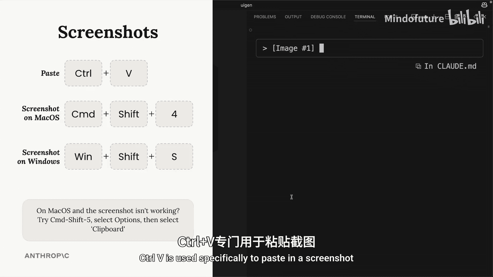
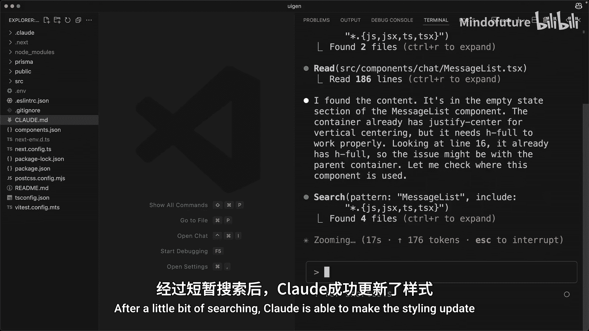
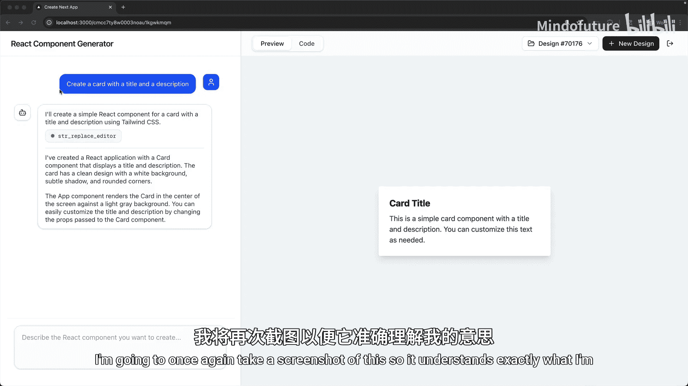
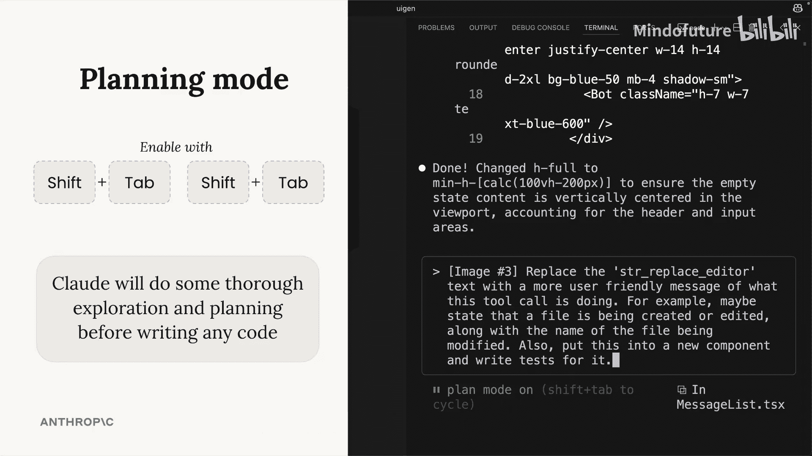
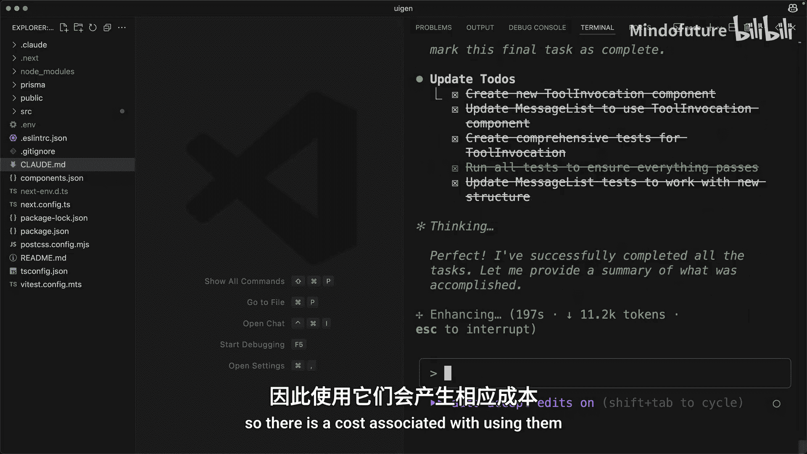
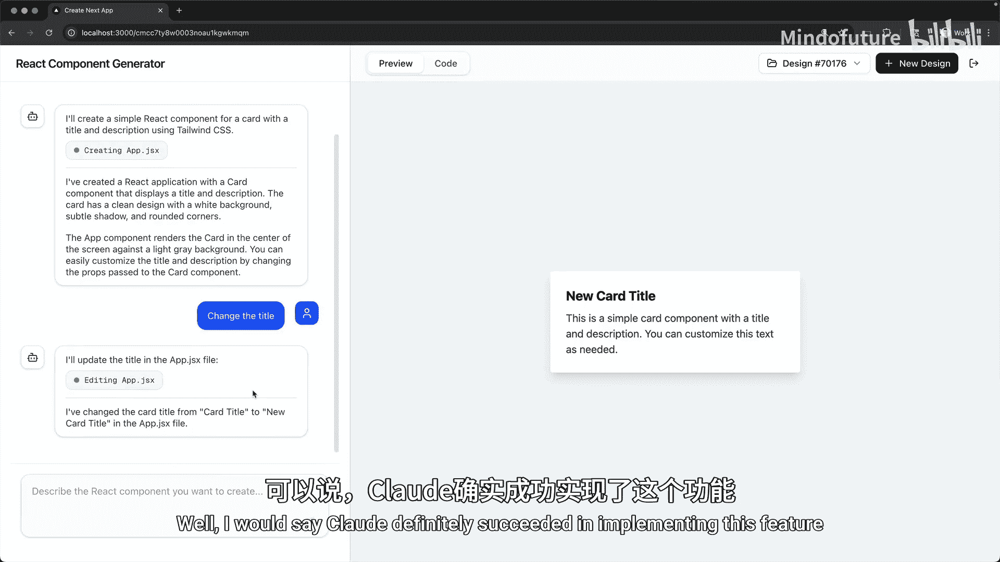
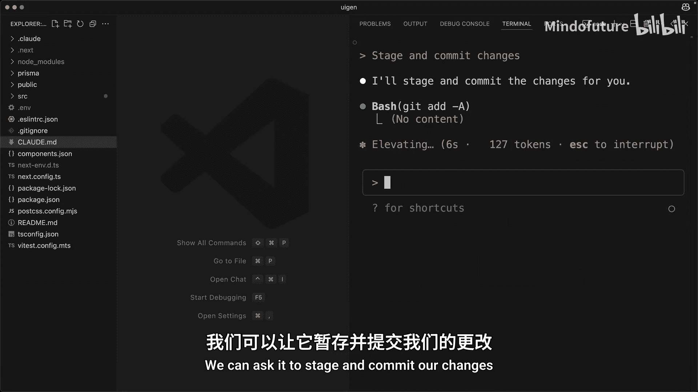

# 【Anthropic】Claude-Code-官方完全教程-｜-Claude-Code-in-Action-｜-vibe-coding-p05-P05_Making_changes--BV12TzGBCERK_p5-

Let's try making a couple of changes to this project along the way。

 I'll show you some useful features around Clade code。

 The first thing I'd like to do is move this placeholder text over here on the left hand side down to the center of this panel to help Claude understand exactly what content I want moved。

 I'm going to take a screenshot of that area right there。

 And then I'm going to paste it into cloud code using control V note that it's control V and not command V that you might be used to on Macs control V is used specifically to paste in a screenshot。

 I can then ask Clade to center that placeholder。 After a little bit of searching。

 Claude is able to make the styling update and then back inside the browser。 Yeah looks great。

 Let me show you the next thing I would like to change in this app。

 I'm going to ask for a card component that displays a title and some description。

 The card is generated without any issue。 but there is one awkward thing on left hand side in the chat interface。

 there is string replace editor。 That little panel right there is meant to indicate to the user that a file is being created。

 But right now it's using a very technical term string replace editor。😊。

For the tool that is being used behind the scenes。 I would like to show a user a little bit more friendly text here and just tell the user that a file is being created and the name of the file。

 And， of course， we should also handle cases where maybe this chatbot is editing a file or deleting a file and other stuff like that to help guide Cla's attention。

 I'm going to once again take a screenshot of this。 So it understands exactly what I'm talking about。

 Then back over here， I'm going to paste that image in and ask Claude to replace that particular text with some more user friendly message。

 Now， this is a little bit of a tricky task that will require Claude to do a decent amount of research in this project to complete When you give Claude a harder task。

 there are two ways that you can easily boost clouds intelligence。

 The first way is to enable plan mode。 Plan mode is enabled by pressing shift tab twice or just once if you are already auto accepting file edits。

 in plan mode， Claude will do much more research over the contents of your project。

 reading more files and coming up with a detailed plan on how to complete your task after completing the。

😊。

P Claude will tell you exactly what it wants to do to complete your task。 At that point。

 you can either accept this plan。 and Claude will implement it。

 or you can redirect Claude in some way。 Maybe it missed some file or didn't consider some scenario。

 The second way in which we can boost Clade's intelligence is by enabling thinking。

 This turns on Claude's extended thinking feature， allowing it to reason more about a particular task。

 to enable thinking there are a handful of different trigger phrases。

 Each one gives Claude a progressively larger token budget to think with。

 given that this is a trickier task。 I might ask Claude to alter think about the best way to implement it。

The last thing to understand is that planning and thinking can be used together。

 So in addition to this Uthink， I'm going to also turn on plan mode as well。

 And I'm going to run this， and we'll see how well Claude can implement this feature。 Now。

 you might be wondering when you should use planning and when you should use thinking。

 Think of these two as handling breadth verse depth。

 Plan mode is useful when you have a task that requires a wide understanding of your code base and requires looking at different areas。

 It's also useful when working on a task that requires several steps to complete。Thinking。

 on the other hand， is useful when you are focusing on a particular tricky bit of logic or troubleshooting a difficult bug。

 The second question you might have is whether you should just enable thinking and planning all the time。

 Well， you certainly can。 Just keep in mind that planning and thinking consume additional tokens。

 So there is a cost associated with using them。 after a couple of minutes of work。

 it looks like the feature is complete。 So I'm going to go back over my editor and test this out。

 So right away， we can see that we get some better status information here than what we have before。

 Use are now being told that a file is being created。 And if I send in a followed request。

 maybe to change the title。

Hopefully now on the follow up， we'll see something about editing that file。 so there we go。

 So now we're editing the app dot Jsx file。 Well I would say Clade definitely succeeded in implementing this feature。

Now that we have made some changes to this project， we should probably commit our changes。

 Cloududcode is a solid Git assistant。 We can ask it to stage and commit our changes。

 and it will write a descriptive commit message for us。

