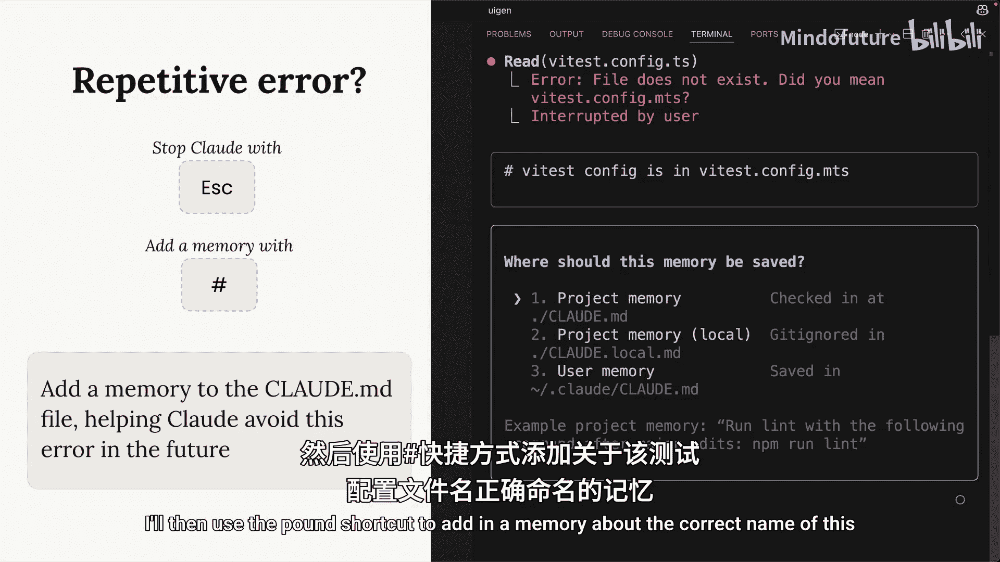
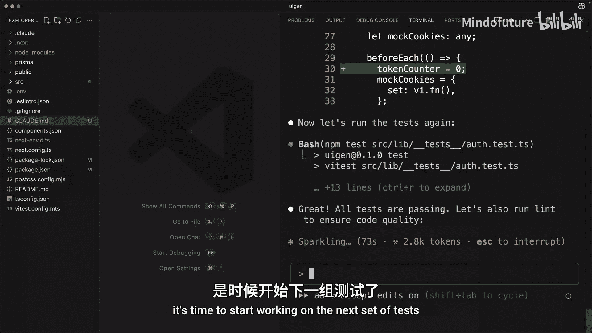
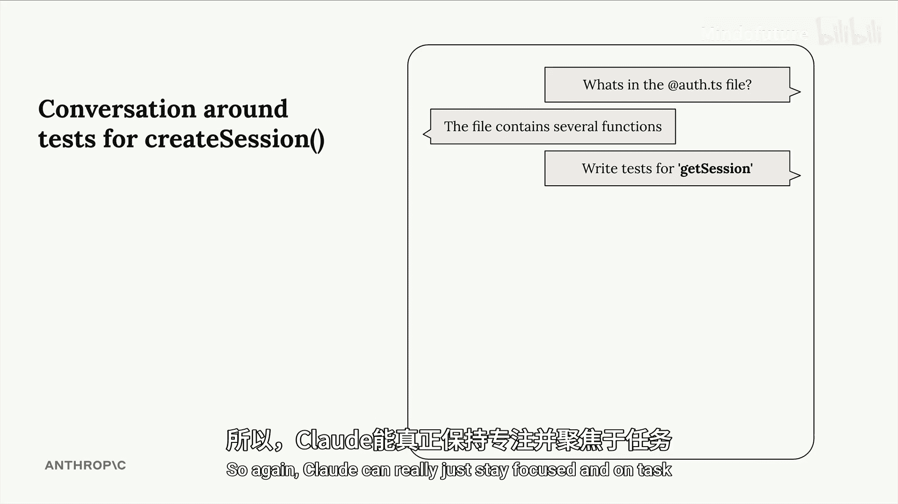
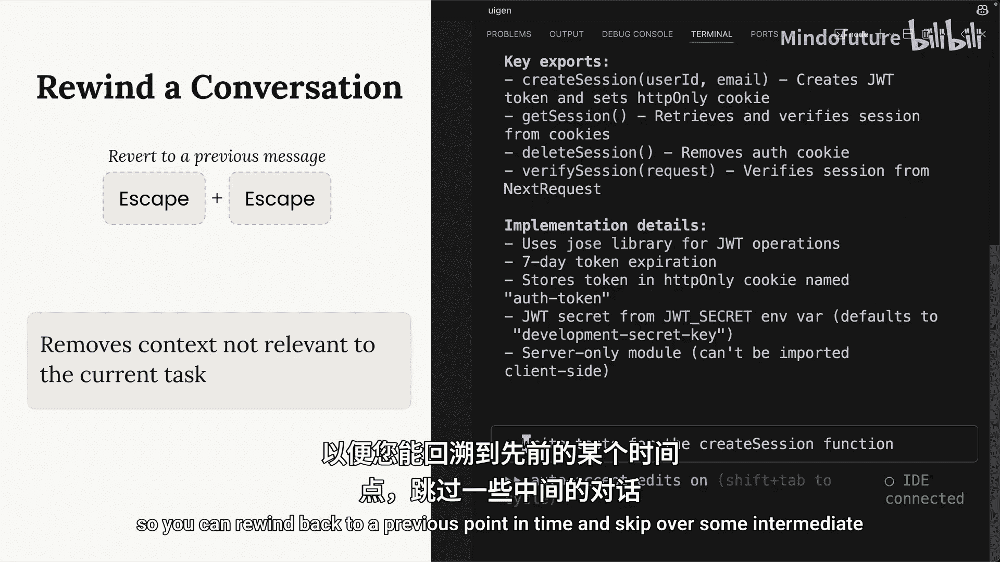
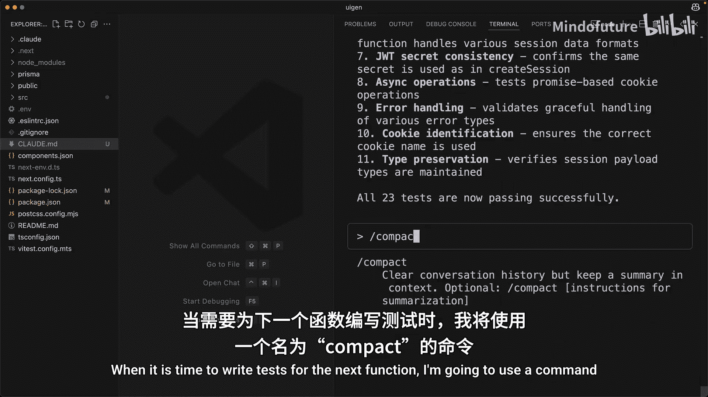
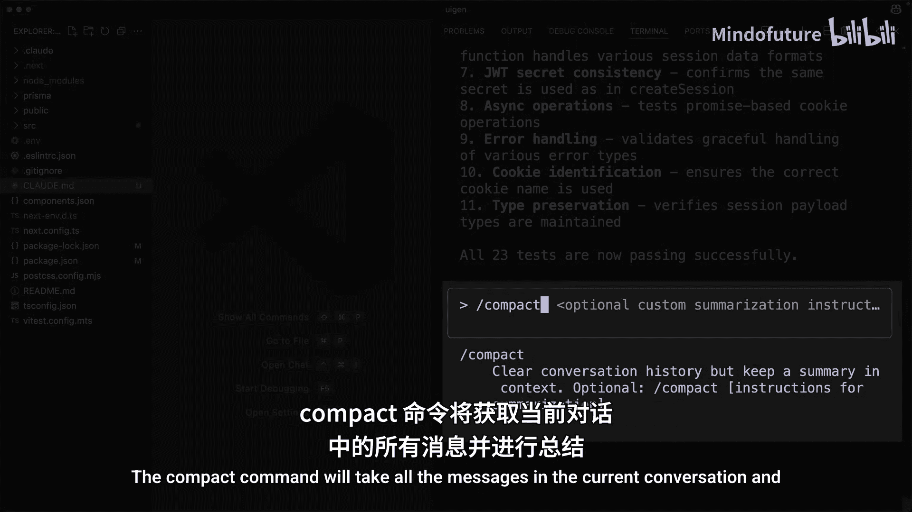
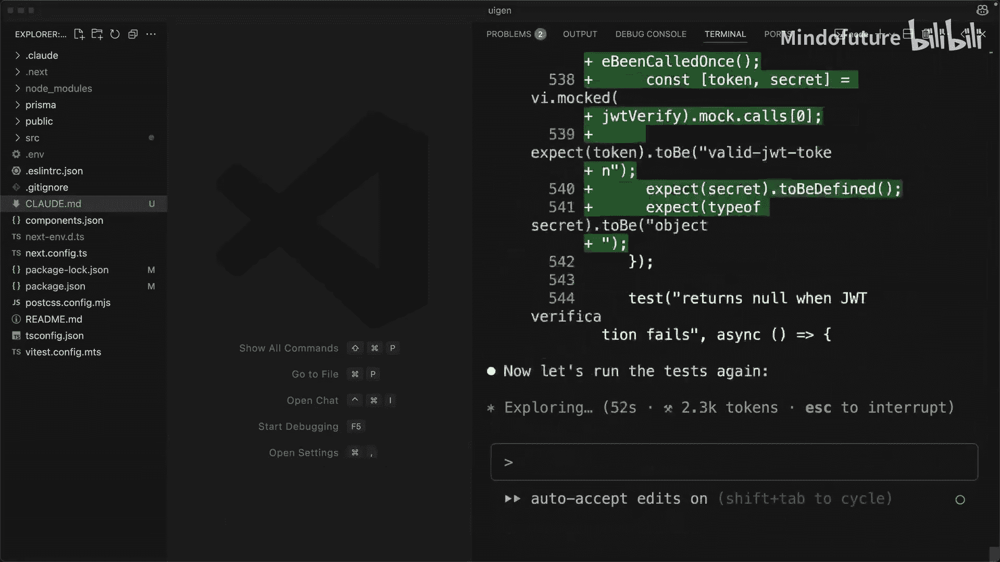
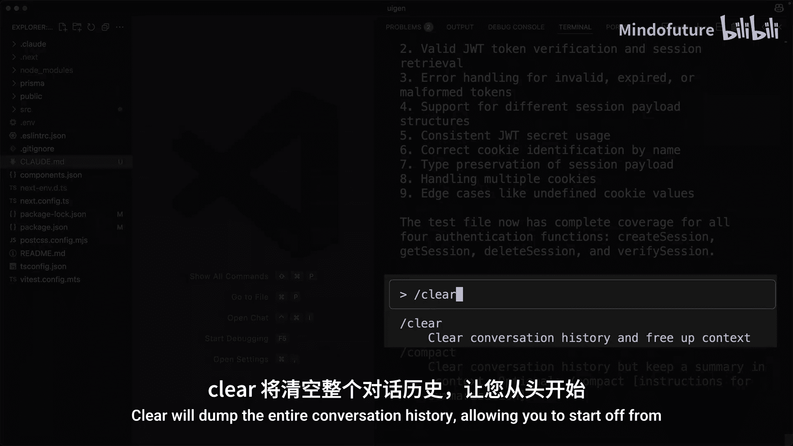
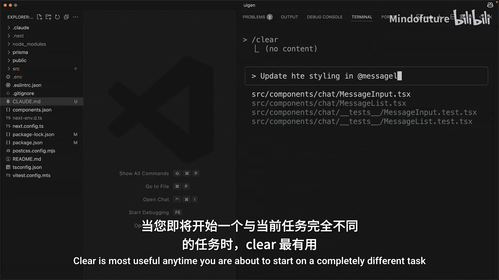
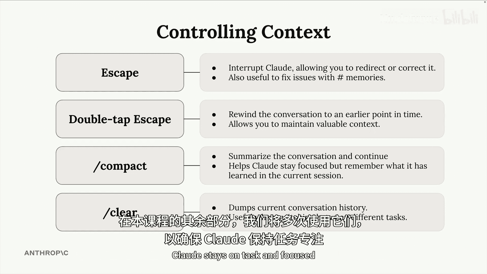

# 【Anthropic】Claude-Code-官方完全教程-｜-Claude-Code-in-Action-｜-vibe-coding-p06-P06_Controlling_context--BV12TzGBCERK_p6-

In this video， I'd like to show you a couple of different techniques for controlling and directing the flow of conversation。

 Here's a basic example right away。 I'm going to ask Claude to write tests for some functions written into a authentication file。

 Claude quickly comes up with a plan for authoring several different tests。 However。

 I know that testing this file is a little tough。 And I'd like Claude to only test one thing at a time。

 to interrupt Claude。 I can press escape。 This will stop Claude in its tracks。

 allowing me to suggest a different path。Combining escape。

 along with memories is a really powerful way to fix errors that Claude makes repeatedly。

 Here's an example。 I'm going to ask Claude to write tests for the same file again。 This time around。

 it will attempt to read a test configuration file that doesn't actually exist。 Now。

 this is an error that I've seen Claude make before on this project。

 So to stop this mistake from being repeated。 I'll very quickly hit escape。

 I'll then use the pound shortcut to add in a memory about the correct name of this test config file。

 And now I probably won't have to see this error again。😊。

Some of these conversation control shortcuts seem like they're just for convenience。

 but used correctly， they can really improve cloudud'sibility to work effectively and stay on task。

 so let me show you a more practical example。Inside the O dot Ts file。

 there are four different functions， and I would like to get clo to write tests for each of them one at a time。

 first starting on a function called to create session。

Claude will definitely attempt to write the tests， but as it is running them。

 it runs into an error and spends a little bit of time debugging it。

 It turns out there was a package that I forgot to install。Eventually。

 the tests are completed and working。 And it's time to start working on the next set of tests。

 But here's the thing In my conversation history， there is now a lot of back and forth around that broken package。

 Now， this is a bunch of context that is not at all relevant to writing the next set of tests。

Ideally， we would be able to jump back in time and go back to the previous message we sent and just update it to say write test for a Git session。

 Now， the benefit here is that we maintain the context where Claude already took a look at the contents of the off dot T S file。

 and it already knows what we're talking about when we refer to Git session。

 And because we dumped all those extra messages that we' just about debugging。

 We're not going to have as much distraction going on here。 So again。

 Claude can really just stay focused and on task。

To go back in the conversation history， hit escape twice。

 This will show you all the different messages that you have sent so you can rewind back to a previous point in time and skip over some intermediate conversation。

Claude is now going to start working on the next set of tests。 This time around。

 Claude stays super focused， but unfortunately， it runs into a number of issues。

 It eventually resolves them and gets the test to pass。 Now， at this point。

 Claude has been working by itself for several minutes and has a really good idea of how to write tests for this file。

At the same time， once again， we have a bunch of context in this conversation history。

 When it is time to write tests for the next function， I'm going to use a command called Compact。

 The compact command will take all the messages in the current conversation and summarize them。

 Compact is really useful when Claude has learned a lot about the current task。

 And you want to maintain that knowledge as it goes into the next task。😊。

The last context related command to be aware of is the clear command。

 Cl will dump the entire conversation history， allowing you to start off from scratch。

 Clear is most useful any time you are about to start on a completely different task unrelated to the current one。

I recommend using these shortcuts quite a bit， particularly when you are changing between tasks or any time you are having a long running conversation with Claude in the remainder of this course。

 we'll use them several times to make sure that Claude stays on task and focused。

