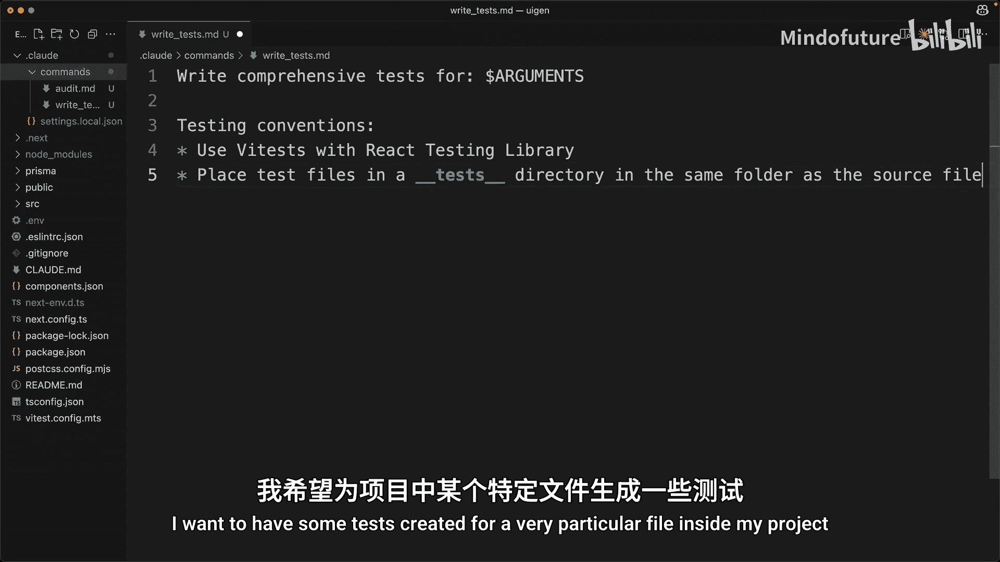
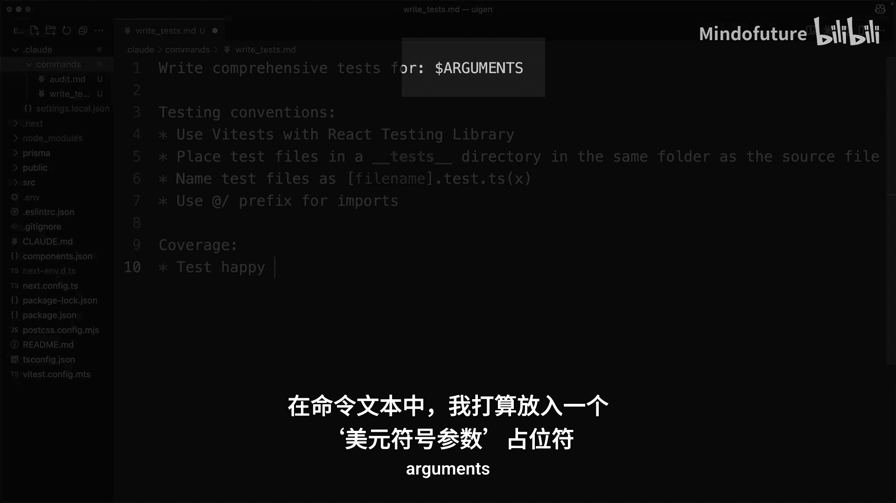
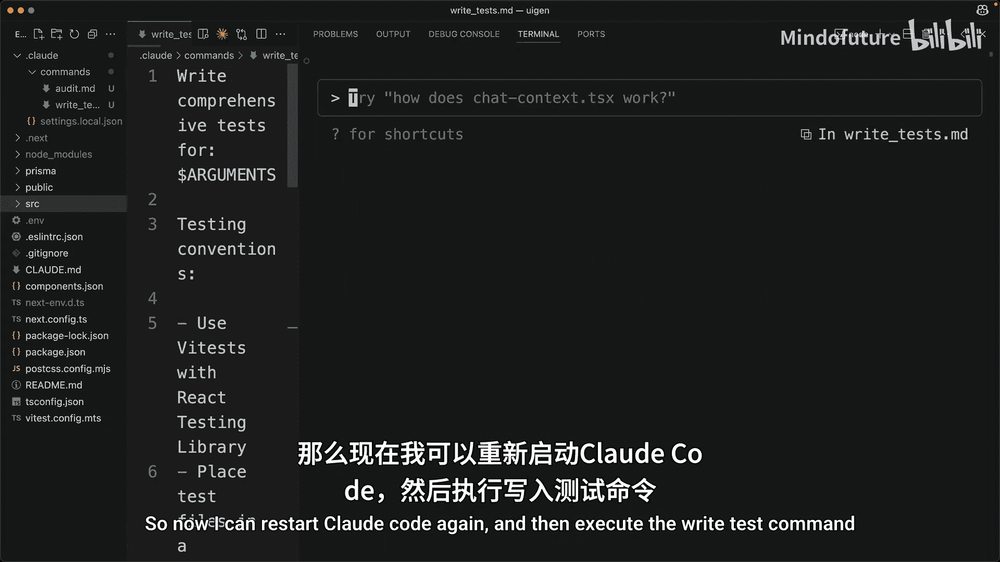
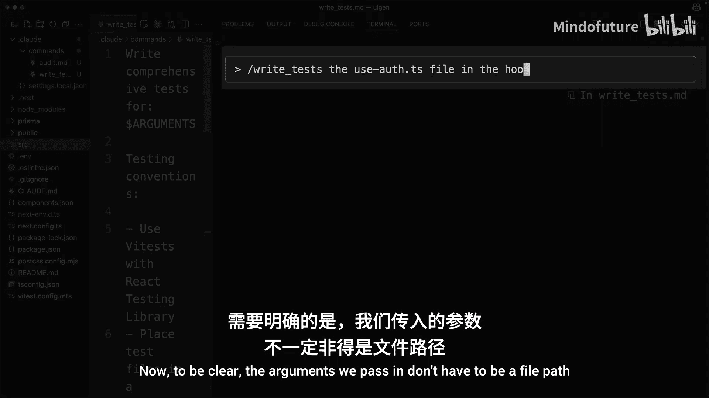
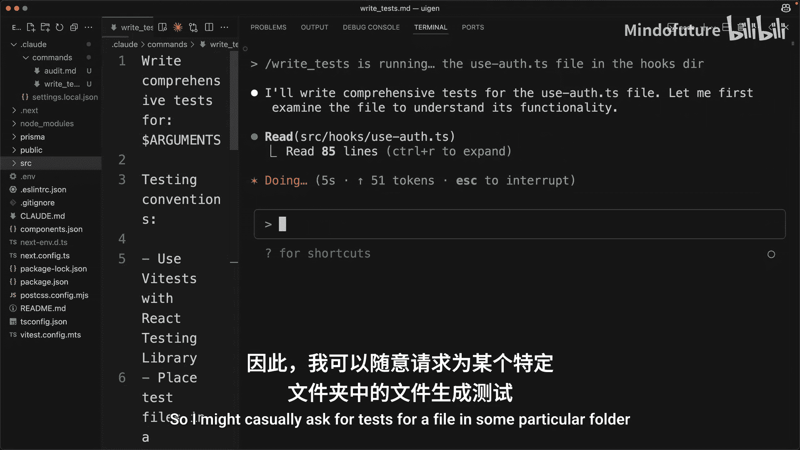

# 【Anthropic】Claude-Code-官方完全教程-｜-Claude-Code-in-Action-｜-vibe-coding-p07-P07_Custom_commands--BV12TzGBCERK_p7-

When you run cloud code， you can enter in a forward slash and see a bunch of commands that are built into cloud code by default。

 In addition to these default commands， you can easily add your own custom commands as well。

 Custom commands are useful for automating repetitive tasks that you find yourself running frequently。

 Let machine an example of how to make one。Inside of my project directory。

 I'm going to find the dot cloud folder inside there I'll make a new directory called commands。

 and then inside that I'll make a new file called audit dotmd。

The name of the file that we create in this case， audit is going to be the name of the command we eventually run。

 The goal of this command is going to be to audit all the different dependencies that have been installed into this project。

 update them if there are any vulnerabilities， and then run tests to make sure that nothing actually broke。

Once you have created the command file， you'll then restart cloud code。 Don't forget to restart it。

 When you re cloud code， put in slash audit。 This will then display the command that you just created。

 You can then run this。 And in this case， it will do exactly what we ask Claude to do。

 Itll run command， see if there are any vulnerable packages。 fix them if necessary。

 and then run tests。Commands can also receive arguments。 Let me show you an example。

 I'm going to make another command called write tests。 When I run this command。

 I want to have some tests created for a very particular file inside my project。

 Inside of the command text， I'm going to put in a placeholder of dollar sign arguments。

 When I run the command。 If I pass in a path to a file。

 That path will be inserted at dollar sign arguments。

So now I can restart cloud code again and then execute the right test command。 Now， to be clear。

 the arguments we pass in don't have to be a file path。 It can be any string we want to pass in。

 so I might casually ask for test for a file in some particular folder。

 giving Claude just a little bit of direction on where to look。

