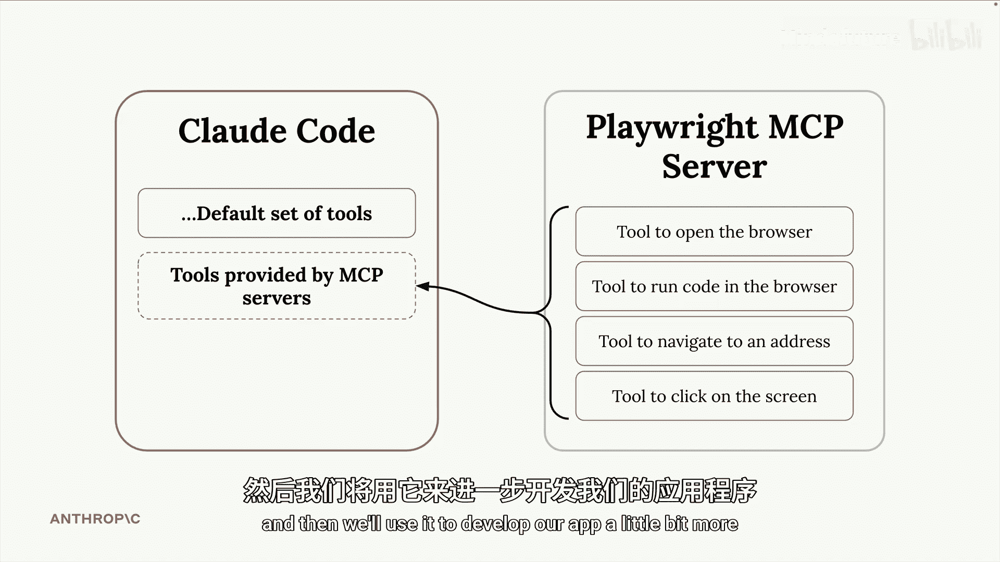
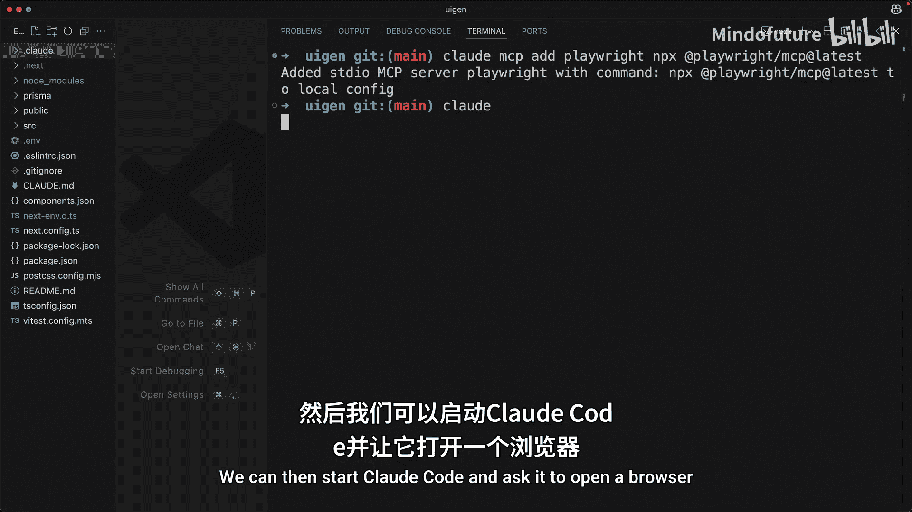
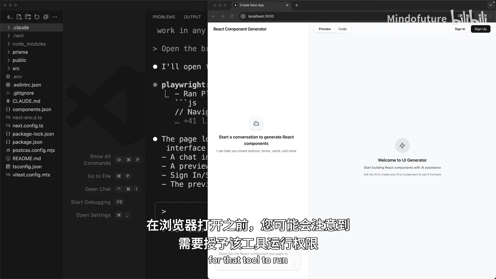
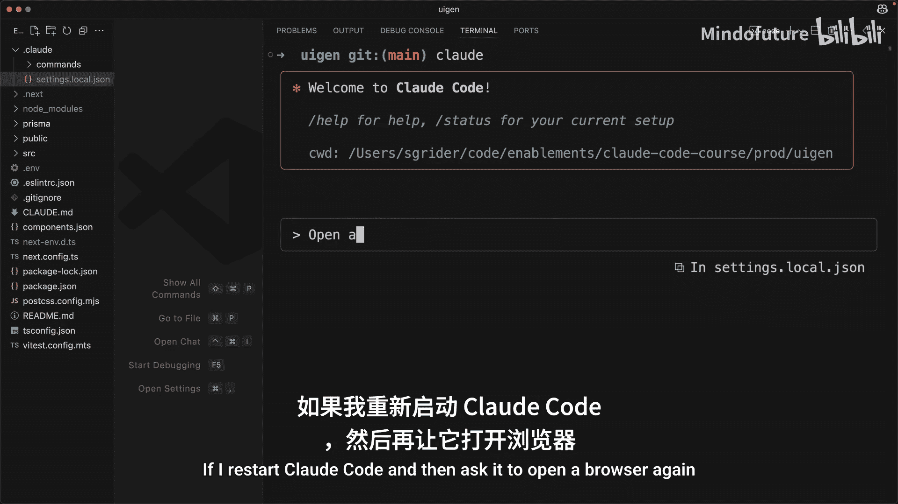
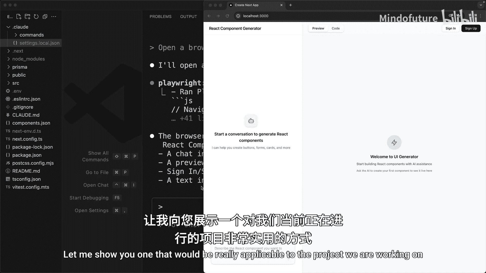
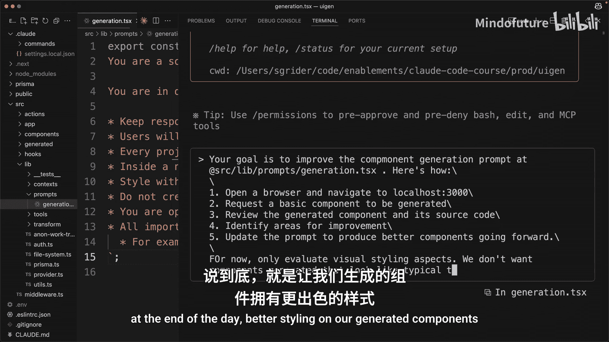
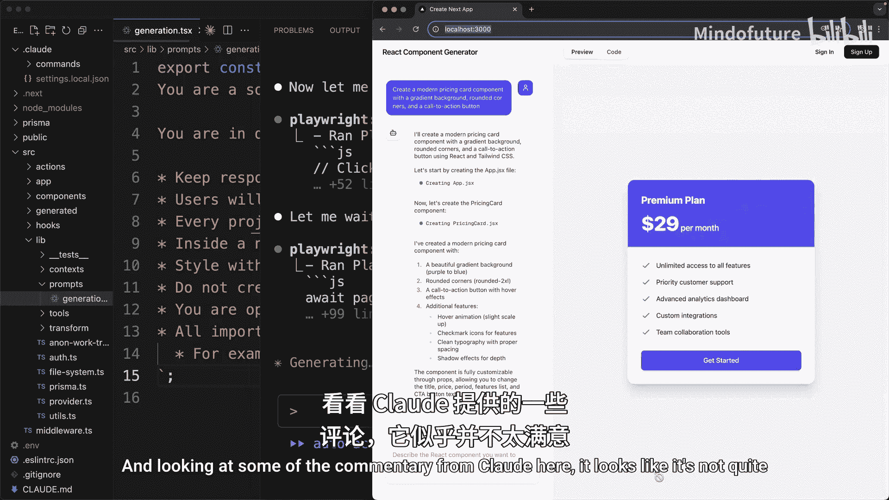
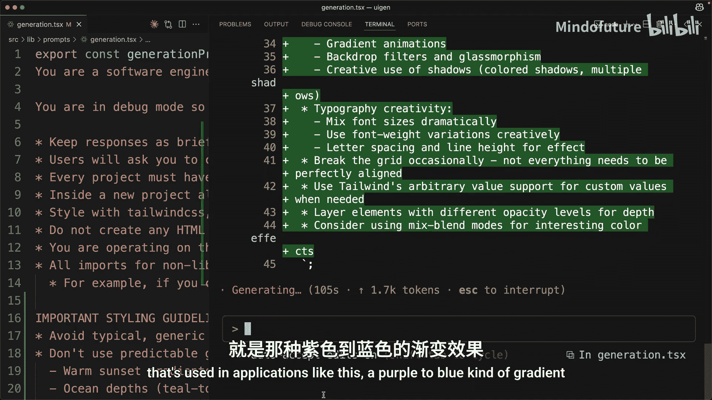
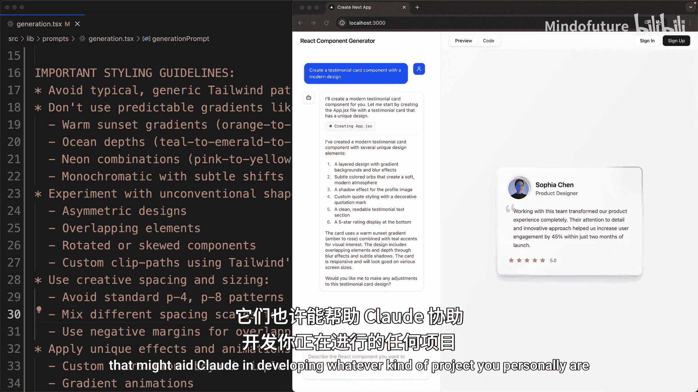

# 【Anthropic】Claude-Code-官方完全教程-｜-Claude-Code-in-Action-｜-vibe-coding-p08-P08_MCP_servers_with_Claude_Code--BV12TzGBCERK_p8-

You can add new tools and capabilities to cloud code through the use of MCP servers。

 These MCP servers either run remotely or locally on your machine。

 a very popular MCP server named playwright gives cloud code the ability to control a browser。

 Let me show you how to add it to cloud code and then we'll use it to develop our app a little bit more to install this server at your terminal not inside of cloudcode will execute cloud MCP ad and then unname for this MCP server。

 I'm going to name it playwright， and then after the name we' add in a command that will start up the server locally on your machine。

 We can then start cloud code and ask it to open a browser and navigate to our application at localhos 3000。

Before the browser opens， you might notice that you are required to give permission for that tool to run。

 If you get tired of all those permission pop ups， you can open up the clod directory inside their settings local do Json。

 And then inside of the allow array。 you can add in a string of MCP underscore underscore。

 notice there are two underscores their playwright。

 This allows cloud code to make use of this MCp server and the tools inside it in any way at once without requiring you to provide permission every time。

 If I restart cloud code and then ask it to open a browser again。

 it will do so without requiring me to give permission。

 There are incredible number of ways that you can use the playwright MCP server。

 Let me show you one that would be really applicable to the project we are working on right now。

 back inside my editor， Im can find the S C Lib prompts， generation do T S X file。

 This is the prompt that is used to actually generate the components that you ask for inside of our app。

😊。

So I want to allow clo code to make use of the browser， generate a component on its own。

 and then tweak this prompt on its own based upon the generated component。

 And hopefully we'll end up with some better looking components being generated out of our app。

 So let me show you how we would do that back inside of Clade code。

 I'm going to ask it to navigate to local host 3000。 attemptt to generate a component。

 Take a look at the generated source code and evaluate the styling。

 and then update our prompt inside that generation do Tsx file。

 And hopefully we'll end up with some at the end of the day。

 better styling on our generated components。😊。

So let's see how it does。 Claude is going to first open up the browser。

 It's going to attempt to generate a component。 and looking at some of the commentary from Claude here。

 it looks like it's not quite so happy。 you might actually notice that it complains about a very common style that's used in applications like this。

 a purple to blue kind of gradient。

Cloudt is then going to update our prompt and then tried to generate a new component。

And all be honest with you， this actually gave a much better result than I ever expected。

 This testimonial card actually looks really， really great。 Based on these results alone。

 you can immediately get a sense that MCP servers really open the door to a lot of interesting use cases。

 And I highly recommend you look into some MCP servers that might aid Clade in developing whatever kind of project you personally are working on。

😊。

