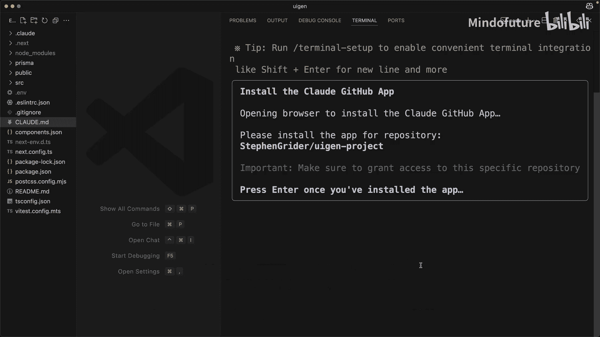
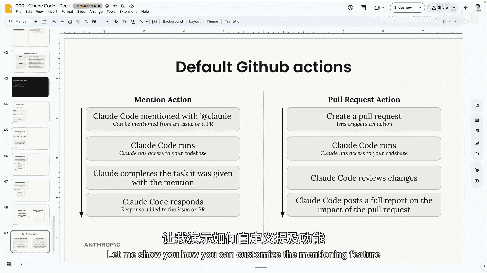
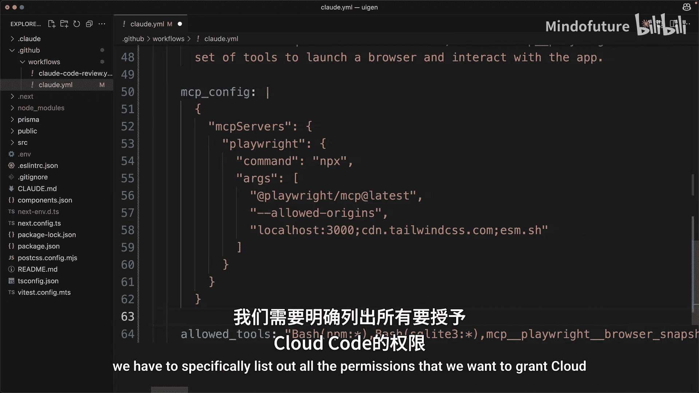
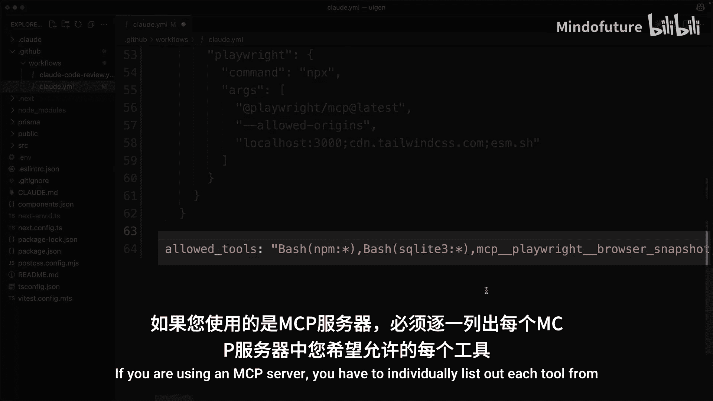
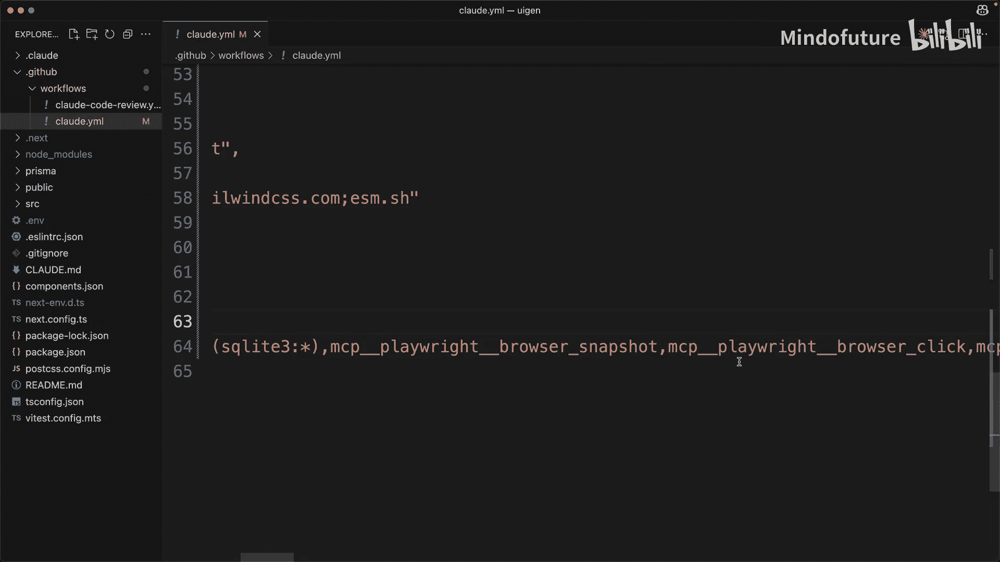
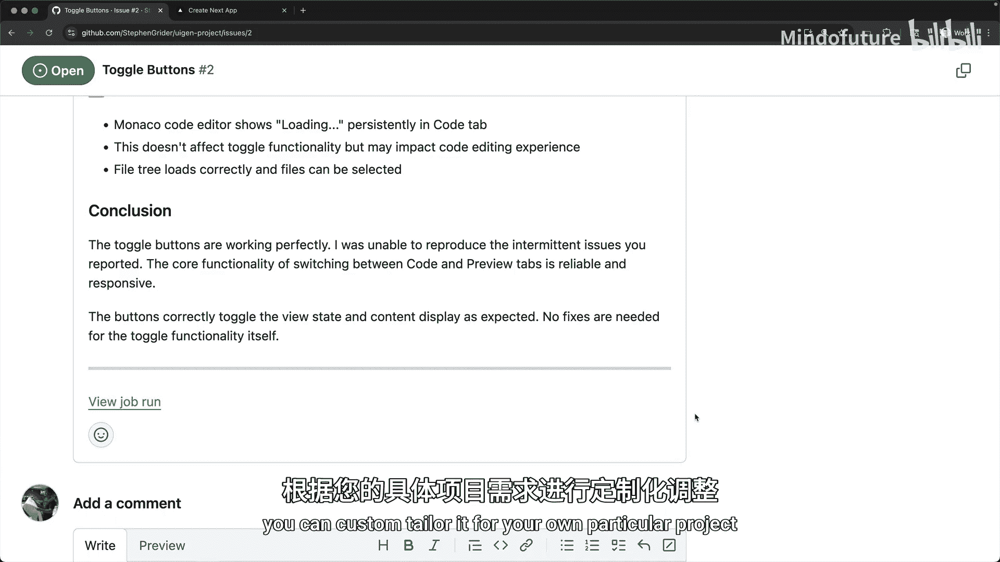

# 【Anthropic】Claude-Code-官方完全教程-｜-Claude-Code-in-Action-｜-vibe-coding-p09-P09_Github_integration--BV12TzGBCERK_p9-

Cloudcode has an official Github integration that allows cloud code to run inside of a Github action。

 You can set up this integration by running slash install Github app。

 This will walk you through a couple of steps。 First。

 you'll need to install the cloud code app on Github。 Next， you'll need to add in an API key。

 And then after this， a pull request will be automatically generated。

 This pull request adds in two different Github actions。

The first action adds in mentioning support， so from an issue or a pull request。

 you can mention Claude with@ Claude and give Claude some kind of task to run。

The second action adds in support for reviewing pull requests， so whenever you create a pull request。

 cloud code will automatically run and review the proposed changes。

Both of these actions can be customized and you can also add in additional actions to trigger based on other types of events。

Let me show you how you can customize the mentioning feature。 First。

 we just merged in those two action config files to our repository on Github。

 So I need to pull those changes down to my local machine。

 Then inside of the newly created Github workflows directory I'll see these two action config files One adds in support for the pull request review and the other add in support for handling mentions。

 Now， here's how I want to customize the mention functionality。

 When I mention Cla inside of an issue or a pull request。

 I wanted to be able to run the project and use the playwright MCP server to access the app inside of a web browser all inside of a Github action。

 to make this work， I'll first add in a step before Cla code runs in this workflow。

 I'll run the setup command and then start the development server up。

 Then I'm going to update the cloud code configuration。 I'll add in some custom instructions。

 These are passed directly to Cla。 and they allow us to provide some additional directions or context。

 In this case， I'll tell Claude that the development server is already running。

 and that I can use the play。

W MCP server to access the app in the browser if needed。

 Then I will add in some configuration to set up the playwright MCP server itself。

 There is one other thing to be aware of here。 When your running cloud code inside of an action。

 we have to specifically list out all the permissions that we want to grant cloud code and there is one tricky aspect to this。

 If you are using an MCP server， you have to individually list out each tool from each MCP server that you want to allow。

 There is no shortcut for permissions like we saw previously。 Unfortunately。

 the playwright MCP server has many different tools so they each need to be listed out。

Once I have finished with this configuration update。

 I'll be sure to commit these changes and push them。Now it's time to test out this updated workflow。

 I'm going to give Claude a little task in our actual app， See these two buttons up here。 Right now。

 they work fine。 I can toggle between the preview and the code panels without issue。

 But I'm going to pretend as though they weren't working as intended。

 I'm going to take a screenshot with that button right there。 I'm then going to make an issue。

 I'm going to paste in the screenshot。 and I'm going to mention Cla with at Cla and ask it to verify that the two buttons are working as intended。

 I'll then create the issue and wait。 Now， it is going to take a minute or two for the action to actually start up and for cloud's respond。

 Remember， as we just saw the action。 we are now setting up the entire app in starting it running before Cla code even starts to run at all。

😊，But eventually， Claude will respond。 It will very often create a check list of steps to accomplish the given task。

 In this case， it is going to attempt to visit the app。

 manually test out the button and fix any issues that it finds。

 Claude will notice that the buttons actually are working just fine。

 And so it's going to terminate early with a message documenting its findings。

Now this is just a small example of how you can use cloudde codes GitHub integration。

 I recommend you spend some time to think about how you can custom tailor it for your own particular project。

