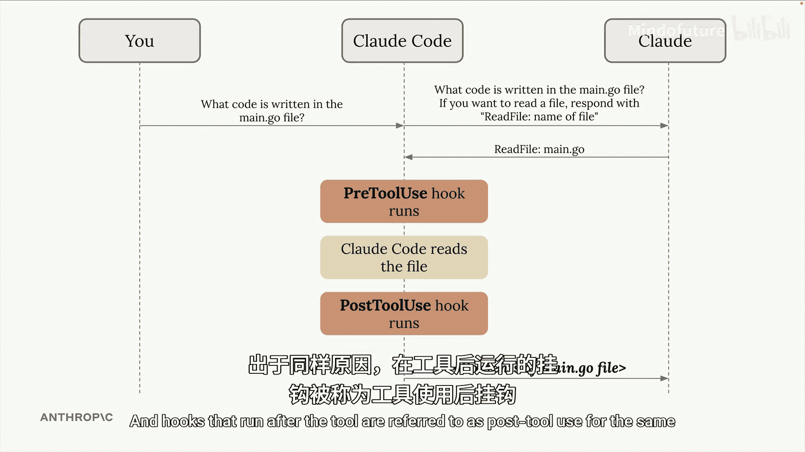
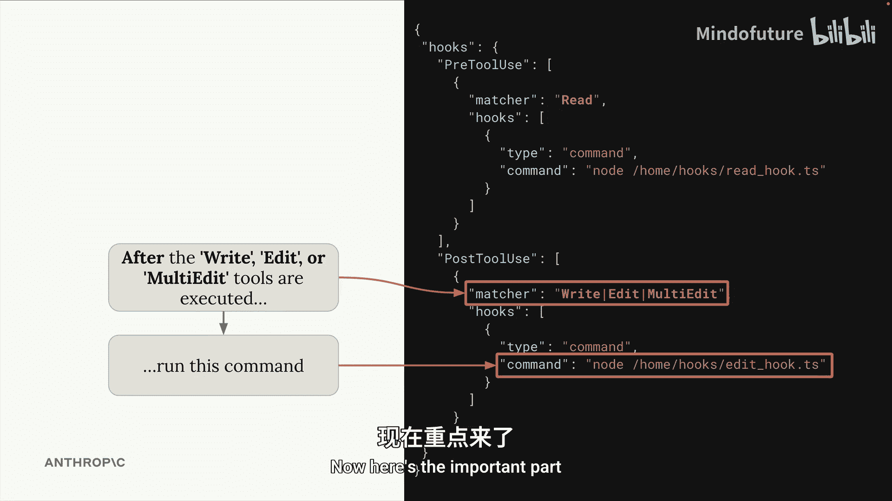
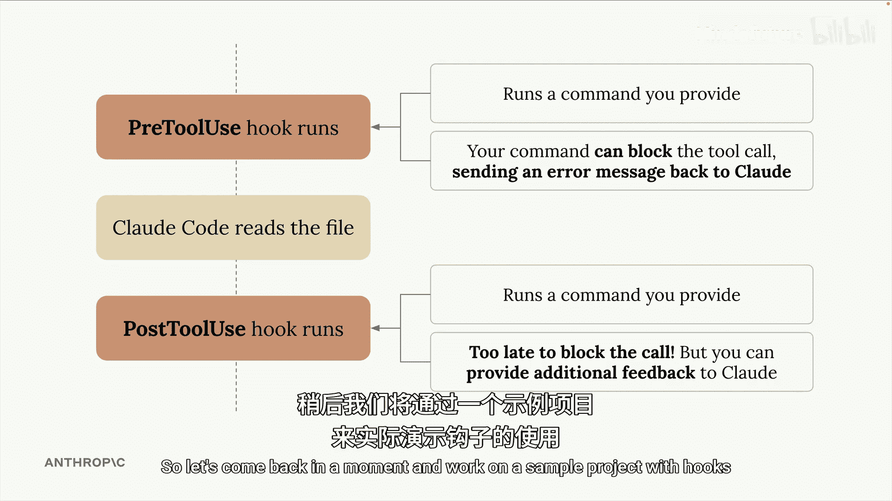

# 【Anthropic】Claude-Code-官方完全教程-｜-Claude-Code-in-Action-｜-vibe-coding-p10-P10_Introducing_hooks--BV12TzGBCERK_p10-

In this video， we are going to take a look at hooks。

 These allow you to run commands before or after Claude attempts to run a tool hookooks can use to implement really interesting and very useful functionality。

 For example， after Claude decides to write a file。

 you can automatically run a code formatter on the created file or you can run tests after a file is edited or you can block Cla from reading particular files。

 the possibilities are really endless and I've got a couple of good examples lined up to show you to give you some ideas of how you might use hooks on your particular project。

First， however， let me help you understand exactly how hooks work as a reminder。

 when you ask Clade code something， your query sent off to the cloud model along with some tool definitions。

 the Cla model might then decide to run a tool by providing a carefully formatted response。

 and at that point， it is up to Clade code to run the requested tool。

 maybe in this case to read a file and then respond with the result of that tool call。Now。

 hooks give us the ability to execute code just before or just after the tool execution hooks that run before a tool are referred to as pretool use hooks because they run before the tool。

 and hooks that run after the tool are referred to as post tool use for the same reason to define hooks。

 we add configuration to the cloud settings file。 remember that there are several different settings files。

 one for global use across all projects on your machine。

 one for your particular project that get shared with other engineers and one for just you on a particular project。

You can add hooks either by writing them out by hand inside this file or by using the builtt in slash hooks command inside of Cloudud code itself。

The configuration itself looks like what you see on the right hand side of this screen。

 only me walk you through this example file just to give you a better idea of what's going on。

So first， notice that there are two distinct sections inside this file。

 One section lists out all the commands that should be executed before a tool use。 remember。

 those are referred to as pretool use hooks。 the other section lists out all the different commands that should be executed after a tool use and again those are post tool use hooks。

In each of these sections， we provide a matchcher。 This indicates which tool use types we are looking for。

 so in this case， I want to find uses of the Read tool Whenever cloud code attempts to read a file。

 I want to run the command you see listed there。😊，Likewise。

 inside the post tool use section after a use of the right， edit or multiedit tools。

 there is a different command that I want to run。 Now， here's the important part。

 Here's what hooks are really intended to do。 Those commands you saw will be given details about the tool call that Claude wants to run In the case of a pretool use hook。

 You can inspect what Cla wants to do。 and if for any reason you don't want to allow it。

 you can block the tool use operation and send an air message back to Claude。

 In the case of a postto use hook。 The tool call has already occurred。 So it's too late to block it。

 but you can do some follow up operation based upon the tool call。

 like maybe format a file that was just edited。 You can also provide some message back to Cla about that tool use。

 For example， you might decide to run a separate program to check the code quality of the edit。

 Or maybe you do a type check and then provide that feedback back to Cla。

 Claude might then take that feedback and make an update to the file that it just wrote to if。

Still confused about hooks or what they are intended to do that is absolutely okay。

 wrapping your head around hooks can be really challenging。

 so let's come back in a moment and work on a sample project with hooks。

