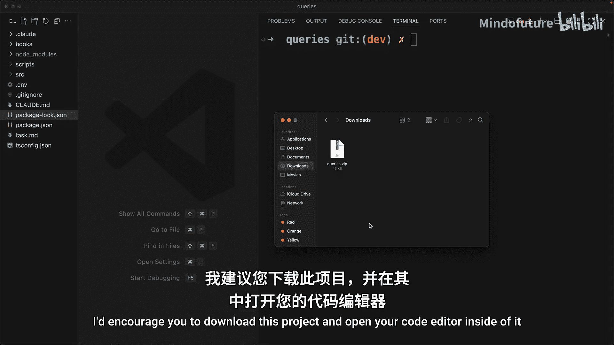
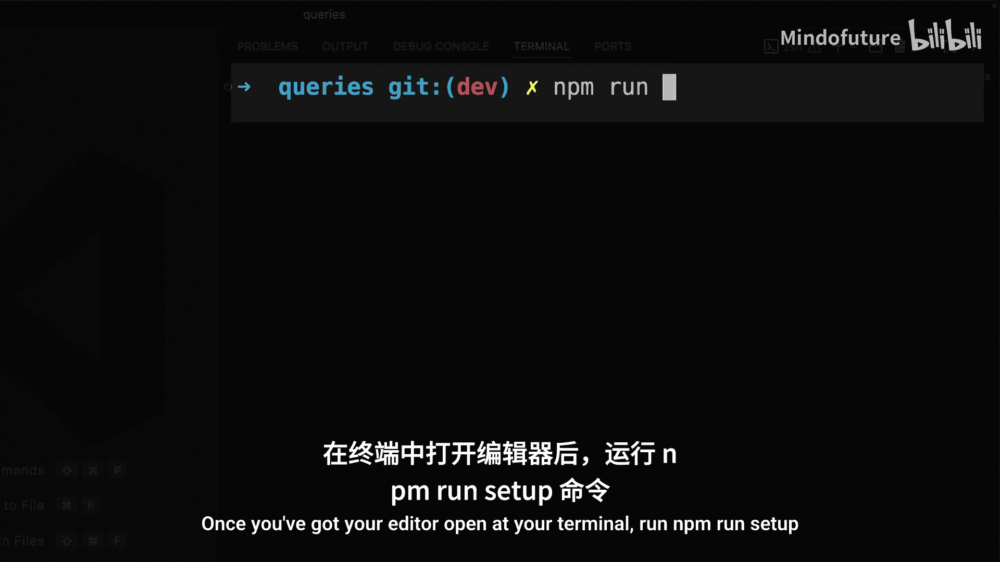
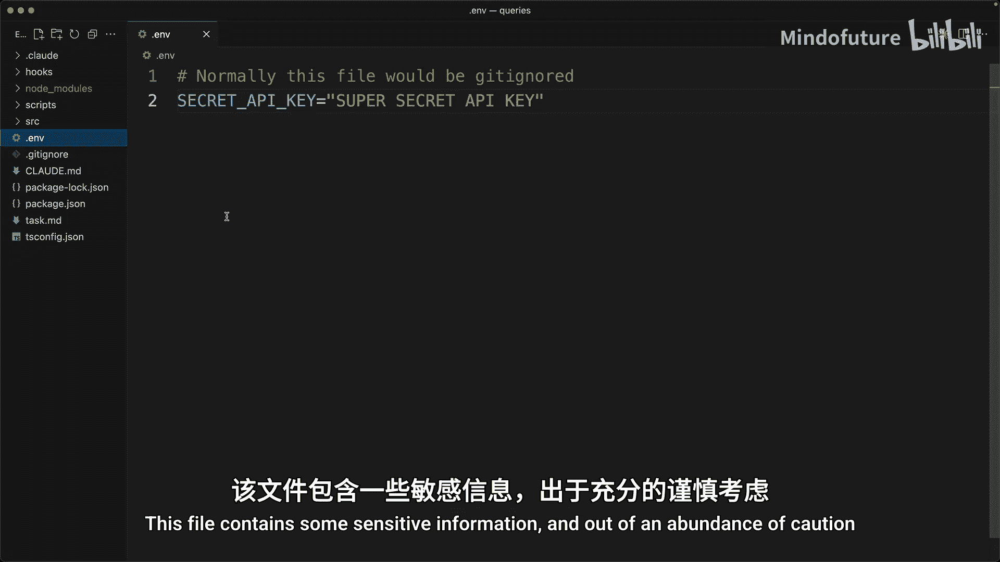
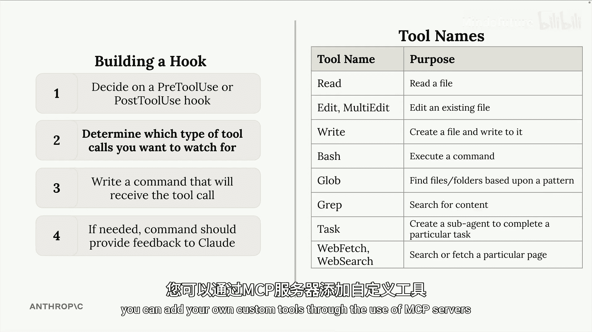
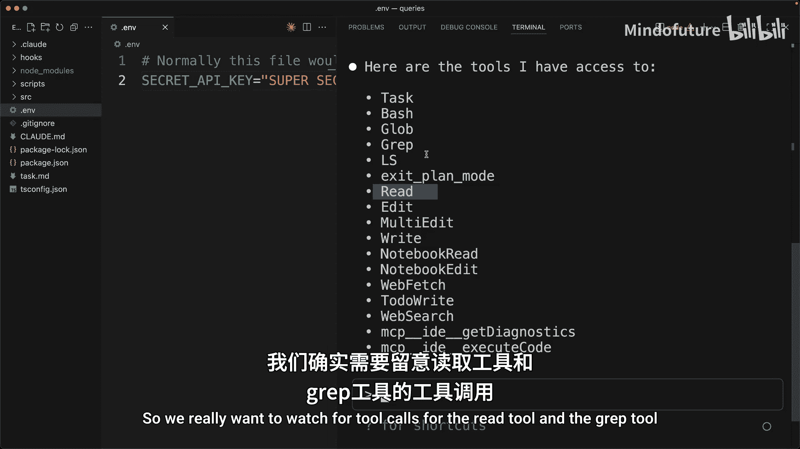
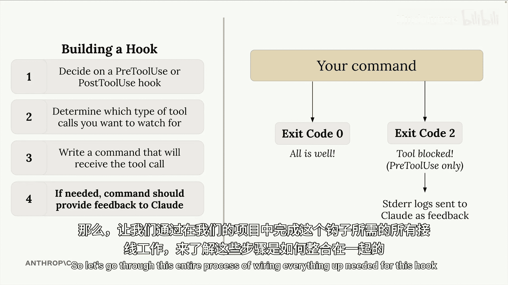

# 【Anthropic】Claude-Code-官方完全教程-｜-Claude-Code-in-Action-｜-vibe-coding-p11-P11_Defining_hooks--BV12TzGBCERK_p11-

To get a better idea of how hooks work， we're going to take a look at a new sample project。

 attach this lecture as a file calledqueries do zip。

 I'd encourage you to download this project and open your code editor inside of it。

 Once you've got your editor open at your terminal run NPm run setup up。

 This is going to install a couple of dependencies and get a couple of hooks ready for use。

 to better understand hooks， we're going to make our own inside of this project。

 So here's what I want our hook to do。 In the root directory of our project is a file called dot E and V。

 This file contains some sensitive information。 And out of an abundance of caution。

 I want to completely prevent Claude from ever reading this file directly。

 Let me show you a couple of diagrams to help you understand how we're gonna put this hook together。

 Step 1 is to decide on whether we need a pretool use or a posttool use hook。😊。

In this scenario， we want to prevent Claude from ever reading a particular file。

 If we make a postto use block， then we will have executed our hook or ran our command after Claude already read the file。

 So in this case， we definitely need a pretool use hook to make sure that we can prevent the read operation from occurring The next thing we need to do is decide exactly which kind of tool calls we want to watch for。

 I've got a list of all the different current tool names on the right hand side of this diagram。 Now。

 memorizing all the different tool names are included inside of cloud code can be really challenging。

 especially since you can add your own custom tools through the use of MCP servers。

 So let me show you a little trick you can use here。😊。

If I go back over and open up Clade code， I can directly ask Claude for a bullet point list of all the different tool names that it has access to right now out of all these different tools。

 there are two that can be used to very easily read the contents of a file。 First。

 there's the retool， and then it's easy to miss， but this one can actually read the contents of a file as well。

 The Gr tool。 Grp can search the contents of a file。

 So we really want to watch for tool calls for the retool and the Gr tool。😊。

Next up， we need to write out a command that is going to receive some information about the tool call that Claude wants to make。

 Here's how that part works。 We're going to write out a command。

 Claud is going to automatically execute it。 And then on standard in to that process。

 Clad is going to feed in some tool called data as Json。

 I've got an example of some tool called data on the top right hand side。

 So it's going to be a big Json object that has some information about the tool name and the input to that tool。

 In this case， the tool name is read。 So Claude is trying to call the read tool。

 And it might be trying to read specifically a file path， pointing to that dot E and V file。

 And again， that's the file that we want to prevent a read operation for。

So then inside of our program or our command， we need to receive this information through standard In。

 parse that JSON， and then read the tool name， the tool input arguments， and so on。

 and decide what we want to do with this tool call。Then on to step 4 in step 4。

 after our command receives that proposed tool called data， we're then going to exit。

 and our exit code is going to provide a signal back to Cla code an exit code of 0 means everything is okay。

 and we want to allow this tool call to occur。An exit code of 2， however。

 is a to Clade code that we want to block this tool call。

 And that specifically only applies for the pre tool use hooks。 because remember。

 only in a pre toolol use hook， can we actually block a tool call。 If we exit with a code of 2。

 then any standard error logs that we generated inside of our command during that time。

 will also be sent as feedback to Cla So we can both deny the tool call and give Claude a reason at the same time as well。

So that's the entire process and I know once again， has a lot of stuff going on here。

 so let's go through this entire process of wiring everything up needed for this hook inside of our project to understand how all these steps come together。

