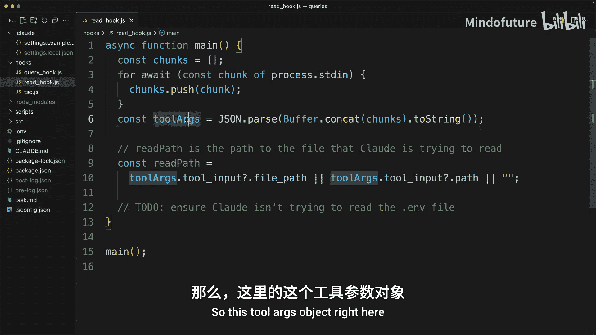
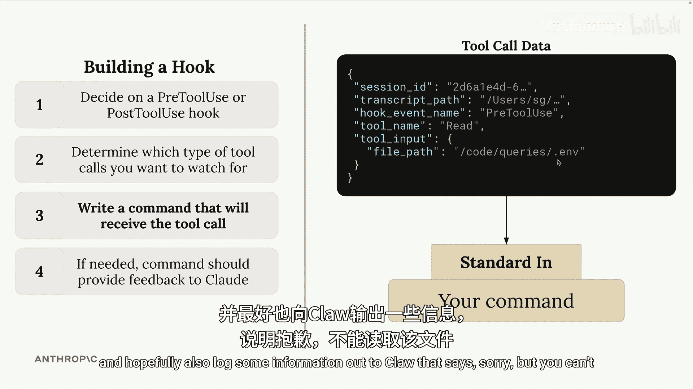
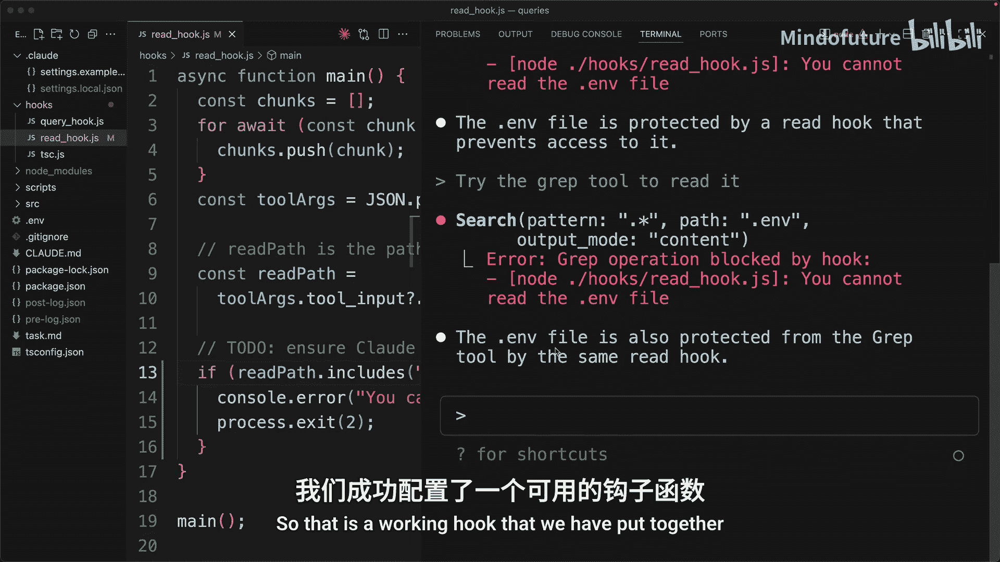

# 【Anthropic】Claude-Code-官方完全教程-｜-Claude-Code-in-Action-｜-vibe-coding-p12-P12_Implementing_a_hook--BV12TzGBCERK_p12-

Let's put together our custom hook remember the entire goal here is to prevent Claude from ever reading the contents of the dot E andV file In the last video。

 we discussed many of the different configuration options we need to set。

 so in this video remaining mostly focused on the implementation to get started inside the dot cloud directory I'm going to open up the settings local do JsonN file。

Remember， inside of here， we have a list of pre tool use hooks and post tool use hooks。

 As we discussed a moment ago， we want to make a pre tool use hook so that we can prevent Claude from ever reading the contents of that particular file。

 I already added in a little configuration section right here for us just to save us a little bit of typing。

 All you need to do is fill in the matcher and the command。First is the matcher。

 So the match is going to be the tools that we want to watch for。 In our case， as we discuss。

 we want to watch for calls to the read and the Gr tools。

I'm going to separate those two tool names with a pipe symbol， so that's not an L or a capital I。

 it is a symbol right above the return key on your keyboard。Then next up。

 we need to provide a command to run whenever Claude attempts to call those two tools。

We could put in here any command you want， so it can be a CLI， it can be a call to a shell script。

 absolutely anything。To follow the pattern that have already established inside the rest of this file。

 I'm going to call a node Js script that I placed ahead of time inside the hooks directory of this project。

 So inside the hooks directory， I've put together for us a read underscore hook dot Js file。

 This is the file that I want to run whenever Clat attempts to call one of those two tools。

 So to call that， I'm going to replace the true right here。

 which is just a placeholder for right now with node。Dot slash hooks， read underscore hook。t js。

I'm going to save this file， and that's all we have to do inside of here。Next up。

 we need to actually implement the command that's going run anytime Cla tries to call the read or the Gr tools。

 So that's gonna to be the read hooked dot js file at the top of this file。

 I've got some code that's going to read from standard in and parse that data as Json。

 So this tools object right here。 that's going to be the big JSson object I showed you in this diagram back over here。

 So it's gonna have properties like session I the tool name， the tool input and so on。

 So all we really need to do is take a look at that file path right there and decide whether or not it is trying to read the dot Ev file。

 If it is， then we want to make sure that we exit from our program or our command here with an exit code of2 and hopefully also log some information out to Cla that says sorry but you can't read that file。

 So you'll notice that back over here。 I've already got some code that's going to read that file path。

You'll also notice that there is a fallback of looking at tool inputput。path right here。

 I'll tell you why that's added in in just a moment。So now let's implement the to do statement。

 we'll say if read path includes dot E V。That means that Claud must be trying to read the dot EMD file and if that's the case。

 that I want to make sure that we block that operation and provide some logging feedback to Claud。

 so I'm going to first add in a console。 air， specifically a console。

t error because we want to log to standard Air remember that's how we provide some feedback to Claud and I'll say something like you cannot read the dot EMD。

File。And then I'll do a process dot exit2。 So now to test this out， I'm going to save the file。

 I'm going to open up Clade code。 If you already have it open， make sure you restart cloud code。

 You have to restart it to have any changes to your hooks take effect。

 I've been going to ask Claude to read the dot E D。File。And it's probably going to attempt to。

 but as it attempts to read it， we're going to send back an error that says you cannot read the dot E file。

 and Clalyde' is hopefully going to realize that sorry you can't actually read this as a matter of fact。

 it's even able to recognize that it was prevented by a read hook。

Now our hook should also be working on GrP operations as well。

 so if I ask Claude to try the GEP tool。This should also hopefully be forbidden as well。

 So let's see how it does。 And yep， same thing it is now forbidden。

 So that is a working hook that we have put together。 Now， this hook is not terribly useful。

 And I'm going to show you a much more useful hook in just a moment。

